# Mermaid 规则

本文件是 Mermaid 图表的详细规范。核心 OutputFormat 中只保留关键规则，详细规则以本文件为准。

---

## 一、使用原则

架构图、流程图、模块关系、依赖关系、数据流、状态机和时序关系优先使用 Mermaid。

Mermaid 必须服务于理解，不得为了"看起来专业"而强行绘制。

核心原则：

> **图负责建立结构，文字负责解释结构。**

只有当图能够明显降低理解成本时才绘制。不要为了看起来丰富、增加内容、增加视觉效果而强行画图。

优先绘制：

- 项目总体架构
- 模块依赖
- 核心业务流程
- 核心数据流
- 关键调用关系
- 线程/进程关系
- 时序关系
- 状态变化

如果 Mermaid 无法准确表达，应使用普通 Markdown 列表或标准代码块。

禁止使用图片承载：架构图、流程图、数据流、依赖关系、状态机、时序关系。

### 渲染版本基准（Typora 1.0）

所有 Mermaid 语法以 Typora 1.0 内置的 **Mermaid 8.13 系列**为唯一渲染基准。

版本事实：

- Typora 1.0（2021-11）：Mermaid 8.13。
- Typora 1.2（2022-03）：升级到 8.14，新增 `requirementDiagram`。
- Typora 1.5（2023-02）：升级到 9.2，新增 `mindmap`。
- `timeline`、`sankey` 等图种需要更高版本。

因此，凡是 8.13 无法渲染的图种和语法一律禁止，即使 Mermaid 官方最新文档、Mermaid Live Editor、GitHub 等高版本环境支持。可用与禁止图种见第四章。

---

## 二、图表方向

知识地图优先使用 `graph LR`（横向展开）：


流程、调用链、生命周期等其他图优先使用 `graph TD`：

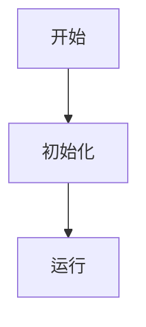

模块架构图和数据流图也可以使用 `LR`。节点较多时，根据实际可读性调整方向。如果一个方向导致连线大量交叉，应尝试其他方向或拆分图表。

---

## 三、基础图表示例

### 流程图

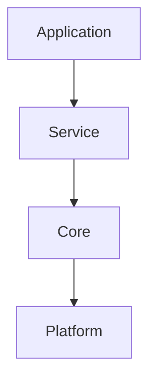

### 数据流

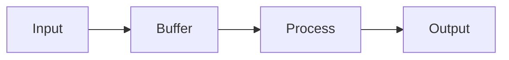

### 时序图

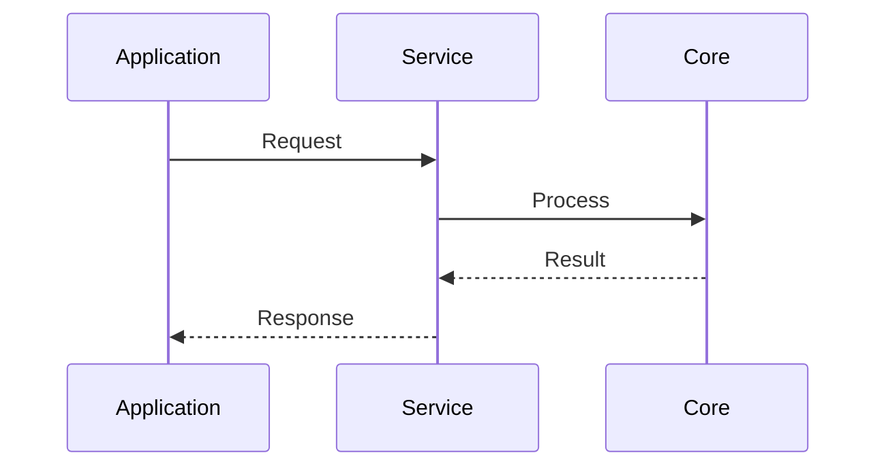

---

## 四、图表类型选择

### 1. Mermaid 8.13 可用图种

只有下表中的图种允许使用：

| 图表类型 | 适用场景 |
| --- | --- |
| `graph` | 流程、模块关系、层级和数据流（首选） |
| `sequenceDiagram` | 对象之间的时序交互 |
| `stateDiagram-v2` | 状态和状态转换 |
| `classDiagram` | 类、结构体和类型关系 |
| `erDiagram` | 实体及其关系 |
| `gantt` | 任务和时间安排 |
| `pie` | 构成占比 |

### 2. Mermaid 8.13 不支持的图种（全部禁止）

| 禁止图种 | 最低版本要求 | 替代方案 |
| --- | --- | --- |
| `mindmap` | Mermaid 9.2 / Typora 1.5 | 用 `graph LR` 表达知识结构，或用缩进列表 |
| `requirementDiagram` | Mermaid 8.14 / Typora 1.2 | 用表格或列表表达需求与验证关系 |
| `timeline` | Mermaid 9.4 | 用有序列表或表格 |
| `quadrantChart` | Mermaid 9.x | 用表格或文字说明 |
| `sankey` | Mermaid 9.4 | 用 `graph LR` 表达流向 |
| `c4Context` 等 C4 系列 | Mermaid 9.x / 10.x | 用 `graph` 分层表达 |
| `zenuml`、`xyChart`、`block` / `architecture-beta`、`kanban`、`treemap`、`venn`、`ishikawa` 等 | Mermaid 10.x / 11.x | 用 `graph`、表格或列表替代 |

判断不了某个图种在 8.13 是否支持时，默认不使用，回退到 `graph`、表格或列表。

### 3. Mermaid 8.13 语法限制（强制）

高版本引入、8.13 无法解析的语法同样禁止：

1. 禁止 Mermaid 10+ 的 YAML frontmatter 配置块（图表开头的 `---` + `config:` 块）。
2. 禁止 `A@{ shape: cloud }` 一类新形状语法。节点形状只使用经典写法：`A[文本]`、`A(文本)`、`A([文本])`、`A((文本))`、`A{文本}`、`A[(文本)]`、`A{{文本}}`、`A[/文本/]`。
3. 禁止用反引号在节点标签中嵌入 Markdown 字符串（8.13 不渲染标签内 Markdown）。
4. 不依赖 `%%{init: ...}%%` 指令和自定义主题配置，保持默认渲染，避免配置差异导致失败。
5. 不使用图标语法（如 `fa:fa-xxx`、`::icon()`），图标依赖集成方加载字体，Typora 1.0 无法保证显示。
6. 不使用 HTML 实体编号（如 `&#9776;`），直接书写 UTF-8 文本，含特殊字符时用双引号包裹。

---

## 五、连线规范

| 语法 | 含义 |
| --- | --- |
| `-->` | 普通方向关系 |
| `-.->` | 虚线关系 |
| `==>` | 粗线强调关系（Mermaid 8.13 支持，尽量少用） |
| `-->|说明|` | 带标签的方向关系 |
| `---` | 无方向连线，使用前确认图表类型支持 |

推荐使用最简单、兼容性较好的连线语法。

连线标签应遵循：文本简短、语义清晰、避免复杂特殊字符、避免过长句子、不嵌入大量代码。

当大量连线交叉时，应调整图表方向、节点顺序、简化关系、拆分图表，或使用文字说明补充。

### 带标签边的语法（强制）

带标签的边**统一使用** `-->|label|` 形式，标签放在管道符之间。

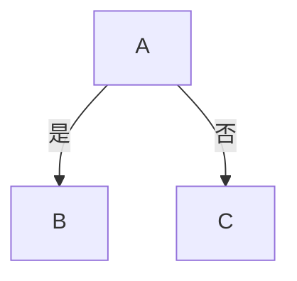

**禁止**使用以下两种"标签夹在连字符之间"的写法，它们在 Typora、VSCode Mermaid 预览、部分 Git 平台等渲染器中经常失败：

```text
A -- 是 --> B
A -- "是" --> B
```

理由：

1. `-- label -->` 中标签前后的空格在不同渲染器里解析不一致，容易被识别为节点 ID 拼接。
2. `-- "label" -->` 双引号在某些 Mermaid 版本下会被错误处理，导致整图不渲染。
3. `-->|label|` 是 Mermaid 官方文档推荐写法，兼容性最稳。

### 双向边的处理（强制）

Mermaid **不支持**带标签的双向虚线，以下写法会让整图不渲染，**全部禁止**：

```text
A <-. "label" .-> B
A <-.->|label| B
A <.-> B
A <-.-> B
```

表达双向关系的正确做法：

1. **拆成两条单向边**（推荐，最稳）：

   ```mermaid
   graph TD
       A -.->|请求| B
       B -.->|响应| A
   ```

2. **实线双向不带标签**（仅在无需标签时使用）：

   ```mermaid
   graph TD
       A <--> B
   ```

3. 若双向都需要带标签，**必须**用第 1 种拆分写法。

### 复杂边的预防

- 节点定义与连线混合在一行（如 `A["..."] -->|label| B["..."]`）在节点文本含特殊字符时容易解析失败，**长节点文本建议先单独声明节点，再单独写连线**：

  ```mermaid
  graph TD
      A["源设备 GPU / 机顶盒"]
      B["显示器 TV"]
      A -->|DDC 读 EDID| B
  ```

- 决策菱形节点用 `{"..."}` 语法，分支标签同样使用 `-->|是|` / `-->|否|`，不要写成 `D -- 是 --> E`。

---

## 六、时序图规范

时序图应明确声明参与者，并保持消息文本简洁。

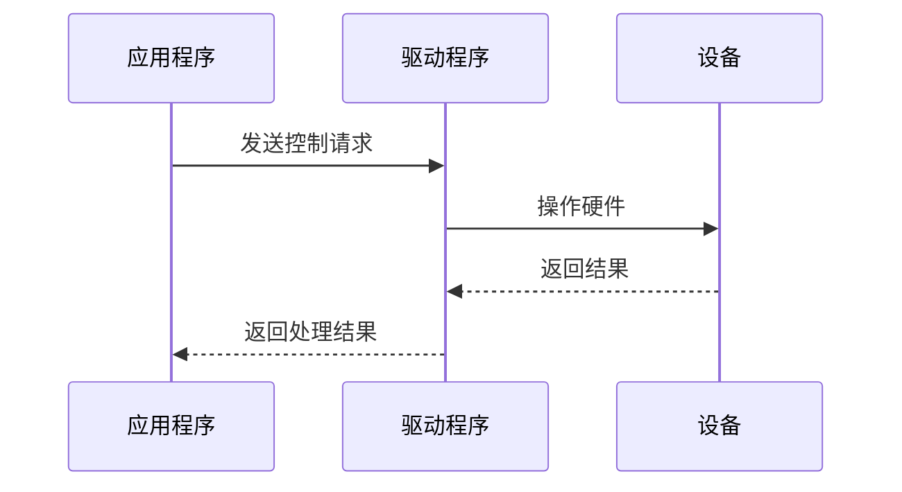

要求：参与者名称清晰、数量不宜过多、消息方向准确、内容简短、调用顺序符合逻辑、避免在消息中嵌入复杂代码、复杂说明放在图表外部、异常流程应明确标识。

---

## 七、状态图规范

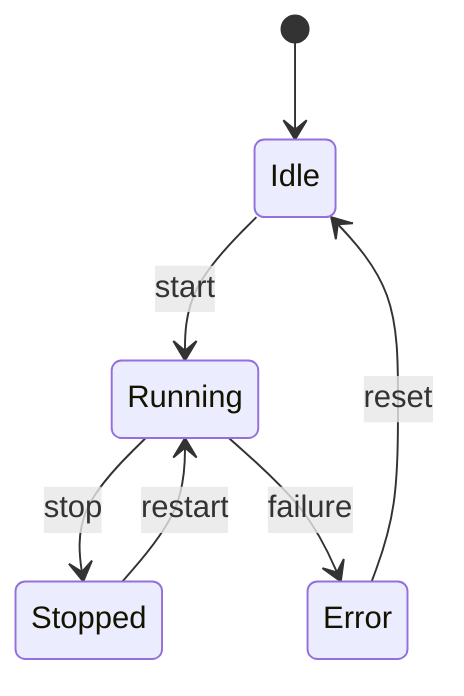

要求：状态名称清晰、转换条件简洁、不将大量业务逻辑写入转换标签、状态过多时拆分、转换与正文描述保持一致。

---

## 八、大图拆分

每张图只表达一个主要问题。

当出现以下情况时，应拆分图表：

- 节点数量过多
- 连线大量交叉
- 节点文本过长
- 图表缩放后难以阅读
- 同时表达多个不同层次的问题
- 图表包含过多无关细节
- 图表无法在目标编辑器中正常显示
- 读者无法快速识别主要流程

建议每张图聚焦一个子主题，通常控制在约 5～8 个主要节点。

推荐的拆分方式：

```text
总体架构图 + 模块依赖图 + 核心业务流程图 + 关键数据流图
```

不要为了"一张图看完所有内容"而制作无法阅读的巨型图。

---

## 九、流程与架构表达

当存在明显的层级关系时优先使用 Mermaid：

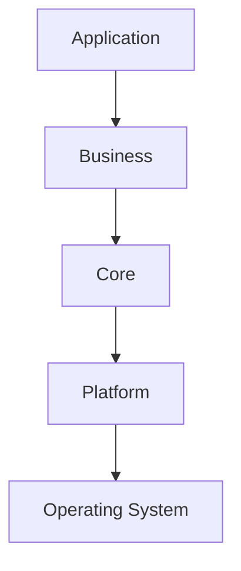

当关系复杂时，拆成：总体架构图 + 模块依赖图 + 核心业务流程图 + 关键数据流图。

---

## 十、节点文本规范

### 1. 禁止 HTML 换行标签

禁止在节点中使用 `<br>` `<br/>` 等 HTML 标签。需要分隔内容时使用空格。

错误：

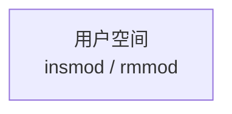

正确：


### 2. 禁止 Unicode 箭头

不要使用 `→` `←` `↑` `↓` `⇒` `⇐` 等 Unicode 箭头表达节点关系。流程方向通过 Mermaid 连线表达。

错误：


正确：

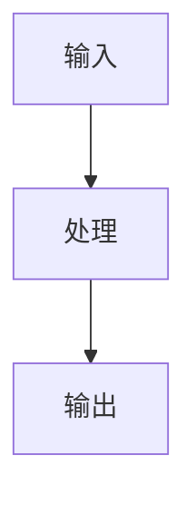

### 3. 禁止中文标点

节点标签和消息文本中禁止使用中文标点（`，` `：` `。` `；`等），需要分隔时使用空格。

错误：

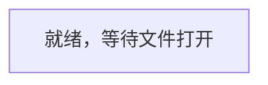

正确：

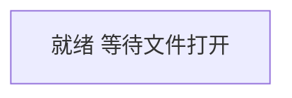

### 4. 特殊路径必须用引号

节点文本以 `/` 开头时必须使用双引号。包含 `/` `@` `=` `[` `]` `(` `)` 等特殊字符时也建议用双引号。

错误：


正确：

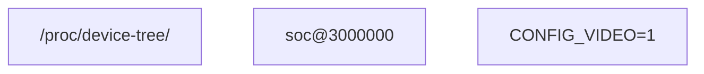

### 5. 节点名称清晰简洁

使用清晰、具体的名称，避免长句，不将大量代码放入节点，一个节点表达一个主要概念，复杂说明放在图表外部。

---

## 十一、代码块嵌套规范

展示 Mermaid 代码示例时，外层代码块用 4 个反引号，内层用 3 个：

````markdown
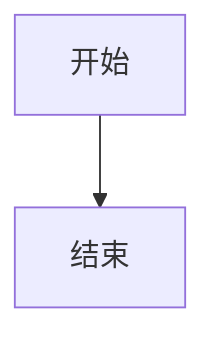
````

注意：内外层反引号数量必须区分，不让外层提前结束，不在代码块开始位置添加无关属性。

---

## 十二、渲染失败时的处理

如果 Mermaid 图表无法正常渲染，按以下顺序排查：

1. 检查代码块是否使用 `mermaid` 标识
2. 检查图表类型是否正确
3. 检查图表方向是否正确
4. 检查节点和连线语法
5. 检查括号和引号是否完整
6. 移除不必要的特殊字符
7. 移除 HTML 标签
8. 缩短节点文本
9. 减少节点数量
10. 简化连线关系
11. 拆分复杂图表
12. 更换为兼容性更高的图表类型
13. 必要时使用 Markdown 列表、表格或纯文本替代

如果简单结构可渲染而复杂结构不行，应逐步增加节点和连线定位问题。

不得在没有实际验证的情况下声称 Mermaid 图表一定可以正常渲染。

---

## 十三、替代方案

当目标环境不支持 Mermaid 或图表无法清晰表达时：

### 列表表达流程

```text
1. 打开设备
2. 配置采集参数
3. 启动数据采集
4. 读取数据
5. 处理数据
6. 输出结果
```

### 表格表达模块关系

| 模块 | 输入 | 输出 | 作用 |
| --- | --- | --- | --- |
| 采集模块 | 硬件数据 | 原始数据 | 获取设备数据 |
| 处理模块 | 原始数据 | 处理结果 | 执行数据处理 |
| 输出模块 | 处理结果 | 输出数据 | 展示或保存结果 |

### 纯文本表达架构

```text
应用层
  |
服务层
  |
驱动层
  |
硬件层
```

---

## 十四、输出前检查

每个 Mermaid 图输出前检查：

```text
代码块是否使用 mermaid 标识？
图种是否在 Mermaid 8.13 可用图种列表内？
是否误用了 mindmap requirementDiagram timeline 等高版本图种？
是否存在 frontmatter 配置块 @{shape:} 标签内反引号 图标指令等 8.13 不支持的语法？
是否存在 HTML 标签？
是否存在 Unicode 箭头？
是否存在容易导致解析失败的中文标点？
是否正确处理 / 开头的路径？
特殊字符是否需要双引号？
图的方向是否合适？
连线语法是否正确？
带标签边是否统一使用 -->|label| 而不是 -- label -->？
是否避免了 <-. .-> / <.-> / <-.-> 等带标签双向虚线？
双向关系是否已拆成两条单向边或用 <--> 实线？
长节点文本是否单独声明再连线？
节点数量是否过多？
图与正文是否一致？
在 Typora 1.0 中渲染失败时是否有替代方案？
```
