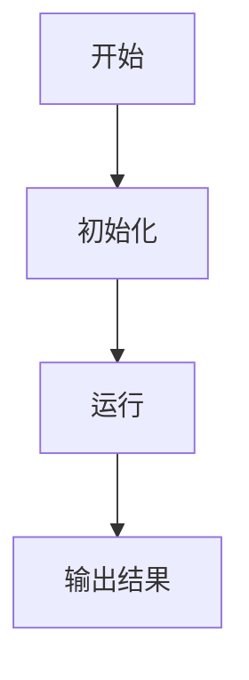
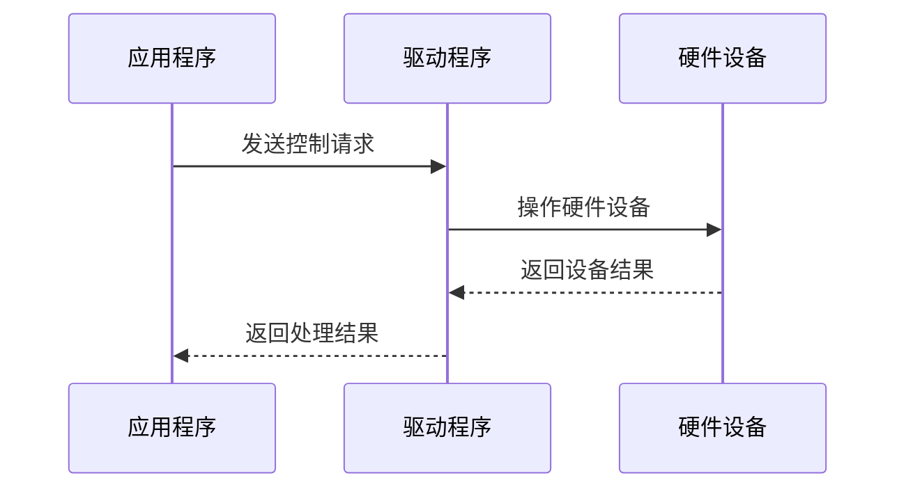
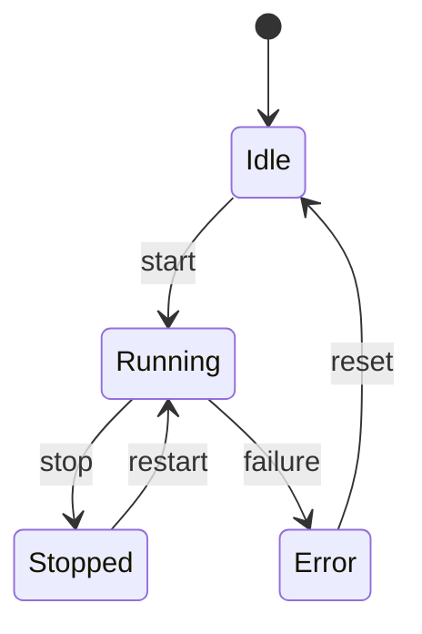
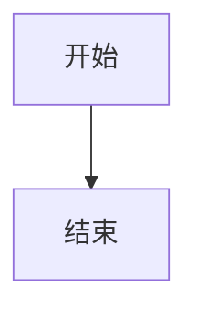

# Mermaid 规则

本文件是 Mermaid 图表的详细规范。核心 OutputFormat 中只保留关键规则，详细规则以本文件为准。

---

## 一、使用原则

只有在流程、架构、依赖关系或时序关系较复杂，且图表有助于理解时，才使用 Mermaid。

常见渲染环境包括：Typora、VS Code Mermaid 插件、GitHub、支持 Mermaid 的 Markdown 阅读器、其他兼容 Mermaid 的文档工具。

不同渲染器和 Mermaid 版本的支持范围可能存在差异。因此，图表应优先使用简单、稳定、兼容性较高的语法。

核心目标：

1. 保证代码块声明正确。
2. 尽量减少语法解析错误。
3. 保证图表结构清晰、易读。
4. 避免使用兼容性较差的复杂语法。
5. 在无法渲染时提供等价的文字说明。

核心原则：

> **图负责建立结构，文字负责解释结构。**

---

## 二、使用正确的代码块声明

Mermaid 图表必须使用 `mermaid` 作为代码块语言标识。



禁止使用 `text`、`svg`、`html` 等错误标识。必须使用 ` ```mermaid ` 开始，` ``` ` 结束。代码块前后应保留适当的 Markdown 空行。

---

## 三、选择图表方向

| 方向 | 适用场景 |
| --- | --- |
| `TD` | 从上到下的流程、调用链和生命周期 |
| `TB` | 从上到下的流程，与 `TD` 类似 |
| `LR` | 从左到右的架构、层级关系和数据流 |
| `RL` | 从右到左的特殊流程 |

默认建议：普通流程图优先 `TD`；模块架构图和数据流图可以用 `LR`。如果一个方向导致连线大量交叉，应尝试其他方向或拆分图表。

知识地图优先使用 `graph LR`（横向展开），流程、调用链、生命周期优先使用 `graph TD`。

---

## 四、选择合适的图表类型

| 图表类型 | 适用场景 |
| --- | --- |
| `graph` | 流程、模块关系、层级和数据流 |
| `sequenceDiagram` | 对象之间的时序交互 |
| `stateDiagram-v2` | 状态和状态转换 |
| `classDiagram` | 类、结构体和类型关系 |
| `erDiagram` | 实体及其关系 |
| `gantt` | 任务和时间安排 |
| `mindmap` | 思维导图和知识组织 |

---

## 五、节点文本规范

### 1. 节点名称清晰简洁

使用清晰、具体的名称。避免长句，不将大量代码放入节点，一个节点表达一个主要概念，复杂说明放在图表外部。

### 2. 中文和空格文本优先使用双引号

当节点文本包含中文、空格、路径或特殊字符时，优先使用双引号。

### 3. 禁止 HTML 标签

不要在节点文本中使用 `<br>` `<br/>` `<div>` `<span>` `<table>` 等 HTML 标签。需要分隔内容时使用空格，或拆分为多个节点。

### 4. 禁止 Unicode 箭头

不要使用 `→` `←` `↑` `↓` `⇒` `⇐` 等 Unicode 箭头表达节点关系。流程方向通过 Mermaid 连线表达。

### 5. 禁止中文标点

节点标签和消息文本中禁止使用中文标点（`，` `：` `。` `；`等），需要分隔时使用空格。这一条是强制规则。

### 6. 特殊路径必须用引号

节点文本以 `/` 开头时必须使用双引号。包含 `/` `@` `=` `[` `]` `(` `)` 等特殊字符时也建议用双引号。

错误：`A[/proc/device-tree/]`
正确：`A["/proc/device-tree/"]`

### 7. 避免过长的节点文本

当节点需要表达大量信息时，应拆分节点或在图表外补充说明。

---

## 六、特殊字符和标点规范

节点文本中包含特殊字符时可能导致解析错误。应重点检查：`:` `;` `,` `(` `)` `[` `]` `{` `}` `<` `>` `"` `'` `|` `#`。

如果特殊字符可能被解释为 Mermaid 语法，应使用双引号、简化文本或改写表达方式。

---

## 七、路径、命令和配置项规范

当节点中包含文件路径、设备节点、Linux 命令、配置项、函数名称、结构体字段等，应优先使用双引号。

如果路径、命令或配置项较复杂，可以在节点中使用简短描述，并在图表外部提供具体内容。

---

## 八、连线规范

| 语法 | 含义 |
| --- | --- |
| `-->` | 普通方向关系 |
| `-.->` | 虚线关系 |
| `==>` | 强调关系，使用前确认渲染器支持 |
| `-->|说明|` | 带标签的方向关系 |
| `---` | 无方向连线，使用前确认图表类型支持 |

推荐使用最简单、兼容性较好的连线语法。连线标签应文本简短、语义清晰、避免复杂特殊字符、不嵌入大量代码。

当大量连线交叉时，应调整图表方向、节点顺序、简化关系、拆分图表，或使用文字说明补充。

---

## 九、节点数量与图表拆分

每张图表应围绕一个主要问题展开。当节点过多、连线交叉、文本过长、缩放后难以阅读时，应拆分图表。

建议每张图聚焦一个子主题，通常控制在约 5～8 个主要节点。

不要为了"一张图看完所有内容"而制作无法阅读的巨型图。

---

## 十、时序图规范

时序图应明确声明参与者，并保持消息文本简洁。



要求：参与者名称清晰、数量不宜过多、消息方向准确、内容简短、调用顺序符合逻辑、避免在消息中嵌入复杂代码、复杂说明放在图表外部、异常流程应明确标识。

---

## 十一、状态图规范



要求：状态名称清晰、转换条件简洁、不将大量业务逻辑写入转换标签、状态过多时拆分、转换与正文描述保持一致。

---

## 十二、图表与正文的配合

每个重要图表应提供必要的文字说明：图表表达的目标、主要模块或节点的含义、关键数据流或调用关系、重要前置条件、异常分支、读者需重点关注的内容。

图表和文字说明必须保持一致。不得出现节点无对应解释、正文描述的流程未在图中体现、连线方向与文字相反、遗漏关键异常分支、展示未经确认的实现细节等情况。

---

## 十三、代码块嵌套规范

展示 Mermaid 代码示例时，外层代码块用 4 个反引号，内层用 3 个：

````markdown

````

注意：内外层反引号数量必须区分，不让外层提前结束，不在代码块开始位置添加无关属性。

---

## 十四、输出前兼容性检查

### 代码块检查

- 是否使用了 `mermaid` 代码块标识
- 是否正确使用开始和结束反引号
- 是否混入了 `svg`、`html` 或其他无关标识
- 是否存在错误的代码块嵌套

### 语法检查

- 图表类型、方向是否正确
- 节点和连线语法是否完整
- 是否存在未闭合的括号或引号
- 是否存在可能导致解析错误的特殊字符

### 内容检查

- 节点名称是否清晰，文本是否过长
- 是否存在 Unicode 箭头、HTML 标签
- 路径、命令和配置项是否适当处理
- 节点数量是否过多，是否存在大量交叉连线
- 图表是否与正文描述一致

### 环境检查

- 当前目标编辑器是否支持 Mermaid
- 使用的图表类型和高级语法是否得到支持
- 是否需要提供列表、表格或纯文本替代方案

---

## 十五、渲染失败时的处理

如果 Mermaid 图表无法正常渲染，按以下顺序排查：

1. 检查代码块是否使用 `mermaid` 标识
2. 检查图表类型是否正确
3. 检查图表方向是否正确
4. 检查节点和连线语法
5. 检查括号和引号是否完整
6. 移除不必要的特殊字符
7. 移除 HTML 标签
8. 缩短节点文本
9. 减少节点数量
10. 简化连线关系
11. 拆分复杂图表
12. 更换为兼容性更高的图表类型
13. 必要时使用 Markdown 列表、表格或纯文本替代

如果简单结构可渲染而复杂结构不行，应逐步增加节点和连线定位问题。

不得在没有实际验证的情况下声称 Mermaid 图表一定可以正常渲染。

---

## 十六、替代方案

### 列表表达流程

```text
1. 打开设备
2. 配置采集参数
3. 启动数据采集
4. 读取数据
5. 处理数据
6. 输出结果
```

### 表格表达模块关系

| 模块 | 输入 | 输出 | 作用 |
| --- | --- | --- | --- |
| 采集模块 | 硬件数据 | 原始数据 | 获取设备数据 |
| 处理模块 | 原始数据 | 处理结果 | 执行数据处理 |
| 输出模块 | 处理结果 | 输出数据 | 展示或保存结果 |

### 纯文本表达架构

```text
应用层
  |
服务层
  |
驱动层
  |
硬件层
```

---

## 十七、兼容性原则总结

1. 使用正确的 `mermaid` 代码块标识
2. 优先使用简单、稳定、兼容性较高的语法
3. 节点名称清晰简洁
4. 节点文本中的特殊字符应谨慎处理
5. 避免使用 HTML 标签
6. 避免使用 Unicode 箭头表达节点关系
7. 路径、命令和配置项应进行适当处理
8. 避免单张图表过于复杂
9. 必要时拆分多个图表
10. 图表必须与正文描述保持一致
11. 图表应提供必要的文字说明
12. 输出前应进行语法和兼容性检查
13. 不得声称未经验证的图表一定可以渲染
14. 无法渲染或无法清晰表达时，应使用列表、表格或纯文本替代
