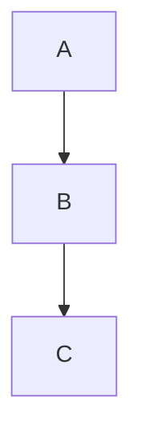
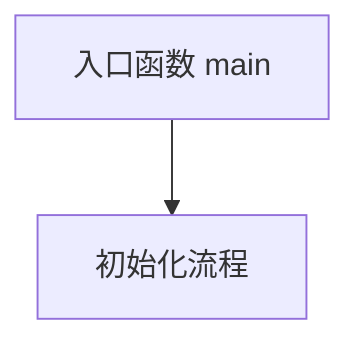

# Mermaid 规则

## 格式主标准

Mermaid 的基础格式规则（禁止 HTML 换行标签、禁止 Unicode 箭头、禁止中文标点、特殊字符双引号包裹、方向选择 `graph` 而非 `flowchart`、知识地图用 `graph LR`、流程用 `graph TD`、大图拆分等）统一遵循 `output_format/OutputFormat .md` 的规定。

本文件不再重复上述通用规则，仅补充本 Skill 专属的 Mermaid 约定。

---

## 强制规则

本规则针对 skill 生成的输出分析文件。

输出文件中所有示意图必须使用 Mermaid。

禁止在输出文件中使用：

- `↓` 箭头表示流程
- `├──` / `└──` Markdown 树表示结构
- 纯文本缩进表示层级

注：skill 自身的定义文件（workflows、domain_profiles）中的 `↓` 和树结构是指令说明，不受此规则约束。

---

## 允许的图表类型

### tree

用于：

目录结构。

模块层级。

### graph LR

用于：

知识地图。

总览图。

模块关系总览。

### graph TD

用于：

模块依赖。

初始化流程。

调用流程。

数据流。

生命周期。

### sequenceDiagram

用于：

线程通信。

网络协议。

IPC。

时序交互。

### stateDiagram

用于：

状态机。

状态变化。

### classDiagram

用于：

对象关系。

数据结构关系。

struct / class 之间的关联。

### mindmap

用于：

知识关系。

概念层级。

---

## 转换规则

原 `↓` 流程：

A
↓
B
↓
C

转换为：



原 Markdown 树：

模块
├── 子模块A
└── 子模块B

转换为：

```mermaid
tree
    模块
    ├── 子模块A
    └── 子模块B
```

---

## 图不是装饰

只有当图明显降低理解成本时才画。

不要为了：

- 看起来丰富
- 增加内容
- 增加视觉效果

强行画图。

原则：

图负责建立结构，文字负责解释结构。

---

## 精确技术结构优先文本

对于以下内容：

- API 调用关系
- 驱动调用链
- 协议时序
- 数据结构
- 内存布局
- 硬件连接
- 数据流

优先使用：

- Mermaid
- ASCII
- 表格
- Markdown

不要使用生成式图片表达需要精确技术关系的内容。

---

## 禁止

信息不足时禁止画图。

禁止为了视觉效果虚构：

模块关系。

调用关系。

数据流。

---

## 节点命名

节点文本使用项目真实名称。

中文节点直接使用中文。

长文本节点用简短 ID + 说明：


