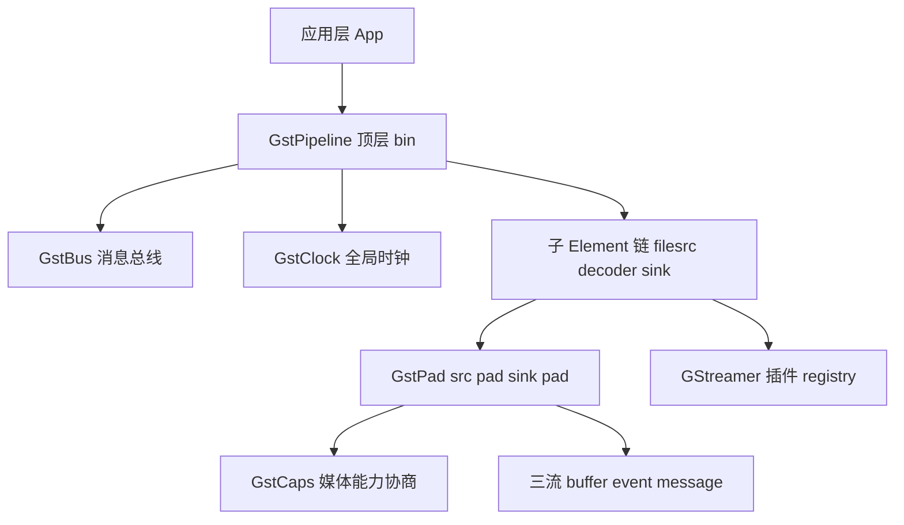
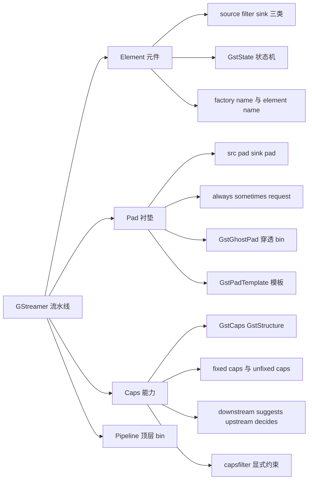
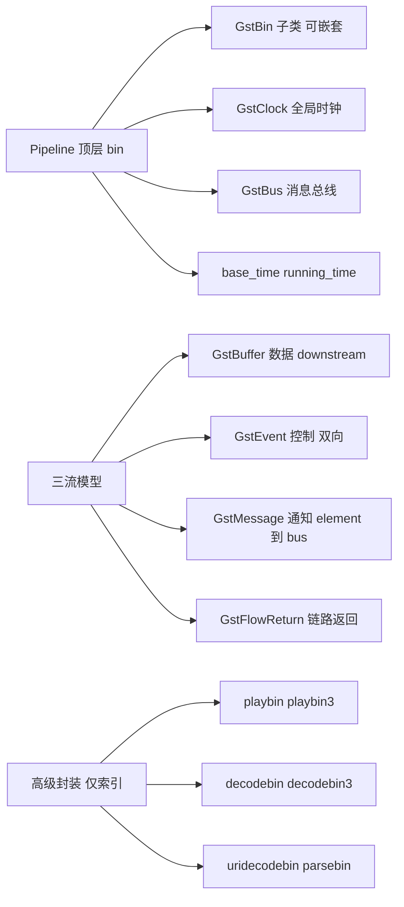
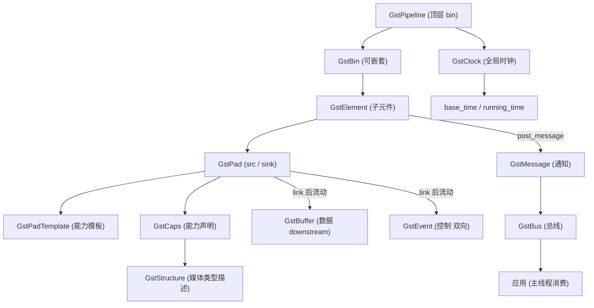
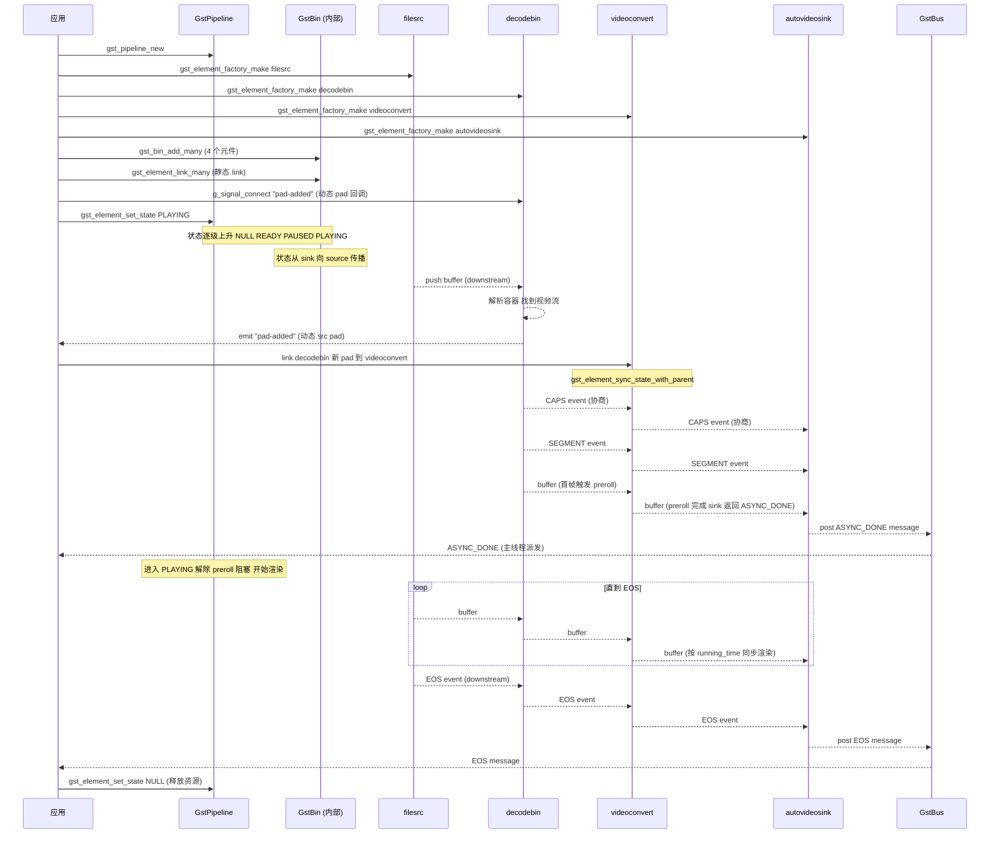
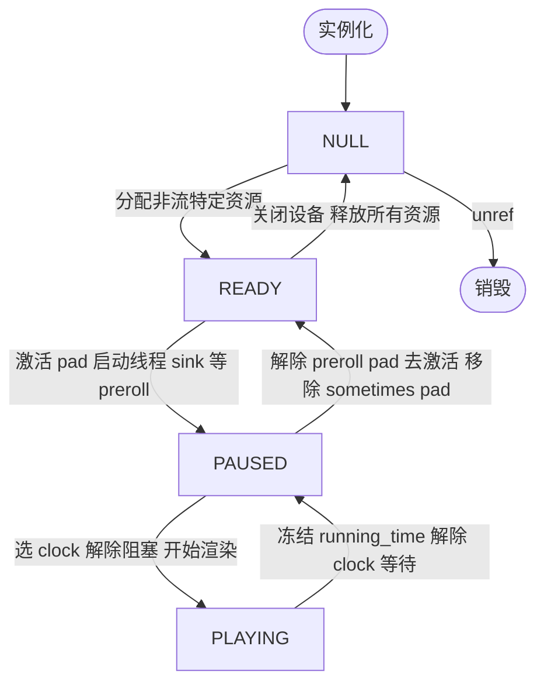
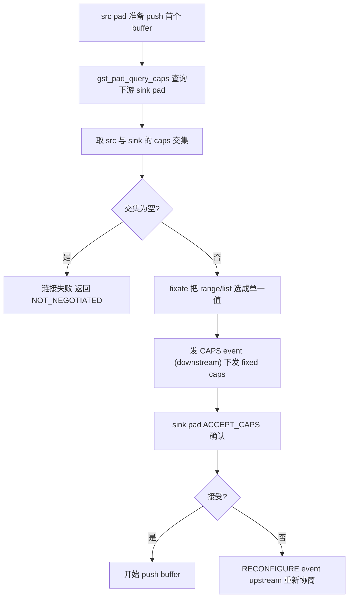
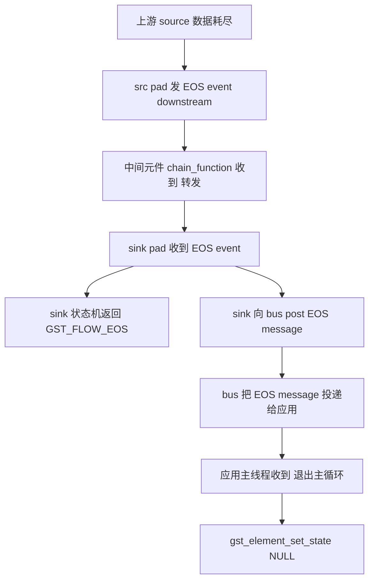
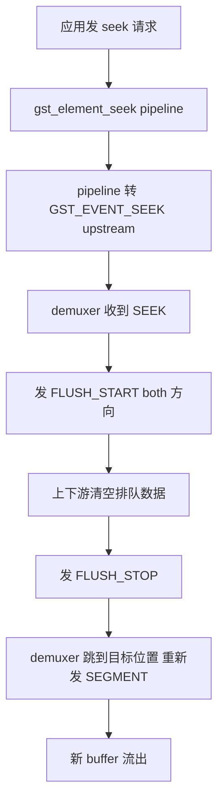

# GStreamer 流水线（Element + Pad 链路）

> 适用范围：GStreamer 1.x（截至 1.24，2024-03 发布）。`GstElement` / `GstPad` / `GstCaps` / `GstPipeline` / `GstBus` / `GstBin` 这套核心抽象在 1.x 系列保持 API/ABI 稳定；`playbin3` / `decodebin3` 等高级封装在 1.24 起被宣布稳定并成为默认。
> 学习边界：只讲"Element + Pad 链路如何拼成一条数据通路"这条主线。包含 Element 状态机、Pad 与 Caps 协商、Pipeline 与三流（buffer/event/message）、Bus 与 GstBin 嵌套。不深入插件内部实现（playbin/decodebin 仅作为高级封装索引）、不展开线程模型细节、不讨论具体 codec 插件。
> 阅读目标：10~20 分钟内建立"GStreamer 为什么是元件+衬垫的组合、数据怎么从源流到汇、状态机如何驱动流动、协商如何决定格式"的整体认知，并拿到一张进入正式学习的地图。

---

## 1. 先建立整体认知

### 1.1 它是什么

**直觉理解**：把一段音视频从"文件"变成"扬声器+屏幕上的画面"，要经过读取、解封装、解码、色彩空间转换、音频重采样、音视频同步、渲染等十几步。如果每步都自己写一遍组合逻辑，代码会爆炸。GStreamer 的做法是：**把每一步做成一个独立的"黑箱元件"（Element），再用"衬垫"（Pad）把它们串成一条流水线（Pipeline），数据从一端进、另一端出**。

**类比及其边界**：元件像"工厂流水线上的工位"，衬垫像"工位之间的传送带接口"，流水线像"整条产线"。但类比到此为止——GStreamer 的衬垫还要协商"能传什么样的料"（Caps），且数据流之外还有控制信号（event）和通知（message）两条并行的流。

**严格定义**：

- **GStreamer**：基于 GObject 的多媒体框架，提供"元件（Element）+ 衬垫（Pad）+ 流水线（Pipeline）"组合式数据流编程模型。源码以 LGPL 许可发布，跨平台。
- **Element（元件，`GstElement`）**：流水线的基本构件，所有 source / filter / sink / demuxer / decoder 均派生自 `GstElement`；对应用而言是黑箱，一端输入、内部处理、另一端输出。
- **Pad（衬垫，`GstPad`）**：Element 对外交互的接口，由方向（src/sink）与可用性（always/sometimes/request）共同定义。数据从一个 element 的 src pad 流向另一个 element 的 sink pad。
- **Caps（能力，`GstCaps`）**：Pad 上声明的"能传输什么样的媒体类型"，由若干 `GstStructure` 组成（如 `video/x-raw, format=I420, width=1920, height=1080, framerate=30/1`）。Pad 链接与数据流动前必须完成 caps 协商。
- **Pipeline（流水线，`GstPipeline`）**：`GstBin` 的子类，作为顶层 bin，额外提供全局时钟 `GstClock`、`GstBus`、`base_time` / `running_time` 计算与状态同步。

### 1.2 为什么存在

**没有它会是怎样**：每个播放器/编辑器/转码器都要自己写一遍"读取 → 解封装 → 解码 → 同步 → 渲染"的组合逻辑。新增一种编码就要改 N 个程序；新增一个输出设备也要改 N 个程序。组合爆炸。

**GStreamer 的方案**：把"每一步"做成可插拔元件，元件之间用标准化的衬垫协议连接，caps 协商解决格式匹配问题，状态机统一驱动起停，bus 解决跨线程通信。结果是：

1. **关注点分离**：编码器只管编码，解封装器只管解封装，sink 只管渲染。每个元件独立演进。
2. **组合自由**：`filesrc ! demuxer ! decoder ! videoconvert ! autovideosink` 这一行 `gst-launch-1.0` 命令就是一条流水线——同一个 decoder 可以接到 filesrc，也可以接到 `httpsrc`，还可以接到 `appsrc`。
3. **插件生态**：第三方编码器/硬件加速器以插件形式注册到 `GstRegistry`，应用通过工厂名按需创建，无需重新编译主程序。
4. **跨平台抽象**：Linux 上 `alsasink` 出声，Windows 上换 `wasapisink`，macOS 上换 `osxaudiosink`——同一份应用代码只改一个工厂名。

一句话：**GStreamer 用"元件 + 衬垫 + 流水线"把多媒体处理变成了可组合的数据流图**。

---

## 2. 在整个体系中的位置



- **Pipeline 是顶层容器**：应用只与 pipeline 交互（设置状态、监听 bus），子元件的具体协作由 bin 内部统一调度。
- **三流各走各的通路**：buffer 与 event 在 pad 之间流动（buffer 只 downstream，event 可双向）；message 不在 pad 之间流动，只从 element 经 bus 到应用。
- **Caps 是衬垫的"语言契约"**：两个 pad 链接前必须确认能用同一种格式说话，caps 协商就是这件事。
- **插件以工厂名注册**：所有可用元件类型在 `GstRegistry` 中以 `GstElementFactory` 注册，应用用 `gst_element_factory_make("工厂名", "实例名")` 按需创建实例。

---

## 3. 知识地图





下面逐一展开这些核心概念。

---

## 4. 核心概念

### 4.1 Element：流水线的基本构件

`GstElement` 是 GStreamer 中构建媒体流水线的基本构件，所有 decoder / encoder / demuxer / video output / audio output 均派生自它。对应用开发者而言 element 是"黑箱"——一端输入数据、内部处理、另一端输出。

**按角色分三类**：

| 类型 | pad 配置 | 职责 | 典型工厂名 |
| ---- | -------- | ---- | ---------- |
| source（源元件） | 仅 src pad | 产生数据（读文件、采集声卡/摄像头） | `filesrc` `alsasrc` `v4l2src` `fakesrc` `appsrc` |
| filter / filter-like（过滤器） | 同时有 sink + src pad | 对输入做处理后输出，数量任意（demuxer 可 1 sink + N src） | `videoconvert` `audioconvert` `audioresample` `videoscale` `queue` `volume` `decodebin` |
| sink（接收元件） | 仅 sink pad | 流水线终点，写文件、播声卡、显窗口 | `filesink` `alsasink` `autovideosink` `fakesink` `appsink` |

**创建与销毁**：

- `gst_element_factory_make(factory_name, element_name)`：第一参数是工厂名（如 `"filesrc"`），决定元件类型；第二参数是实例名，应用自定义，用于在 bin 中查找与调试输出，传 `NULL` 得唯一默认名。
- 创建后 refcount = 1，不再使用需 `gst_object_unref()`，refcount 减至 0 完全销毁。
- **factory name 与 element name 是两件事**：factory name 决定"是什么元件"（类型），element name 决定"这个实例叫什么"（标识）。

### 4.2 GstState：Element 的状态机

每个 element 有 4 种状态，pipeline 实例化后处于 `NULL`。状态转换不是直接跳变，而是逐级经过中间态。

| 状态 | 含义 | 资源状态 |
| ---- | ---- | -------- |
| `NULL` | 初始默认状态 | 未分配任何运行时资源、未加载运行库；过渡到 NULL 会释放所有资源 |
| `READY` | 已就绪 | 已分配所有"非流特定"资源（运行库、运行内存）；尚未打开流特定资源（如具体文件） |
| `PAUSED` | 预滚动 preroll | pad 已激活可接收数据；sink 只接受一个 buffer 然后阻塞（即 preroll），数据不流动 |
| `PLAYING` | 播放中 | sink 解除阻塞开始渲染；pipeline 选定 clock 并下发；live source 开始产生数据 |

**上升转换 `NULL → READY → PAUSED → PLAYING` 各阶段发生什么**：

| 转换 | 主要动作 |
| ---- | -------- |
| NULL → READY | 检查所需资源是否可用；device sink/source 探测设备以约束 caps；必要时打开设备 |
| READY → PAUSED | 激活 pad 以接收数据，启动 streaming 线程；pipeline 重置 running_time 为 0；**sink 必须返回 ASYNC，待收到首个 buffer 或 EOS（即 preroll）才完成切换**；live sources 返回 NO_PREROLL 且不产生数据 |
| PAUSED → PLAYING | 多数元件忽略此转换；pipeline 选 clock 并下发给所有子元件；sinks 解除对 preroll buffer 的阻塞并开始渲染；**EOS 仅允许在 PLAYING 发布**；live sources 开始产生数据并返回 SUCCESS |

**下降转换 `PLAYING → PAUSED → READY → NULL`**：

| 转换 | 主要动作 |
| ---- | -------- |
| PLAYING → PAUSED | 多数元件忽略；pipeline 计算 running_time 并存储以便回到 PLAYING；sinks 解除 clock 等待；若无待播 buffer 返回 ASYNC；已排队 EOS 消息被移除；live sources 停止产生数据并返回 NO_PREROLL |
| PAUSED → READY | sinks 解除 preroll 等待；元件解除设备等待；chain/get_range() 返回 FLUSHING；pad 去激活、streaming 线程停止；sinks 忘记所有协商格式；移除 sometimes pads |
| READY → NULL | 元件关闭设备；重置任何内部状态 |

**`gst_element_set_state` 的返回值（`GstStateChangeReturn`）**：

| 返回值 | 含义 |
| ------ | ---- |
| `GST_STATE_CHANGE_SUCCESS` | 已同步完成切换 |
| `GST_STATE_CHANGE_ASYNC` | 异步进行中（如 sink 等待首 buffer preroll），需用 `gst_element_get_state()` 轮询或监听 bus 的 ASYNC_DONE 消息 |
| `GST_STATE_CHANGE_NO_PREROLL` | 切换成功但 PAUSED 无法产生数据（live source 的标识） |
| `GST_STATE_CHANGE_FAILURE` | 失败且应已向 bus 发 error 消息 |

**为什么 PAUSED 用于 preroll**：sink 在 PAUSED 只接受一个 buffer 然后阻塞，使每个 sink 都拿到首帧——这保证从 PAUSED 切到 PLAYING 时能"立刻渲染"，避免起播时的黑屏/静音。这就是播放器"点开就出第一帧"的机制基础。

### 4.3 Pad：Element 的输入输出接口

`GstPad` 是 Element 对外交互的接口。数据从一个 element 的 source pad 流向另一个 element 的 sink pad。术语从 element 内部视角定义——element 在 sink pad 上接收数据，在 source pad 上产生数据。

**Pad 的两个独立属性**：

| 属性 | 取值 | 含义 |
| ---- | ---- | ---- |
| direction（方向） | `GST_PAD_SRC` / `GST_PAD_SINK` | src pad 产出数据，sink pad 接收数据 |
| availability（可用性） | `GST_PAD_ALWAYS` / `GST_PAD_SOMETIMES` / `GST_PAD_REQUEST` | 见下表 |

**三种可用性**：

| 可用性 | 含义 | 典型元件 |
| ------ | ---- | -------- |
| always | 元件创建时 pad 就存在，永久可用 | `videoconvert`（1 sink + 1 src，固定） |
| sometimes | 元件运行到某个阶段才创建/移除 pad | `decodebin`（解析后才知道有几路流）、`oggdemux` |
| request | 应用主动调用 `gst_element_request_pad_simple()` 请求创建 | `tee`（一进多出分路器）、`muxer`（多路合并） |

**Ghost Pad（幽灵衬垫，`GstGhostPad`）**：作为另一个 pad 的 proxy，让 `GstBin` 像普通 element 一样暴露内部子 element 的 pad，构建层次化 pipeline。

```text
Pipeline (GstBin)
  +-- Bin (内部封装一组元件, 暴露 ghost pad 给外部)
  |     +-- elementA.src_pad -----> [ghost src pad]  (对外像一个元件)
  |     +-- elementB.sink_pad <---- [ghost sink pad] (对外像一个元件)
  +-- elementC
        ^
        | 外部 link 到 ghost pad 时, 实际数据穿透到内部 element 的真 pad
```

**Ghost pad 会增加数据处理开销**，但让 bin 可以像单个 element 一样被 link——这是 playbin3 等高级封装能"像一个元件被使用"的实现基础。

### 4.4 GstPadTemplate：Pad 的能力模板

`GstPadTemplate` 描述 pad 可能的媒体类型，在 element factory 注册时（`_class_init` 中用 static pad template）声明，caps 创建后不可修改。含 `GstPadPresence`（always/sometimes/request）和 direction。

```text
Element Factory 注册时:
  static GstStaticPadTemplate sink_templ =
      GST_STATIC_PAD_TEMPLATE ("sink", GST_PAD_SINK, GST_PAD_ALWAYS,
          GST_STATIC_CAPS ("audio/x-raw, format=(string){S16LE,S32LE}, "
                           "rate=[8000,96000], channels=[1,2]"));
  static GstStaticPadTemplate src_templ =
      GST_STATIC_PAD_TEMPLATE ("src", GST_PAD_SRC, GST_PAD_ALWAYS,
          GST_STATIC_CAPS ("audio/x-raw, format=S16LE, rate=44100, channels=2"));
```

**为什么需要 template**：link 时只需 pad template caps 交集非空即可链接——这是协商的"第一步"，让 GStreamer 在不实例化完整元件前就能判断"这两个 pad 能不能接到一起"。

### 4.5 GstCaps：衬垫的能力声明

`GstCaps` 内部含一个或多个 `GstStructure`，每个 Structure 描述一种媒体类型（mimetype + fields）。多个 Structure 表示"任一可接受"，按优先级排序。还可附 `GstCapsFeatures`（如 `feature:memory:GstDmaBuf`）。

```text
示例 GstCaps (raw 视频):
  video/x-raw
    format: {I420, YV12, NV12, YUY2, BGRx}   ← 多个候选 (list)
    width: [16, 4096]                          ← range
    height: [16, 2160]
    framerate: [0/1, 60/1]

示例 fixed GstCaps (已协商):
  video/x-raw
    format: I420                                ← 单一值
    width: 1920
    height: 1080
    framerate: 30/1
```

**fixed vs unfixed caps**：

- **fixed caps**：仅一个 `GstStructure` 且所有字段值都不是 range/list/array 等非固定类型。
- **unfixed caps**：含 range/list 或多个 structure。
- **EMPTY caps** 是 fixed（无任何 structure）；**ANY caps** 不是 fixed（匹配一切）。
- **已协商 pad 的 caps 必为 fixed**——这是协商完成的标志。

### 4.6 Caps 协商机制

GStreamer caps 协商的基本规则：

> **Downstream suggests formats, upstream decides on format**（下游建议格式，上游决定格式）。

**4 个核心 query/event**：

| 工具 | 方向 | 用途 |
| ---- | ---- | ---- |
| `GST_QUERY_CAPS` | 双向 | 查询 pad 可能支持的 caps，可带 filter |
| `GST_QUERY_ACCEPT_CAPS` | 双向 | 检查给定 fixed caps 是否可接受 |
| `GST_EVENT_CAPS` | downstream | 上游向下游下发已协商格式（caps 必须 fixed） |
| `GST_EVENT_RECONFIGURE` | upstream | 下游请求上游重新协商 |

**Push 模式协商（最常见）**：上游 src pad 在 push 第一个 buffer 之前，通过 `gst_pad_query_caps` 查询下游 sink pad 的可能 caps，取交集后 fixate（把 range/list 选成单一值），通过 `GST_EVENT_CAPS` 下发给下游。

**Pull 模式协商**：下游 sink pad 在 `gst_pad_pull_range()` 之前必须先完成协商——通过 `gst_pad_query_caps()` 取交集 + fixate，通常在 SCHEDULING query 成功后、拉取线程启动前完成。

**`gst_pad_link` 返回成功 ≠ caps 已 fixed**：链接成功只代表 pad template caps 交集非空；真正固定 caps 在数据流动前的协商阶段完成。这是一个高概率误解点。

### 4.7 capsfilter：显式约束 caps

`capsfilter` 是 core 元件，通过 `"caps"` property 显式约束 pad 间允许的媒体类型，常置于 `audioconvert` / `videoconvert` / `videoscale` 之后强制输出特定格式。

```text
gst_element_link_filtered(A, B, caps)  自动等价于:
   A ! capsfilter caps=<给定 caps> ! B
```

**典型用法**：强制 `videoconvert` 输出 `BGRx` 给某个不支持 I420 的下游元件。

### 4.8 Pipeline：顶层 bin

`GstPipeline` 是特殊的 `GstBin`，用作顶层容器。类层次：

```text
GObject
  └── GstObject
        └── GstElement
              └── GstBin              (可容纳多个 element, 本身也是 element)
                    └── GstPipeline   (顶层 bin, 额外提供 clock/bus/base_time)
```

**GstPipeline 在 GstBin 之上的额外职责**：

| 能力 | 说明 |
| ---- | ---- |
| 全局 `GstClock` | PAUSED→PLAYING 时选定一个 clock（通常来自 sink 元件，如音频 sink 的声卡时钟），分发给所有子元件 |
| `GstBus` | pipeline 自带一个 bus，子元件通过 `gst_element_post_message` 把消息投递到所属 bin 的 bus |
| `base_time` / `running_time` | `running_time = absolute_time - base_time`；PLAYING 累加，PAUSED 冻结；flushing seek 后重置为 0 |
| 全局 latency 计算 | 累加所有 sink 的 latency 并下发 |
| bus flushing | 状态切换时清理 bus 中积压的消息 |

**为什么需要 pipeline 而不是裸 GstBin**：多媒体播放需要"统一的时钟基准"和"与应用通信的 bus"——这两个是顶层 bin 才需要提供的全局资源。子 bin（如 decodebin3 内部）不需要自带 bus，借用所属 pipeline 的。

### 4.9 三流模型：buffer / event / message

GStreamer 流水线中流动的不只是数据，而是**四种通信**：buffers、events、messages、queries。本笔记聚焦前三种。

| 流 | 载体 | 流动范围 | 方向 | 内容 |
| -- | ---- | -------- | ---- | ---- |
| 数据流 | `GstBuffer` | pad 之间 | **只 downstream** | 媒体数据 + PTS/DTS/duration/offset |
| 控制流 | `GstEvent` | pad 之间 | 双向（downstream / upstream） | EOS、CAPS、SEGMENT、SEEK、FLUSH_START/STOP、RECONFIGURE |
| 通知流 | `GstMessage` | element → bus → 应用 | 单向（element 到 bus） | ERROR、EOS、STATE_CHANGED、DURATION、TAG、ASYNC_DONE、STREAM_START |
| 查询流 | `GstQuery` | pad 之间 | 双向（同步） | DURATION、POSITION、SEEING、CAPS、SCHEDULING |

**关键区别**：

- **event 和 message 不是一回事**：event 在 pad 之间流动（含方向），message 只在 bus 上由 element→application，不进 pad 之间。
- **buffer 不能 upstream**：buffers 总是 downstream（source→sink）。上游不可能"反向推数据给下游"。
- **message 不在 pad 之间流动**：它由 element 通过 `gst_element_post_message` 直接投到 bus，应用从 bus 消费。

**典型流的顺序**（一路数据从产生到结束）：

```text
STREAM_START event (downstream)
    ↓
SEGMENT event (downstream, 携带 timescale/start/base)
    ↓
CAPS event (downstream, 协商完成的标志)
    ↓
N x GstBuffer (downstream, 实际媒体数据)
    ↓
EOS event (downstream, 数据流结束)
    ↓
[内部] sink 把 EOS 上送 bus
    ↓
EOS message (element → bus → 应用)
```

### 4.10 GstBuffer：数据的载体

`GstBuffer` 含一个或多个 `GstMemory`（内存块），元数据包括 `DTS / PTS / duration / offset / offset_end`。

- **PTS（Presentation Time Stamp，展示时间戳）**：何时展示该 buffer 给用户，不一定单调。
- **DTS（Decoding Time Stamp，解码时间戳）**：何时解码该 buffer，通常单调。
- **时间戳单位为纳秒**，可为 `GST_CLOCK_TIME_NONE`（未定义）。
- **refcount = 1 才可写**（copy-on-write 语义）；多个下游共享同一 buffer 时 refcount > 1，修改需 `gst_buffer_make_writable()`。

### 4.11 GstEvent：控制信号

Event 在 pad 之间并行于数据流，分 downstream / upstream / both 三类。

| Event | 方向 | 触发场景 |
| ----- | ---- | -------- |
| `GST_EVENT_EOS` | downstream | 上游数据耗尽，通知下游"再无数据" |
| `GST_EVENT_CAPS` | downstream | 协商完成，下发 fixed caps |
| `GST_EVENT_SEGMENT` | downstream | 携带 timescale / start / base，用于把 buffer 时间戳转 running_time |
| `GST_EVENT_FLUSH_START` / `FLUSH_STOP` | both | seek 时清空上下游排队数据 |
| `GST_EVENT_SEEK` | upstream | 应用 → pipeline → 上游（如 demuxer）执行 seek |
| `GST_EVENT_RECONFIGURE` | upstream | 下游请求上游重新协商 caps |

**EOS event → EOS message 的转换**：sink 收到 EOS event 后向上游回送 EOS event（让上游也知道结束）；pipeline 收到 sink 的 EOS event 后在 bus 上 post EOS message；应用监听 bus 收到 EOS 后退出。这就是"播放到末尾自然退出"的链路。

### 4.12 GstMessage：通知的载体

Message 是 `GstMiniObject` 子类，由 element 经 `gst_element_post_message` 投递到 bus。常见类型：

| Message | 含义 |
| ------- | ---- |
| `GST_MESSAGE_ERROR` / `WARNING` / `INFO` | 带 `GError` + debug string；ERROR 通常意味部分 pipeline 停止流动，应用必须处理 |
| `GST_MESSAGE_EOS` | sink 元件在所有 sink 都 EOS 时投递 |
| `GST_MESSAGE_STATE_CHANGED` | 携带 old / new / pending state |
| `GST_MESSAGE_DURATION_CHANGED` | 元件检测/更新了流时长 |
| `GST_MESSAGE_ASYNC_DONE` | sinks 收到首个 buffer 完成异步状态切换 |
| `GST_MESSAGE_TAG` | 携带 `GstTagList`（标题、艺术家等元数据） |
| `GST_MESSAGE_STREAM_START` | 新流开始（如换台、切片切换） |
| `GST_MESSAGE_BUFFERING` | 进度缓冲（如网络流） |
| `GST_MESSAGE_CLOCK_LOST` | 时钟丢失（如设备热插拔） |

### 4.13 GstFlowReturn：链路返回值

`GstFlowReturn` 是 chain / get_range 函数的返回值，让上游知道下游的处理结果。

| 返回值 | 含义 |
| ------ | ---- |
| `GST_FLOW_OK` | 一切正常，可继续推 |
| `GST_FLOW_ERROR` | 下游出错 |
| `GST_FLOW_NOT_NEGOTIATED` | caps 不匹配，需要重新协商 |
| `GST_FLOW_EOS` | 下游已 EOS（如 sink 收到 EOS event 后） |
| `GST_FLOW_FLUSHING` | 下游正在 flushing（pad 未激活或 seek 中） |
| `GST_FLOW_WRONG_STATE` | pad 状态不对 |

上游根据返回值决策：`OK` 继续，`EOS` 停止产生数据，`NOT_NEGOTIATED` 重协商，`FLUSHING` 暂停等 flush_stop。

### 4.14 Bus：跨线程通信桥梁

`GstBus` 负责按 FIFO 把 `GstMessage` 从 streaming threads 投递给应用，并在不同线程间 marshaller 消息（应用通常只从单线程消费）。

- **Pipeline 自带 bus**：每个 `GstPipeline` 默认拥有一个 bus；子 element 通过 `gst_element_post_message` 把消息投递到所属 bin 的 bus。
- **READY→NULL 时 bus 进入 flushing**：丢弃所有现存与新增消息，以打破循环引用。

**三种消费方式**：

| 方式 | 调用线程 | 适用场景 |
| ---- | -------- | -------- |
| `gst_bus_add_watch` / `gst_bus_add_signal_watch` | **主线程**（GMainContext 异步派发） | 大多数 GUI 应用；可用 `g_signal_connect(bus, "message::error", ...)` |
| `gst_bus_timed_pop_filtered` | 调用线程阻塞 | 命令行工具，自己控制 main loop |
| `gst_bus_set_sync_handler` | **投递线程**（streaming thread）同步执行 | 需要立即响应（如同步处理 EOS）；仅当应用可处理多线程时使用 |

**异步特性**：默认 `add_watch` 在主线程派发，不适合 cross-fade / gapless 等实时响应场景（需用插件在 pipeline 内完成）。

### 4.15 GstBin 的状态传播

GstBin 在 bin 上 `set_state` 会传播到所有子 element。传播顺序**从 sink 到 source**——确保下游先就绪可处理 buffer；下降切换时 sink 先关闭，使上游 `_push()` 返回 `GST_FLOW_FLUSHING` 而级联关闭。

```text
状态上升 (NULL → READY → PAUSED → PLAYING):
  传播顺序: sink → ... → source  (下游先就绪)

状态下降 (PLAYING → PAUSED → READY → NULL):
  传播顺序: sink → ... → source  (下游先关闭, 上游自然 flush)
```

**为什么从 sink 向 source 传播**：上升时，sink 先进入 PAUSED 才能 preroll；如果 source 先产生数据而 sink 还没准备好，buffer 会被丢弃。下降时，sink 先关闭让上游的 `_push()` 收到 `FLUSHING` 自然停流——避免悬挂 buffer。

### 4.16 高级封装元件（仅索引）

以下元件都是 GStreamer 内部用 bin + ghost pad + 多个子元件组合出来的"超级元件"，应用可直接当 element 使用。本笔记不展开其内部实现。

| 元件 | 角色说明 |
| ---- | -------- |
| `playbin` / `playbin3` | 高层播放器元件（playbin3 **本身是 GstPipeline**），URI in → 自动选 demuxer/decoder/sink；playbin3 用 `GstStreamCollection` 消息 + `GST_EVENT_SELECT_STREAMS` 替代 playbin 的属性/信号机制 |
| `decodebin` / `decodebin3` | 自动 demux + decode 至 raw，输出**动态 (sometimes) pad**；decodebin3 内部用 `parsebin` |
| `uridecodebin` / `uridecodebin3` | URI + decodebin 组合；uridecodebin3 包 `urisourcebin` + `decodebin3` |
| `parsebin` | 自动检测 + 解析，产出 timed elementary streams；decodebin3 内部使用 |
| `urisourcebin` | 为 URI 选合适 source element，需要时经 `queue2` 缓冲 |

**版本差异**：`playbin3` / `uridecodebin3` / `decodebin3` / `urisourcebin` / `parsebin` 作为 playbin2/decodebin2 的替代品，**在 1.24（2024-03-04 发布）起被宣布稳定并成为 `gst-play-1.0` / GstPlay / GstPlayer 的默认**；旧 `playbin` / `decodebin` 仍并存，新代码推荐用 `*3` 系列。

### 4.17 动态 Pad 与 `pad-added` 信号

`decodebin` / `oggdemux` 等元件使用 sometimes pad——运行时才知道要产生多少 src pad。应用必须监听 `"pad-added"` 信号在回调里挂接：

```text
应用层挂接流程:
  1. 创建 decodebin, 连接 "pad-added" 信号回调
  2. 把 decodebin 加进 pipeline, 设为 PLAYING
  3. decodebin 解析流, 找到目标 caps 时 ghost 该 pad 并 emit "pad-added"
  4. 回调中拿到新 pad, 判断 caps 方向, link 到下游元件
  5. 若回调中新增 element, 需 gst_element_sync_state_with_parent() 同步状态
```

**找不到兼容元件时** decodebin emit `"unknown-type"` 信号，应用可提示用户缺少解码器。

### 4.18 Pad Probe：拦截数据流

`gst_pad_add_probe()` 附加回调，类型含 BUFFER / EVENT / QUERY / BLOCK / IDLE。返回值：

| 返回值 | 含义 |
| ------ | ---- |
| `GST_PAD_PROBE_OK` | 继续传递当前项 |
| `GST_PAD_PROBE_DROP` | 丢弃当前项（buffer 不再向下游传；query 返回拒绝） |
| `GST_PAD_PROBE_REMOVE` | 移除 probe 自身 |
| `GST_PAD_PROBE_PASS` | 仅放行当前阻塞项，下次再阻塞 |

**约束**：probe 在 streaming 线程执行，不应阻塞或改 pipeline 状态。典型用途是观察 buffer（调试）、丢帧（节流）、修改 buffer 内容（如音量调节）。

### 4.19 时钟与同步

- **`running_time = absolute_time - base_time`**：PAUSED→PLAYING 时 pipeline 计算 base_time 并分发给所有 element。
- **Buffer → running_time 转换** 由前导 `SEGMENT` event 决定：`running_time = (buffer.pts - segment.start) / |segment.rate| + segment.base`。
- **sink 同步到 clock**：sink 比较 buffer 的 running_time 与当前 clock 的 running_time，决定立即渲染 / 等待 / 丢帧。
- **PAUSED 冻结 running_time，PLAYING 累加**；flushing seek 后重置为 0（通过重发 base_time）。

---

## 5. 核心概念之间的关系



- **Element 是黑箱，Pad 是接口，Caps 是契约**：这三者构成"可组合数据流图"的最小三角。没有 Pad，元件之间无法通信；没有 Caps，元件之间不知道"能说什么话"。
- **Pipeline 是顶层 bin，Bus 是它与应用的桥梁**：应用从不直接调元件的内部函数，只通过 `set_state` 控制流动、通过 bus 收消息。
- **三流分走三路**：buffer 与 event 在 pad 之间；message 走 bus 到应用。三者协同完成"数据传输 + 控制信号 + 应用通知"。
- **状态机驱动一切**：从 NULL 到 PLAYING 的转换触发 pad 激活、streaming 线程启动、preroll、clock 选择——状态机是流水线生命周期的统一驱动器。
- **GstBin 用 ghost pad 把内部对外暴露成一个元件**：这让 playbin3 这种"复杂内部结构"可以像单个元件一样被 `gst_element_factory_make` 创建和使用。

---

## 6. 工作原理

### 6.1 一条简单流水线的生命周期

以 `filesrc location=a.mp4 ! decodebin ! videoconvert ! autovideosink` 为例，从创建到播放结束。



### 6.2 状态机驱动的"四态"演化



**关键转换点**：

- **READY→PAUSED 的 ASYNC**：sink 必须返回 ASYNC，待收到首个 buffer 或 EOS 才完成切换（即 preroll 完成）。这就是 `gst_element_set_state(pipeline, PLAYING)` 可能返回 ASYNC 的根本原因。
- **PAUSED→PLAYING 的 clock 选择**：pipeline 才在此刻选定并下发 clock——只有 PLAYING 才允许对钟同步。
- **PLAYING→PAUSED 的 running_time 冻结**：pipeline 存储当前 running_time，以便切回 PLAYING 时从同一时刻继续。
- **PAUSED→READY 的 sometimes pad 移除**：动态生成的 pad（如 decodebin 的 src pad）会被移除——这是为什么重新进入 PAUSED 时要重新触发 `pad-added`。

### 6.3 Caps 协商的完整流程



**关键事实**：

- **下游建议，上游决定**：sink pad 通过 `gst_pad_query_caps` 报告自己支持哪些 caps；src pad 在交集里 fixate 出最终格式并下发 `CAPS event`。
- **CAPS event 是 sticky event**：新 pad 链接后会自动收到上一次的 CAPS event——这就是为什么动态 pad 不需要重新触发协商也能正确工作。
- **RECONFIGURE 触发重协商**：下游能力变化（如换 sink）时，发 `RECONFIGURE` event 给上游，上游收到后重新走完整流程。

### 6.4 EOS 的传播链路



- **EOS 首先是 event 不是 message**：EOS event 从上游沿 pad 一路 downstream 到 sink，sink 才把它转成 EOS message 投到 bus。
- **EOS message 只在 PLAYING 发布**：PAUSED 状态下即使数据流到 EOS 也不会 post message（设计上避免起播时立即触发"播放结束"）。
- **FLUSH_STOP 清除 EOS 状态**：seek 后通过 FLUSH_STOP 让 sink 重新进入"可接收数据"状态。

### 6.5 Seek 的执行链路



- **Seek 是 upstream event**：应用 → pipeline → 上游（通常是 demuxer），与数据流方向相反。
- **FLUSH_START/STOP 是 both 方向**：既要清空上游已 push 的 buffer（downstream flush），又要让下游停止拉取（upstream flush）。
- **seek 后 running_time 重置为 0**：通过重发 base_time 实现，segment.start 也调整为 seek 目标时间。

---

## 7. 示例代码

### 7.1 最小可运行示例：用 `playbin` 播放一个文件

```c
#include <gst/gst.h>

int main(int argc, char **argv)
{
    GstElement *pipeline;
    GstBus *bus;
    GstMessage *msg;

    gst_init(&argc, &argv);

    /* playbin3 是 GstPipeline 子类, 直接当 pipeline 用 */
    pipeline = gst_element_factory_make("playbin", "player");
    g_object_set(pipeline, "uri", "https://gstreamer.freedesktop.org/data/media/sintel_trailer-480p.webm", NULL);

    /* 状态切换: NULL -> READY -> PAUSED -> PLAYING (逐级上升) */
    gst_element_set_state(pipeline, GST_STATE_PLAYING);

    /* 阻塞等待 EOS 或 ERROR */
    bus = gst_element_get_bus(pipeline);
    msg = gst_bus_timed_pop_filtered(bus, GST_CLOCK_TIME_NONE,
            GST_MESSAGE_ERROR | GST_MESSAGE_EOS);

    if (msg != NULL)
        gst_message_unref(msg);

    gst_object_unref(bus);
    gst_element_set_state(pipeline, GST_STATE_NULL);  /* 释放所有资源 */
    gst_object_unref(pipeline);
    return 0;
}
```

**解释**：

- **位置**：对应知识地图的"Pipeline 顶层 bin"和"高级封装 playbin"两支。
- **为什么需要**：演示最简的"创建 pipeline → 设置状态 → 等 bus → 退出"四步生命周期。
- **执行后发生什么**：`gst_element_factory_make("playbin", ...)` 内部 playbin 是 GstPipeline 子类，自带 bus；`set_state(PLAYING)` 触发 NULL→READY→PAUSED→PLAYING 四级上升，preroll 后开始播放；`gst_bus_timed_pop_filtered` 阻塞等 EOS 或 ERROR。
- **API 映射**：`gst_element_factory_make`（4.1 节）、`gst_element_set_state`（4.2 节）、`gst_bus_timed_pop_filtered`（4.14 节）。

### 7.2 手动构建流水线（含动态 pad 处理）

```c
#include <gst/gst.h>

/* pad-added 回调: decodebin 解析后产出 src pad 时调用 */
static void on_pad_added(GstElement *element, GstPad *pad, gpointer data)
{
    GstPad *sinkpad;
    GstElement *convert = (GstElement *)data;

    /* 拿 videoconvert 的 sink pad */
    sinkpad = gst_element_get_static_pad(convert, "sink");
    if (gst_pad_is_linked(sinkpad)) {
        gst_object_unref(sinkpad);
        return;  /* 已 link 过, 不重复 */
    }

    /* 检查新 pad 的 caps (是否视频) */
    GstCaps *caps = gst_pad_get_current_caps(pad);
    GstStructure *str = gst_caps_get_structure(caps, 0);
    const gchar *name = gst_structure_get_name(str);
    if (!g_str_has_prefix(name, "video/x-raw")) {
        gst_caps_unref(caps);
        gst_object_unref(sinkpad);
        return;  /* 跳过音频等其它流 */
    }
    gst_caps_unref(caps);

    /* link decodebin 新 pad -> videoconvert sink pad */
    gst_pad_link(pad, sinkpad);
    gst_object_unref(sinkpad);
}

int main(int argc, char **argv)
{
    GstElement *pipeline, *src, *dec, *conv, *sink;
    GstBus *bus;
    GstMessage *msg;

    gst_init(&argc, &argv);

    pipeline = gst_pipeline_new("mypipeline");
    src  = gst_element_factory_make("filesrc", "src");
    dec  = gst_element_factory_make("decodebin", "dec");
    conv = gst_element_factory_make("videoconvert", "conv");
    sink = gst_element_factory_make("autovideosink", "sink");

    g_object_set(src, "location", "input.mp4", NULL);

    gst_bin_add_many(GST_BIN(pipeline), src, dec, conv, sink, NULL);

    /* 静态 link: src -> dec, conv -> sink */
    gst_element_link(src, dec);
    gst_element_link(conv, sink);

    /* 动态 link: dec 的 sometimes pad -> conv 的 sink pad (回调中完成) */
    g_signal_connect(dec, "pad-added", G_CALLBACK(on_pad_added), conv);

    gst_element_set_state(pipeline, GST_STATE_PLAYING);

    bus = gst_element_get_bus(pipeline);
    msg = gst_bus_timed_pop_filtered(bus, GST_CLOCK_TIME_NONE,
            GST_MESSAGE_ERROR | GST_MESSAGE_EOS);
    if (msg) gst_message_unref(msg);

    gst_object_unref(bus);
    gst_element_set_state(pipeline, GST_STATE_NULL);
    gst_object_unref(pipeline);
    return 0;
}
```

**解释**：

- **位置**：对应知识地图的"Element 三类"、"Pad 有时存在 sometimes"、"Pad-added 信号"三支。
- **为什么需要**：演示动态 pad（sometimes）的标准处理模式——这是 decodebin/oggdemux 等元件的必经路径。
- **执行后发生什么**：`filesrc ! decodebin ! videoconvert ! autovideosink` 中前两段（src → dec）和后段（conv → sink）可静态 link；中间 dec → conv 因 dec 的 src pad 是 sometimes，必须等 `pad-added` 信号触发后回调中 link。
- **关键 API 映射**：`gst_element_factory_make`（4.1）、`gst_element_link`（4.6 链接前提）、`gst_pad_get_current_caps`（4.5）、`g_signal_connect "pad-added"`（4.17）。

### 7.3 用 `gst-launch-1.0` 快速验证流水线

```bash
# 1. 最简播放 (playbin 内部自动构建整条 pipeline)
gst-launch-1.0 playbin uri=https://gstreamer.freedesktop.org/data/media/sintel_trailer-480p.webm

# 2. 手动构建 pipeline (filesrc ! decodebin ! videoconvert ! autovideosink)
gst-launch-1.0 filesrc location=input.mp4 ! decodebin ! videoconvert ! autovideosink

# 3. 验证某个元件的 pad template caps (不用真跑 pipeline)
gst-inspect-1.0 videoconvert

# 4. 用 fakesrc/fakesink 做无副作用测试
gst-launch-1.0 fakesrc num-buffers=100 ! fakesink

# 5. tee 分路 + 两条 sink (queue 解耦)
gst-launch-1.0 audiotestsrc ! tee name=t \
    t. ! queue ! autoaudiosink \
    t. ! queue ! wavenc ! filesink location=out.wav

# 6. 显式 caps 约束 (capsfilter)
gst-launch-1.0 videotestsrc ! video/x-raw,format=I420,width=640,height=480,framerate=30/1 \
    ! videoconvert ! autovideosink
```

**解释**：

- **位置**：对应"factory name"、"capsfilter 显式约束"、"tee request pad"、"queue 多线程解耦"等支。
- **为什么需要**：`gst-launch-1.0` 是验证 pipeline 结构最快的方式；`gst-inspect-1.0` 查看元件的 pad template caps，是判断"两个元件能不能 link"的第一手工具。
- **关键技巧**：`!` 是 link 操作符；`tee name=t` 后用 `t.` 引用其 src pad；`queue` 创建新 streaming 线程让两条分支并行运行；`video/x-raw,format=...` 是 inline caps，等价于插入一个 capsfilter。

### 7.4 监听 bus 的多种方式

```c
/* 方式 1: gst_bus_add_watch (主线程异步派发, 推荐用于 GLib 主循环应用) */
gst_bus_add_watch(bus, (GstBusFunc)my_bus_callback, NULL);

/* 方式 2: gst_bus_add_signal_watch + g_signal_connect (信号形式) */
gst_bus_add_signal_watch(bus);
g_signal_connect(bus, "message::error", G_CALLBACK(on_error), NULL);
g_signal_connect(bus, "message::eos", G_CALLBACK(on_eos), NULL);
g_signal_connect(bus, "message::state-changed", G_CALLBACK(on_state_changed), NULL);

/* 方式 3: gst_bus_timed_pop_filtered (阻塞式, 推荐用于简单命令行工具) */
GstMessage *msg = gst_bus_timed_pop_filtered(bus, GST_CLOCK_TIME_NONE,
        GST_MESSAGE_ERROR | GST_MESSAGE_EOS);

/* 方式 4: gst_bus_set_sync_handler (在投递线程同步执行, 高级用法) */
gst_bus_set_sync_handler(bus, my_sync_handler, NULL, NULL);
```

**解释**：

- **位置**：对应 4.14 节 Bus 三种消费方式。
- **关键差异**：方式 1/2 在主线程异步执行（线程安全，适合 GUI）；方式 3 阻塞调用线程；方式 4 在 streaming 线程同步执行（必须线程安全，适合需要立即响应的场景如 EOS 同步处理）。

---

## 8. 实际应用

| 场景 | 典型流水线结构 | 关键考量 |
| ---- | -------------- | -------- |
| 简单文件播放 | `playbin uri=...` | playbin 内部自动选 demuxer/decoder/sink；新代码用 playbin3 |
| 视频转码 | `filesrc ! decodebin ! videoconvert ! x264enc ! mp4mux ! filesink` | x264enc 的属性（bitrate/preset）决定输出质量 |
| 实时直播采集 | `v4l2src ! videoconvert ! autovideosink` | v4l2src 是 live source，READY→PAUSED 返回 NO_PREROLL |
| 网络流媒体 | `souphttpsrc location=... ! queue ! decodebin ! autovideosink` | queue 解耦网络抖动；souphttpsrc 是 live source |
| 多路音视频合成 | `videomixer name=m ! autovideosink  v4l2src ! m.  videotestsrc ! m.` | mixer 用 request pad 接收多路输入 |
| 屏幕录制 | `ximagesrc ! videoconvert ! vp8enc ! webmmux ! filesink` | ximagesrc 抓 X11 屏幕 |
| 摄像头预览+拍照 | `v4l2src ! tee name=t  t. ! videoconvert ! autovideosink  t. ! videoconvert ! jpegenc ! filesink location=snapshot.jpg` | tee 分流，一路预览一路拍照 |
| RTMP 推流 | `v4l2src ! videoconvert ! x264enc tune=zerolatency ! flvmux ! rtmpsink location=rtmp://...` | tune=zerolatency 关闭 B 帧降延迟 |

**通用模式**：

- **live source 起播**：`gst_element_set_state` 返回 `NO_PREROLL` 是正常的，不要当错误处理；直播源不需要 preroll。
- **queue 解耦**：当 pipeline 中有"快慢不一"的两段（如网络读取 vs 解码），中间插 `queue` 让它们各自跑在自己的 streaming 线程上。
- **动态 pad 的统一处理**：所有 sometimes pad 元件（decodebin / uridecodebin / oggdemux / qtdemux）都用同样的 `pad-added` 信号模式处理。

---

## 9. 常见误区

### 误区 1："pad 必须在 link 前完全确定 caps"

- **为什么容易这样理解**：直觉上"两个接口要连起来"必须先确认能说同一种话。
- **正确理解**：`gst_pad_link` 时只需 **pad template caps 交集非空**即可链接成功；真正 fixed caps 在数据流动前的协商阶段完成。`gst_pad_link` 返回 `GST_PAD_LINK_OK` ≠ caps 已 fixed。`gst_element_link` 内部会先做 template caps 兼容检查，但不触发完整协商。

### 误区 2："event 和 message 是同一类东西"

- **为什么容易这样理解**：两者都叫"事件/消息"，且都传递"非数据"信息。
- **正确理解**：

| | Event | Message |
| -- | ----- | ------- |
| 载体类 | `GstEvent` | `GstMessage` |
| 流动范围 | pad 之间（element ↔ element） | element → bus → 应用 |
| 方向 | 双向（downstream / upstream） | 单向 |
| 应用层能否直接收 | 不能（要靠 element 转成 message） | 能（应用从 bus 消费） |
| 典型例子 | EOS / CAPS / SEGMENT / SEEK / FLUSH | ERROR / EOS / STATE_CHANGED / TAG |

EOS 首先是 downstream event，沿 pad 流到 sink；sink 才把它转成 EOS message 投到 bus 给应用。

### 误区 3："`gst_element_set_state(pipeline, PLAYING)` 同步返回即代表已开始播放"

- **为什么容易这样理解**：API 名"set_state"看起来是同步操作。
- **正确理解**：`set_state` 可能返回 `GST_STATE_CHANGE_ASYNC`——pipeline 正在等待 sink 完成 preroll（拿到首帧 buffer）。要确认真正进入 PLAYING：

```c
/* 方式 1: 轮询 get_state */
GstState state, pending;
gst_element_get_state(pipeline, &state, &pending, GST_CLOCK_TIME_NONE);

/* 方式 2: 监听 bus 的 ASYNC_DONE 消息 (推荐) */
gst_bus_add_signal_watch(bus);
g_signal_connect(bus, "message::async-done", G_CALLBACK(on_ready), NULL);
```

### 误区 4："PAUSED 与 PLAYING 对所有元件都不同"

- **为什么容易这样理解**：状态机有 4 个状态，看起来每个状态都有独立行为。
- **正确理解**：除 sink 与 live source/sink 外，**多数元件在 PAUSED 与 PLAYING 行为完全一致**——它们不关心 clock，只是把 buffer 从 sink pad chain 到 src pad。PAUSED 与 PLAYING 的真正区别仅在"是否同步到 clock 渲染"和"live source 是否产生数据"。

### 误区 5："playbin 是 helper 函数而非 element"

- **为什么容易这样理解**：playbin "看起来很高级"，让人觉得它是一个库函数。
- **正确理解**：playbin / playbin3 **本身是 GstElement**（且是 GstPipeline 子类），可用 `gst_element_factory_make("playbin", ...)` 创建。它内部用 bin + ghost pad + 多个子元件实现"自动选 demuxer/decoder/sink"的逻辑，但对外暴露的就是一个普通元件接口（`uri` property、`play` / `pause` 通过 `set_state`）。

### 误区 6："buffer 也能 upstream"

- **为什么容易这样理解**：双向通信很常见，"数据"应该也能反向。
- **正确理解**：buffers **总是 downstream**（source → sink）。反向通信通过 event（如 SEEK upstream）和 query（如 DURATION upstream）完成，buffer 永远只朝一个方向流。

### 误区 7："caps 协商总是由上游发起"

- **为什么容易这样理解**：数据是上游推下来的，看起来"上游决定"。
- **正确理解**：协商规则是 **"downstream suggests, upstream decides"**——下游 sink pad 通过 `gst_pad_query_caps` 报告自己支持哪些 caps（suggestions）；上游 src pad 在交集里 fixate 出最终格式并下发 `CAPS event`（decision）。Push 模式下下游还可发 `RECONFIGURE` event 主动触发上游重协商；Pull 模式协商甚至由 sink 发起。

---

## 10. 相关知识

```text
GStreamer 流水线 (Element + Pad 链路)
├── GObject 类型系统 (GstElement / GstBin / GstPad 都是 GObject 子类)
├── GLib 主循环 (GMainLoop / GMainContext, bus watch 集成)
├── GStreamer 插件开发 (GstPlugin / GstElementClass / pad template 注册)
├── GStreamer 工具链
│   ├── gst-launch-1.0 (命令行 pipeline 验证)
│   ├── gst-inspect-1.0 (元件/caps/property 检查)
│   ├── gst-discoverer-1.0 (流信息发现)
│   └── GStreamer Daemon (gst-d) (运行时 pipeline 控制)
├── 兄弟笔记
│   ├── 音频编码层与封装层 (ES 与容器, PTS/DTS, 与本笔记的 buffer 时间戳呼应)
│   └── 视频编码层与封装层 (GOP / B 帧 / DTS≠PTS, 解释为什么 GStreamer buffer 有 DTS 和 PTS 两个字段)
├── 高级主题 (本笔记不展开)
│   ├── 线程模型 (GstTask / GstTaskPool / streaming lock)
│   ├── 同步与延迟 (latency calculation / synchronization)
│   ├── Base classes (GstBaseSrc / GstBaseSink / GstBaseTransform / GstPushSrc / GstPullSrc)
│   └── Allocation (GstAllocator / GstMemory / GstBufferPool)
└── 应用框架
    ├── GStreamer Editing Services (GES, 非线性编辑)
    ├── GstPlayer (高层播放器封装)
    └── RtspServer / WebRTC (协议层封装)
```

---

## 11. 知识脉络（因果链）

```text
为什么出现
    多媒体处理步骤多 组合爆炸 每个应用都自己写一遍不可持续
    ↓
遇到了什么问题
    如何让"读取 解封装 解码 渲染"各步独立演进又自由组合
    ↓
为什么需要它
    一个统一抽象让"元件"像积木一样可拼
    ↓
采用什么方案
    Element 黑箱 + Pad 接口 + Caps 契约 + Pipeline 顶层 bin + Bus 跨线程通信
    ↓
方案由什么组成
    Element (4 态状态机驱动生命周期)
    Pad (src/sink + always/sometimes/request + ghost)
    Caps (Structure + 协商 downstream suggests upstream decides)
    Pipeline (GstBin 子类 提供 clock/bus/base_time)
    三流 (buffer 数据 / event 控制 / message 通知)
    ↓
各部分如何协作
    应用 set_state -> 状态逐级上升 -> sink 向 source 传播
    -> pad 激活 -> caps 协商 -> SEGMENT + CAPS event 下发
    -> buffer 流动 -> sink preroll 完成 -> ASYNC_DONE
    -> pipeline 选 clock -> PLAYING 解除阻塞
    -> sink 按 running_time 同步渲染 -> EOS event 流到 sink
    -> sink 转 EOS message -> bus -> 应用退出
    ↓
工作过程
    1) 构造 pipeline (factory_make + bin_add + link)
    2) 监听 bus + 处理动态 pad 信号
    3) set_state PLAYING (内部 4 级上升 + preroll + clock)
    4) 数据流 (buffer + event + message 三流并行)
    5) EOS 或 ERROR 收尾 (set_state NULL 释放资源)
    ↓
最终结果
    可组合 多线程 跨平台 跨编码的通用多媒体处理框架
```

---

## 12. 正式学习时重点关注

1. **为什么状态机要分 4 个状态，而不是简单的"启动/停止"两态？** 重点理解 NULL/READY/PAUSED/PLAYING 各自承担的职责（资源分配顺序、preroll、clock 同步）。
2. **PAUSED 为什么用于 preroll？** 理解 sink 在 PAUSED "只接受一个 buffer 然后阻塞"的机制，以及它如何让 PLAYING 起播"瞬间出第一帧"。
3. **Caps 协商的"downstream suggests, upstream decides"如何具体实现？** 重点追踪 `gst_pad_query_caps` → 取交集 → fixate → `CAPS event` 下发这条链路。
4. **GstBin 如何通过 ghost pad 让"内部对外像一个元件"？** 这是 playbin3 / decodebin3 等"超级元件"的实现基础。
5. **三流（buffer / event / message）为什么要分开？** 重点理解它们各自的流动范围（pad 之间 vs bus 之上）、方向（downstream-only vs 双向 vs 单向）、用途（数据 vs 控制 vs 通知）。
6. **状态机为什么从 sink 向 source 传播？** 思考上升和下降两个方向的不同含义。
7. **动态 pad（sometimes）为什么需要 `pad-added` 信号？** 思考为什么 demuxer/decoder 在 link 时不能确定要产生几个 src pad。
8. **`gst_element_set_state` 为什么可能返回 ASYNC？** 理解 preroll 机制与 ASYNC_DONE 消息的对应关系。
9. **live source 为什么在 PAUSED 不产生数据？** 理解 `NO_PREROLL` 返回值的语义及其对应用层处理逻辑的影响。
10. **EOS 从 event 到 message 的转换链路？** 追踪"source 数据耗尽 → EOS event downstream → sink 转 message → bus → 应用"的完整路径。

---

## 13. 参考资料

### 第一优先级（官方文档）

- GStreamer 官方文档主页：https://gstreamer.freedesktop.org/documentation/
- GStreamer Application Development Manual（核心概念与 API）：
  - Basics - Elements：https://gstreamer.freedesktop.org/documentation/application-development/basics/elements.html
  - Basics - Pads：https://gstreamer.freedesktop.org/documentation/application-development/basics/pads.html
  - Basics - Bus：https://gstreamer.freedesktop.org/documentation/application-development/basics/bus.html
  - Introduction - Basics（四类通信）：https://gstreamer.freedesktop.org/documentation/application-development/introduction/basics.html
  - Advanced - Pipeline manipulation（pad probe）：https://gstreamer.freedesktop.org/documentation/application-development/advanced/pipeline-manipulation.html
  - Advanced - Clocks（running_time / base_time）：https://gstreamer.freedesktop.org/documentation/application-development/advanced/clocks.html
  - Advanced - Threads：https://gstreamer.freedesktop.org/documentation/application-development/advanced/threads.html
- GStreamer Design Manual（设计原理）：
  - Overview：https://gstreamer.freedesktop.org/documentation/additional/design/overview.html
  - States：https://gstreamer.freedesktop.org/documentation/additional/design/states.html
  - Caps：https://gstreamer.freedesktop.org/documentation/additional/design/caps.html
  - Negotiation：https://gstreamer.freedesktop.org/documentation/additional/design/negotiation.html
  - Streams：https://gstreamer.freedesktop.org/documentation/additional/design/streams.html
  - Scheduling（PUSH/PULL）：https://gstreamer.freedesktop.org/documentation/additional/design/scheduling.html
  - Synchronisation：https://gstreamer.freedesktop.org/documentation/additional/design/synchronisation.html
  - GstPipeline：https://gstreamer.freedesktop.org/documentation/additional/design/gstpipeline.html
  - GstBus：https://gstreamer.freedesktop.org/documentation/additional/design/gstbus.html
  - Messages：https://gstreamer.freedesktop.org/documentation/additional/design/messages.html
  - Decodebin：https://gstreamer.freedesktop.org/documentation/additional/design/decodebin.html
  - Playback Gapless：https://gstreamer.freedesktop.org/documentation/additional/design/playback-gapless.html
- GStreamer API Reference（1.x）：
  - GstElement：https://gstreamer.freedesktop.org/documentation/gstreamer/gstelement.html
  - GstPad：https://gstreamer.freedesktop.org/documentation/gstreamer/gstpad.html
  - GstPadTemplate：https://gstreamer.freedesktop.org/documentation/gstreamer/gstpadtemplate.html
  - GstCaps：https://gstreamer.freedesktop.org/documentation/gstreamer/gstcaps.html
  - GstGhostPad：https://gstreamer.freedesktop.org/documentation/gstreamer/gstghostpad.html
  - GstPipeline：https://gstreamer.freedesktop.org/documentation/gstreamer/gstpipeline.html
  - GstBus：https://gstreamer.freedesktop.org/documentation/gstreamer/gstbus.html
  - GstMessage：https://gstreamer.freedesktop.org/documentation/gstreamer/gstmessage.html
  - GstBuffer：https://gstreamer.freedesktop.org/documentation/gstreamer/gstbuffer.html
  - GstEvent：https://gstreamer.freedesktop.org/documentation/gstreamer/gstevent.html
- Plugin Development - Basics - States：https://gstreamer.freedesktop.org/documentation/plugin-development/basics/states.html
- Tutorials（官方教程）：
  - Basic tutorial 1: Hello world：https://gstreamer.freedesktop.org/documentation/tutorials/basic/hello-world.html
  - Basic tutorial 6: Media formats and Pad Capabilities：https://gstreamer.freedesktop.org/documentation/tutorials/basic/media-formats-and-pad-capabilities.html
  - Basic tutorial 7: Multithreading and Pad Availability：https://gstreamer.freedesktop.org/documentation/tutorials/basic/multithreading-and-pad-availability.html
  - Basic tutorial 12: Streaming（live source / NO_PREROLL）：https://gstreamer.freedesktop.org/documentation/tutorials/basic/streaming.html
  - Playback tutorials：https://gstreamer.freedesktop.org/documentation/tutorials/playback/custom-playbin-sinks.html
- Playback 元件参考：
  - playbin3：https://gstreamer.freedesktop.org/documentation/playback/playbin3.html
- Release Notes 1.24（playbin3 / decodebin3 稳定化）：https://gstreamer.freedesktop.org/releases/1.24/

### 第二优先级（高质量文章 / 演讲）

- Sebastian Dröge. "GStreamer Element States: How do they work in detail?" GStreamer Conference 2016. https://gstreamer.freedesktop.org/data/events/gstreamer-conference/2016/Sebastian%20Dr%C3%B6ge%20-%20GStreamer%20Element%20States:%20How%20do%20they%20work%20in%20detail%3F.pdf

### 第三优先级（社区/参考）

- lazka's PyGObject Docs（Gst-1.0 Python 绑定，含 GstBin 类层次参考）：https://lazka.github.io/pgi-docs/Gst-1.0/classes/Bin.html
