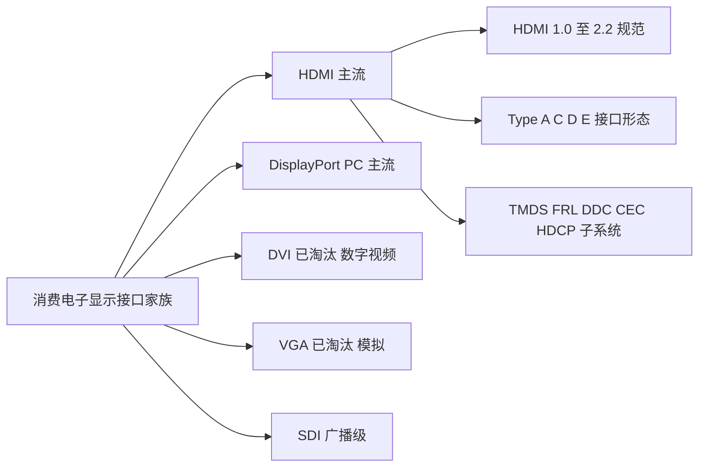
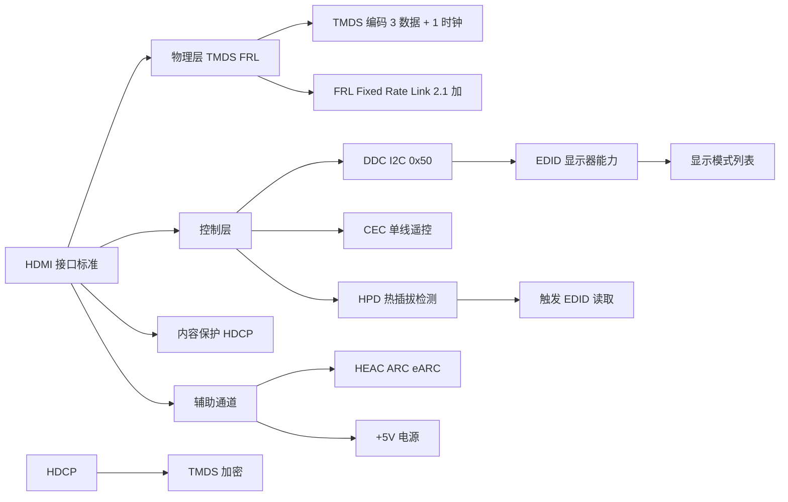
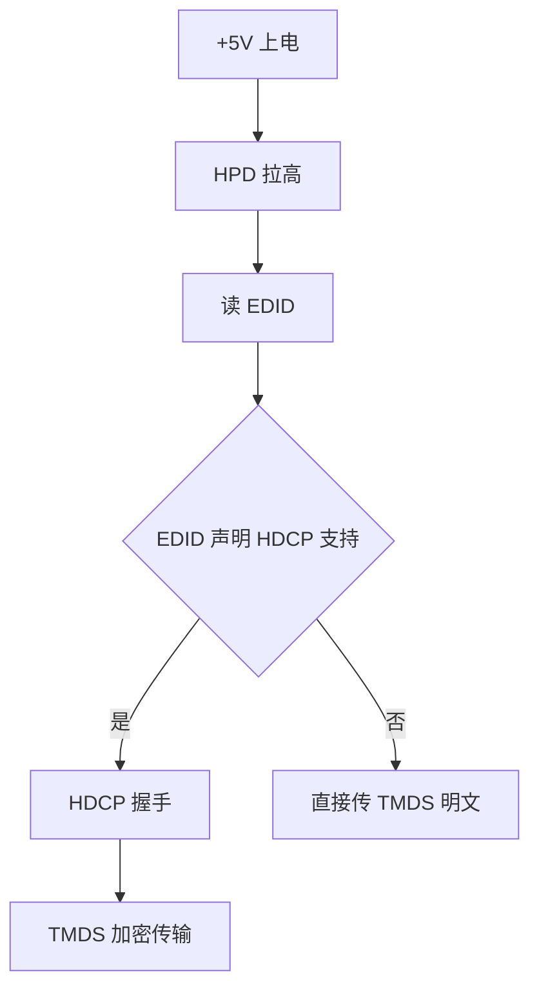
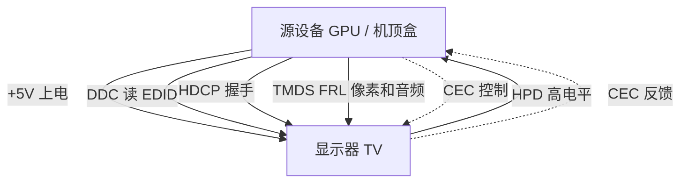
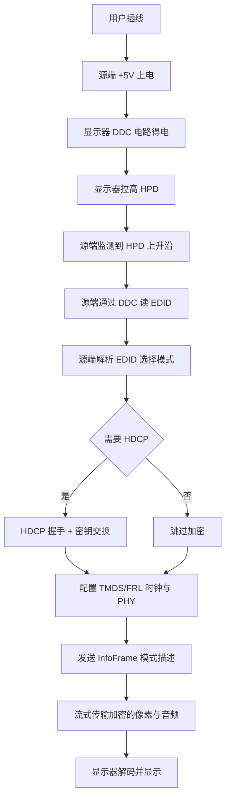

# HDMI 高清晰度多媒体接口

## 1. 先建立整体认知

> HDMI（High-Definition Multimedia Interface，高清晰度多媒体接口）是一种用于在源设备和显示设备之间通过单根线缆同时传输未压缩数字视频、多声道音频与控制信号的接口标准。

它是消费电子和 PC 显示领域事实上的主流数字接口。可以把它理解为：

> 一根线同时承载 视频像素流 + 音频采样流 + 设备控制消息 + 显示能力描述 + 内容保护密钥。

HDMI 不是单一协议，而是一个**多层协议栈**：物理层用差分对传输高速串行信号，链路层用 TMDS 或 FRL 编码像素，控制层用 DDC（I2C）读取显示器能力，并用单线 CEC 总线做设备间遥控，外加 HDCP 做内容保护握手。理解 HDMI，就是理解这些层如何并行协作。

### 直觉理解

把 HDMI 想象成一条双向的"音视频快递通道"：

- 主干道：三对差分数据线 + 一对差分时钟线，像四条并行的高速车道，连续把像素和音频样本"流"到显示器。
- 旁路递送：两根 I2C 线像快递员递送显示器的"能力清单"（EDID），让源端知道对方能显示什么。
- 遥控线：一根 CEC 单线像家里的红外遥控总线，让电视遥控器能控制 soundbar 或机顶盒。
- 门铃线：HPD 引脚像门铃，告诉源端"显示器在线，可以开始读清单和发数据"。

### 严格理解

HDMI 1.0–2.0 的视频传输层使用 TMDS（Transition-Minimized Differential Signaling，跳变最小化差分信号）编码，包含 3 个数据通道 + 1 个时钟通道，每通道使用一对差分线。HDMI 2.1 引入 FRL（Fixed Rate Link）信令模式替代 TMDS 用于高带宽传输，TMDS 模式上限保持在 18 Gbps，FRL 可达 48 Gbps。HDMI 2.2 进一步将 FRL 升级到 96 Gbps。

---

## 2. 为什么需要 HDMI

HDMI 出现之前，消费电子和 PC 用一连串模拟/数字接口拼接音视频：

```text
模拟视频   VGA / SCART / RCA 复合 / S-Video / 色差
模拟音频   RCA 红白 / SCART 音频针
数字视频   DVI-D（只传视频，无音频）
```

这种状态带来四个核心问题：

1. **线缆混乱**：电视后面要插 5～7 根线（视频三色差 + 音频两路 + 控制若干），用户难装难修。
2. **模拟信号衰减**：VGA/色差线越长越花，时序和颜色漂移严重，高分辨率下接近上限。
3. **无内容保护**：模拟信号可以被中间设备录制成清晰拷贝，影视版权方不接受。
4. **无设备联动**：电视、机顶盒、功放、DVD 各自有遥控器，用户必须切换多个遥控器。

HDMI 的设计目标就是用**单根数字线**解决上述全部问题：

| 问题 | HDMI 的解决方案 |
| --- | --- |
| 线缆混乱 | 单根线同时传 视频 + 多声道音频 + 控制 |
| 模拟衰减 | 全数字差分传输，抗干扰强，长距离仍稳定 |
| 无内容保护 | 内置 HDCP（High-bandwidth Digital Content Protection）握手 |
| 无设备联动 | CEC 单线总线，一个遥控器控多设备 |

> **设计核心：把模拟时代的多线音视频接口压缩成一根数字差分总线，并在协议层内嵌设备协商与版权保护。**

---

## 3. HDMI 在整个体系中的位置



HDMI 与 DVI 同源——两者物理层都基于 TMDS，所以 HDMI 可通过被动转接头兼容 DVI-D。DisplayPort 是另一条独立技术路线，物理层用微包封传输（MAIN-LINK）而非 TMDS，需要主动协议转换芯片才能转 HDMI。

在 Linux 内核里，HDMI 通常不作为独立子系统存在，而是挂在 **DRM/KMS（Direct Rendering Manager / Kernel Mode Setting）** 显示框架之下，由 HDMI 控制器驱动（如 `drm/bridge/dw-hdmi`、`adv7511`、`tda998x`）实现为 `drm_bridge` 或 `drm_encoder`，CEC 部分由独立的 `cec` 框架管理，DDC 部分复用 `i2c` 子系统。

---

## 4. 知识地图



下面每一节会展开知识地图中的某个分支，并解释它为什么存在、与谁协作。

---

## 5. 核心概念

### 5.1 TMDS（跳变最小化差分信号）

> TMDS（Transition-Minimized Differential Signaling，跳变最小化差分信号）是 HDMI 1.0 至 2.0 的物理层信令方式，源自 DVI，3 对差分数据线 + 1 对差分时钟线，每对用正负两条线传输互补信号以抵消共模干扰。

**编码原理**：8bit 像素数据通过 TMDS 编码器映射成 10bit 字符，编码有两层目的：

1. **跳变最小化**：用 XNOR 或 XOR 选择极性，使 0/1 翻转次数最少，便于接收端时钟恢复（CDR）。
2. **直流平衡**：编码后的 10bit 中 0 和 1 数量接近，避免差分对长期累积直流偏置导致接收端判决阈值漂移。

**通道结构**：

- Data0：传输 Blue 通道（或 YCbCr 中的 Cb/Cr 之一）+ HSYNC/VSYNC 同步信号（在消隐期通过 data island 携带）
- Data1：Green 通道
- Data2：Red 通道
- Clock：TMDS 时钟，频率等于像素时钟，每个像素 10bit

**速率关系**：TMDS 单 lane 比特率 = 像素时钟 × 10。HDMI 1.0–1.2 单 lane 1.65 Gbps，HDMI 1.3+ 提到 3.4 Gbps（单 lane），三 lane 总带宽：

- HDMI 1.0–1.2：3 × 1.65 = 4.95 Gbps
- HDMI 1.3–1.4：3 × 3.4 = 10.2 Gbps
- HDMI 2.0：3 × 6.0 = 18.0 Gbps

### 5.2 DDC 与 EDID

> DDC（Display Data Channel，显示数据通道）是 HDMI 复用的 I2C 总线，源端作为主控，通过 SCL/SDA 读取显示器内部 EEPROM 中的 EDID 数据。

EDID（Extended Display IDentification Data，扩展显示标识数据）是一个 128 字节（或多个 128 字节块）的数据结构，包含：

- 厂商标识、产品 ID、序列号
- 支持的分辨率与刷新率列表
- 支持的色彩格式（RGB 4:4:4 / YCbCr 4:4:4 / 4:2:2）
- 支持的音频格式与扬声器布局
- HDCP 版本能力位

I2C 设备地址固定为 `0x50`。源端读完 EDID 后才知道该给对方发什么模式。

### 5.3 CEC（消费电子控制）

> CEC（Consumer Electronics Control，消费电子控制）是 HDMI 协议栈中的单线低速总线（典型 3.3V，约 200 µs 位周期），允许 HDMI 链路上的设备互相发送控制消息，例如"电视开机时打开 soundbar"。

CEC 是单线、半双工、CSMA 类型的总线，物理上接在所有 HDMI 设备之间。常见用法：

- 一键播放（One Touch Play）：开机时让电视自动切换到对应输入
- 系统待机（System Standby）：一个遥控器让链路上所有设备一起待机
- 音频路由控制：电视把音频路由到功放
- 设备名广播：设备向电视报告自己的友好名称

CEC 是可选功能，很多设备硬件支持但厂商不实现或部分实现，这是 CEC 调试困难的主要原因之一。

### 5.4 HPD 与 +5V Power

| 引脚 | 作用 |
| --- | --- |
| Pin 18 +5V Power | 源端输出 5V，最小 55mA，用于在显示器待机时给 DDC 电路供电 |
| Pin 19 HPD | 显示器拉高表示"在线且可读 EDID"；拉低或脉冲表示请求重新协商 |

HPD 是 HDMI 的"门铃"。源端通过监测 HPD 的电平变化触发：

1. 上电/插入事件 → 重新读 EDID
2. 模式切换请求（显示器拉低 HPD 一段 ≥1ms 脉冲）→ 源端重新检查能力

### 5.5 HDCP（高带宽数字内容保护）

> HDCP（High-bandwidth Digital Content Protection）是 HDMI 之上的内容保护握手协议，源端与接收端在传输前先做密钥交换，传输中对 TMDS/FRL 数据流加密，避免中间设备直接录制。

HDCP 在 HDMI 链路中**严格串行依赖**：



HDCP 经历三代：

- HDCP 1.4：用于 HDMI 1.x/2.0，40 位密钥，基于源端 + 接收端 + 中继器（repeater）拓扑
- HDCP 2.2：用于 HDMI 2.0 之后的受保护内容，基于 RSA-OAEP + AES-CTR，密钥更现代
- HDCP 2.3：HDMI 2.1 主要版本，适配 FRL 信令

### 5.6 HEAC：ARC 与 eARC

> HEAC（HDMI Ethernet and Audio Return Channel）是 HDMI 1.4 起加入的反向辅助通道，复用 +5V 和 HPD 引脚差分传输。

- ARC（Audio Return Channel，HDMI 1.4）：电视把音频反向回送到功放，使用 TMDS data island 期间发送，支持压缩格式如 Dolby Digital
- eARC（Enhanced ARC，HDMI 2.1）：使用专用差分通道，支持 Dolby TrueHD / DTS-HD MA / Dolby Atmos 等无损高码率格式

---

## 6. 核心概念之间的关系

HDMI 的所有子协议并不是孤立运行的，它们围绕**"安全、合规地让一帧像素出现在屏幕上"**这个目标串联：



依赖关系（顺序不能颠倒）：

1. **+5V 上电** → 给显示器 DDC 电路供电
2. **HPD 拉高** → 源端被告知"可以读 EDID 了"
3. **DDC 读 EDID** → 源端知道对方支持什么模式、什么音频、什么色彩格式
4. **HDCP 握手** → 若 EDID 声明支持 HDCP 且源端需要加密，则完成密钥协商
5. **TMDS / FRL 传输** → 加密后的像素和音频样本流向显示器
6. **CEC 旁路** → 全程双向，独立于上述主链路

只要任何一步失败，链路要么不亮、要么黑屏、要么降级。

---

## 7. 物理层与引脚定义

### 7.1 Type A 19 pin 定义

Type A 是消费电子最主流的 HDMI 接口形态，19 个引脚分两排交错排列：

| Pin | 信号 | 说明 |
| --- | --- | --- |
| 1 | TMDS Data2+ | 数据通道 2 正端 |
| 2 | TMDS Data2 Shield | 通道 2 屏蔽地 |
| 3 | TMDS Data2− | 数据通道 2 负端 |
| 4 | TMDS Data1+ | 数据通道 1 正端 |
| 5 | TMDS Data1 Shield | 通道 1 屏蔽地 |
| 6 | TMDS Data1− | 数据通道 1 负端 |
| 7 | TMDS Data0+ | 数据通道 0 正端 |
| 8 | TMDS Data0 Shield | 通道 0 屏蔽地 |
| 9 | TMDS Data0− | 数据通道 0 负端 |
| 10 | TMDS Clock+ | TMDS 时钟正端 |
| 11 | TMDS Clock Shield | 时钟屏蔽地 |
| 12 | TMDS Clock− | TMDS 时钟负端 |
| 13 | CEC | 消费电子控制单线 |
| 14 | Reserved / HEAC Data+（HEC） | 保留，HDMI 1.4+ 用于以太网 |
| 15 | SCL（DDC） | I2C 时钟线 |
| 16 | SDA（DDC） | I2C 数据线 |
| 17 | DDC/CEC Ground | 控制信号地 |
| 18 | +5V Power | 源端给显示端 5V 电源 |
| 19 | HPD / HEAC Data− | 热插拔检测 / eARC 反向数据 |

观察规律：Pin 1–12 几乎全是 TMDS 的四对差分线 + 屏蔽地；13–17 是低速控制；18/19 是电源和热插拔/反向数据。

### 7.2 引脚分组与功能对应

| 功能子系统 | 涉及引脚 |
| --- | --- |
| 高速视频/时钟（TMDS） | 1–12 |
| CEC 控制总线 | 13 |
| HEAC（ARC/eARC/以太网） | 14, 19 |
| DDC（I2C 读 EDID） | 15, 16, 17 |
| 电源与热插拔 | 17, 18, 19 |

---

## 8. 工作流程

下面是一次完整的 HDMI 上电握手时序，从用户插线到屏幕亮起：



关键节点说明：

- **HPD 上升沿**：源端的 GPIO 中断捕获，Linux 内核里会调用 `drm_helper_hpd_irq_event()` 触发 KMS 重新探测
- **EDID 读取**：通过 `drm_get_edid(connector, adapter)` 调用 I2C，读 256 字节（或扩展块更多）
- **InfoFrame**：HDMI 在视频消隐期（VBlank / HBlank 的 data island）发送的元数据包，描述色彩空间、像素格式、音频格式、HDR 元数据等
- **模式切换**：用户切换分辨率/刷新率时，显示器会拉低 HPD 一段 ≥1ms 脉冲，源端响应并重新走流程

---

## 9. TMDS 编码原理

### 9.1 8b/10b 编码

TMDS 把每个 8bit 像素分量编码成 10bit 字符。两步：

1. **跳变最小化**：根据当前 8bit 中 0/1 数量与前一字符极性，决定是否对位取反，使得 0→1 翻转次数尽量少。具体算法用 XNOR/XOR + 极性位。
2. **直流平衡**：编码器维护一个计数器 `TMDS_bias`，跟踪已发送字符中 1 的累积数量。若偏多 1，下一字符使用反极性版本，使长期 0/1 数量平衡。

10bit 字符最高位是极性位（`XOR` / `XNOR` 选择标志），次位是反极性位（直流平衡用），低 8 位是数据。

### 9.2 同步与 data island

TMDS 不只有像素数据。视频流被分为两类区间：

- **Active Video**：可见像素行，传输 RGB/YCbCr 像素
- **Data Island / Blanking**：消隐期，传输同步信号（HSYNC/VSYNC）和辅助数据包（InfoFrame、音频包、音频时钟再生包 N/CTS）

这种设计让单条 TMDS 通道既传像素又传控制信息和音频——是 HDMI 用 4 对差分线替代多条电缆的根本原因。

### 9.3 TMDS 与 FRL 的差异

| 维度 | TMDS（HDMI 1.0–2.0） | FRL（HDMI 2.1+） |
| --- | --- | --- |
| 编码方式 | 8b/10b，开销 25% | 16b/18b，开销 12.5% |
| Lane 数 | 3 数据 + 1 时钟 | 4 数据（时钟内嵌） |
| 单 lane 速率 | 最高 6 Gbps | 最高 12 Gbps |
| 总带宽 | 18 Gbps | 48 Gbps |
| 时钟 | 独立差分对 | 内嵌于数据流 |

HDMI 2.1 设备先以 TMDS 模式启动以兼容旧设备，握手成功后协商升级到 FRL。

---

## 10. 版本演进

| 版本 | 发布年 | 带宽上限 | 信令 | 典型能力 |
| --- | --- | --- | --- | --- |
| 1.0 | 2002 | 4.95 Gbps | TMDS | 1080p 60Hz 8 声道音频 |
| 1.3 | 2006 | 10.2 Gbps | TMDS | Deep Color 30/36/48bit，Dolby TrueHD |
| 1.4 | 2009 | 10.2 Gbps | TMDS | 4K 30Hz，ARC，HDMI 以太网通道 |
| 2.0 | 2013 | 18 Gbps | TMDS | 4K 60Hz，HDR metadata，32 声道音频 |
| 2.1 | 2017 | 48 Gbps | FRL | 8K 60Hz / 4K 120Hz，eARC，VRR/ALLM/QMS/QFT |
| 2.2 | 2025 | 96 Gbps | next-gen FRL | 4K 240Hz / 8K 60Hz 12bit 4:4:4 / 12K 120 / 16K 60，LIP |

HDMI 论坛禁止厂商在产品包装上印版本号（如"2.1"），改用线缆认证名：

| 认证名 | 对应版本 | 带宽 |
| --- | --- | --- |
| High Speed HDMI | 1.4 | 10.2 Gbps |
| Premium High Speed HDMI | 2.0 | 18 Gbps |
| Ultra High Speed HDMI | 2.1 | 48 Gbps |
| Ultra96 HDMI | 2.2 | 64 / 80 / 96 Gbps |

---

## 11. 接口类型

主流 HDMI 物理接口都是 19 pin：

| 类型 | 尺寸 | 用途 |
| --- | --- | --- |
| Type A | 14.0 × 4.45 mm | 电视/显示器/显卡主流 |
| Type B | 21.2 × 4.45 mm | 29 pin 双链路版本，标准定义但极少使用 |
| Type C（Mini） | 10.42 × 2.42 mm | 平板/相机/便携设备 |
| Type D（Micro） | 6.4 × 2.8 mm | 手机/小型平板 |
| Type E | 带锁扣 | 车载娱乐系统，防振动松脱 |

Type C 和 Type D 的引脚功能与 Type A 一一对应，仅物理形状和位置不同，所以可以通过被动转接头互通。

---

## 12. Linux 内核驱动架构

Linux 把 HDMI 看作 DRM 显示流水线的最后一段，并不为它单独立子系统。

### 12.1 DRM/KMS 流水线


HDMI 相关的部分主要是 **Encoder + Bridge + Connector + PHY**。HDMI 控制器 IP（如 Synopsys DesignWare、NXP TDA998X、ADI ADV7511）通常实现为 `drm_bridge` 挂在主显示驱动的 Encoder 链上。

### 12.2 关键数据结构与回调

| 对象 | 主要职责 |
| --- | --- |
| `drm_connector` | 暴露给用户态，实现 `detect()` `fill_modes()` |
| `drm_encoder` | 把 CRTC 并行像素转成 HDMI 协议时序 |
| `drm_bridge` | HDMI 控制器寄存器配置、PHY 编程、HDCP |
| `i2c_adapter` | 提供 DDC 通道给 `drm_get_edid()` |
| `cec_adapter` | CEC 协议栈，独立于 DRM |

### 12.3 关键 API 调用链

读 EDID 的内核侧调用：

```c
struct edid *edid = drm_get_edid(connector, ddc_adapter);
if (edid) {
    drm_connector_update_edid_property(connector, edid);
    drm_add_edid_modes(connector, edid);
    kfree(edid);
}
```

`drm_get_edid()` 内部通过 `i2c_transfer()` 向地址 `0x50` 发起 I2C 读操作，读取至少 256 字节（基础 128 + 第一个扩展块 128）。

HPD 中断处理：

```c
irqreturn_t hpd_irq_handler(int irq, void *data)
{
    struct drm_connector *connector = data;
    drm_helper_hpd_irq_event(connector->dev);
    return IRQ_HANDLED;
}
```

`drm_helper_hpd_irq_event()` 会在系统工作队列上调度一次 connector 探测，最终调用 `connector->funcs->detect()`。

### 12.4 调试入口

```bash
ls /sys/class/drm/
cat /sys/class/drm/card0-HDMI-A-1/status
cat /sys/class/drm/card0-HDMI-A-1/edid | edid-decode
modetest -M rockchip -s 32@31:1920x1080
```

CEC 调试：

```bash
ls /dev/cec*
cec-ctl --playback
cec-ctl -S
```

---

## 13. 示例代码

### 示例 1：用 modetest 列出 HDMI connector 支持的模式

对应 5.2 节"读 EDID 后填充显示模式列表"。

```bash
modetest -M rockchip -c
```

```text
Connectors:
id  encoder status   name             size       mm
32  31      connected HDMI-A-1        0x0
  modes:
    index name                 refresh (Hz) hdisp hdisp_mm ...
    0     1920x1080            60.00       1920 1920
    1     3840x2160            30.00       3840 3840
  props:
    1 EDID:
      flags: immutable blob
      blobs:
      value: 00ffffffff0004c2d8...
```

EDID blob 中能解析出厂商 ID、模式列表、音频能力等。

### 示例 2：HPD 处理与 EDID 读取（驱动简化版）

这段对应 7 节流程图中的 "HPD 上升沿 → 读 EDID → 选模式"。

```c
static enum drm_connector_status
hdmi_connector_detect(struct drm_connector *connector, bool force)
{
    struct hdmi_ctx *ctx = to_hdmi_ctx(connector);

    if (gpiod_get_value(ctx->hpd_gpio))
        return connector_status_connected;
    return connector_status_disconnected;
}

static const struct drm_connector_funcs hdmi_connector_funcs = {
    .detect         = hdmi_connector_detect,
    .fill_modes     = drm_helper_probe_single_connector_modes,
    .destroy        = drm_connector_cleanup,
    .reset          = drm_atomic_helper_connector_reset,
    .atomic_duplicate_state = drm_atomic_helper_connector_duplicate_state,
    .atomic_destroy_state  = drm_atomic_helper_connector_destroy_state,
};
```

`drm_helper_probe_single_connector_modes()` 内部会调用 `get_modes()` 回调，进而调用 `drm_get_edid()` 读 EDID 并填充 mode 列表。

### 示例 3：通过 I2C 直接读 EDID（用户态验证）

不依赖 DRM，直接用 I2C 工具核对 DDC 通道可用性：

```bash
i2cdump -y 1 0x50 w
```

```text
     0  1  2  3  4  5  6  7  8  9  a  b  c  d  e  f    0123456789abcdef
00: 00 ff ff ff ff ff ff 00 4c 2d d8 00 00 00 00 00    ........L-......
10: 00 00 01 04 b5 1d 1e 78 3e 4a 35 a5 56 50 9f 27    .......x>J5.VP.'
20: 0f 50 54 bf ee 00 01 01 01 01 01 01 01 01 01 01    .PT.............
```

开头 `00 ff ff ff ff ff ff 00` 是 EDID 头部魔数，`4c 2d` 是厂商 EISA ID（这里 `4c2d` 对应某家显示器厂）。

---

## 14. 常见误区

### 误区 1：HDMI 等于"数字版的 VGA"

**错误理解**：HDMI 就是把 VGA 模拟信号变成数字信号，跟 DVI 没本质区别。

**为什么容易这样理解**：HDMI 物理层确实基于 DVI 的 TMDS，且早期常用转接头互转。

**正确理解**：HDMI 在 TMDS 之上叠加了 DDC/EDID、CEC、HDCP、HEAC、InfoFrame 等多层协议。DVI 只有视频，而 HDMI 用 data island 在同一 TMDS 流中嵌入音频、模式描述、HDR 元数据、控制包，是一个完整的多媒体协议栈。

### 误区 2："HDMI 2.1 线"等于"支持 4K 120Hz"

**错误理解**：买了标"2.1"的设备就一定能跑 4K 120Hz。

**为什么容易这样理解**：厂商常在产品上只标"HDMI 2.1"作为通用卖点。

**正确理解**：HDMI 论坛禁止厂商用版本号宣传，改为按功能命名。HDMI 2.1 是一个特性集合（VRR / ALLM / eARC / FRL 4K120 / 动态 HDR 等），厂商可以只实现其中一部分。例如只支持 eARC 的电视也可以标"支持 HDMI 2.1"，但它根本跑不了 4K 120Hz。要确认具体功能必须看线缆认证名（Ultra High Speed HDMI Cable）和具体规格项。

### 误区 3：HDMI 2.1 用 TMDS 跑 48 Gbps

**错误理解**：HDMI 2.1 = 48 Gbps = TMDS 升级到 48 Gbps。

**为什么容易这样理解**：旧版本带宽提升都是 TMDS 提速。

**正确理解**：HDMI 2.1 的 TMDS 模式上限仍是 18 Gbps，新增的 48 Gbps 由 FRL（Fixed Rate Link）信令模式提供，使用 4 数据 lane + 16b/18b 编码，时钟内嵌。HDMI 2.1 设备会先以 TMDS 启动（兼容旧设备），握手后再升级到 FRL。

### 误区 4：CEC 是必须的

**错误理解**：HDMI 标准要求设备实现 CEC，所以接 HDMI 就能互相遥控。

**为什么容易这样理解**：CEC 写在标准里。

**正确理解**：CEC 是可选功能。硬件引脚在所有 Type A 接口都存在，但厂商可以不实现驱动栈，或只实现一小部分命令集。实际调试时常常发现一端实现、一端没实现，导致 CEC 链路不通。

---

## 15. 相关知识

```text
HDMI
├── DVI          TMDS 同源 可被动互转
├── DisplayPort  另一条技术路线 微包封 需主动转换
├── HDCP         内容保护握手 协议独立于 HDMI 也可用于 DP
├── DRM/KMS      Linux 显示子系统 HDMI 驱动挂载点
├── I2C          DDC 通道的物理承载
├── EDID         显示器能力描述 DDC 上传输的数据结构
├── VESA 标准族  DMT GTF CVT 等时序规范 EDID 中引用
└── CEC          独立单线总线协议栈
```

只做索引，不展开：

- **DVI**：HDMI 的 TMDS 物理层与 DVI-D 完全兼容，单链路 DVI 转 HDMI 只需被动转接头。
- **DisplayPort**：物理层与 HDMI 不同，带宽更高（DP 2.1 UHBR20 = 80 Gbps），协议转换需主动芯片。
- **HDCP**：可同时用于 HDMI、DP、DVI，密钥交换协议独立。
- **VESA CVT/CVT-RB**：EDID 中描述分辨率的时序标准，决定像素时钟与消隐期长度。

---

## 16. 正式学习时重点关注

按本笔记的脉络深入时，下面这些是真正应该花时间搞清楚的：

1. **TMDS 编码细节**：8b/10b 编码具体怎么实现跳变最小化？直流平衡计数器的工作机理？为什么是 10bit 而不是 9bit 或 12bit？
2. **data island 与 InfoFrame**：HSYNC/VSYNC 在哪个数据岛的哪个位置传输？AVI InfoFrame（Auxiliary Video Information）如何描述色彩空间和像素格式？
3. **EDID 数据结构**：基础 128 字节里各字段偏移？扩展块（E-EDID）如何链接？为什么 HDMI VSDB（Vendor-Specific Data Block）特别重要？
4. **HPD 时序**：HPD 脉冲的宽度协议规定？源端响应延迟容忍度？模式切换时 HPD 和 RSEN（Receiver Sense）协同？
5. **HDCP 1.x vs 2.x**：两代协议的密钥体系差异（对称 vs 非对称）、repeater 拓扑下的 KSV 列表交换、撤销列表（revocation list）如何下发？
6. **FRL 的 16b/18b 编码**：与 8b/10b 相比开销为何降低到 12.5%？FRL 如何在 4 lane 上内嵌时钟？FRL LT（Link Training）过程？
7. **DRM bridge 链**：`drm_bridge` 如何串联？`drm_bridge_chain_*` 辅助函数和 HDMI 控制器 IP（如 dw-hdmi）如何协作？
8. **CEC 协议栈**：帧格式、仲裁、定址（logical address allocation）、消息重试与错误注入？
9. **音频时钟再生**：N/CTS 参数如何让显示器从 TMDS 时钟精确恢复出 IEC 60958 音频时钟？
10. **超分辨率与色度采样**：4:4:4 / 4:2:2 / 4:2:0 在 TMDS 通道中如何分时复用？

---

## 17. 参考资料

- HDMI Forum 官方规范与版本说明：<https://hdmiforum.org/specifications/>
- HDMI Licensing Administrator 官方资源：<https://www.hdmi.org/>
- Linux Kernel GPU Driver Developer's Guide（DRM/KMS）：<https://docs.kernel.org/gpu/index.html>
- Linux Kernel DRM/KMS KMS Pipeline 文档：<https://www.kernel.org/doc/html/latest/gpu/drm-kms.html>
- Linux Kernel HDMI CEC 文档：<https://www.kernel.org/doc/html/latest/admin-guide/media/cec.html>
- Synopsys DesignWare HDMI Bridge 驱动源码：`drivers/gpu/drm/bridge/synopsys/dw-hdmi.c`
- VESA DisplayPort 与 HDMI 协议对比白皮书（VESA 官方）
```
