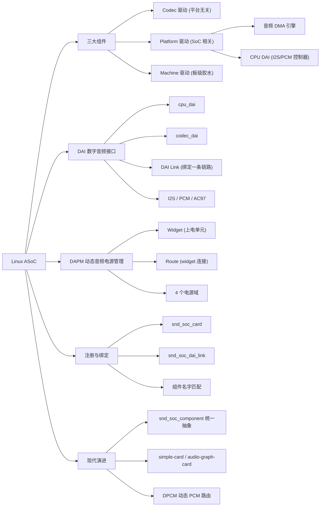
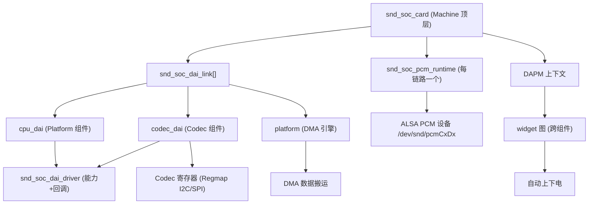

# Linux ASoC（ALSA System on Chip）

> 适用范围：主线 Linux（2.6.27 引入 ASoC 框架，至 6.x 持续演进）。核心三组件模型（Machine / Platform / Codec）自 2.6 起稳定；`snd_soc_component` 统一抽象在 4.x 后逐步成为主流；DPCM、simple-card 等机制在 3.x ~ 5.x 间逐步成熟。文中对关键演进已标注版本。
> 前置关联：建议先了解 ALSA（PCM 设备、control 设备、`struct snd_pcm` / `struct snd_kcontrol`）、Linux 驱动模块（platform_driver / probe）、设备树（compatible 匹配、节点描述）和字符设备。ASoC 建立在标准 ALSA 之上，目的是"把嵌入式音频系统拆成可重用的组件"。
> 阅读目标：10~20 分钟内建立"ASoC 是什么、为什么存在、由什么组成、组件之间如何协作、音频数据如何流动、DAPM 如何自动省电"的可靠整体认知。

---

## 1. 先建立整体认知

### 1.1 它是什么

**直觉理解**：你手上有一块 ARM 开发板，SoC 里有 I2S 控制器和 DMA，板子上挂着一颗音频 Codec 芯片（如 WM8731），还有喇叭、耳机、麦克风。要让 Linux 里的 `aplay` 能播放声音，需要把"应用发出的 PCM 数据"搬运到"Codec 里的 DAC"再变成模拟信号。ASoC 就是内核里专门为这种**嵌入式音频硬件**设计的子系统——它把整个音频系统拆成几个可重用的驱动组件，用 DAI Link 把它们粘起来注册成一张 ALSA 声卡。

**严格定义**：ALSA System on Chip（ASoC）是 Linux 内核 ALSA 子系统的一部分，位于 `sound/soc/`，目标是**为嵌入式 SoC 处理器和便携式音频 Codec 提供更好的 ALSA 支持**。它将嵌入式音频系统抽象为三类可重用驱动组件（Codec / Platform / Machine）+ 数字音频接口（DAI）+ 动态音频电源管理（DAPM），并在标准 ALSA 之上建立组件注册、绑定、PCM 数据传输、电源管理的统一框架。

### 1.2 为什么存在

**在 ASoC 出现之前**，内核里已经有 SoC 音频支持，但存在三个突出问题：

1. **Codec 驱动与 SoC CPU 紧耦合**。同一颗 WM8731 在 4 个不同 SoC 平台上有 4 份不同源码，代码无法重用，维护困难。
2. **缺少标准的音频事件通知**。耳机插入、Mic 检测等事件在便携设备上非常常见，但没有标准方法上报，每块板子都要自己写一套。
3. **整颗 Codec 始终上电**。播放时整个 Codec 都上电，在 PC 上无所谓，但在电池供电的移动设备上严重浪费电量；也无法通过改变过采样率、偏置电流等方式省电。

**ASoC 的解法**：把音频系统拆成**可重用组件**，再用一个"机器驱动"把它们按板子实际情况粘起来，并引入 DAPM 让音频通路上的每个模块**只在需要时上电**。

一句话：**ASoC = "把嵌入式音频拆成可重用组件 + 按需上电"的标准框架。**

### 1.3 在整个体系中的位置

```text
应用层 aplay / arecord / amixer
        ↓ (系统调用)
ALSA Core (sound/core)            ← 标准 ALSA：PCM 设备、control 设备、声卡抽象
        ↓
ASoC Core (sound/soc)             ← 本文档主题：组件注册、DAI Link 绑定、DAPM
        ↓
Codec 驱动   Platform 驱动   Machine 驱动
        ↓           ↓             ↓
   I2C/SPI     DMA + I2S/PCM    绑定 + 板级控制
        ↓           ↓             ↓
        └────── 音频硬件 ───────┘
        Codec 芯片  |  SoC I2S 控制器  |  DMA  |  喇叭/耳机/Mic
```

ASoC 不是替代 ALSA，而是**在 ALSA 之上**为嵌入式音频加了一层"组件化 + 电源管理"框架。用户空间仍然用标准 ALSA 接口（`/dev/snd/pcm*`、`/dev/snd/control*`），完全透明。

---

## 2. 在整个体系中的位置要点

| 层次 | 位置 | 职责 |
| --- | --- | --- |
| 用户空间 | `aplay` / `arecord` / `amixer` / alsa-lib | 通过 ALSA 标准接口播放、录制、调节音量 |
| ALSA Core | `sound/core/*.c` | PCM 子系统、control 子系统、声卡注册 |
| **ASoC Core** | **`sound/soc/*.c`** | **组件注册、DAI Link 匹配绑定、DAPM 电源图、PCM 操作转发** |
| 组件驱动 | `sound/soc/codecs/`、`sound/soc/<platform>/` | Codec 驱动、Platform 驱动（DMA + CPU DAI）、Machine 驱动 |
| 硬件 | SoC I2S/PCM 控制器、DMA、外部 Codec | 实际数据搬运与数模转换 |

ASoC 是 ALSA 的"嵌入式特化层"：标准 ALSA 已能驱动 PC 声卡，但嵌入式场景下 Codec 可重用、SoC DMA 可重用、只有板级连接不可重用——ASoC 正是为分离这三者而生。

---

## 3. 知识地图



下面逐一展开这些核心概念。

---

## 4. 核心概念

### 4.1 三大组件：Codec / Platform / Machine

这是 ASoC 最核心的拆分。嵌入式音频硬件可以自然分成三部分，软件驱动也对应分成三类：

| 组件 | 对应硬件 | 是否可重用 | 职责 |
| --- | --- | --- | --- |
| **Codec 驱动** | 外部音频 Codec 芯片（WM8731 / RT56xx / TLV320 等） | **可重用**，平台无关 | 音频控制（音量/静音）、Codec DAI 能力、DAPM 描述、寄存器 IO |
| **Platform 驱动** | SoC 内部的音频 DMA + I2S/PCM 控制器 | **可重用**，与 SoC 绑定 | 音频 DMA 引擎驱动、CPU DAI 驱动（I2S/PCM/AC97）、DSP 驱动 |
| **Machine 驱动** | 一块具体的板子（板级连接） | **几乎不可重用** | 描述并绑定 Codec + Platform，处理板级 GPIO/时钟/Jack/功放 |

**为什么这样拆**：Codec 芯片和 SoC 平台都是独立产品，理论上可以任意组合。只有"这块板子用哪个 SoC 配哪个 Codec、I2S 怎么连、功放 GPIO 是几号"是板级特定的。拆分后，Codec 驱动只写一次就能在任意平台复用，Platform 驱动只写一次就能配任意 Codec。

**类比及其边界**：把 Codec 驱动比作"声卡上的 DSP 配置代码"、Platform 驱动比作"主板南桥的 DMA 驱动"、Machine 驱动比作"机箱接线图"是安全的；但不要把 Platform 误认为是"整个平台/SoC"——ASoC 里的 Platform 专指音频 DMA + CPU DAI，不含 SoC 其他子系统。

### 4.2 DAI（Digital Audio Interface，数字音频接口）

- 中文名称：数字音频接口；缩写：DAI。
- 作用：**SoC 与 Codec 之间传输数字音频数据的接口**。分 `cpu_dai`（SoC 侧的 I2S/PCM 控制器）和 `codec_dai`（Codec 侧的 AIF），二者通过 I2S/PCM 总线物理相连。
- 在 ASoC 中是 `struct snd_soc_dai`，驱动侧用 `struct snd_soc_dai_driver` 描述能力（采样率、通道数、格式）和操作回调（`snd_soc_dai_ops`）。

ASoC 主要支持三种 DAI 协议：

| DAI | 线数 | 典型特征 |
| --- | --- | --- |
| **I2S** | 4 线（BCLK / LRC / TX / RX） | HiFi 常见；BCLK 和 LRC 主从可灵活配置；LRCLK = 采样率 |
| **PCM** | 4 线（BCLK / SYNC / TX / RX） | 类似 I2S，支持 TDM（多设备共用总线，网络模式） |
| **AC97** | 5 线（RESET + 分时复用） | PC 声卡常见；BCLK 由 Codec 驱动，FRAME 由控制器驱动 |

> 版本提示：现代嵌入式设备以 I2S / PCM（含 TDM）为主，AC97 已基本退出嵌入式新设计。SoundWire 等新接口在 5.x 后逐步加入支持。

### 4.3 DAI Link（DAI 链路）

- 中文名称：DAI 链路。
- 作用：**把一对 cpu_dai + codec_dai（+ platform）绑定成一条音频数据通路**。Machine 驱动用 `struct snd_soc_dai_link` 描述每条链路要连接哪些组件，ASoC Core 再按名字去匹配已注册的组件。
- 一个系统可以有多条 DAI Link（多媒体链路、语音链路、蓝牙链路……），每条对应一个 PCM 设备。

### 4.4 DAPM（Dynamic Audio Power Management，动态音频电源管理）

- 中文名称：动态音频电源管理；缩写：DAPM。
- 作用：**让音频通路上的每个模块只在需要时上电，不需要时自动断电**。完全在 ASoC Core 内完成，对用户空间透明（应用无需改代码）。
- 两个基本元素：
  - **Widget**：可被软件上电/断电的音频硬件单元（Mixer、Mux、PGA、ADC、DAC、Speaker、Mic、Supply、DAI IN/OUT……）。
  - **Route**：widget 之间的连接（声音能从 A 流到 B，则 A→B 是一条 route）。
- DAPM 把所有 widget 组成一张**有向图**，根据"当前激活的播放/录音流 + 用户 mixer 设置"自动算出哪些 widget 在通路上、需要上电，其余断电。

**DAPM 的 4 个电源域**：

| 电源域 | 内容 | 何时变化 |
| --- | --- | --- |
| Codec bias 域 | VREF / VMID（Codec 核心电源） | probe/remove、suspend/resume |
| Platform/Machine 域 | 外部功放、Jack 检测等物理 IO | 异步事件（耳机插入） |
| Path 域 | 音频子系统信号通路 | 用户改 mixer/mux 设置时（amixer） |
| Stream 域 | DAC / ADC | 流启动/停止时（aplay/arecord） |

### 4.5 snd_soc_component（现代统一抽象）

- 早期 ASoC 把 Codec、Platform、DAI 分别用独立结构管理，导致注册路径复杂。
- 现代内核用 `struct snd_soc_component` **统一抽象** Codec / Platform / CPU DAI 等组件，通过 `devm_snd_soc_register_component()` 注册，再在该组件下挂 DAI。这是 4.x 之后的主流写法。
- 即便你在新代码里看到 `snd_soc_component`，底层仍是"组件 + DAI"的概念，三大组件的逻辑划分仍然成立。

---

## 5. 核心概念之间的关系



**关键关系**：

- **Machine 驱动是入口**：一切从 `snd_soc_card` 开始，它持有 `snd_soc_dai_link[]`，每条 link 用名字引用 cpu_dai / codec_dai / platform。
- **ASoC Core 负责匹配绑定**：各组件驱动先各自注册（声明自己叫什么名字、有什么能力），Machine 注册时 Core 按 `dai_link` 里的名字找到对应组件，全部 probe 成功后才算声卡就绪。
- **DAPM 图是跨组件的**：一张声卡的 widget 图可以横跨 Codec 和 Machine（例如 Codec 的 LINE OUT → 板上的功放 → 喇叭），这样断电能从 Codec 一路延伸到板级功放。
- **PCM 设备由 link 产生**：每个 `dai_link` 绑定成功后生成一个 `snd_soc_pcm_runtime`，进而注册一个 ALSA PCM 设备节点。

---

## 6. 工作原理 / 工作流程

### 6.1 组件注册与声卡绑定流程

```text
1. Codec 驱动加载（I2C/SPI 总线匹配）
     → devm_snd_soc_register_component()
     → 注册 codec_dai（snd_soc_register_dai）

2. Platform 驱动加载（SoC platform 匹配）
     → 注册 platform DMA 引擎
     → 注册 cpu_dai

3. Machine 驱动加载（板级 platform_device/dt 匹配）
     → 填充 snd_soc_dai_link[]（cpu_dai_name / codec_dai_name / platform_name）
     → devm_snd_soc_register_card()

4. ASoC Core 按 dai_link 中的名字查找已注册组件
     → 全部匹配成功 → 逐个调用各组件 probe
     → 为每个 dai_link 创建 snd_soc_pcm_runtime
     → 注册 ALSA PCM 设备 /dev/snd/pcmCxDx[p|c]
     → 注册 control 设备 /dev/snd/controlCx
```

注意绑定是**延迟的**：如果某个 Codec 还没 probe，声卡注册会延迟，直到 Codec 就绪。这就是为什么 I2C Codec 未上电时 `/proc/asound/cards` 可能为空。

### 6.2 播放数据流（playback）

以 `aplay` 播放一段音频为例，数据流和控制流如下：

```text
用户空间 aplay
     ↓ write() PCM 数据
ALSA Core (PCM 子系统)
     ↓ 把数据写入环形缓冲区 (DMA buffer)
ASoC Core → platform DMA 驱动
     ↓ DMA 把 buffer 数据搬运到 I2S TX FIFO
CPU DAI (I2S 控制器)
     ↓ I2S 串行总线 (BCLK/LRC/TX)
Codec DAI (AIF)
     ↓ 进入 Codec 内部
DAC (数字→模拟)
     ↓ 模拟信号
Mixer / PGA / 功放
     ↓
喇叭 / 耳机
```

**控制流（电源）**：在 `trigger(START)` 时，DAPM 沿 widget 图反向查找"从 DAC 到输出端"哪些 widget 需要上电，按 `dapm_up_seq` 顺序依次上电；`trigger(STOP)` 时按 `dapm_down_seq` 反向断电。这就是 ASoC 的"按需上电"。

### 6.3 DAPM 自动电源决策

```text
事件源：
  - 用户启动/停止流 (Stream 域)
  - 用户改 mixer/mux (Path 域)
  - Jack 插拔事件 (Machine 域)
        ↓
DAPM 标记受影响 widget 为 dirty
        ↓
dapm_power_widgets() 遍历 widget 图
        ↓
对每条 active 路径反向追溯
        ↓
算出哪些 widget 应上电、哪些应断电
        ↓
按 dapm_up_seq / dapm_down_seq 排序
        ↓
依次执行上/下电（寄存器写入 + 事件回调）
```

**为什么需要排序**：上电顺序错误会产生 pop/click 噪声。例如要先上电 PGA 再上电 DAC、先断开 mux 再断 DAC。`soc-dapm.c` 里的 `dapm_up_seq[]` / `dapm_down_seq[]` 给每种 widget 类型一个优先级，保证全局顺序正确。

---

## 7. 示例代码

### 7.1 最小 DAI Link 定义（Machine 驱动）

```c
#include <sound/soc.h>

/* 用宏声明一条 dai_link 的组件引用 */
SND_SOC_DAILINK_DEFS(hifi,
    DAILINK_COMP_ARRAY(COMP_CPU("samsung-i2s.0")),        /* cpu_dai */
    DAILINK_COMP_ARRAY(COMP_CODEC("wm8731.0-001a", "wm8731-hifi")), /* codec + codec_dai */
    DAILINK_COMP_ARRAY(COMP_PLATFORM("samsung-audio")));  /* platform DMA */

static struct snd_soc_dai_link my_dai_link = {
    .name        = "hifi",
    .stream_name = "HiFi Playback",
    .ops         = &my_ops,           /* hw_params 等回调 */
    SND_SOC_DAILINK_REG(hifi),        /* 展开上面的组件引用 */
};

static struct snd_soc_card my_card = {
    .name      = "MyBoard",
    .owner     = THIS_MODULE,
    .dai_link  = &my_dai_link,
    .num_links = 1,
};

static int my_audio_probe(struct platform_device *pdev)
{
    struct snd_soc_card *card = &my_card;
    card->dev = &pdev->dev;
    return devm_snd_soc_register_card(&pdev->dev, card);
}
```

**它做什么**：声明"这块板子上，SoC 的 `samsung-i2s.0` DAI 连接到 `wm8731` Codec 的 `wm8731-hifi` DAI，DMA 由 `samsung-audio` 提供"。注册后 ASoC Core 自动按名字匹配并创建 PCM 设备。

### 7.2 Codec DAI 能力描述（Codec 驱动片段）

```c
static const struct snd_soc_dai_ops wm8731_dai_ops = {
    .hw_params  = wm8731_hw_params,   /* 设置采样率/格式 → 写 Codec 寄存器 */
    .set_fmt    = wm8731_set_dai_fmt, /* I2S/左对齐/主从 */
    .set_sysclk = wm8731_set_dai_sysclk,
    .mute_stream = wm8731_mute,      /* 数字静音，减少 pop */
};

static struct snd_soc_dai_driver wm8731_dai = {
    .name = "wm8731-hifi",
    .playback = {
        .stream_name  = "Playback",
        .channels_min = 1, .channels_max = 2,
        .rates        = SNDRV_PCM_RATE_8000_96000,
        .formats      = SNDRV_PCM_FMTBIT_S16_LE,
    },
    .capture = {
        .stream_name  = "Capture",
        .channels_min = 1, .channels_max = 2,
        .rates        = SNDRV_PCM_RATE_8000_96000,
        .formats      = SNDRV_PCM_FMTBIT_S16_LE,
    },
    .ops = &wm8731_dai_ops,
};
```

**对应概念**：`playback/capture` 描述 DAI 能力（ASoC 用它和 cpu_dai 的能力做"协商"，取交集）；`ops` 是 ASoC Core 在 PCM 流程各阶段回调驱动的地方——`hw_params` 在用户设置硬件参数时调用，驱动据此写 Codec 寄存器。

### 7.3 DAPM widget 与 route（Codec 驱动片段）

```c
static const struct snd_soc_dapm_widget wm8731_dapm_widgets[] = {
    SND_SOC_DAPM_DAC("DAC", "HiFi Playback", WM8731_PWR, 3, 1),
    SND_SOC_DAPM_ADC("ADC", "HiFi Capture",  WM8731_PWR, 2, 1),
    SND_SOC_DAPM_OUTPUT("LOUT"),   /* Codec 输出引脚 */
    SND_SOC_DAPM_OUTPUT("ROUT"),
    SND_SOC_DAPM_INPUT("LLINEIN"),
};

static const struct snd_soc_dapm_route wm8731_audio_map[] = {
    {"LOUT", NULL, "DAC"},   /* 声音从 DAC 流到 LOUT 引脚 */
    {"ROUT", NULL, "DAC"},
    {"ADC",  NULL, "LLINEIN"},
};
```

**它做什么**：声明 Codec 内部的"上电单元"和它们之间的连接。`stream_name`（"HiFi Playback"）必须和 DAI driver 里的 stream_name 一致——这是 DAPM 把"流"和"widget"关联起来的钥匙。ASoC Core 据此在播放时自动给 DAC 上电、停止时断电。

---

## 8. 实际应用

### 8.1 典型嵌入式音频链路

```text
应用 aplay
   ↓
/dev/snd/pcmC0D0p            (ALSA PCM 设备)
   ↓
ASoC: platform DMA → cpu_dai (I2S) → codec_dai (AIF) → DAC
   ↓
Codec 模拟输出 → 板级功放 → 喇叭
```

### 8.2 用户空间调试入口

| 命令 / 路径 | 作用 |
| --- | --- |
| `aplay -l` / `arecord -l` | 列出已注册的播放/录音 PCM 设备 |
| `amixer -c 0 contents` | 查看 card 0 所有控制（音量、mux） |
| `/proc/asound/cards` | 已注册声卡 |
| `/proc/asound/pcm` | 所有 PCM 设备 |
| `/proc/asound/card0/pcm0p0/` | 某 PCM 设备状态 |
| debugfs `/sys/kernel/debug/asoc/` | ASoC 组件、DAI、DAPM 状态 |

### 8.3 简化方案：simple-audio-card / audio-graph-card

对于简单 1:1（一个 cpu_dai 接一个 codec）的场景，内核提供了**通用 machine 驱动**，无需自己写 C 代码，只用设备树描述即可：

```text
sound {
    compatible = "simple-audio-card";
    simple-audio-card,name = "MyBoard";
    simple-audio-card,format = "i2s";
    simple-audio-card,cpu {
        sound-dai = <&i2s0>;
    };
    simple-audio-card,codec {
        sound-dai = <&codec>;
        system-clock-frequency = <12288000>;
    };
};
```

`audio-graph-card` 更进一步，支持基于端口（port）的图式连接，适合多 DAI 复杂拓扑。两者背后仍是标准的 ASoC 框架，只是省掉了板级 Machine 驱动代码。

---

## 9. 常见误区

### 误区 1：把 ASoC 和 ALSA 当成两个东西

- **错误理解**：ASoC 是 ALSA 的替代品，用 ASoC 就不用 ALSA 了。
- **为什么容易这样理解**：两者都叫"音频框架"，且 ASoC 文档经常单独出现。
- **正确理解**：ASoC 是 ALSA 的子集/扩展。用户空间接口、PCM 子系统、control 子系统、声卡注册全是标准 ALSA，ASoC 只是在 ALSA 之上加了"嵌入式组件化 + DAPM"这一层。

### 误区 2：以为 Platform 驱动 = 整个 SoC 平台

- **错误理解**：Platform 驱动描述整个 SoC。
- **正确理解**：ASoC 里的 Platform 专指**音频 DMA 引擎 + CPU DAI（I2S/PCM 控制器）**，不是 SoC 上所有外设。看到 Platform 应理解为"SoC 音频侧"。

### 误区 3：把 codec_dai 和 Codec 芯片等同

- **错误理解**：codec_dai 就是 Codec 芯片本身。
- **正确理解**：codec_dai 是 Codec 芯片上的**数字音频接口（AIF）**，只是 Codec 内部众多部件之一（Codec 还包含 DAC/ADC/Mixer/PGA/寄存器等）。codec_dai 描述"数据怎么进/出 Codec"，Codec 驱动描述"Codec 内部怎么工作"。

### 误区 4：DAPM 等于 ALSA 的 runtime PM

- **错误理解**：DAPM 就是内核 runtime PM。
- **正确理解**：DAPM **独立于** runtime PM，专门针对音频通路设计。它基于 widget 图和 mixer 状态做决策，粒度细到单个 mixer/mux/DAC，而 runtime PM 只到设备级。两者可共存。

---

## 10. 相关知识

```text
Linux ASoC
├── ALSA Core (标准 ALSA 框架)
│   ├── PCM 子系统 (ring buffer / period / hw_params)
│   ├── Control 子系统 (snd_kcontrol)
│   └── 声卡注册 (snd_card)
├── Linux 驱动模型
│   ├── platform_driver / platform_device
│   ├── 总线匹配 (I2C / SPI / platform)
│   └── probe/remove 生命周期
├── 设备树 (DT)
│   ├── compatible 匹配
│   ├── sound-dai / ports / endpoints
│   └── simple-audio-card / audio-graph-card
├── Regmap 子系统
│   └── Codec 寄存器 IO 抽象
├── DMA Engine
│   └── 音频 DMA 数据搬运
├── Clock / Regulator 框架
│   └── MCLK / 偏置电压供给
└── SoundWire / Audio DSP (现代扩展)
```

相关知识只做必要解释，不自动把每个关联知识展开成新的学习主题。需要时再单独学习 ALSA PCM、Regmap、DMA Engine 等。

---

## 11. 知识脉络

```text
为什么出现 ASoC？
    ↓ (Codec 驱动耦合、无事件通知、整颗上电费电)
遇到什么问题？
    ↓ (嵌入式音频组件无法重用、电源无法细粒度管理)
为什么需要它？
    ↓ (让 Codec/Platform 可重用 + 按需上电)
采用什么方案？
    ↓ (拆成 Codec/Platform/Machine 三大组件 + DAI + DAPM)
方案由什么组成？
    ↓ (组件驱动 + DAI Link 绑定 + DAPM widget 图)
各部分如何协作？
    ↓ (Machine 用 dai_link 引用各组件，Core 按名字匹配绑定，DAPM 跨组件建图)
工作过程？
    ↓ (注册→匹配→probe→PCM 设备；播放→DMA→I2S→Codec→DAC→输出；DAPM 按需上下电)
最终结果？
    ↓ (应用用标准 ALSA 接口就能播放/录音，且全程最低功耗)
```

---

## 12. 正式学习时重点关注

1. ASoC 把音频系统拆成 Codec / Platform / Machine 三类的**动机**是什么？为什么是这三类而不是两类或四类？
2. `snd_soc_dai_link` 里的 cpu_dai_name / codec_dai_name / platform_name 是怎么**按名字匹配**到已注册组件的？延迟绑定机制是什么？
3. DAI 的 `snd_soc_dai_driver` 里 `playback/capture` 能力描述，如何与 cpu_dai 能力做"协商取交集"？
4. DAPM 的 widget 图是**跨组件**的——Codec 的 widget 和 Machine 的 widget 怎么连成一张图？
5. `stream_name` 在 DAI driver 和 DAPM widget 之间起什么桥梁作用？
6. `dapm_up_seq` / `dapm_down_seq` 的排序为什么能减少 pop/click 噪声？
7. 一条 DAI Link 是如何最终变成 `/dev/snd/pcmCxDx[p|c]` 设备节点的？中间经过哪些结构？
8. simple-audio-card 为什么能不写 C 代码就完成 Machine 驱动的工作？它的限制是什么？
9. DPCM（Dynamic PCM）和普通 ASoC 有什么区别？FE/BE DAI 的概念解决了什么问题？
10. `snd_soc_component` 统一抽象后，老的 Codec/Platform 分类还有意义吗？

这些不是考试题，而是正式学习时应该把注意力放过去的地方。

---

## 13. 参考资料

- [ALSA SoC Layer Overview（内核官方文档）](https://docs.kernel.org/sound/soc/overview.html) — ASoC 设计目标与三大组件划分的权威说明。
- [ASoC Machine Driver（内核官方文档）](https://docs.kernel.org/sound/soc/machine.html) — `snd_soc_card`、`snd_soc_dai_link`、注册流程。
- [ASoC Codec Class Driver（内核官方文档）](https://docs.kernel.org/sound/soc/codec.html) — Codec 驱动必须提供的特性、`snd_soc_dai_driver` 示例。
- [ASoC Digital Audio Interface (DAI)](https://docs.kernel.org/sound/soc/dai.html) — AC97 / I2S / PCM 三种 DAI 协议。
- [Dynamic Audio Power Management (DAPM)](https://docs.kernel.org/sound/soc/dapm.html) — widget 类型、route、4 个电源域。
- [Dynamic PCM (DPCM)](https://www.kernel.org/doc/html/v5.12/sound/soc/dpcm.html) — FE/BE DAI 与运行时动态路由。
- [Linux ALSA 音频系统：platform, machine, codec](https://blog.csdn.net/weixin_41965270/article/details/80906062) — 中文对三大组件与数据流的工程化讲解。
- [Linux 内核 ASoC 基本数据结构](https://blog.csdn.net/tq08g2z/article/details/131882514) — `snd_soc_dai` / `snd_soc_component` / `snd_soc_dai_ops` 结构梳理。
- [ASoC 概述（中文翻译）](https://blog.csdn.net/Qidi_Huang/article/details/52154845) — 内核 `overview.txt` 的中文译本，适合快速对照原文。
- [sound/soc/soc-dapm.c（内核源码）](https://github.com/torvalds/linux/blob/master/sound/soc/soc-dapm.c) — DAPM 实现源头，含 `dapm_up_seq` / `dapm_down_seq`。
