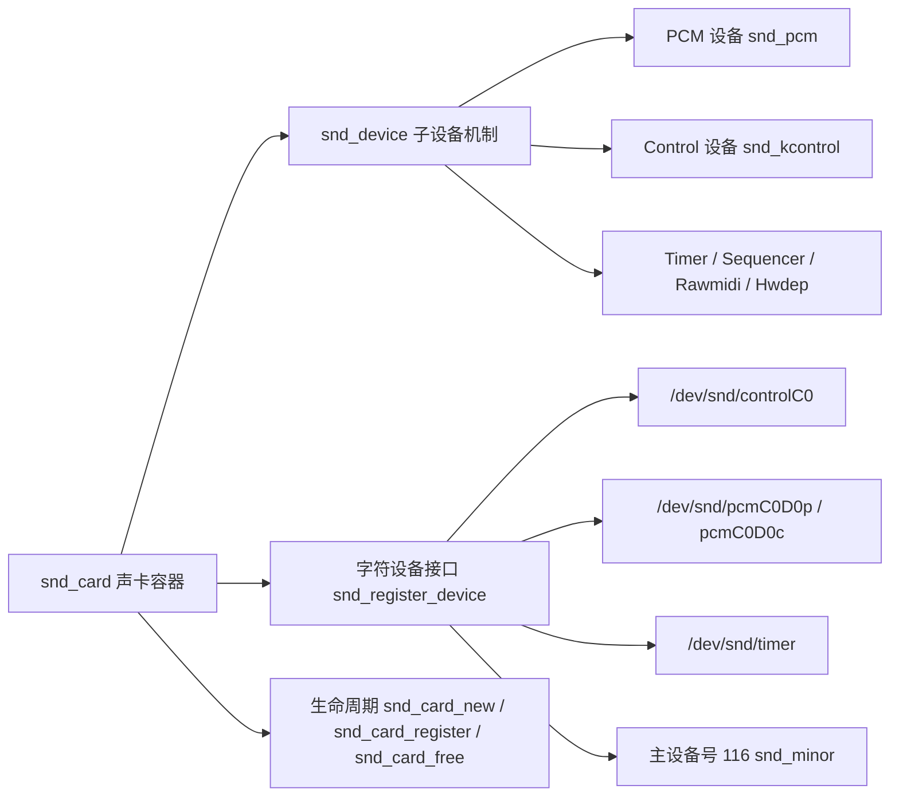
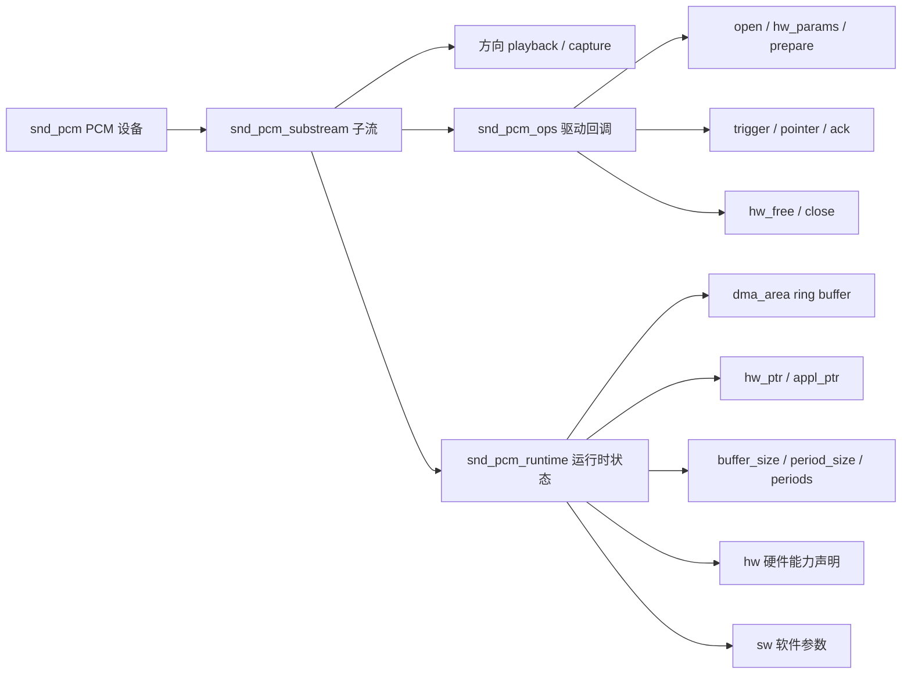
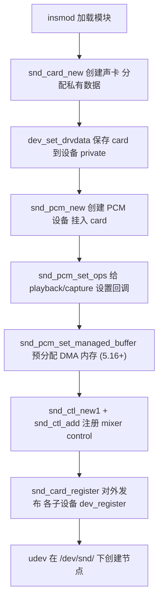
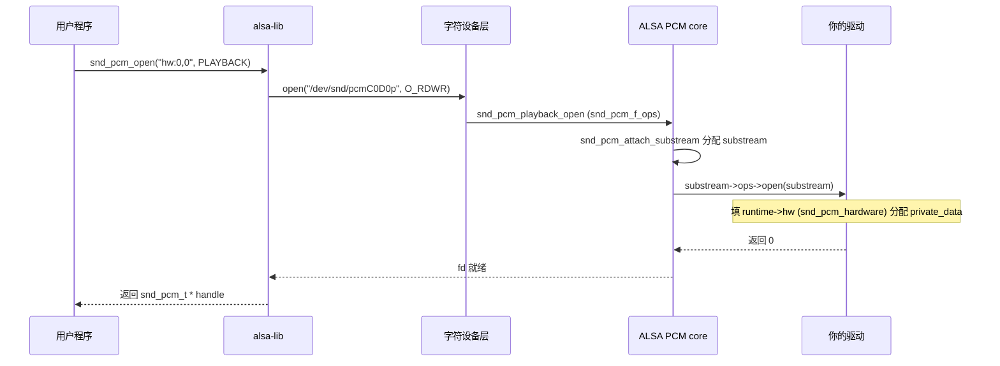
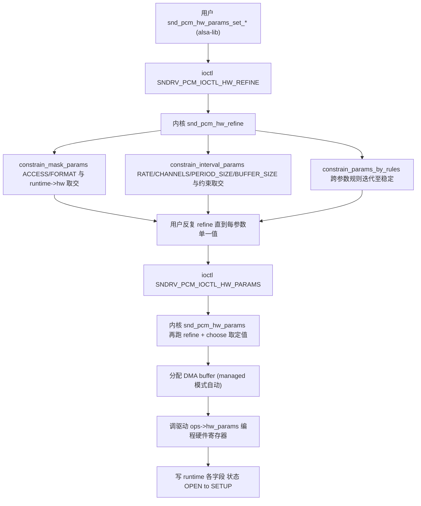
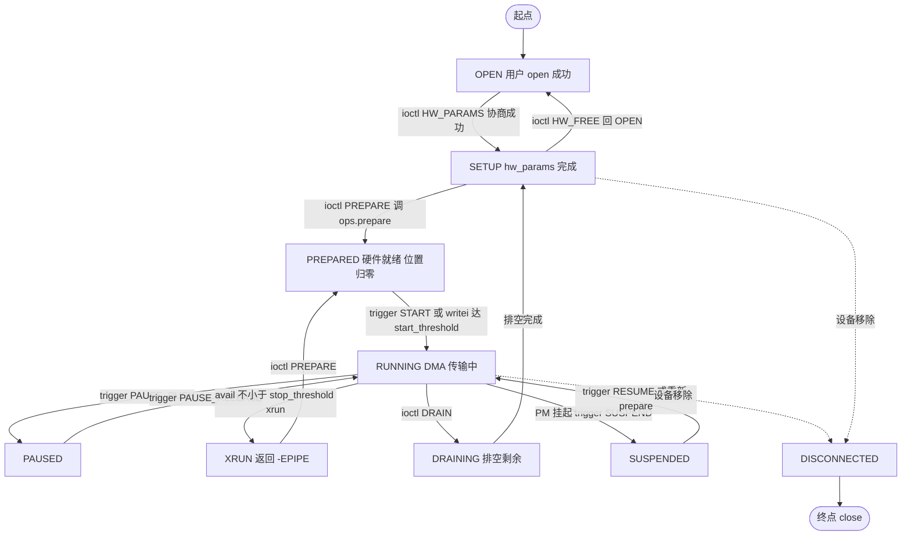
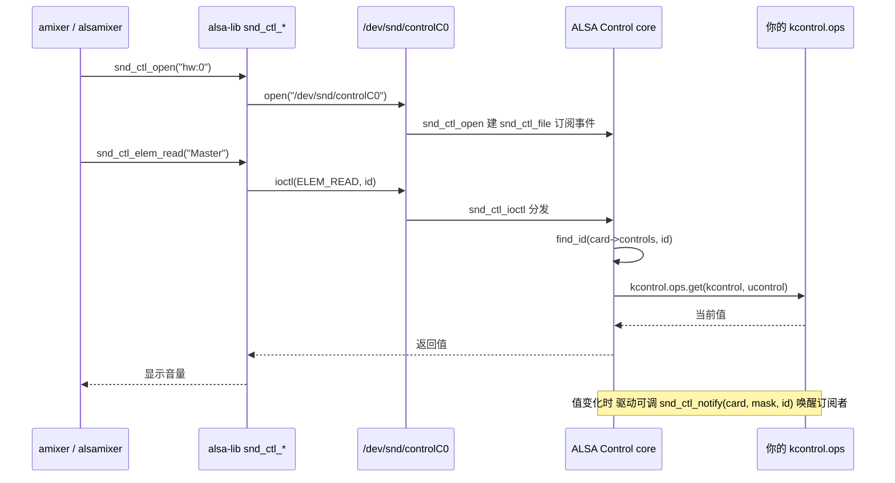

# Linux ALSA（Advanced Linux Sound Architecture）

> 适用范围：主线 Linux（2.6 起为默认声音子系统，至 6.x 持续演进）。核心抽象（`snd_card` / `snd_pcm` / `snd_pcm_substream` / `snd_kcontrol`）自 2.6 起稳定；个别 API（`snd_pcm_ops.copy`、`sync_stop`、`snd_pcm_set_managed_buffer`）存在版本差异，文中已标注。
> 学习边界：本文讲 ALSA **内核通用框架**（`sound/core`）：声卡抽象、PCM 子系统、Control 子系统、字符设备接口、数据流。**不深入** ASoC（已有姊妹笔记 [Linux ASoC.md](./Linux%20ASoC.md)）、不深入 HDA/USB 具体驱动实现、不深入 alsa-lib 用户空间 API 全集、不展开 Timer/Sequencer/Rawmidi/Hwdep/Compress offload（仅第 10 节索引）。
> 阅读目标：10~20 分钟内建立"ALSA 是什么、为什么存在、由什么组成、PCM 数据如何流动、Control 如何调节、驱动如何接入"的可靠整体认知。

---

## 1. 先建立整体认知

### 1.1 它是什么

**直觉理解**：你在 Linux 上 `aplay music.wav`，应用发出的 PCM 采样最终要变成喇叭里的模拟波形。中间这条链路——从应用的 `write()` 一路到 DMA 控制器和音频 Codec——就是 ALSA 管的事。它把"一张声卡"抽象成内核里的一个 `snd_card` 对象，把"播放/录音流"抽象成 `snd_pcm_substream`，把"音量/静音/路由"抽象成 `snd_kcontrol`，再统一暴露成 `/dev/snd/*` 字符设备让用户空间通过 `alsa-lib` 访问。

**严格定义**：ALSA（Advanced Linux Sound Architecture）是 Linux 内核的**声音子系统**，源码位于 `sound/`。它提供：（1）声卡容器抽象 `struct snd_card`；（2）PCM 子系统（`struct snd_pcm` / `struct snd_pcm_substream` / `struct snd_pcm_runtime`）；（3）Control 子系统（`struct snd_kcontrol`，即 mixer）；（4）统一的字符设备接口 `/dev/snd/*`（主设备号 116）；（5）配套的用户空间库 `alsa-lib` 与工具 `alsa-utils`。ASoC（`sound/soc/`）是 ALSA 在嵌入式 SoC 场景的特化层，建立在 ALSA 之上而非替代。

### 1.2 为什么存在

**ALSA 出现之前**，Linux 用的是 OSS（Open Sound System）。OSS 在 1990 年代由 4Front Technologies 商业化，存在三个突出问题：

1. **许可证问题**：OSS 高级功能走专有商业许可，与 Linux 内核 GPL 不兼容，阻碍发行版集成。
2. **单应用独占硬件**：OSS 不做软件混音，一个进程 `open(/dev/dsp)` 后别的进程就无法出声。桌面多应用同时发声做不到。
3. **低延迟与多声道能力不足**：OSS 缺少精确的硬件参数协商、周期中断、mmap 直访缓冲等专业音频特性，无法满足音乐制作与专业声卡需求。

ALSA 项目 1998 年由 Jaroslav Kysela 基于 Gravis Ultrasound 驱动发起，**2002 年在 2.5 开发系列合入内核，2.6 起成为默认声音子系统**，OSS 退居兼容层（`sound/oss/`，主线仅余 m68k dmasound 残留）。OSS v4 在 2007 年重新以 GPL 开源，但生态已无。

ALSA 的解法对应了 OSS 的三个痛点：

1. **GPL-2.0 内核驱动 + LGPL-2.1 用户空间库**——许可证彻底开源。
2. **`dmix` / `dsnoop` 插件**——内核不做混音，但在 alsa-lib 层提供软件混音，多应用共享同一 PCM 设备。
3. **HW params 协商 + period/IRQ 模型 + mmap 直访**——支持精确采样率/格式/通道协商、低延迟周期中断、零拷贝 mmap。

一句话：**ALSA = "把声卡抽象成可协商参数的字符设备 + 用 period/IRQ 控制唤醒粒度"的内核音频框架。**

### 1.3 在整个体系中的位置

```text
应用层 aplay / arecord / amixer / PulseAudio / PipeWire
        ↓ (alsa-lib → 系统调用)
字符设备 /dev/snd/controlC0 /dev/snd/pcmC0D0p /dev/snd/timer ...  (主设备号 116)
        ↓ (snd_register_device 注册)
ALSA Core  sound/core/                                       ← 本文主题
   ├── snd_card   声卡容器
   ├── PCM 子系统  snd_pcm / snd_pcm_substream / snd_pcm_runtime
   ├── Control 子系统  snd_kcontrol (mixer)
   ├── Timer / Sequencer / Rawmidi / Hwdep                   (本文仅索引)
        ↓
具体驱动层
   ├── PCI/ISA 声卡    sound/pci/ sound/isa/                  (HDA 等)
   ├── USB 音频        sound/usb/
   ├── ASoC 嵌入式    sound/soc/                              (姊妹笔记)
        ↓
硬件  Codec 芯片 / SoC I2S 控制器 / DMA 控制器 / DAC / ADC
```

ALSA 是"**应用 ↔ 字符设备 ↔ ALSA core ↔ 具体驱动 ↔ 硬件**"这条链的中间层。它不替代具体驱动（HDA、USB、ASoC 各自实现硬件传输），而是**为所有这些驱动提供统一的声卡抽象、PCM 数据通路、Control 接口和用户空间 ABI**。

---

## 2. 在整个体系中的位置要点

| 层次 | 位置 | 职责 |
| --- | --- | --- |
| 用户空间 | `aplay` / `amixer` / alsa-lib | 通过 `/dev/snd/*` 字符设备 open/ioctl/read/write/mmap 访问音频 |
| 字符设备层 | `/dev/snd/controlC0`、`/dev/snd/pcmC0D0p` 等 | 主设备号 116，由 `snd_register_device()` 创建 |
| **ALSA Core** | **`sound/core/*.c`** | **声卡容器、PCM 子系统、Control 子系统、Timer** |
| 具体驱动 | `sound/pci/`、`sound/usb/`、`sound/soc/` | 实现 `snd_pcm_ops` 回调，操作具体硬件 |
| 硬件 | Codec / SoC I2S / DMA / DAC / ADC | 实际采样与数模转换 |

关键判断：ALSA 是**框架**，具体驱动是**插件**。驱动作者不直接写字符设备、不直接处理用户 ioctl——这些都由 ALSA core 完成；驱动只负责实现一组回调（`snd_pcm_ops`、`snd_kcontrol_ops`）并挂到 `snd_card` 上。

---

## 3. 知识地图

ALSA 概念较多，拆成两张图。

**图 1：声卡抽象层（snd_card 与子设备）**



**图 2：PCM 数据通路**



下面逐一展开。

---

## 4. 核心概念

### 4.1 snd_card（声卡容器）

- 中文名称：声卡；英文：sound card；类型 `struct snd_card`，定义于 `include/sound/card.h`（旧版在 `include/sound/core.h`）。
- 作用：**一张声卡的顶层容器**。它持有该卡所有 PCM 设备、Control 元素、Timer 等子设备，是驱动注册音频功能的入口。

关键字段：

| 字段 | 含义 |
| --- | --- |
| `int number` | 卡号（`/proc/asound/cards` 中的索引，0 起） |
| `char id[16]` | 卡标识，出现在 `/proc/asound/id` |
| `char shortname[32]` / `char longname[80]` | 短/长名，出现在 `/proc/asound/cards` |
| `struct device *dev` | 父设备（如 `&pci->dev`），6.x 起原 `dev_root` 字段统一为 `dev` |
| `struct list_head devices` | 子设备链表（`struct snd_device`） |
| `struct list_head controls` | Control 元素链表（`struct snd_kcontrol`） |
| `struct rw_semaphore controls_rwsem` | control 链表读写锁 |
| `void *private_data` | 驱动私有数据 |
| `void (*private_free)(struct snd_card *)` | 卡释放时回调，驱动清理私有数据 |
| `struct module *module` | 拥有该卡的模块（`THIS_MODULE`） |

三个核心 API（`include/sound/card.h`、`sound/core/card.c`、`sound/core/init.c`）：

```c
// 创建并初始化一张声卡，extra_size 为驱动私有数据大小
int snd_card_new(struct device *parent, int idx, const char *xid,
                 struct module *module, int extra_size,
                 struct snd_card **card_ret);

// 把已建好的声卡对外发布：调用各 snd_device 的 dev_register
int snd_card_register(struct snd_card *card);

// 释放声卡：反向调用各 snd_device 的 dev_free，注销字符设备
void snd_card_free(struct snd_card *card);
```

> 版本提示：`snd_card_create()` 在 **v3.15（2014）** 被 `snd_card_new()` 取代并删除；6.x 后新增 devm 版本 `snd_devm_card_new()`，通过 devres 自动释放。

### 4.2 snd_device 子设备机制

- 中文名称：子设备；英文：ALSA sub-device；类型 `struct snd_device`。
- 作用：**让 `snd_card` 自动管理子设备（PCM、Control、Timer 等）的注册与销毁**。驱动用 `snd_device_new()` 把子设备挂进 card，`snd_card_register()` 时按顺序调用各 `dev_register`，`snd_card_free()` 反向调用 `dev_free`——驱动无需手动释放它们。

```c
struct snd_device_ops {
    int (*dev_register)(struct snd_device *dev);
    int (*dev_disconnect)(struct snd_device *dev);
    int (*dev_free)(struct snd_device *dev);
};

int snd_device_new(struct snd_card *card, enum snd_device_type type,
                   void *device_data, const struct snd_device_ops *ops);
```

`snd_pcm_new()`、`snd_ctl_create()` 等内部都会调 `snd_device_new()` 把自己挂进 card。这是 ALSA 把"声卡 = 子设备集合"自动化的关键。

### 4.3 字符设备接口（/dev/snd/* 与 snd_minor）

ALSA 把所有用户空间接口暴露为字符设备，**主设备号固定为 116**（`CONFIG_SND_MAJOR`，可在模块参数 `snd.major` 覆盖）。每个节点对应 `struct snd_minor`，由 `snd_register_device()` 注册到全局 `snd_minors[]` 数组（按次设备号索引）：

```c
int snd_register_device(int type, struct snd_card *card, int dev,
                        const struct file_operations *f_ops,
                        void *private_data, struct device *device);
```

`type` 取 `SNDRV_DEVICE_TYPE_*`：`CONTROL` / `PCM_PLAYBACK` / `PCM_CAPTURE` / `RAWMIDI` / `TIMER` / `HWDEP` / `SEQUENCER`。节点命名规则：

| 节点 | 含义 |
| --- | --- |
| `/dev/snd/controlC0` | 卡 0 的 Control 设备（mixer 入口） |
| `/dev/snd/pcmC0D0p` | 卡 0、PCM 设备 0、playback 子流 |
| `/dev/snd/pcmC0D0c` | 卡 0、PCM 设备 0、capture 子流 |
| `/dev/snd/hwC0D0` | 卡 0、设备 0 的 hwdep（硬件特殊访问） |
| `/dev/snd/midiC0D0` | 卡 0、设备 0 的 rawmidi |
| `/dev/snd/timer` | 全局定时器（次设备号固定 33） |
| `/dev/snd/seq` | 音序器 |

> 必要关联：节点创建走 `device_create()`，由 devtmpfs/udev 在 `/dev/snd/` 下生成——这与 [Linux字符设备.md](./Linux字符设备.md) 讲的 cdev 机制一致，只是 ALSA 把"主设备号 116 + 次设备号编码 type/card/dev/stream"集中管理。

### 4.4 snd_pcm 与 snd_pcm_substream

PCM 子系统是 ALSA 的核心，抽象成三层：

```text
snd_card                  一张声卡
   └── snd_pcm            一个 PCM 设备（可含 playback + capture 两个 stream）
          ├── streams[SNDRV_PCM_STREAM_PLAYBACK]   struct snd_pcm_str
          │       └── substream  snd_pcm_substream  (单方向可有多子流)
          └── streams[SNDRV_PCM_STREAM_CAPTURE]
                  └── substream  snd_pcm_substream
```

- `struct snd_pcm`：代表一个 PCM 设备，关键字段 `card`、`device`（卡内编号）、`streams[2]`（0=PLAYBACK, 1=CAPTURE）、`open_wait`。
- `struct snd_pcm_substream`：代表**一个方向上的一个子流**，是驱动真正操作的单元。关键字段：
  - `pcm` / `pstr`：所属 PCM 与 stream
  - `stream`：方向（`SNDRV_PCM_STREAM_PLAYBACK` / `_CAPTURE`）
  - `number` / `name[32]`：子流编号与名称
  - `ops`：**驱动回调表** `const struct snd_pcm_ops *`
  - `runtime`：**运行时状态** `struct snd_pcm_runtime *`（open 后才分配）
  - `private_data`：从 `pcm->private_data` 拷贝，驱动可用
  - `dma_buffer`：预分配 DMA 缓冲描述
  - `ref_count` / `pid`：引用计数与打开进程

创建与挂接 API：

```c
int snd_pcm_new(struct snd_card *card, const char *id, int device,
                int playback_count, int capture_count,
                struct snd_pcm **rpcm);

void snd_pcm_set_ops(struct snd_pcm *pcm, int stream,
                     const struct snd_pcm_ops *ops);
```

`playback_count` / `capture_count` 决定该 PCM 设备每个方向有几个 substream（多子流支持多进程同时打开）。

### 4.5 snd_pcm_runtime（运行时状态）

`struct snd_pcm_runtime` 是 PCM 子系统**最核心的数据结构**——它承载了一次 PCM 流的全部运行时状态。它在 `snd_pcm_open` 成功后分配，挂在 `substream->runtime` 上。关键字段按职责分组：

| 分组 | 字段 | 含义 |
| --- | --- | --- |
| 状态 | `state` | PCM 状态机当前状态（`SNDRV_PCM_STATE_*`） |
| HW params | `access` / `format` / `rate` / `channels` | 协商后的访问模式/格式/采样率/通道数 |
| HW params | `period_size` / `periods` / `buffer_size` | 周期/周期数/总缓冲（**均以 frame 为单位**） |
| HW params | `frame_bits` / `sample_bits` | 每帧/每样本位数 |
| HW params | `hw` | `struct snd_pcm_hardware`，驱动声明的硬件能力 |
| SW params | `avail_min` / `start_threshold` / `stop_threshold` | 唤醒/自动启/自动停阈值 |
| SW params | `boundary` | hw_ptr/appl_ptr 取模的边界（不是 buffer_size！） |
| 指针 | `status->hw_ptr` | 硬件已传输位置（内核更新） |
| 指针 | `control->appl_ptr` | 应用已提交位置（用户更新） |
| DMA | `dma_area` | ring buffer 虚拟地址（CPU/驱动用） |
| DMA | `dma_addr` | ring buffer 总线物理地址（DMA 控制器用） |
| DMA | `dma_bytes` | ring buffer 字节数 |
| mmap | `status` / `control` | mmap 到用户态的共享页（用户可直接读指针） |

> 关键认知：`status` 和 `control` 是**与用户空间共享的页**。用户态通过 mmap 即可读到 `hw_ptr` / `appl_ptr`，poll 仍由 period IRQ 唤醒——这是 ALSA 低延迟路径的基础。

### 4.6 snd_pcm_hardware（驱动能力声明）

`struct snd_pcm_hardware` 是驱动向 ALSA core 声明"我这个硬件能做什么"的契约。驱动在 `snd_pcm_ops.open` 回调里把它填进 `runtime->hw`：

```c
struct snd_pcm_hardware {
    unsigned int info;              // SNDRV_PCM_INFO_* (MMAP/INTERLEAVED/...)
    u64 formats;                    // SNDRV_PCM_FMTBIT_* (S16_LE / S32_LE / ...)
    u32 subformats;                 // 子格式（如 S32_LE 的有效位宽）
    unsigned int rates;             // SNDRV_PCM_RATE_* (8000/44100/48000/...)
    unsigned int rate_min, rate_max;
    unsigned int channels_min, channels_max;
    unsigned int buffer_bytes_max;
    unsigned int period_bytes_min, period_bytes_max;
    unsigned int periods_min, periods_max;
    unsigned int fifo_size;
};
```

HW params 协商时，ALSA core 把用户请求的参数与 `runtime->hw` 取交集——驱动声明的能力是协商的**上界**。例如驱动只填 `rates = SNDRV_PCM_RATE_8000_48000`，用户请求 96000 会被拒绝。

### 4.7 snd_pcm_ops（驱动回调表）

这是驱动实现 PCM 功能的**全部接口**。每个回调在 PCM 状态机的特定时刻被调用：

```c
struct snd_pcm_ops {
    int (*open)(struct snd_pcm_substream *substream);        // 用户 open 时分配 runtime->private_data
    int (*close)(struct snd_pcm_substream *substream);       // 释放
    int (*hw_params)(..., struct snd_pcm_hw_params *params);  // 编程格式/速率寄存器，分配 DMA
    int (*hw_free)(...);                                      // 释放 hw_params 资源
    int (*prepare)(...);                                      // 置硬件就绪，DMA 位置归零
    int (*trigger)(..., int cmd);                             // START/STOP/PAUSE_PUSH/PAUSE_RELEASE/SUSPEND/RESUME/DRAIN
    int (*sync_stop)(...);                                    // 5.19+ 新增，停止前同步
    snd_pcm_uframes_t (*pointer)(...);                        // 返回当前 DMA 帧位置（核心！）
    int (*fill_silence)(..., ...);                            // 静音填充（旧名 silence）
    int (*copy)(..., struct iov_iter *iter);                  // 数据拷贝（5.18+ 改用 iov_iter）
    int (*ack)(...);                                          // appl_ptr 推进后回调
    struct page *(*page)(..., unsigned long offset);          // mmap 页分配
    int (*mmap)(..., struct vm_area_struct *vma);
};
```

> 版本提示：
> - `.copy` 签名在 **5.18+** 由 `void __user *buf` 改为 `struct iov_iter *iter`，旧的 `snd_pcm_lib_write/read` memcpy 助手已在 5.x 中期移除。
> - `sync_stop` 回调为 **5.19 新增**，用于停止前同步（替代部分旧 `stop` 语义）。
> - 旧 `wall_clock` → 现 `get_time_info`；旧 `silence` → 现 `fill_silence`。

`pointer` 是**最关键也最容易出 bug 的回调**：它返回当前 DMA 在 ring buffer 内的帧偏移（`0 <= pos < buffer_size`），ALSA core 据此更新 `hw_ptr`。返回 `SNDRV_PCM_POS_XRUN`（`(snd_pcm_uframes_t)-1`）可显式报告 xrun。

### 4.8 snd_kcontrol（Control 元素）

Control 子系统暴露 mixer / volume / mute / switch / enum 等可调参数。每个可调项是一个 `struct snd_kcontrol`：

```c
struct snd_kcontrol_new {
    snd_ctl_elem_iface_t iface;     // MIXER / PCM / CARD / ...
    unsigned int device, subdevice;
    const char *name;               // 如 "Master Playback Volume"
    unsigned int index;             // 同名 control 的索引
    unsigned int access;            // READ / WRITE / VOLATILE / TLV / ...
    unsigned int count;             // 同构元素数（立体声=2）
    snd_kcontrol_info_t *info;      // 返回元素类型与范围
    snd_kcontrol_get_t *get;        // 读当前值
    snd_kcontrol_put_t *put;        // 写新值
    union { snd_kcontrol_tlv_rw_t *c; const unsigned int *p; } tlv;  // dB 标度
    unsigned long private_value;
};

int snd_ctl_add(struct snd_card *card, struct snd_kcontrol *kcontrol);
struct snd_kcontrol *snd_ctl_new1(const struct snd_kcontrol_new *kctlnew, void *private_data);
```

control 类型（`SNDRV_CTL_ELEM_TYPE_*`）：`BOOLEAN` / `INTEGER` / `ENUMERATED` / `BYTES` / `IEC958` / `INTEGER64`。iface（`SNDRV_CTL_ELEM_IFACE_*`）决定该 control 属于哪类设备：`MIXER` / `PCM` / `CARD` / `RAWMIDI` / `TIMER` / `SEQUENCER` / `HWDEP`。

> 时序关键：`snd_card_new()` 内部已 `INIT_LIST_HEAD(&card->controls)` 并调 `snd_ctl_create()` 建 control 设备对象。`snd_ctl_add()` 可在 `snd_card_register()` **之前或之后**调用——之前调仅入链表（赋 numid，无订阅者），之后调会向已订阅 ctl_file 发 `EVENT_MASK_ADD`。`snd_card_register()` 之前 control 接口**对外不可见**（kernel-doc 原文："Until calling this, the ALSA control interface is blocked from the external accesses"）。惯例顺序：`snd_card_new` → 加各 control（`snd_ctl_add`）→ `snd_card_register`。

---

## 5. 核心概念之间的关系

```text
【静态结构关系】
snd_card
   ├── devices 链表 ── snd_device (PCM / Control / Timer / ...)
   │       └── dev_register / dev_free 由 snd_card_register / snd_card_free 调用
   ├── controls 链表 ── snd_kcontrol (一个 mixer 元素)
   │       └── ops.info / get / put
   ├── private_data ── 驱动私有
   └── number / id / shortname / longname ── 出现在 /proc/asound/

【PCM 子系统内部关系】
snd_pcm (一个 PCM 设备)
   └── streams[2]
          └── substream (一个方向一个子流)
                 ├── ops           ── 驱动回调 (snd_pcm_ops)
                 ├── runtime       ── 运行时状态 (snd_pcm_runtime)
                 │       ├── hw    ── 硬件能力 (snd_pcm_hardware)
                 │       ├── state  ── PCM 状态机
                 │       ├── dma_area / dma_addr / dma_bytes  ── ring buffer
                 │       ├── status->hw_ptr   ── 硬件位置 (内核更新)
                 │       └── control->appl_ptr ── 应用位置 (用户更新)
                 └── dma_buffer    ── 预分配 DMA 描述

【用户空间 ↔ 内核】
/dev/snd/controlC0  ── (主116) ── snd_minors[] ── snd_ctl_f_ops ── kcontrol.ops
/dev/snd/pcmC0D0p   ── (主116) ── snd_minors[] ── snd_pcm_f_ops ── substream.ops
```

- `snd_card` 是顶层容器，`snd_device` 是它管理子设备的通用机制，`snd_kcontrol` 与 `snd_pcm` 都通过它挂入 card。
- `snd_pcm_substream` 是驱动真正操作的单元，`runtime` 是它的全部运行时状态。
- 用户空间通过主设备号 116 找到 `snd_minors[]`，由 `snd_ctl_f_ops` / `snd_pcm_f_ops` 分发到具体 kcontrol 或 substream。

---

## 6. 工作原理

### 6.1 声卡注册流程（模块加载时）



注意顺序：**先建 card，再加子设备（PCM/control/...），最后 register**。`snd_card_register()` 之前用户空间 `open(/dev/snd/controlC0)` 会失败。

### 6.2 PCM open 完整调用链



之后 `snd_pcm_hw_params` / `snd_pcm_prepare` / `snd_pcm_start` / `snd_pcm_writei` 都走 ioctl，最终触发 `substream->ops->hw_params` / `prepare` / `trigger` / `copy`。

### 6.3 HW params 协商流程

ALSA 的参数协商是**约束满足**过程，不是"用户说什么就是什么"：



约束载体：`struct snd_interval { unsigned int min, max, integer; }` 用于 RATE/CHANNELS/PERIOD_SIZE 等区间参数；`struct snd_mask` 用于 ACCESS/FORMAT 位掩码参数。它们存在 `runtime->hw_constraints`。

### 6.4 数据流（playback 与 capture）

```text
【playback】
应用 buffer (用户空间)
    ↓ copy_from_iter / write 系统调用
dma_area ring buffer (内核 DMA 内存, 虚拟地址 dma_area / 总线地址 dma_addr)
    ↓ 推进 appl_ptr
DMA 控制器从 dma_addr 周期读出
    ↓ 硬件总线
Codec DAC ──→ 模拟输出

【capture】
Codec ADC ──→ 数字采样
    ↓ 硬件总线
DMA 控制器周期写入 dma_addr
    ↓ period 满 IRQ
dma_area ring buffer
    ↓ snd_pcm_period_elapsed 唤醒
应用 poll 返回 ──→ copy_to_iter / read ──→ 应用 buffer
```

> 关键认知：`dma_area` 是 CPU 视角的虚拟地址，`dma_addr` 是 DMA 控制器视角的总线地址，**两者指向同一块物理内存**。驱动通过 `dma_area` 操作数据，DMA 控制器通过 `dma_addr` 操作数据。这也是 [Linux字符设备.md](./Linux字符设备.md) 里 `copy_to_user` 模式的扩展——这里多了一层 DMA 引擎。

### 6.5 Period → IRQ → 唤醒

ALSA 用 **period** 作为中断粒度，而不是整个 buffer：

- `buffer_size = period_size * periods`（均以 frame 为单位）
- 硬件每传完一个 period 触发一次 IRQ
- 驱动在 IRQ 中调 `snd_pcm_period_elapsed(substream)`（封装 `snd_pcm_elapsed()`）
- `snd_pcm_elapsed()` → `snd_pcm_update_hw_ptr0(substream, 1)` → `snd_pcm_update_state()`
- 若 `avail >= runtime->control->avail_min` 则 `wake_up(&runtime->sleep)` 唤醒等待的 poll/read/write

为什么用 period 而不是整个 buffer？

| period 大小 | 延迟 | CPU/功耗 | 适用场景 |
| --- | --- | --- | --- |
| 小（如 64 帧） | 低 | 高（中断频繁） | 专业音频、实时通信 |
| 大（如 1024 帧） | 高 | 低（中断少） | 普通播放、省电模式 |

`buffer_size` 决定外层容量上界（防 xrun 的余量），`period_size` 决定唤醒粒度，二者在 hw_params 协商时由驱动的 `period_bytes_min/max` / `periods_min/max` 约束。

### 6.6 hw_ptr / appl_ptr / boundary / xrun

这是 ALSA 数据流**最容易出错**的部分，必须精确理解：

```text
runtime->boundary = (<= LONG_MAX 的最大 buffer_size 二次幂倍数)
                  由 snd_pcm_hw_params 中循环算出：
                  while (runtime->boundary*2 <= LONG_MAX - buffer_size)
                      runtime->boundary *= 2;

hw_ptr  对 boundary 取模, 单调递增 (不回绕到 0)
appl_ptr 对 boundary 取模, 单调递增

缓冲内位置 = hw_ptr % buffer_size
            appl_ptr % buffer_size
```

**为什么不对 buffer_size 取模？** 因为 hw_ptr / appl_ptr 单调递增才能正确表达"累计传输量"——若对 buffer_size 取模，hw_ptr 会回绕，无法区分"buffer 空"和"buffer 满"（两种状态模运算结果相同）。引入 `boundary`（远大于 buffer_size）后，hw_ptr 与 appl_ptr 之差（mod boundary）能唯一确定缓冲占用。

**avail（可用帧数）公式**：

```text
playback: avail = (hw_ptr + buffer_size - appl_ptr) mod boundary
                  即 "应用还能再写多少帧"
capture:  avail = (appl_ptr + buffer_size - hw_ptr) mod boundary
                  即 "应用还能再读多少帧"
```

**xrun 判据**（统一在 `snd_pcm_update_state()` 中）：

```c
if (avail >= runtime->stop_threshold) {
    __snd_pcm_xrun(substream);   // 状态进入 SNDRV_PCM_STATE_XRUN, 返回 -EPIPE
    return -EPIPE;
}
```

默认 `stop_threshold = buffer_size`，于是：

- **playback underrun**：应用写太慢，`hw_ptr` 追上 `appl_ptr`，缓冲空（`playback_avail >= buffer_size` 即 `hw_ptr >= appl_ptr` mod boundary）。状态 → XRUN，I/O 返回 `-EPIPE`。
- **capture overrun**：应用读太慢，`hw_ptr` 超前 `appl_ptr` 达 `buffer_size`，缓冲溢出（`capture_avail >= buffer_size`）。

> 常见错误：把 playback xrun 描述为"`appl_ptr - hw_ptr > buffer_size`"——这在物理上不可能（应用不可能比硬件多提交超过 buffer 的量）。正确判据是 **hw_ptr 追上 appl_ptr**。

xrun 恢复：调 `snd_pcm_prepare()` 回 `PREPARED` 状态重置硬件位置，或 `snd_pcm_drop()` / `snd_pcm_drain()` 终止流。

### 6.7 PCM 状态机

PCM 子系统的状态机定义在 `include/uapi/sound/asound.h` 的 `SNDRV_PCM_STATE_*`：



九个状态：`OPEN=0` / `SETUP=1` / `PREPARED=2` / `RUNNING=3` / `XRUN=4` / `DRAINING=5` / `PAUSED=6` / `SUSPENDED=7` / `DISCONNECTED=8`。

> 版本提示：`SNDRV_PCM_RATE_12000/24000/128000` 自 **6.12** 起新增（扩展采样率支持）。

### 6.8 Control 读写流程



关键 ioctl：`SNDRV_CTL_IOCTL_CARD_INFO` / `ELEM_LIST` / `ELEM_INFO` / `ELEM_READ` / `ELEM_WRITE` / `ELEM_ADD` / `ELEM_REPLACE` / `ELEM_REMOVE` / `TLV_READ` / `TLV_WRITE` / `SUBSCRIBE_EVENTS` / `PCM_INFO` / `HWDEP_INFO`。

`snd_ctl_notify(card, mask, id)` 可在**原子上下文**调用，遍历订阅的 `ctl_file`，事件入队后 `wake_up(change_sleep)` 并发 `SIGIO` / `POLL_IN`。这是 ALSA 异步通知 control 变化的标准机制（如耳机插入触发 "Headphone Jack" control 变化）。

---

## 7. 示例代码

下面给出一个**最小可运行 ALSA PCM 驱动骨架**，对应知识地图的位置已标注。

### 7.1 内核驱动：最小 PCM 骨架

```c
#include <linux/module.h>
#include <linux/platform_device.h>
#include <sound/core.h>
#include <sound/pcm.h>
#include <sound/pcm_params.h>
#include <sound/soc.h>

/* 位置：知识地图 4.6 —— 驱动能力声明 */
static const struct snd_pcm_hardware my_pcm_hw = {
    .info             = SNDRV_PCM_INFO_MMAP |
                        SNDRV_PCM_INFO_INTERLEAVED |
                        SNDRV_PCM_INFO_BLOCK_TRANSFER,
    .formats          = SNDRV_PCM_FMTBIT_S16_LE | SNDRV_PCM_FMTBIT_S32_LE,
    .rates            = SNDRV_PCM_RATE_8000_48000,
    .rate_min         = 8000,
    .rate_max         = 48000,
    .channels_min     = 1,
    .channels_max     = 2,
    .buffer_bytes_max = 64 * 1024,
    .period_bytes_min = 1024,
    .period_bytes_max = 32 * 1024,
    .periods_min      = 2,
    .periods_max      = 32,
};

/* 位置：知识地图 4.7 —— snd_pcm_ops 回调实现 */
static int my_pcm_open(struct snd_pcm_substream *substream)
{
    /* 把硬件能力交给 ALSA core, 作为协商上界 */
    substream->runtime->hw = my_pcm_hw;
    return 0;   /* 真实驱动这里分配 private_data */
}

static int my_pcm_hw_params(struct snd_pcm_substream *substream,
                            struct snd_pcm_hw_params *params)
{
    /* 真实驱动这里: 编程硬件格式寄存器, 准备 DMA 描述符 */
    return 0;
}

static int my_pcm_prepare(struct snd_pcm_substream *substream)
{
    /* 真实驱动这里: 重置 DMA 位置 = 0, 等待 trigger */
    return 0;
}

static int my_pcm_trigger(struct snd_pcm_substream *substream, int cmd)
{
    switch (cmd) {
    case SNDRV_PCM_TRIGGER_START:   /* 启动 DMA */ break;
    case SNDRV_PCM_TRIGGER_STOP:   /* 停止 DMA */ break;
    default: return -EINVAL;
    }
    return 0;
}

static snd_pcm_uframes_t my_pcm_pointer(struct snd_pcm_substream *substream)
{
    /* 真实驱动这里: 读 DMA 当前位置寄存器, 返回 0 <= pos < buffer_size */
    return 0;   /* 占位 */
}

static const struct snd_pcm_ops my_pcm_ops = {
    .open       = my_pcm_open,
    .hw_params  = my_pcm_hw_params,
    .prepare    = my_pcm_prepare,
    .trigger    = my_pcm_trigger,
    .pointer    = my_pcm_pointer,
};

/* 位置：知识地图 4.4 + 6.1 —— 创建 PCM 并挂回调 */
static int my_card_probe(struct platform_device *pdev)
{
    struct snd_card *card;
    struct snd_pcm *pcm;
    int err;

    /* 4.1: 创建声卡容器 */
    err = snd_card_new(&pdev->dev, SNDRV_DEFAULT_IDX1, SNDRV_DEFAULT_STR1,
                       THIS_MODULE, 0, &card);
    if (err < 0) return err;

    strcpy(card->shortname, "My Dummy Card");
    strcpy(card->longname,  "My Dummy Sound Card for learning");

    /* 4.4: 创建 PCM 设备, 1 playback + 1 capture */
    err = snd_pcm_new(card, "My PCM", 0, 1, 1, &pcm);
    if (err < 0) goto err_free;
    pcm->private_data = card->private_data;
    snd_pcm_set_ops(pcm, SNDRV_PCM_STREAM_PLAYBACK, &my_pcm_ops);
    snd_pcm_set_ops(pcm, SNDRV_PCM_STREAM_CAPTURE,  &my_pcm_ops);

    /* 4.5/6.5: 预分配 DMA 内存 (5.16+ 推荐用 managed 版本) */
    snd_pcm_set_managed_buffer_all(pcm, SNDRV_DMA_TYPE_CONTINUOUS,
                                   NULL, 64 * 1024, 64 * 1024);

    /* 4.8: 注册一个最简 control (省略, 真实驱动会加 mixer) */

    /* 6.1: 对外发布, 此前 control 接口对外不可见 */
    err = snd_card_register(card);
    if (err < 0) goto err_free;

    platform_set_drvdata(pdev, card);
    return 0;

err_free:
    snd_card_free(card);
    return err;
}

static int my_card_remove(struct platform_device *pdev)
{
    snd_card_free(platform_get_drvdata(pdev));
    return 0;
}

static struct platform_driver my_card_driver = {
    .probe  = my_card_probe,
    .remove = my_card_remove,
    .driver = { .name = "my-alsa-card" },
};
module_platform_driver(my_card_driver);
MODULE_LICENSE("GPL");
```

**代码解释**：

1. **做什么**：注册一张最小声卡，含 1 个 PCM 设备（playback + capture 各 1 子流），无 mixer。
2. **位于知识地图哪里**：覆盖 4.1（`snd_card_new`）、4.4（`snd_pcm_new` + `snd_pcm_set_ops`）、4.6（`snd_pcm_hardware`）、4.7（`snd_pcm_ops` 回调）、6.1（注册流程）、6.5（managed DMA 预分配）。
3. **为什么需要这一步**：ALSA 是"框架+插件"模型——驱动只需声明能力（`snd_pcm_hardware`）和实现回调（`snd_pcm_ops`），所有字符设备、ioctl 分发、状态机推进、ring buffer 管理由 ALSA core 完成。
4. **执行后发生什么**：`insmod` 后 `/dev/snd/controlC0` / `/dev/snd/pcmC0D0p` / `/dev/snd/pcmC0D0c` 出现，`aplay -l` 列出该卡，`aplay -D hw:0,0 test.wav` 触发完整 open→hw_params→prepare→trigger→writei 链路。
5. **关键 API 对应概念**：`snd_card_new` ↔ 4.1；`snd_pcm_new` ↔ 4.4；`snd_pcm_set_ops` ↔ 4.7；`runtime->hw = my_pcm_hw` ↔ 4.6；`snd_pcm_set_managed_buffer_all` ↔ 6.5；`snd_card_register` ↔ 6.1。

### 7.2 用户空间：aplay 等价最小路径

```c
/* 用 alsa-lib 走完整 PCM 流程, 对应 6.2/6.3/6.7 的用户态视角 */
#include <alsa/asoundlib.h>

int play(const char *dev, const void *buf, snd_pcm_uframes_t frames,
         unsigned rate, int channels, snd_pcm_format_t fmt)
{
    snd_pcm_t *handle;
    snd_pcm_hw_params_t *hw;
    int dir;

    /* 6.2: open /dev/snd/pcmC0D0p */
    if (snd_pcm_open(&handle, dev, SND_PCM_STREAM_PLAYBACK, 0) < 0) return -1;

    /* 6.3: HW params 协商 */
    snd_pcm_hw_params_alloca(&hw);
    snd_pcm_hw_params_any(handle, hw);                 /* 取驱动能力全集 */
    snd_pcm_hw_params_set_access(handle, hw,
        SND_PCM_ACCESS_RW_INTERLEAVED);                 /* 交错访问 */
    snd_pcm_hw_params_set_format(handle, hw, fmt);     /* S16_LE 等 */
    snd_pcm_hw_params_set_rate_near(handle, hw, &rate, &dir);
    snd_pcm_hw_params_set_channels(handle, hw, channels);
    snd_pcm_hw_params(handle, hw);                      /* 触发驱动 ops.hw_params */

    /* 6.7: PREPARE → START (writei 达 start_threshold 自动启) */
    snd_pcm_prepare(handle);
    snd_pcm_sframes_t n = snd_pcm_writei(handle, buf, frames);
    /* 每次 writei 内部推进 appl_ptr, 触发 ops.copy 或直接写 dma_area */

    snd_pcm_drain(handle);                              /* DRAINING → SETUP */
    snd_pcm_close(handle);                              /* close → OPEN → free */
    return n;
}
```

> 关键对应：`snd_pcm_hw_params_set_*` 调用最终触发 `SNDRV_PCM_IOCTL_HW_REFINE` 与 `HW_PARAMS`；`snd_pcm_writei` 在 buffer 满时阻塞，由 period IRQ 唤醒；`snd_pcm_drain` 进入 `DRAINING` 状态排空剩余数据。

---

## 8. 实际应用

ALSA 在真实系统中的典型出现位置：

```text
应用层
  ├── aplay / arecord          命令行播放/录制
  ├── amixer / alsamixer       调音台 (调 snd_kcontrol)
  ├── PulseAudio / PipeWire    桌面音频服务 (聚合多 ALSA 设备, 提供更高层 API)
  └── 专业 DAW (JACK)          低延迟音乐制作
        ↓ alsa-lib
字符设备 /dev/snd/*
        ↓
ALSA Core (sound/core)
        ↓
具体驱动
  ├── HDA (sound/pci/hda/)     Intel HDA, 现代主板集成声卡
  ├── USB-audio (sound/usb/)   USB 声卡
  ├── ASoC (sound/soc/)        嵌入式 SoC (手机/板子)
  └── virtio-snd               虚拟机音频
        ↓
硬件
  └── Codec / DAC / ADC / DMA / I2S 控制器
```

调试入口：`/proc/asound/`（`cards` / `pcm` / `card0/`）、`/sys/class/sound/`、`alsa-info.sh`。常见问题排查：`dmesg | grep -i snd`、`aplay -l` 列卡、`aplay -L` 列 PCM 设备、`cat /proc/asound/card0/pcm0p/sub0/hw_params` 看当前协商参数。

---

## 9. 常见误区

### 误区 1：以为 ALSA 就是 ASoC

**错误理解**：嵌入式开发板上调音频就是在调 ALSA。

**为什么容易这样理解**：嵌入式教程常把"ALSA 驱动"和"ASoC 驱动"混用，且 ASoC 也确实在 `sound/` 目录下。

**正确理解**：ALSA 是**通用声音子系统**（`sound/core`），处理声卡容器、PCM、Control、字符设备等所有声卡共有的事；ASoC 是 ALSA 在**嵌入式 SoC 场景的特化层**（`sound/soc`），额外提供 Codec/Platform/Machine 三组件拆分 + DAPM 动态电源管理。PC 声卡（HDA/USB）只用 ALSA core 不用 ASoC；嵌入式板子（如树莓派、手机）用 ASoC，但底层仍走 ALSA core 的 PCM/control 接口。详见姊妹笔记 [Linux ASoC.md](./Linux%20ASoC.md)。

### 误区 2：以为 period_size 越小越好

**错误理解**：低延迟就是 period_size 设最小，响应最快。

**为什么容易这样理解**：period 越小，每次中断越早，看起来"反应越快"。

**正确理解**：period 越小，**中断频率越高，CPU 开销与功耗越大**，且 period 太小会让单次中断处理时间接近甚至超过 period 时长，导致中断风暴。专业音频（如 64 帧/period @ 48kHz ≈ 1.3ms）是少数高端场景；普通播放用 1024 帧/period @ 44.1kHz ≈ 23ms 已足够。period_size 是"延迟 vs 功耗"的权衡，不是越极致越好。

### 误区 3：以为 hw_ptr / appl_ptr 对 buffer_size 取模

**错误理解**：环形缓冲嘛，指针当然对 buffer_size 取模回绕。

**为什么容易这样理解**：ring buffer 概念上确实回绕，而 buffer_size 是最直观的回绕点。

**正确理解**：hw_ptr / appl_ptr 对 `runtime->boundary` 取模，**单调递增不回绕**。boundary 是"<= LONG_MAX 的最大 buffer_size 二次幂倍数"，远大于 buffer_size。这样 `(hw_ptr - appl_ptr) mod boundary` 能唯一确定缓冲占用——若对 buffer_size 取模，"buffer 空"和"buffer 满"会得到相同的指针值，无法区分。缓冲内位置才用 `ptr % buffer_size`。

### 误区 4：把 playback xrun 描述成 "appl_ptr - hw_ptr > buffer_size"

**错误理解**：xrun 就是应用提交的数据超过缓冲容量溢出。

**为什么容易这样理解**：直觉上"溢出 = 超过容量"。

**正确理解**：playback 的 xrun 是 **underrun**（欠载），不是 overrun（溢出）——是**应用写太慢**，硬件 DMA 已经追上应用位置，缓冲空了，硬件"没数据可放"导致 underrun。判据是 `playback_avail >= stop_threshold`，即 `(hw_ptr + buffer_size - appl_ptr) mod boundary >= buffer_size`，等价于 `hw_ptr >= appl_ptr`（mod boundary，缓冲占用为 0）。capture 才是 overrun。统一判据见 6.6 节。

### 误区 5：以为 snd_card_register 后才能 snd_ctl_add

**错误理解**：声卡必须先 register 才能加 control。

**为什么容易这样理解**：直觉上"先发布再加东西"似乎顺序反了，且很多教程确实在 register 前加 control，让人困惑。

**正确理解**：`snd_ctl_add()` 在 `snd_card_register()` 前后都可调用——**之前**调仅入 `card->controls` 链表（赋 numid，无订阅者）；**之后**调会向已订阅 ctl_file 发 `EVENT_MASK_ADD` 通知。`snd_card_register()` 之前 control **字符设备节点**对外不可见（用户 `open` 会失败），但 control 已在 card 内部就绪。惯例顺序是 `snd_card_new` → 加 PCM → 加 control → `snd_card_register`。

---

## 10. 相关知识

```text
Linux ALSA (本文)
├── 姊妹笔记
│   ├── Linux 字符设备            (snd 设备节点是字符设备, 主设备号 116)
│   ├── Linux ASoC               (ALSA 的 SoC 特化层, 组件化 + DAPM)
│   ├── 音频协议 SPDIF-I2S-DMIC   (Codec 与 SoC 之间的物理层数据传输)
│   └── Linux 驱动模块            (module_init / platform_driver 模型)
│
├── 必要关联 (本文已涉及)
│   ├── dmaengine 框架           (soc-generic-dmaengine-pcm.c 把 dmaengine 与 ALSA period 对接)
│   ├── UAPI 稳定 ABI             (include/uapi/sound/asound.h 定义 ioctl 号与结构, 向后兼容)
│   ├── VFS / inode / file       (字符设备基础, snd_minor 通过 cdev 注册)
│   └── devtmpfs / udev          (自动在 /dev/snd/ 下创建节点)
│
└── 扩展 (仅索引, 不展开)
    ├── ALSA Timer              (sound/core/timer.c, 全局定时器, /dev/snd/timer)
    ├── ALSA Sequencer          (sound/core/seq/, MIDI 音序, /dev/snd/seq)
    ├── Rawmidi                 (sound/core/rawmidi.c, 原始 MIDI, /dev/snd/midiCxDx)
    ├── Hwdep                   (sound/core/hwdep.c, 硬件特殊访问, /dev/snd/hwCxDx)
    ├── Compress offload        (sound/core/compress_offload.c, 硬件解码)
    ├── HDA 驱动                (sound/pci/hda/, Intel HDA 与 codec)
    ├── USB-audio               (sound/usb/, URB 队列实现)
    ├── alsa-lib 完整 API       (snd_pcm_* / snd_ctl_* / snd_mixer_*)
    ├── alsa-plugins            (dmix / dsnoop / upmix / vdownmix 等用户空间插件)
    ├── UCM (Use Case Manager)  (alsa-ucm-conf, 描述设备用例与路由)
    ├── Topology                (alsa-topology-conf, 描述声卡拓扑)
    └── PulseAudio / PipeWire   (用户空间音频服务, 在 ALSA 之上)
```

---

## 11. 知识脉络（因果链）

```text
OSS 商业化 + 单应用独占 + 缺低延迟
    ↓
1998 ALSA 项目发起 (Jaroslav Kysela)
    ↓
2002 合入 2.5, 2.6 起默认
    ↓
应用如何统一访问音频?
    ↓
字符设备 /dev/snd/* + 主设备号 116 + alsa-lib
    ↓
内核如何组织一张声卡?
    ↓
snd_card 顶层容器 + snd_device 自动管理子设备
    ↓
音频数据如何流动?
    ↓
PCM 子系统三层: snd_pcm → snd_pcm_substream → snd_pcm_runtime
ring buffer (dma_area) + period + IRQ
    ↓
驱动如何接入?
    ↓
snd_pcm_hardware 声明能力 (协商上界)
snd_pcm_ops 实现回调 (open/hw_params/prepare/trigger/pointer)
    ↓
状态如何推进?
    ↓
PCM 状态机: OPEN → SETUP → PREPARED → RUNNING → (XRUN/PAUSED/DRAINING/SUSPENDED/DISCONNECTED)
    ↓
如何控制音量/路由?
    ↓
Control 子系统: snd_kcontrol + snd_ctl_add + ops(info/get/put)
    ↓
嵌入式场景需要组件化 + 省电?
    ↓
ASoC 在 ALSA 之上加 Codec/Platform/Machine 三组件 + DAPM
```

---

## 12. 正式学习时重点关注

1. **PCM 三层抽象与 runtime 字段**：`snd_card` → `snd_pcm` → `snd_pcm_substream` → `snd_pcm_runtime`。`runtime` 字段最多最杂，但只要按"状态/HW params/SW params/指针/DMA/mmap"六组分类就清晰。重点理解 `hw_ptr` / `appl_ptr` / `boundary` 三者关系——这是 xrun 检测、avail 计算、唤醒判断的数学基础。

2. **HW params 协商是约束满足**：驱动声明能力（`snd_pcm_hardware`）作为上界，用户请求作为约束，ALSA core 反复 `constrain_*` 取交集直到每参数单一值。理解这个模型后，看任意驱动 `open` 回调为什么那样填 `runtime->hw` 就不再困惑。

3. **PCM 状态机驱动 trigger 与 pointer**：所有状态转换的触发点（用户 ioctl / 驱动 trigger / IRQ 推进 hw_ptr）必须熟记。`pointer` 回调是 xrun 检测的入口——返回错位置会让 ALSA 误判 xrun 或永远不唤醒。

4. **period → IRQ → snd_pcm_period_elapsed → wake_up 链路**：这是 ALSA 低延迟的工程实现。`avail_min`（默认 = `period_size`）决定唤醒阈值，`start_threshold` 决定 writei 自动启播时机，`stop_threshold` 决定 xrun 判据。

5. **字符设备接口与 UAPI 稳定 ABI**：`include/uapi/sound/asound.h` 是内核与 alsa-lib 的契约，所有 ioctl 号与结构定义在此。理解 ALSA 字符设备分发逻辑（`snd_minors[]` + `snd_pcm_f_ops` / `snd_ctl_f_ops`）才能看懂为什么 `open(/dev/snd/pcmC0D0p)` 最终调到你驱动的 `ops->open`。

6. **snd_card_register 的时序意义**：`snd_card_new` 创建但**不对外可见**；`snd_card_register` 才让所有 `snd_device` 的 `dev_register` 跑起来，字符设备节点此时才出现。驱动 probe 函数的经典三段式：`snd_card_new` → 加 PCM/control → `snd_card_register`。

---

## 13. 参考资料

### 第一优先级（官方文档）

- **Linux Kernel Documentation: Sound** — https://docs.kernel.org/sound/index.html
  - `sound/kernel-api/alsa-driver-api.rst` — ALSA Driver API 参考（`snd_card_new` / `snd_pcm_new` / `snd_pcm_set_ops` / `snd_ctl_add` 等 API）
  - `sound/kernel-api/writing-an-alsa-driver.rst` — Takashi Iwai 编写的 PCI 驱动编写指南（文件树结构、PCM、Control、Timer 章节）
  - `sound/designs/` — control-names、channel-mapping-api、compress-offload、timestamping、tracepoints、procfile、powersave、oss-emulation、jack-injection、midi-2.0 等设计文档
  - `sound/alsa-configuration.html` — 内核配置选项（含 `snd.major` 默认 116 说明）
- **ALSA Project 官网** — https://www.alsa-project.org
  - Introduction（项目历史、许可证、组件清单）
  - Download（alsa-lib / alsa-utils / alsa-plugins / alsa-firmware / alsa-oss / alsa-ucm-conf / alsa-topology-conf）
- **ALSA Library API Documentation** — https://www.alsa-project.org/alsa-doc/alsa-lib/
  - `pcm.html` — PCM API、formats、access modes、state machine、HW/SW params
  - `group___control.html` — Control API、TLV 类型码、iface 枚举
- **内核源码**（通过 elixir.bootlin.com 或本地 `linux-source` 包查阅）：
  - `include/sound/card.h`（旧 `include/sound/core.h`）— `struct snd_card` 定义
  - `include/sound/pcm.h` — `struct snd_pcm_hardware` / `struct snd_pcm_ops` / `struct snd_pcm_runtime` / `struct snd_pcm_substream` / `SNDRV_PCM_POS_XRUN`
  - `include/sound/control.h` — `struct snd_kcontrol` / `struct snd_kcontrol_new` / `struct snd_kcontrol_ops`
  - `include/uapi/sound/asound.h` — UAPI：`SNDRV_PCM_STATE_*` / `SNDRV_PCM_FORMAT_*` / `SNDRV_CTL_IOCTL_*` / `SNDRV_CTL_ELEM_IFACE_*` / `SNDRV_CTL_ELEM_TYPE_*`
  - `include/sound/memalloc.h` — `struct snd_dma_buffer` / `SNDRV_DMA_TYPE_*`
  - `sound/core/card.c` / `sound/core/init.c` — `snd_card_new` / `snd_card_register` / `snd_card_free`
  - `sound/core/sound.c` — `snd_register_device` / `snd_minors[]` / 主设备号 116 处理
  - `sound/core/pcm.c` — `snd_pcm_new` / `snd_pcm_set_ops` / `snd_pcm_attach_substream`
  - `sound/core/pcm_native.c` — `snd_pcm_hw_refine` / `snd_pcm_hw_params` / 默认 sw params（boundary 计算）/ ioctl 分发
  - `sound/core/pcm_lib.c` — `snd_pcm_period_elapsed` / `snd_pcm_update_state` / `snd_pcm_update_hw_ptr0` / `__snd_pcm_xrun`
  - `sound/core/pcm_memory.c` — `snd_pcm_lib_preallocate_pages` / `snd_pcm_set_managed_buffer`（v5.16+）/ `snd_pcm_lib_malloc_pages`
  - `sound/core/control.c` — `snd_ctl_add` / `snd_ctl_new1` / `snd_ctl_ioctl` / `snd_ctl_notify`

### 第二优先级（高质量技术资料）

- **kernel-internals.org: ALSA PCM Internals** — PCM 子系统内部机制与字段说明
- **STM32 Wiki: ALSA overview** — 嵌入式视角的 ALSA 组件描述
- **Linux Journal: A User's Guide to ALSA** (Dave Phillips) — ALSA 历史与用户视角

### 第三优先级（社区与工程实践）

- **ALSA project FAQ / Mailing list archives** — `alsa-devel` 邮件列表是 ALSA 主开发讨论地
- **Stack Overflow `alsa` / `linux-alsa` tag** — 常见工程问题与坑
- **GitHub `torvalds/linux` Issues / Pull Requests** — 内核演进跟踪

### 版本与变更跟踪

- **v3.15 (2014)**：`snd_card_create()` 被 `snd_card_new()` 取代并删除。
- **v5.16 (2021 末)**：`snd_pcm_set_managed_buffer*` 引入（Takashi Iwai「ALSA: pcm: Manage buffers...」系列），取代但不删除 `snd_pcm_lib_preallocate_pages*`。
- **v5.18**：`snd_pcm_ops.copy` 签名由 `void __user *buf` 改为 `struct iov_iter *iter`。
- **v5.19**：`snd_pcm_ops.sync_stop` 回调新增。
- **v6.12**：`SNDRV_PCM_RATE_12000/24000/128000` 扩展采样率新增。

---

> 姊妹笔记：
> - [Linux ASoC.md](./Linux%20ASoC.md) — ALSA 在嵌入式 SoC 场景的特化层（Codec/Platform/Machine 三组件 + DAPM 动态电源管理）
> - [Linux字符设备.md](./Linux字符设备.md) — ALSA `/dev/snd/*` 节点的字符设备基础（cdev / file_operations / 设备号）
> - [音频协议SPDIF-I2S-DMIC.md](./音频协议SPDIF-I2S-DMIC.md) — Codec 与 SoC 之间的物理层数字音频接口协议
