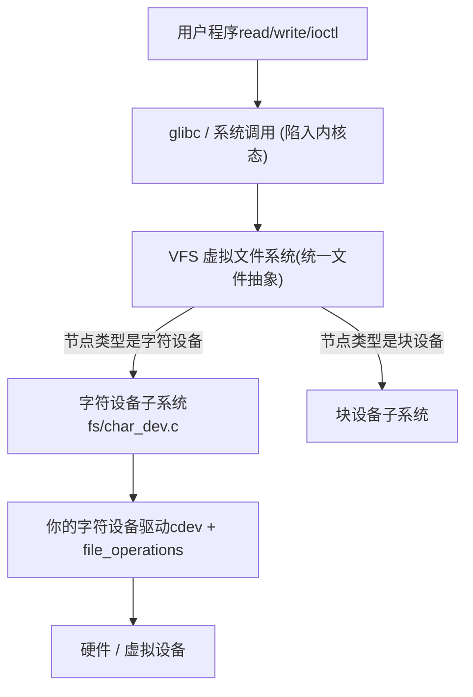
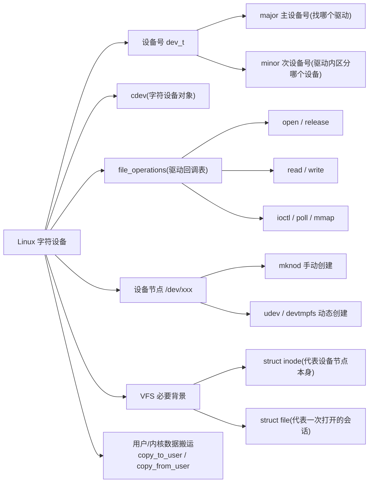
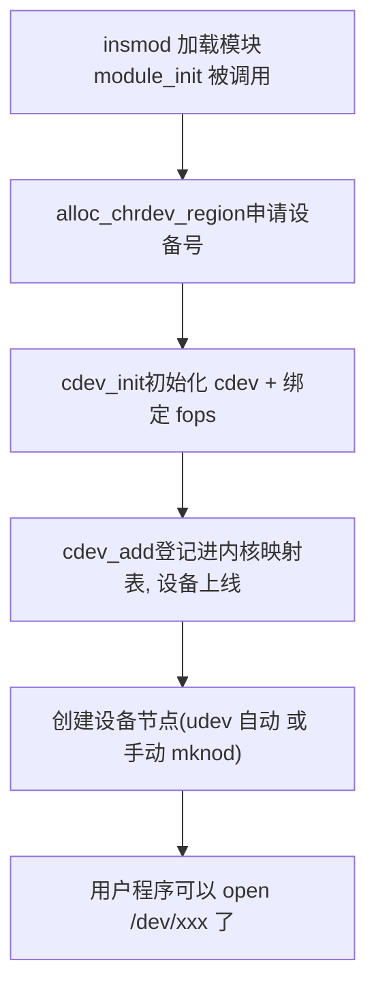
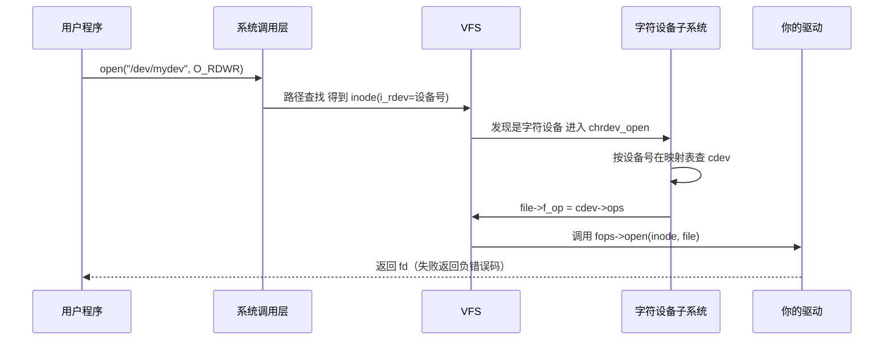

# Linux 字符设备（Character Device）

> 适用范围：主线 Linux（2.6 ~ 6.x）。核心机制（设备号、cdev、file_operations、VFS 调用链）自 2.6 起保持稳定；个别 API 签名存在版本差异，文中已标注。
> 阅读目标：10~20 分钟内建立"字符设备是什么、为什么存在、由什么组成、如何工作"的可靠整体认知。

---

## 1. 先建立整体认知

### 1.1 它是什么

**直觉理解**：Linux 说"一切皆文件"。字符设备就是把"像数据流一样访问的硬件"（串口、键盘、摄像头、传感器……）伪装成一个文件放在 `/dev` 目录下。你 `open()` 它、`read()` 它、`write()` 它，内核把这些文件操作转发给对应的驱动程序，驱动再操控真正的硬件。

**严格定义**：字符设备（Character Device）是 Linux 三类基础设备抽象之一，以**字节流**方式被访问，用户空间通过 `/dev` 下的设备节点（device node）以标准文件系统调用（open/read/write/ioctl/close）与之交互，内核 VFS 层把这些调用转接到驱动提供的 `file_operations` 回调函数上。

### 1.2 三类设备对比

| 设备类型 | 访问方式 | 典型例子 | 用户接口 |
| --------- | --------- | --------- | --------- |
| 字符设备（char） | 字节流、通常顺序访问 | 串口、终端、键盘、/dev/null | `/dev` 节点 + 文件操作 |
| 块设备（block） | 固定大小块、可随机访问，经过页缓存和 I/O 调度 | 硬盘、eMMC、U 盘 | `/dev` 节点 + 文件系统 |
| 网络设备（net） | 数据包（socket 语义） | 网卡 | socket 接口，无 `/dev` 节点 |

**类比及其边界**：把字符设备比作"一个只读/只写的管道"是安全的；但不要把它比作"磁盘上的小文件"——设备节点本身不存数据，它只是一个"指向驱动的入口编号"（见第 10 节误区）。

### 1.3 为什么存在

如果每块硬件都要求用户程序学习一套专属接口，应用生态就无法建立。Linux 的方案是：

1. **统一接口**：所有字符设备都暴露 open / read / write / ioctl / close 这套标准系统调用。应用作者只需要懂文件操作，就能操作摄像头、串口、传感器。
2. **隔离硬件细节**：驱动程序负责把标准调用翻译成对具体硬件寄存器/协议的操作，硬件换了，应用代码不变。
3. **权限与安全**：设备节点是文件，天然复用了文件系统的权限体系（owner / group / mode），普通用户能否访问某硬件由文件权限控制。

一句话：**字符设备 = "把硬件接入 VFS 文件操作体系"的标准插口。**

---

## 2. 在整个体系中的位置要点



- **VFS 是分流器**：用户打开 `/dev/xxx` 时，VFS 根据节点的类型和设备号判断"这该由字符设备子系统处理"，而不是根据目录位置。
- **字符设备子系统是登记处**：它维护一张"设备号 → cdev → file_operations"的映射表，负责把文件操作精确转发到正确的驱动。
- **驱动是真正的实现者**：你写驱动时，实际是在实现一组回调函数，然后把它们挂到这张表上。

---

## 3. 知识地图



下面逐一展开这些核心概念。

---

## 4. 核心概念

### 4.1 设备号（Device Number，dev_t）

- 中文名称：设备号；英文：device number；类型 `dev_t`（32 位整数）。
- 作用：**用户空间通过设备号找到驱动**。它是设备节点的核心属性，也是内核登记处的索引键。

```text
dev_t（自 Linux 2.6 起，共 32 位）
┌─────────────┬──────────────────────────┐
│ major（12位）│       minor（20位）       │
│  0 ~ 4095   │       0 ~ 1048575        │
└─────────────┴──────────────────────────┘
```

- **主设备号（major）**：标识"由哪个驱动处理"。major 相同的节点都交给同一个驱动。
- **次设备号（minor）**：内核不解释它，原样传给驱动，用于**同一驱动内部区分多个同类设备实例**（例如一个串口驱动管理 ttyS0、ttyS1……）。

内核态配套工具（`<linux/kdev_t.h>`）：`MAJOR(dev)`、`MINOR(dev)` 拆分；`MKDEV(major, minor)` 组合。
用户态查看：`ls -l /dev` 第一列是 `c`（char），倒数两列就是 major, minor：

```text
crw-rw-rw- 1 root root 1,   3 /dev/null      ← 字符设备, major=1, minor=3
crw-rw-rw- 1 root root 1,   5 /dev/zero
crw-rw-rw- 1 root tty  5,   0 /dev/tty
crw------- 1 root root 89,  0 /dev/i2c-0      ← i2c-dev 框架固定占用 major 89
```

**设备号从哪来？** 两种方式：

| API | 说明 |
| ----- | ------ |
| `alloc_chrdev_region(&dev, firstminor, count, name)` | **推荐**。向内核动态申请一段没被占用的设备号，避免冲突 |
| `register_chrdev_region(dev, count, name)` | 静态指定已知可用的设备号范围（如你在官方清单里有保留号） |
| `register_chrdev(major, name, fops)` | 旧式 API（2.4 时代主用），一次注册 0~255 全部 minor。2.6 起推荐改用 cdev 接口，但此函数至今仍存在 |

官方设备号分配清单由内核文档 `Documentation/admin-guide/devices.rst` 维护（major 1 是 mem 系，4 是 tty 系，10 是 misc 系，89 是 i2c-dev……）。驱动作者原则上应动态申请，而不是随便挑一个静态号。

### 4.2 设备节点（Device Node，/dev/xxx）

- 中文名称：设备节点；英文：device node / special file。
- 作用：**用户空间访问设备的"文件名入口"**。它把一个文件路径与设备号绑定：节点属性里存着 `类型(char) + major + minor`。

创建方式有两种：

1. **手动**：`mknod /dev/mydev c 234 0`（c=char 类型，234=major，0=minor）。适合学习实验。
2. **自动（工程现实）**：驱动把设备注册进内核设备模型并上报 uevent，用户空间的 **udev / devtmpfs** 守护进程监听后自动在 `/dev` 下创建/命名节点。所以真实系统上你几乎不用手动 mknod——但"节点是怎么出现的"这个机制必须理解。

**关键认知**：设备节点和注册是**两件独立的事**。节点只是一个"带编号的门牌"；如果内核登记处里没有对应编号的处理者，开门就会失败（见第 10 节误区 1）。

### 4.3 cdev（字符设备对象）

- 英文：`struct cdev`（character device），定义于 `<linux/cdev.h>`。
- 作用：**内核里代表"一个字符设备"的对象**，把 设备号范围 与 一张 `file_operations` 回调表 绑定在一起。

三个关键 API（`<linux/cdev.h>`）：

```c
void cdev_init(struct cdev *cdev, const struct file_operations *fops); // 初始化并绑定 fops
int  cdev_add(struct cdev *cdev, dev_t dev, unsigned count);           // 登记进内核映射表
void cdev_del(struct cdev *cdev);                                      // 注销
```

`cdev_add()` 执行后，"设备号 → cdev → fops"这条映射链就进了内核的字符设备映射表，设备立即"上线"——之后只要有人以该设备号打开节点，内核就能找到你的驱动。

### 4.4 file_operations（文件操作表，fops）

- 英文：`struct file_operations`，定义于 `<linux/fs.h>`，习惯简称 **fops**。
- 作用：**驱动暴露给 VFS 的回调函数表**。这是用户空间和你的驱动之间的全部接口，也是字符设备驱动的核心工作内容。

驱动最常用的成员：

| 成员 | 对应用户调用 | 解决什么问题 |
| ------ | ------------- | ------------- |
| `open` | `open()` | 设备上电/初始化、为本次打开准备私有数据 |
| `release` | `close()` | 清理、释放资源（注意叫 release 不叫 close） |
| `read` | `read()` | 从设备读数据到用户缓冲区 |
| `write` | `write()` | 把用户缓冲区数据写到设备 |
| `unlocked_ioctl` | `ioctl()` | 除读写外的控制命令（设置波特率、切换模式等） |
| `poll` | `poll()/select()/epoll` | 判断是否可读/可写，支持多路复用 |
| `mmap` | `mmap()` | 把设备内存映射到用户空间（大数据量场景） |
| `llseek` | `lseek()` | 调整读写位置（流设备通常不需要） |
| `owner` | — | 通常填 `THIS_MODULE`，防止驱动卸载时回调仍在被调用 |

没有实现的成员填 NULL（C99 指定初始化语法），用户调用对应操作会得到相应默认行为或 -EINVAL。

> 版本提示：老式 `ioctl` 成员因涉及大内核锁已被 `unlocked_ioctl` 取代（内核 2.6.36 前后完成迁移），读老教材时注意区分。

### 4.5 struct file 与 struct inode（VFS 必要背景）

理解这两个结构，才能看懂 fops 回调的参数。

| | struct inode | struct file |
| --- | --- | --- |
| 代表什么 | 设备节点本身（磁盘上/内存中的那个"文件"） | **一次打开**得到的会话 |
| 生命周期 | 节点存在就存在（内核会缓存） | 从 open 到 close |
| 驱动关心的成员 | `i_rdev`（设备号）、`i_cdev`（指向 cdev） | `f_op`（本次使用的回调表）、`private_data`（驱动私有数据）、`f_mode`（读写权限） |
| 一句话 | "这个设备是什么" | "这个进程这次打开它要干什么" |

**约定俗成的用法**：`open()` 时把设备私有数据存进 `file->private_data`，之后 `read/write/ioctl/release` 都从 `private_data` 取回来。多个进程（或同一进程多次）打开同一设备，内核各建一个 `struct file`，彼此独立。

### 4.6 用户空间与内核空间的数据搬运

驱动运行在内核态，**绝不能直接解引用用户空间传来的指针**（用户指针可能无效、被换出、指向不可读地址——内核态直接访问会崩溃内核）。必须用：

```c
#include <linux/uaccess.h>

copy_to_user(void __user *to, const void *from, unsigned long n);    // 内核 → 用户
copy_from_user(void *to, const void __user *from, unsigned long n);  // 用户 → 内核
```

返回值是**没有拷贝成功的字节数**（0 表示全部成功）——这是初学时最常记反的一点。这两个函数内部完成地址合法性检查并处理缺页，是用户/内核边界的标准通道。

---

## 5. 核心概念之间的关系

所有概念串起来就是一条映射链和一个调用链：

```text
【注册时建立的静态映射链】
设备号 dev_t (major,minor)
    → 登记 cdev (cdev_add)
        → 绑定 file_operations (cdev_init)
            → 你的 open/read/write/... 实现

【访问时建立的动态关系】
用户 open("/dev/xxx")
    → VFS 找到该路径的 struct inode（含设备号）
        → 按设备号查映射表，找到 cdev
            → 把 cdev->ops 挂到新建的 struct file->f_op 上
                → 调用 fops->open
                    → 之后 read/write/ioctl 全部沿 file->f_op 转发
```

- 设备号是**索引**，cdev 是**登记条目**，fops 是**能力清单**。
- inode 承载"哪个设备"，file 承载"哪次访问"。
- 设备节点是用户空间可见的"门牌"，指向设备号。

```mermaid
classDiagram
    class 设备节点 "/dev/xxx" {
        类型 = char
        major = 234
        minor = 0
    }
    class inode {
        i_rdev 设备号
        i_cdev → cdev
    }
    class cdev {
        ops → file_operations
    }
    class file_operations {
        open()
        read()
        write()
        unlocked_ioctl()
        release()
    }
    class file "struct file (每次打开)" {
        f_op → file_operations
        private_data
    }
    设备节点 --> inode : VFS 解析路径时对应
    inode --> cdev : i_cdev
    cdev --> file_operations : ops
    file --> file_operations : f_op (open 时从 cdev 拷来)
```

---

## 6. 工作原理

### 6.1 驱动注册流程（模块加载时）



注意顺序：**先有设备号，再登记 cdev，节点最后创建**。缺少 cdev_add 时即使建了节点也无法打开（映射表里查无此号）。

### 6.2 一次 open 的完整调用链



之后的 `read(fd,...)` / `write(fd,...)` / `ioctl(fd,...)`：系统调用带 fd → 找到 struct file → 直接调用 `file->f_op->read/write/...`（不再查表）。`close(fd)` 则调用 `fops->release` 并销毁这个 struct file。

### 6.3 read 的数据流

```text
用户缓冲区 buf（用户空间内存）
        ↑ copy_to_user
驱动 read(): 从硬件/内部缓冲取数据 → 拷贝到用户 buf → 返回实际拷贝的字节数
```

驱动负责"数据从设备到用户缓冲区"的搬运，且跨用户/内核边界时必须用 copy_to_user。

### 6.4 卸载流程（与注册严格逆序）

```text
rmmod → module_exit
  → 删除设备节点（自动创建的会随注销消失）
  → cdev_del()          从映射表移除
  → unregister_chrdev_region()  归还设备号
```

---

## 7. 示例代码

一个最小但完整的字符设备驱动 + 用户测试程序。代码分块解释，对应上文各概念。

### 7.1 驱动骨架（内核空间）

```c
// chr_demo.c —— 最小字符设备驱动
#include <linux/module.h>
#include <linux/fs.h>       // alloc_chrdev_region, file_operations
#include <linux/cdev.h>     // cdev_init / cdev_add
#include <linux/uaccess.h>  // copy_to_user

static dev_t devno;              // 4.1 设备号: major + minor
static struct cdev my_cdev;      // 4.3 字符设备对象
static char kbuf[64] = "hello from kernel\n";

// fops 回调之一: 对应用户 read()
static ssize_t my_read(struct file *file, char __user *buf,
                       size_t len, loff_t *off)
{
    return simple_read_from_buffer(buf, len, off, kbuf, sizeof(kbuf));
    // 等价于: 校验偏移后 copy_to_user(buf, kbuf, n) 并返回拷贝字节数
}

// fops 回调之一: 对应用户 open()
static int my_open(struct inode *inode, struct file *file)
{
    pr_info("chr_demo: opened\n");
    return 0;
}

// fops 回调之一: 对应用户 close()
static int my_release(struct inode *inode, struct file *file)
{
    pr_info("chr_demo: released\n");
    return 0;
}

// 4.4 回调表: 用户空间能对这个设备做什么, 全在这里声明
static const struct file_operations my_fops = {
    .owner   = THIS_MODULE,
    .open    = my_open,
    .read    = my_read,
    .release = my_release,
};

// 模块加载: 对应 6.1 注册流程
static int __init chr_demo_init(void)
{
    int ret;

    ret = alloc_chrdev_region(&devno, 0, 1, "chr_demo");   // 1) 申请设备号
    if (ret < 0)
        return ret;
    pr_info("chr_demo: major=%d minor=%d\n",
            MAJOR(devno), MINOR(devno));

    cdev_init(&my_cdev, &my_fops);                          // 2) cdev 绑定 fops
    my_cdev.owner = THIS_MODULE;
    ret = cdev_add(&my_cdev, devno, 1);                     // 3) 登记, 设备上线
    if (ret < 0) {
        unregister_chrdev_region(devno, 1);
        return ret;
    }

    pr_info("chr_demo: 手动测试请 mknod /dev/chr_demo c %d 0\n",
            MAJOR(devno));
    return 0;
}

// 模块卸载: 与注册严格逆序
static void __exit chr_demo_exit(void)
{
    cdev_del(&my_cdev);
    unregister_chrdev_region(devno, 1);
    pr_info("chr_demo: removed\n");
}

module_init(chr_demo_init);
module_exit(chr_demo_exit);
MODULE_LICENSE("GPL");
```

**逐块说明**：

| 代码 | 在知识地图的位置 | 为什么需要 | 执行后发生什么 |
| ------ | ---------------- | ----------- | -------------- |
| `alloc_chrdev_region(&devno, 0, 1, "chr_demo")` | 4.1 设备号 | 内核登记处按设备号索引，必须先占号 | 得到动态分配的 major，输出到 dmesg |
| `struct file_operations my_fops` | 4.4 fops | 这是驱动对用户空间暴露的全部能力 | 之后 VFS 转发操作时按此表调用 |
| `cdev_init(&my_cdev, &my_fops)` + `cdev_add(...)` | 4.3 cdev | 建立"设备号 → cdev → fops"映射链 | 设备立即可被打开（前提是有节点） |
| `my_open / my_read / my_release` | 6.2 调用链 | 实现用户调用的落点 | 用户 open/read/close 时被 VFS 依次调用 |
| `cdev_del` + `unregister_chrdev_region` | 6.4 | 逆序清理，防止悬空映射 | 模块安全卸载 |

> 简化说明：示例省略了自动创建节点（class_create/device_create，版本间签名有差异，如 6.4 内核起 class_create 去掉了模块参数），学习阶段用 `mknod` 手动建节点即可；工程中交由 udev 自动完成。

### 7.2 用户空间测试程序

```c
// test.c —— 像操作普通文件一样操作设备
#include <stdio.h>
#include <fcntl.h>
#include <unistd.h>

int main(void)
{
    char buf[64];
    int fd = open("/dev/chr_demo", O_RDWR);   // → fops->open
    if (fd < 0) { perror("open"); return 1; }

    int n = read(fd, buf, sizeof(buf) - 1);   // → fops->read → copy_to_user
    if (n >= 0) { buf[n] = '\0'; printf("got: %s", buf); }

    close(fd);                                 // → fops->release
    return 0;
}
```

**实验步骤**：

```bash
make                      # 编译模块
sudo insmod chr_demo.ko   # 加载, dmesg 查看 major
sudo mknod /dev/chr_demo c <dmesg里的major> 0
sudo chmod 666 /dev/chr_demo
gcc test.c -o test && ./test
sudo rmmod chr_demo
```

这个实验能亲眼看清一条完整因果链：**申请设备号 → 登记 cdev → 建节点 → open 命中映射表 → read 触发回调**。中间任何一环缺失，失败模式都不同（见第 10 节）。

---

## 8. 实际应用

你每天在用的字符设备：

| 设备节点 | major, minor | 用途 |
| --------- | ------------- | ------ |
| `/dev/null` | 1, 3 | 丢弃一切写入 |
| `/dev/zero` | 1, 5 | 读出无限 0 |
| `/dev/random` | 1, 8 | 随机数源 |
| `/dev/tty`、`/dev/ttyS0` | 5, 0；4, 64 | 终端、串口 |
| `/dev/i2c-N` | 89, N | 用户态直访 I2C 总线（i2c-dev 框架） |
| `/dev/gpiochipN` | 254+, N | 用户态 GPIO（GPIO 字符框架，替代老式 /sys GPIO） |
| `/dev/vfio/vfio` | — | 用户态驱动框架（虚拟化/DPDK 场景） |

典型工程路径：

```text
用户程序
   ↓ open/read/write/ioctl
/dev/xxx（字符设备节点）
   ↓ VFS + chrdev 子系统
字符设备驱动（你写的 cdev + fops）
   ↓ 寄存器 / 总线协议
硬件（传感器、串口、摄像头接口……）
```

嵌入式开发中大量外设驱动（按键、LED、ADC、RTC、SPI/I2C 设备）都以字符设备形式暴露给应用层——这就是为什么它是驱动开发的第一课。

---

## 9. 常见误区

**误区 1：建了设备节点就能打开设备。**

- 为什么容易这样想：节点明明就在 `/dev` 下，文件操作当然能成功。
- 正确理解：节点只是"门牌"，内核还要能在映射表里按设备号找到 cdev。只申请了设备号（甚至号都没申请）就 mknod，`cat` 会得到 `No such device`（ENODEV）之类错误。**注册（cdev_add）和创建节点是两件独立的事，缺一不可。**

**误区 2：major 和 minor 都是内核用来找驱动的。**

- 正确理解：**只有 major 参与查找驱动**；minor 内核不解释，原样交给驱动自行区分设备实例。同一个驱动（同 major）可以服务多台设备（不同 minor）。

**误区 3：驱动里可以直接使用用户空间传来的指针。**

- 为什么危险：用户指针可能无效或已被换出内存，内核态直接解引用可能导致内核崩溃。
- 正确理解：跨用户/内核边界必须走 `copy_to_user` / `copy_from_user`，它们做合法性检查并安全处理缺页。

**误区 4：`/dev` 下的文件和普通文件一样，数据存在磁盘上。**

- 正确理解：设备节点里存的不是数据，而是 `类型 + major + minor` 三个属性。read 它不会读到"节点文件的内容"，而是触发驱动的 read 回调。这也是为什么删除节点不影响硬件，重建节点即可恢复访问。

---

## 10. 相关知识（扩展索引，本文不展开）

- **misc 设备框架**：对"就一个简单字符设备"的场景，misc 框架（固定 major=10，自动分配 minor 并自动建节点）封装了 cdev 样板代码，入门后值得了解。
- **udev / devtmpfs**：用户空间设备管理器，监听内核 uevent 自动创建 `/dev` 节点，是现代系统节点的真正来源。
- **sysfs / kobject / 设备模型**：cdev 之下还有 kobject 体系支撑 `/sys` 与 uevent，属于字符设备的底层实现，初学不必深入。
- **poll / mmap / 异步通知**：让字符设备支持多路复用、内存映射、信号通知的进阶 fops 能力。
- **ioctl 命令编码**：`_IO/_IOW/_IOR/_IOWR` 宏如何编码命令字，写正式驱动时需要。
- **块设备 / platform 总线 / PCI / DMA**：其他设备类型与总线框架，属后续学习主题。

---

## 11. 知识脉络（一页因果链）

```text
硬件五花八门, 用户程序不能直接碰硬件
    ↓ 需要统一、安全、带权限管理的访问入口
Linux 选择"一切皆文件": 把硬件伪装成 /dev 下的节点
    ↓ 节点必须能定位到正确的处理者
用 设备号(major/minor) 作为节点的核心属性
    ↓ 内核需要一张 "设备号 → 处理者" 的登记表
驱动创建 cdev, 绑定 file_operations, cdev_add 登记
    ↓ 用户 open("/dev/xxx") 时
VFS 从节点拿到设备号 → 查表找到 cdev → 把 fops 挂到 struct file
    ↓ 之后每次 read/write/ioctl/close
沿 file->f_op 调用驱动回调, 数据经 copy_to_user/copy_from_user 跨界搬运
    ↓ 最终效果
应用只用懂文件操作, 就能操作任何字符设备; 驱动只实现回调, 就能接入整个生态
```

---

## 12. 正式学习时重点关注

带着这些问题进入教材（如 LDD3 第 3 章 scull 或最新内核文档），理解效率最高：

1. 为什么需要 major / minor 两个号？内核用哪个、驱动用哪个？
2. `alloc_chrdev_region` 和 `register_chrdev_region`、以及旧 API `register_chrdev` 的区别与取舍？
3. cdev 和设备节点是什么关系？为什么二者缺一不可？
4. file_operations 如何连接用户空间和驱动？每个回调的参数（file/inode/buf/off）分别是什么？
5. open("/dev/xxx") 从系统调用到驱动的完整路径是什么？（chrdev_open 做了什么）
6. read/write 回调里为什么必须 copy_to_user / copy_from_user？返回值各代表什么？
7. private_data 的惯用法：如何用它在 open 和其他回调之间传递设备私有数据？
8. 驱动注册和设备节点创建如何配合（udev 自动创建）？卸载时为什么要严格逆序清理？
9. ioctl 如何设计命令字？poll 和 mmap 分别在什么场景需要？

---

## 13. 参考资料

1. [Linux Kernel Documentation — Linux allocated devices (设备号官方分配清单)](https://docs.kernel.org/admin-guide/devices.html)
2. Jonathan Corbet, Alessandro Rubini, Greg Kroah-Hartman, *Linux Device Drivers, 3rd Edition*, Chapter 3 "Char Drivers"（免费在线：[lwn.net/Kernel/LDD3](https://lwn.net/Kernel/LDD3/)）—— 经典 scull 实例
3. [The Linux Kernel Module Programming Guide (维护中的现代版)](https://sysprog21.github.io/lkmpg/) — Character Device Drivers 一章
4. 内核源码：`fs/char_dev.c`（chrdev_open 与映射表实现）、`include/linux/cdev.h`、`include/linux/fs.h`（file_operations 定义）
5. [Kernel Docs — Implementing I2C device drivers in userspace](https://docs.kernel.org/i2c/dev-interface.html)（真实字符设备 /dev/i2c-N 的用户态使用实例）
