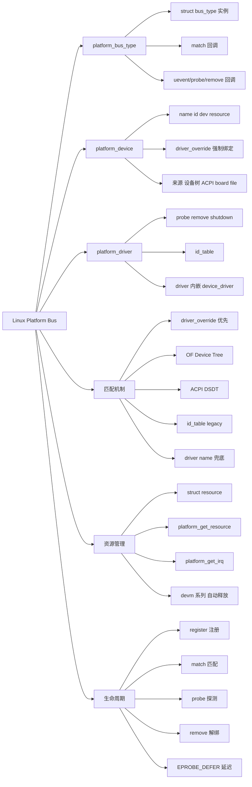
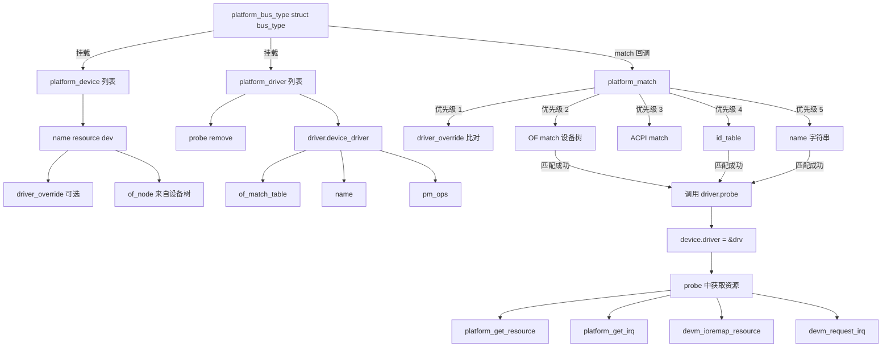
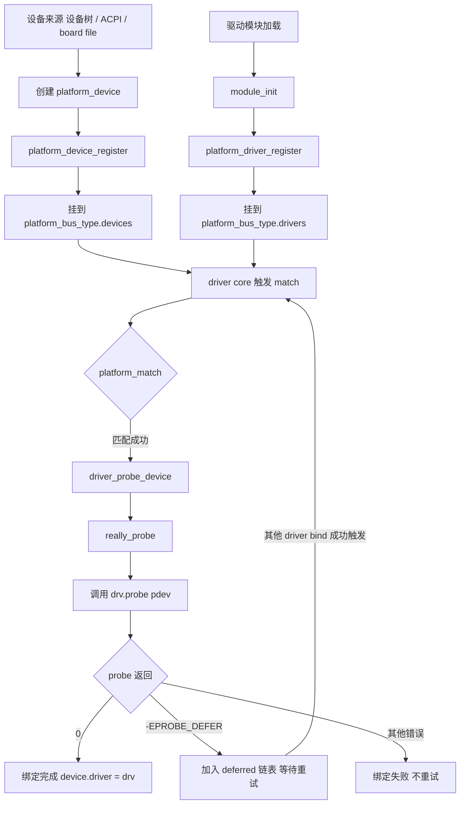

# Linux 平台总线（Platform Bus）

> 适用范围：Linux 2.6 起（device model 引入），3.x 起配合 Device Tree 成为主流，6.x 仍然如此。核心数据结构（platform_device / platform_driver / platform_bus_type）和 probe/remove 生命周期保持稳定；个别 API（如 devm_ 系列、fw_devlink、async probe）随版本演进。
> 前置关联：建议先了解 Linux 驱动模块（module_init / module_exit）、字符设备（cdev / file_operations）和设备树（compatible / reg / 节点）。平台总线不是一种硬件总线，而是 Linux 设备模型为"无法被自动枚举的 SoC 内部外设"提供的虚拟总线。
> 阅读目标：10~20 分钟内建立"平台总线是什么、为什么存在、由什么组成、device 与 driver 如何匹配、probe/remove 如何工作"的可靠整体认知。

---

## 1. 先建立整体认知

### 1.1 它是什么

**直觉理解**：在一块 ARM SoC 上有 UART、I2C、SPI、GPIO、Timer、Watchdog 等控制器，它们直接焊在芯片内部、地址固定、永远存在，但**没有像 PCI/USB 那样的枚举协议**——内核无法"问"它们"你是谁、你在哪里"。Linux 的做法是：搞一条**纯软件虚拟出来的总线**，叫 platform bus。把"硬件在哪里、长什么样"写成 platform_device 注册进去，把"怎么操作这个硬件"写成 platform_driver 也注册进去，总线根据 name 或 compatible 字符串把两者匹配起来，匹配成功就调用驱动的 `probe()`。

**严格定义**：Platform bus 是 Linux 设备模型（driver model）中的一个 `struct bus_type` 实例，名为 `platform_bus_type`，定义于 `drivers/base/platform.c`。它是一条**伪总线（pseudo-bus）**，用于连接那些"直接挂在 CPU 总线上、可被 CPU 直接寻址、但没有标准枚举协议"的设备。它提供与 PCI/USB 等真总线一致的"device + driver + match + probe"框架，让 SoC 内部外设也能享受设备模型的统一管理（sysfs、电源管理、模块化、热插拔语义等）。

### 1.2 为什么存在

**对比真总线**：

| 总线 | 是否可枚举 | 设备来源 | 例子 |
| --- | --- | --- | --- |
| PCI / PCIe | 是 | 启动时 BIOS/RC 扫描配置空间 | 网卡、显卡 |
| USB | 是 | host controller 探测 | U 盘、鼠标 |
| I2C / SPI | 否（需提前知道从设备地址） | 板级描述 | EEPROM、传感器 |
| **Platform** | **否** | **C 代码 / Device Tree / ACPI** | **SoC 上的 UART、GPIO、Timer** |

PCI/USB 设备驱动只要写"如何操作"，设备会自动出现在总线上。而 SoC 内部外设：

1. **没有枚举协议**：CPU 不能扫描寄存器问"你是谁"。
2. **地址、中断、时钟是固定的板级信息**：每块板子不同。
3. **硬件不能告诉内核自己的存在**：内核必须从外部"被告知"。

**Platform bus 的解法**：把"硬件描述"和"驱动逻辑"彻底分离，再用一条虚拟总线做匹配中介。

```text
没有 platform bus:               有 platform bus:
驱动里写死地址 (耦合)             设备 (描述硬件)
    |                                |
    v                                v
编译进内核, 换板子改源码           驱动 (操作硬件)
                                     |
                                     v
                                 虚拟总线匹配 -> probe
```

一句话：**platform bus = 让"不可枚举的 SoC 外设"也能套用统一 driver model 的中间层。**

### 1.3 在整个体系中的位置

```text
应用层  open/read/ioctl
    |
    v
VFS / 字符设备子系统
    |
    v
具体驱动 (cdev + file_operations)
    ^
    | probe 时注册
    |
platform_driver  <--- 匹配 --->  platform_device
    |                                |
    +-------- platform_bus -----------+
                     |
                     v
        设备模型 (driver model, kobject, sysfs)
                     |
                     v
        设备树 / ACPI / board file (硬件描述来源)
```

- platform bus **不属于** VFS 也不属于字符设备子系统——它只负责"把 device 和 driver 拉郎配"，probe 触发后驱动自己决定要不要去注册 cdev。
- platform bus **不操作硬件**：硬件操作仍由驱动自己写。它只提供"绑定时机"和"统一资源管理接口"。

---

## 2. 在整个体系中的位置

| 组件 | 职责 | 与 platform bus 的关系 |
| --- | --- | --- |
| `struct bus_type platform_bus_type` | 虚拟总线实例 | 提供 match / uevent / probe / remove 回调 |
| `platform_device` | 描述硬件（地址、IRQ、名称） | 注册到 platform bus 等待匹配 |
| `platform_driver` | 操作硬件（probe / remove） | 注册到 platform bus 等待匹配 |
| Device Tree (.dts/.dtb) | 板级硬件描述 | 内核解析后自动创建 platform_device |
| ACPI DSDT (x86) | 板级硬件描述 | 解析后创建 platform_device |
| board file (legacy) | C 代码硬编码设备 | 直接 `platform_device_register` |
| driver model 核心 | kobject / sysfs / 电源管理 | platform bus 复用其基础设施 |
| 字符设备 / misc / net 等 | driver 暴露给用户的接口 | 在 probe 中注册到对应子系统 |

---

## 3. 知识地图



---

## 4. 核心概念

### 4.1 platform_bus_type（虚拟总线）

- 英文名称：platform bus；类型 `struct bus_type`；实例名 `platform_bus_type`。
- 一句话解释：Linux 设备模型中为"不可枚举设备"专门创建的一条虚拟总线，名字是 "platform"。
- 在当前知识中的作用：所有 platform_device 和 platform_driver 都挂在这条总线上，由它的 `match` 方法决定谁和谁配对。

`bus_type` 关键字段（`include/linux/device/bus.h`）：

```c
struct bus_type {
    const char      *name;            /* "platform" */
    int (*match)(struct device *dev, struct device_driver *drv);
    int (*uevent)(struct device *dev, struct kobj_uevent_env *env);
    int (*probe)(struct device *dev);
    int (*remove)(struct device *dev);
    void (*shutdown)(struct device *dev);
    const struct dev_pm_ops *pm;
    ...
};
```

`match` 是总线最核心的回调：每当有新 device 或新 driver 注册到总线时，driver core 会调用 `bus->match()` 尝试配对，匹配成功后再调用 `bus->probe()`（最终走到驱动自己的 `probe`）。

> 版本提示：`platform_bus_type` 自 2.6 起存在至今；现代内核（5.x+）引入 fw_devlink、async probe 等增强，但 `match` / `probe` / `remove` 三件套语义未变。

### 4.2 platform_device（平台设备）

- 英文名称：platform device；类型 `struct platform_device`；头文件 `<linux/platform_device.h>`。
- 一句话解释：描述一个"无法被自动枚举的设备"的内核对象，携带名称和硬件资源（地址、IRQ、DMA 等）。
- 在当前知识中的作用：它是"硬件在那里"的软件化身，注册到 platform bus 后等待 driver 来匹配。

```c
struct platform_device {
    const char      *name;          /* 用于 name 匹配 */
    int             id;             /* 实例编号, -1 表示只有一个 */
    struct device   dev;            /* 内嵌通用 device (继承) */
    u32             num_resources;
    struct resource *resource;       /* 资源数组 */
    const struct platform_device_id *id_entry;
    char            *driver_override;/* 强制绑定到指定 driver */
    ...
};
```

关键点：

- `name` + `id`：构成设备在 sysfs 中的名字（如 `uart.0`）。`id = -1` 表示单实例，名字就是 `uart`。
- `dev`：内嵌 `struct device`，是 driver model 的"通用设备"——platform_device 通过这个内嵌成员"继承"通用设备属性（kobject、parent、bus、driver、pm、of_node 等）。
- `resource`：硬件资源数组（地址段、IRQ），驱动 probe 时通过 `platform_get_resource()` 取出。
- `driver_override`：用户空间可写此字段强制指定一个驱动名，跳过常规匹配。

### 4.3 platform_driver（平台驱动）

- 英文名称：platform driver；类型 `struct platform_driver`；头文件 `<linux/platform_device.h>`。
- 一句话解释：操作 platform_device 的驱动结构，提供 probe/remove 等回调。
- 在当前知识中的作用：包含"如何初始化设备、如何释放、如何挂起恢复"的实现，是开发者的主战场。

```c
struct platform_driver {
    int  (*probe)(struct platform_device *);
    void (*remove)(struct platform_device *);
    void (*shutdown)(struct platform_device *);
    int  (*suspend)(struct platform_device *, pm_message_t state);
    int  (*resume)(struct platform_device *);
    struct device_driver driver;     /* 内嵌通用 driver */
    const struct platform_device_id *id_table; /* legacy name 匹配表 */
    bool prevent_deferred_probe;
    bool driver_managed_dma;
};
```

关键点：

- 内嵌的 `driver`（`struct device_driver`）才是真正被注册到 bus 的对象；其中 `driver.of_match_table`、`driver.name`、`driver.pm` 都是常用字段。
- `id_table`：旧式 name 匹配表（board file 时代用得多）。
- `prevent_deferred_probe`：禁止该 driver 参与 deferred probe（一般不设）。

### 4.4 struct resource（硬件资源）

- 英文名称：resource；头文件 `<linux/ioport.h>`。
- 一句话解释：描述一段硬件资源（内存区、IRQ、DMA 通道、IO 端口等）的结构。
- 在当前知识中的作用：platform_device 携带的"硬件位置清单"，probe 时被驱动取出做 ioremap / request_irq 等。

```c
struct resource {
    resource_size_t start;     /* 起始地址 / IRQ 号 */
    resource_size_t end;       /* 结束地址 / IRQ 号 */
    const char      *name;
    unsigned long   flags;     /* 资源类型标志 */
    unsigned long   desc;
    struct resource *parent, *sibling, *child; /* 资源树 */
};
```

常见 flags：

| 标志 | 含义 |
| --- | --- |
| `IORESOURCE_MEM` | 内存映射区（MMIO） |
| `IORESOURCE_IRQ` | 中断号 |
| `IORESOURCE_IO` | IO 端口（x86） |
| `IORESOURCE_DMA` | DMA 通道 |
| `IORESOURCE_REG` | 寄存器偏移 |
| `IORESOURCE_BUS` | 总线号 |

资源通过 `platform_get_resource(pdev, IORESOURCE_MEM, 0)` 按类型+索引取出；中断用 `platform_get_irq(pdev, 0)`。

### 4.5 匹配表：of_match_table 与 id_table

#### of_match_table（Device Tree 匹配）

- 类型 `const struct of_device_id []`；头文件 `<linux/mod_devicetable.h>`。
- 一句话解释：驱动声明的"我能处理哪些 compatible 字符串"列表，内核拿它和设备树节点的 `compatible` 属性逐项比对。
- 在当前知识中的作用：现代嵌入式 Linux 最常用的匹配方式。

```c
static const struct of_device_id my_uart_of_match[] = {
    { .compatible = "vendor,my-uart", .data = &my_uart_drvdata_v1 },
    { .compatible = "vendor,my-uart-v2", .data = &my_uart_drvdata_v2 },
    { /* sentinel, 必须以空项结尾 */ }
};
MODULE_DEVICE_TABLE(of, my_uart_of_match);  /* 模块加载时暴露给用户空间 */
```

`compatible` 格式为 `"厂商,型号"`，与设备树节点的 `compatible` 属性完全一致。`.data` 字段可挂驱动的私有数据，probe 中用 `of_device_get_match_data()` 取出。

#### id_table（legacy name 匹配）

- 类型 `const struct platform_device_id []`。
- 一句话解释：旧式"name 字符串 + driver_data"匹配表，设备树出现前的主流匹配方式。
- 在当前知识中的作用：维护老代码或非 DT 平台时还会遇到。

```c
static const struct platform_device_id my_uart_ids[] = {
    { "my-uart",   (kernel_ulong_t)&my_uart_drvdata_v1 },
    { "my-uart-v2",(kernel_ulong_t)&my_uart_drvdata_v2 },
    { /* sentinel */ }
};
MODULE_DEVICE_TABLE(platform, my_uart_ids);
```

### 4.6 driver_override（强制绑定）

- 字段位置：`platform_device.driver_override`。
- 一句话解释：用户空间可通过 sysfs 写此字段，强制设备只绑定到指定名字的 driver。
- 在当前知识中的作用：调试或特殊需求时绕过常规匹配规则。

```bash
echo "my_special_driver" > /sys/bus/platform/devices/uart.0/driver_override
```

设置后，`platform_match` 会优先检查 `driver_override` 是否等于候选 driver 的 `name`，相等才返回匹配；不等则拒绝。这避免了"被最先注册的 driver 抢走"的问题。

### 4.7 devm_* 系列（Devres，管理型资源）

- 英文名称：devres (device-managed resource)；自 Linux 2.6.21 由 Tejun Heo 引入。
- 一句话解释：把资源（内存、ioremap、IRQ、clk、regulator 等）的"申请"和"释放"绑定到 device 生命周期，probe 失败或 remove 时自动逆序释放。
- 在当前知识中的作用：消除驱动中"goto err 解释放"样板代码，是现代 platform driver 的标准写法。

常见 devm_ 接口：

| devm_ 接口 | 替代的老接口 | 释放时机 |
| --- | --- | --- |
| `devm_kzalloc` | `kzalloc` + `kfree` | device detach |
| `devm_ioremap_resource` | `request_mem_region` + `ioremap` | device detach |
| `devm_request_irq` | `request_irq` + `free_irq` | device detach |
| `devm_clk_get` | `clk_get` + `clk_put` | device detach |
| `devm_gpiod_get` | `gpiod_get` + `gpiod_put` | device detach |
| `devm_regulator_get` | `regulator_get` + `regulator_put` | device detach |

原理：每个 `struct device` 内部有一条 devres 链表，devm_ 函数申请资源时同时挂到链表上；probe 失败返回非 0，或 remove 完成后，driver core 自动遍历链表逆序释放。

---

## 5. 核心概念之间的关系



核心关系：

1. **bus 持有两个链表**：devices 链表和 drivers 链表。注册 device 或 driver 时都会触发 match。
2. **device 是"硬件的化身"，driver 是"操作的化身"**：两者通过 bus 间接联系，互不直接持有。
3. **match 是策略点**：bus 的 `match` 决定配对规则；platform_bus_type 用的是 `platform_match`，支持多种匹配方式按优先级串联。
4. **probe 是动作点**：match 成功后由 driver core 调用 `driver.probe()`，让驱动"接管设备"。
5. **devm_ 是资源绑定**：资源申请挂在 device 上，device 离开 driver 时自动释放——不必在 remove 里手动 free。

---

## 6. 工作原理

### 6.1 注册与匹配总流程



### 6.2 platform_match 匹配优先级

`drivers/base/platform.c` 中的 `platform_match` 按如下顺序尝试，先匹配者胜出：

```c
static int platform_match(struct device *dev, struct device_driver *drv)
{
    struct platform_device *pdev = to_platform_device(dev);
    struct platform_driver *pdrv = to_platform_driver(drv);

    /* 1. driver_override 强制绑定 */
    if (pdev->driver_override)
        return !strcmp(pdev->driver_override, drv->name);

    /* 2. Device Tree: of_match_table vs pdev->dev.of_node */
    if (of_driver_match_device(dev, drv))
        return 1;

    /* 3. ACPI: acpi_match_table */
    if (acpi_driver_match_device(dev, drv))
        return 1;

    /* 4. legacy id_table */
    if (pdrv->id_table)
        return platform_match_id(pdrv->id_table, pdev) != NULL;

    /* 5. driver name 兜底 */
    return strcmp(pdev->name, drv->driver.name) == 0;
}
```

要点：

- **优先级 1 (driver_override)**：用户强制指定，跳过其他所有规则。
- **优先级 2 (OF/Device Tree)**：嵌入式最常用，`of_match_table` 中的 `compatible` 与设备树节点的 `compatible` 比对。
- **优先级 3 (ACPI)**：x86 / 现代 arm64 服务器用 ACPI DSDT 描述硬件。
- **优先级 4 (id_table)**：旧式 name 字符串表，老代码 / 非 DT 平台用。
- **优先级 5 (name)**：最朴素——device.name 和 driver.driver.name 字符串相等即匹配。

> 注意：匹配顺序意味着同时配置了 DT 和 id_table 时，DT 优先。一个驱动可同时支持多种匹配方式以兼容老平台。

### 6.3 probe 调用链

```text
platform_driver_register()
    -> driver_register()
        -> bus_add_driver()
            -> driver_attach()       // 遍历 bus 上所有 device 试图匹配
                -> __driver_attach()
                    -> driver_match_device()  // 调用 bus->match
                    -> driver_probe_device()  // 匹配成功后
                        -> really_probe()
                            -> dev->bus->probe(dev)   // platform_bus 的 probe
                                -> platform_drv_probe()
                                    -> pdrv->probe(pdev)  // 你写的 probe
```

反向调用（device 先注册、driver 后到）也类似：device_register 会触发 bus 重新扫描 drivers 链表为新 device 找匹配。

### 6.4 资源获取标准模板

probe 中典型步骤：

```c
static int my_probe(struct platform_device *pdev)
{
    struct resource *res;
    void __iomem *base;
    int irq;
    int ret;

    /* 1. 获取内存资源并 ioremap (devm 版一步到位) */
    res = platform_get_resource(pdev, IORESOURCE_MEM, 0);
    base = devm_ioremap_resource(&pdev->dev, res);
    if (IS_ERR(base))
        return PTR_ERR(base);

    /* 2. 获取 IRQ 并注册中断 */
    irq = platform_get_irq(pdev, 0);
    if (irq < 0)
        return irq;

    ret = devm_request_irq(&pdev->dev, irq, my_isr, 0,
                           dev_name(&pdev->dev), pdev);
    if (ret)
        return ret;

    /* 3. 读设备树属性 */
    u32 clk_rate;
    of_property_read_u32(pdev->dev.of_node, "clock-frequency", &clk_rate);

    /* 4. 注册到子系统 (字符设备 / misc / net ...) */
    ...
    return 0;
}
```

`platform_get_resource(pdev, type, index)`：从 pdev->resource 数组中按类型和索引取出第 index 个资源。设备树路径下，内核会自动把节点的 `reg` / `interrupts` 翻译成 resource 数组挂到 platform_device 上。

### 6.5 Deferred Probe（延迟探测）

- 触发条件：probe 中需要的资源（clk、regulator、gpio、另一个设备的 driver）尚未就绪，返回 `-EPROBE_DEFER`。
- 实现：`drivers/base/dd.c` 把该 device 加入 `deferred_probe_pending` 链表。
- 重试时机：每当任意 driver bind 成功（`driver_bound()` 被调用），会触发 workqueue 把 pending 链表搬到 active 链表重新跑一遍 `bus_probe_device()`。
- 终止：链表收敛（没有新 driver bind 或所有 deferred 设备都已 probe 成功）后停止。
- 调试：

```bash
cat /sys/kernel/debug/devices_deferred      # 列出尚未 probe 的设备和原因
echo "file dd.c +p" > /sys/kernel/debug/dynamic_debug/control
```

现代内核还有 **fw_devlink**：在 probe 之前就根据设备树的 `clocks`/`regulators`/`pinctrl-0` 等引用建立 supplier-consumer 链，没就绪的 supplier 直接让 consumer 不进入 probe，避免无谓的失败重试。

### 6.6 remove 与生命周期

```text
device 注册 -> match -> probe(成功) -> 设备工作
                                      |
                                      v
        remove <- driver_unregister <- 模块卸载 / 设备移除
            |
            v
        devres_release_all    // 逆序释放所有 devm_ 资源
            |
            v
        device.driver = NULL   // 解绑
```

- `remove` 中**只做 devm 管不到的事**：注销 cdev、注销 misc、 unregister to subsystem 等。devm 申请的资源不需要手动释放。
- 如果 probe 注册了非 devm 资源（如 `cdev_add`、`input_register_device`、`platform_device_register_data` 等没有 devm 版本的），必须在 remove 显式注销。
- probe 失败时，devm 链表也会自动回滚——这是 devm_ 最重要的工程价值。

---

## 7. 示例代码

### 7.1 最小 platform_driver（DT 匹配）

```c
#include <linux/module.h>
#include <linux/platform_device.h>
#include <linux/of_device.h>
#include <linux/io.h>

static const struct of_device_id my_drv_of_match[] = {
    { .compatible = "vendor,my-ip" },
    { /* sentinel */ }
};
MODULE_DEVICE_TABLE(of, my_drv_of_match);

static int my_probe(struct platform_device *pdev)
{
    struct resource *res;
    void __iomem *base;

    res = platform_get_resource(pdev, IORESOURCE_MEM, 0);
    base = devm_ioremap_resource(&pdev->dev, res);
    if (IS_ERR(base))
        return PTR_ERR(base);

    dev_info(&pdev->dev, "probed, base=%p\n", base);
    return 0;
}

static int my_remove(struct platform_device *pdev)
{
    dev_info(&pdev->dev, "removed\n");
    return 0;
}

static struct platform_driver my_driver = {
    .probe  = my_probe,
    .remove = my_remove,
    .driver = {
        .name = "my-ip",
        .of_match_table = my_drv_of_match,
    },
};
module_platform_driver(my_driver);   // 等价于 init+register / exit+unregister
MODULE_LICENSE("GPL");
```

`module_platform_driver` 是个宏，展开后等价于：

```c
static int __init my_driver_init(void) {
    return platform_driver_register(&my_driver);
}
module_init(my_driver_init);

static void __exit my_driver_exit(void) {
    platform_driver_unregister(&my_driver);
}
module_exit(my_driver_exit);
```

### 7.2 对应的设备树节点

```dts
my_ip: my-ip@40000000 {
    compatible = "vendor,my-ip";       /* 与 of_match_table 一致 */
    reg = <0x40000000 0x1000>;        /* 第 0 个 IORESOURCE_MEM */
    interrupts = <0 42 4>;            /* 第 0 个 IORESOURCE_IRQ */
    status = "okay";
};
```

内核启动时 `of_platform_populate` 会扫描根节点下所有带 `compatible` 的节点，自动创建对应的 platform_device 并注册到 platform bus。

### 7.3 用 .data 区分多版本

```c
struct my_drvdata {
    unsigned int fifo_size;
    bool has_dma;
};

static const struct my_drvdata v1 = { .fifo_size = 16,  .has_dma = false };
static const struct my_drvdata v2 = { .fifo_size = 256, .has_dma = true };

static const struct of_device_id my_drv_of_match[] = {
    { .compatible = "vendor,my-ip",   .data = &v1 },
    { .compatible = "vendor,my-ip-v2",.data = &v2 },
    { /* sentinel */ }
};

static int my_probe(struct platform_device *pdev)
{
    const struct my_drvdata *cfg = of_device_get_match_data(&pdev->dev);
    dev_info(&pdev->dev, "fifo_size=%u has_dma=%d\n",
             cfg->fifo_size, cfg->has_dma);
    return 0;
}
```

### 7.4 旧式 board file 注册（legacy）

```c
/* 不推荐, 仅用于无设备树的老平台或学习 */
static struct resource my_uart_res[] = {
    [0] = DEFINE_RES_MEM(0x44e09000, 0x2000),
    [1] = DEFINE_RES_IRQ(72),
};

static struct platform_device my_uart_pdev = {
    .name = "my-uart",
    .id   = -1,
    .num_resources = ARRAY_SIZE(my_uart_res),
    .resource      = my_uart_res,
};

static int __init my_board_init(void)
{
    return platform_device_register(&my_uart_pdev);
}
arch_initcall(my_board_init);
```

驱动侧只需提供 `name = "my-uart"` 的 platform_driver 即可走"优先级 5"匹配。

---

## 8. 实际应用

### 8.1 典型场景

- **SoC 内部控制器**：UART、I2C、SPI、GPIO、PWM、Timer、Watchdog、RTC、DMA controller、Interrupt controller。
- **虚拟或软 IP**：FPGA 中自研 IP core、厂商自研加速器。
- **简单外设**：LED、按键、蜂鸣器（无总线协议的）。
- **MFD 子设备**：MFD 把一个芯片拆成多个 platform_device，分别由 audio/codec/rtc 子驱动处理。
- **内存映射外设**：任何 CPU 可直接寻址、不可枚举的设备。

### 8.2 工程中真实出现的位置

```text
/proc/device-tree/...        <- 设备树节点
    v
内核 of_platform_populate
    v
platform_device (sysfs: /sys/bus/platform/devices/...)
    v
platform_driver (sysfs: /sys/bus/platform/drivers/...)
    v
probe 后注册到子系统 (字符设备 / misc / input / net ...)
    v
/dev/xxx 或 /sys/class/xxx/
```

实例可看内核源码：

- `drivers/tty/serial/8250/8250_core.c`：8250 UART 的 platform_driver。
- `drivers/gpio/gpio-pl061.c`：ARM PrimeCell GPIO（注意：PrimeCell 走 `amba_bus_type`，结构类似但不是 platform bus）。
- `drivers/mfd/simple-mfd-i2c.c`：把 DT 子节点自动变成 platform_device。

### 8.3 用户态检查匹配状态

```bash
# 看所有 platform 设备
ls /sys/bus/platform/devices/

# 看所有 platform 驱动
ls /sys/bus/platform/drivers/

# 看某设备绑定的驱动
ls -l /sys/bus/platform/devices/uart.0/driver

# 强制解绑 (调试)
echo uart.0 > /sys/bus/platform/drivers/my-ip/unbind

# 强制绑定
echo uart.0 > /sys/bus/platform/drivers/my-ip/bind
```

---

## 9. 常见误区

### 误区 1：platform bus 是真实的硬件总线

- **错误理解**：平台总线对应 SoC 上一根叫 "platform" 的硬件总线。
- **为什么容易这样理解**：名字里有 "bus"。
- **正确理解**：platform bus 是 **纯软件** 的 `struct bus_type` 实例，没有对应物理总线。它只是 driver model 给"不可枚举设备"准备的统一框架。物理上这些设备可能挂在 APB（ARM Peripheral Bus）/AHB/AXI 上，但内核不关心这个细节。

### 误区 2：platform_device 等于设备树节点

- **错误理解**：platform_device 就是设备树节点。
- **为什么容易这样理解**：现代嵌入式 90% 的 platform_device 来自设备树。
- **正确理解**：platform_device 是内核对象，**来源可以是设备树、ACPI、board file C 代码，甚至驱动运行时动态创建**。设备树只是其中一种"硬件描述来源"。可以理解为：设备树节点 -> 解析后 -> 创建 platform_device。

### 误区 3：probe 就是 init

- **错误理解**：probe 和 module_init 都是初始化，可以二选一。
- **为什么容易这样理解**：两者都叫"初始化"，写法都返回 int。
- **正确理解**：
  - `init`（module_init）：**驱动模块**加载时执行一次，只负责 `platform_driver_register`。
  - `probe`：**每匹配到一个设备**调用一次，做设备特定的初始化。
  - 一个驱动模块 init 一次，但 probe 可能 0 次（没匹配到设备）、1 次（单设备）、N 次（多实例）。
  - probe 可以返回 `-EPROBE_DEFER` 延后重试，init 不行。

### 误区 4：用 devm_ 就不用写 remove 了

- **错误理解**：全用 devm_，remove 是空函数就行。
- **为什么容易这样理解**：devm_ 确实自动释放申请的资源。
- **正确理解**：devm_ 只管**它接管的那类资源**（kzalloc、ioremap、irq、clk 等）。如果 probe 里还做了：
  - `cdev_add` / `misc_register`（注册字符设备）
  - `input_register_device`
  - 创建 sysfs 属性
  - 启动工作队列 / 内核线程
  
  这些**没有 devm 版本或不能 devm** 的操作，仍然必须在 remove 显式反向注销。否则 device 已解绑但用户态还能 open，导致 use-after-free。

### 误区 5：name 匹配和 of_match_table 是同一回事

- **错误理解**：把 `driver.name` 和 `of_match_table` 当成同一套匹配。
- **正确理解**：是**两套独立**的匹配机制（`platform_match` 优先级 5 和 2）。`driver.name` 用于 name 兜底匹配，一般用作 sysfs 中的驱动名；`of_match_table` 才是 DT 匹配的核心。两者可以同名也可以不同名。

---

## 10. 相关知识

```text
Linux 平台总线
├── 设备模型 (driver model)
│   ├── bus_type / device / device_driver
│   ├── kobject / kset / sysfs
│   └── devres (devm_ 机制)
├── 设备描述来源
│   ├── Device Tree (DTS/DTB/of_* API)
│   ├── ACPI (x86 / arm64 server)
│   └── board file (legacy, 逐步淘汰)
├── 驱动子类总线
│   ├── amba_bus_type (ARM PrimeCell)
│   ├── i2c_bus_type
│   └── spi_bus_type
├── 探测机制
│   ├── deferred probe (EPROBE_DEFER)
│   ├── fw_devlink (supplier-consumer 链)
│   └── async probe (PROBE_PREFER_ASYNCHRONOUS)
├── 资源接口
│   ├── platform_get_resource / platform_get_irq
│   ├── devm_ioremap_resource
│   ├── devm_request_irq
│   ├── devm_clk_get / devm_gpiod_get
│   └── iommu / dma_mask
└── 注册到子系统的入口
    ├── 字符设备 (cdev / misc)
    ├── input subsystem
    ├── net device
    ├── hwrng / hwmon / iio / rtc ...
    └── sysfs attrs
```

只列关系，不展开。每个相关知识点都应作为独立学习主题。

---

## 11. 知识脉络

```text
为什么出现 platform bus
    |
    v
SoC 内部外设不可枚举, 但又想用统一 driver model
    |
    v
方案: 一条虚拟总线 + device/driver 分离 + match 规则
    |
    v
由什么组成
    |
    +-- platform_bus_type (struct bus_type 实例)
    +-- platform_device (描述硬件: name + resource + dev)
    +-- platform_driver (操作硬件: probe/remove + driver)
    +-- match (driver_override > OF > ACPI > id_table > name)
    +-- devm_ (资源随 device 生命周期自动释放)
    |
    v
如何工作
    |
    +-- device 注册 / driver 注册 -> 触发 match
    +-- 匹配成功 -> really_probe -> 调用 driver.probe
    +-- probe 中获取资源 (devm_ioremap_resource / devm_request_irq)
    +-- probe 注册到字符设备 / misc / input 等子系统
    +-- probe 失败可返回 -EPROBE_DEFER 延迟重试
    +-- remove 时 devres_release_all 自动逆序释放
    |
    v
最终结果
    |
    +-- SoC 不可枚举外设也能用统一框架管理
    +-- sysfs / 电源管理 / 模块化 / 热插拔语义全可用
    +-- 设备描述 (DT/ACPI) 与驱动代码彻底解耦
```

---

## 12. 正式学习时重点关注

1. 为什么 platform bus 是"伪总线"？它和 PCI/USB 等真总线的本质区别是什么？
2. `struct platform_device` 内嵌 `struct device`，这种"通过内嵌实现继承"的 C 语言手法在内核中普遍吗？
3. `platform_match` 的 5 级优先级如何串行工作？为什么 driver_override 排在最前面？
4. of_match_table 中的 `compatible` 与设备树节点的 `compatible` 是如何比对成功的？多字符串列表怎么处理？
5. probe 调用链：从 `platform_driver_register` 到 `pdrv->probe` 经过了哪些函数？
6. devm_ 机制如何实现"probe 失败自动回滚"？devres 链表挂在哪个数据结构上？
7. `-EPROBE_DEFER` 如何让"驱动以任意顺序加载"成为可能？fw_devlink 在此基础上又解决了什么？
8. remove 中哪些资源必须手动释放？哪些可以放心交给 devm_？
9. `module_platform_driver` 宏展开后做了什么？为什么比手写 init/exit 更受推荐？
10. sysfs 中 `/sys/bus/platform/devices/` 和 `/sys/bus/platform/drivers/` 各代表什么？bind/unbind 接口如何使用？

---

## 13. 参考资料

1. Linux Kernel Documentation — Platform Devices and Drivers
   https://docs.kernel.org/driver-api/driver-model/platform.html
2. Linux Kernel Source — `drivers/base/platform.c`（platform_bus_type 与 platform_match 实现）
3. Linux Kernel Source — `drivers/base/dd.c`（driver probe / deferred probe 实现）
4. Linux Kernel Source — `include/linux/platform_device.h`（数据结构定义）
5. Linux Kernel Source — `include/linux/ioport.h`（struct resource 与资源标志）
6. Linux Kernel Documentation — Driver Model
   https://docs.kernel.org/driver-api/driver-model/index.html
7. Linux Kernel Documentation — Device Tree for Driver Model
   https://docs.kernel.org/driver-api/driver-model/device.html
8. Bootlin E-ALE Slides — Introduction to Linux Kernel Driver Programming: The Device Model
   https://hosted-files.sched.co/osseu19/dc/opdenacker-kernel-programming-device-model.pdf
9. Eli Billauer — The Right Way: Managed Resource Allocation in Linux Device Drivers（devm_ 起源与原理）
   http://www.haifux.org/hebrew/lectures/323/haifux-devres.pdf
10. Linux Kernel Documentation — devres (device-managed resources)
    `Documentation/driver-api/driver-model/devres.rst`
11. Jonathan Corbet 等 — Linux Device Drivers, 3rd Edition (LDD3), Chapter 14: Device Classes and Driver Model（概念基础，2.6 时代但思想未变）
