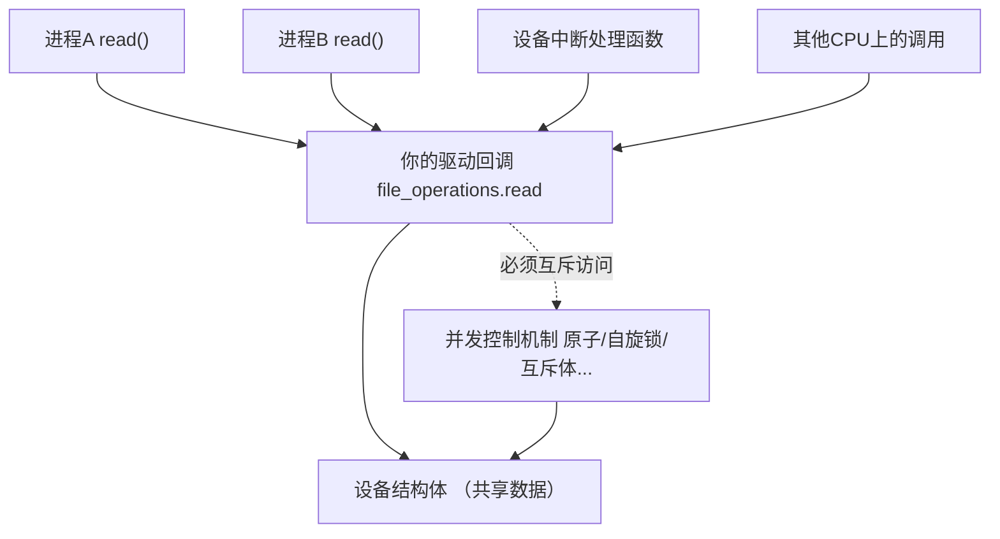
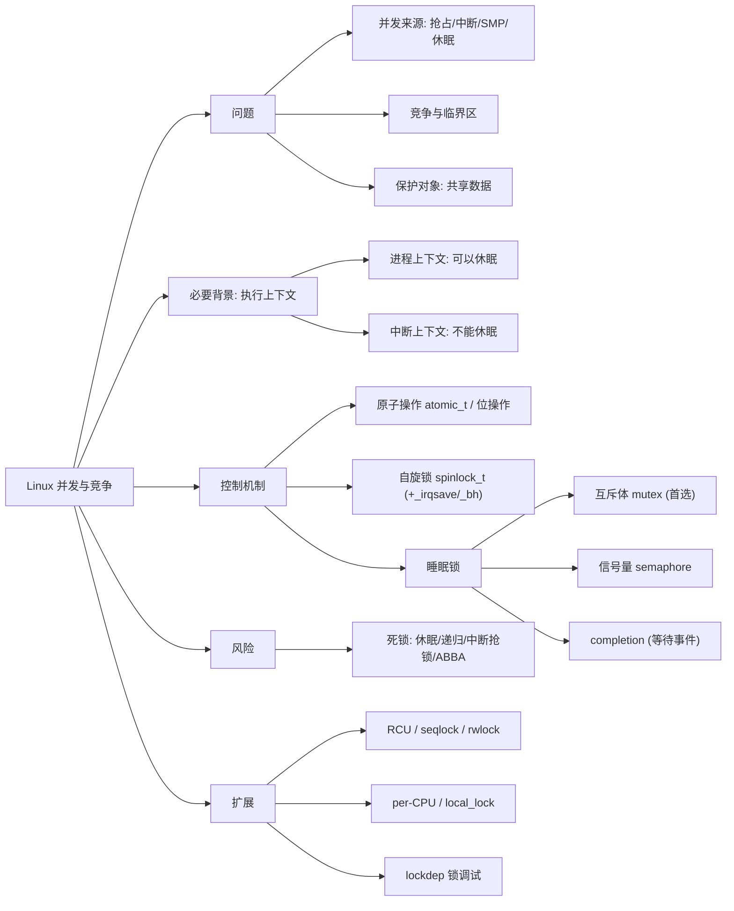
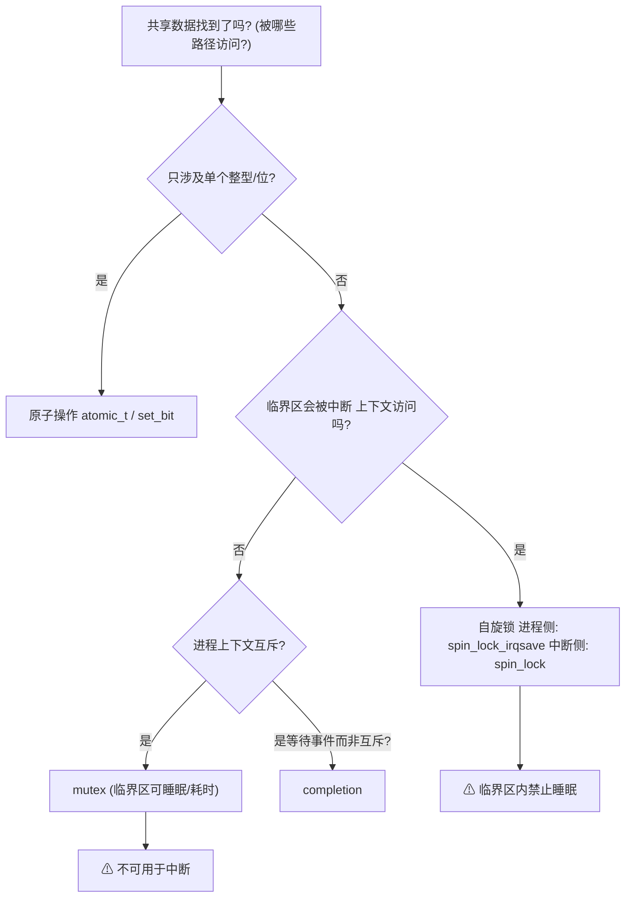

# Linux 并发与竞争（Concurrency and Race Conditions）

> 适用范围：主线 Linux（2.6 ~ 6.x），面向驱动开发。核心机制（原子操作、自旋锁、互斥体、信号量、completion）长期稳定；PREEMPT_RT 等配置差异文中已标注。
> 前置关联：建议先建立《Linux 字符设备》认知（驱动以回调函数形式被多路径调用，天然存在并发）。
> 阅读目标：10~20 分钟内建立"并发从哪来、竞争是什么、保护什么、用什么工具保护、怎么选、怎么不死锁"的可靠整体认知。

---

## 1. 先建立整体认知

### 1.1 它是什么

**直觉理解**：一个驱动就像一台公共打印机——多个用户（进程、线程、中断、其他 CPU）可能同时想用它。如果没人维持秩序，两个任务的输出会互相穿插、覆盖，打印出"你名字配我电话"的混乱结果。**并发与竞争**这一课，就是教你在内核里"维持秩序"的手段。

**严格定义**：
- **并发（Concurrency）**：多个执行路径（任务、线程、中断、多核）在时间上重叠访问同一资源。
- **竞争（Race Condition，竞争条件/竞态）**：执行结果依赖于多个执行路径相对时序的情况。一旦结果因时序而不同，代码就存在 bug，无论是否已表现出故障。
- **临界区（Critical Region/Section）**：访问共享资源、必须互斥执行的代码段。

**一个 30 秒就能看懂的竞争**（来自内核官方文档《Unreliable Guide To Locking》）：

两个执行路径同时对计数器执行 `very_important_count++`（C 一行 = 读-改-写三条底层操作）：

| 期望（串行） | 实际（可能） |
|---|---|
| 实例1: 读5 → 加1得6 → 写6 | 实例1: 读5 |
| 实例2: 读6 → 加1得7 → 写7 | 实例2: 读5 |
| 最终结果 7 ✓ | 实例1: 加1得6 → 写6实例2: 加1得6 → 写6**最终结果 6 ✗（丢一次更新）** |

结果取决于时序——这就是竞争。

### 1.2 为什么存在（内核为什么必须直面它）

普通应用程序的并发库（pthread 等）不够用，因为**内核里的并发来源更多、后果更严重**（数据错乱 → 内核崩溃 → 整机挂掉），且没有"崩溃了重启进程"的安全垫。

Linux 内核中并发的四个来源：

| 来源 | 说明 | 单核也会发生吗 |
|------|------|:---:|
| ① 抢占（Preemption） | 调度器可在任意时刻抢占正在运行的任务，换别的任务跑（2.6 起内核支持抢占） | ✅ |
| ② 中断（Interrupt） | 硬件中断可打断任何正在执行的代码，中断处理函数又访问驱动数据 | ✅ |
| ③ 多任务/SMP | 多个任务真正并行运行在不同 CPU 上 | ❌（仅多核） |
| ④ 自身休眠 | 持有数据期间调用可能休眠的函数，主动让出 CPU，别人趁机访问 | ✅ |

**关键认知：即使单核系统，①②④ 也足以产生竞争。**"我的板子是单核所以不用加锁"是危险误解。

### 1.3 保护的是"数据"，不是"代码"

这是官方文档反复强调、初学者最容易忽略的一点：

- 局部变量：各执行路径私有，**不需要**保护；
- 需要保护的是**被多条路径共享的数据**：全局变量、**设备结构体**（驱动里所有 open/read/write 回调共享同一个 dev 结构体）、硬件寄存器、共享缓冲区。

正确的工作顺序：**先找出哪些数据被共享、被哪些路径访问，再选工具**——而不是上来就背 API。

---

## 2. 在整个体系中的位置

以字符设备驱动为例（与上一篇笔记衔接）：



同一段驱动代码会被**进程上下文**和**中断上下文**从不同 CPU 同时调用——这正是上一篇笔记里"每个进程 open 后各有一个 struct file、共享同一个设备结构体"的自然推论。

---

## 3. 知识地图



---

## 4. 核心概念

### 4.1 执行上下文（必要的背景概念）

选工具之前必须先回答一个问题：**这段代码在什么上下文执行？**

| | 进程上下文 | 中断（原子）上下文 |
|---|---|---|
| 谁在执行 | 代表某个用户任务（系统调用、驱动回调、内核线程） | 硬件中断处理函数、softirq/tasklet |
| 能否休眠 | ✅ 可以（睡一会儿，调度器安排别人跑） | ❌ **绝对不能**（没有"任务"可睡，睡下去系统瘫痪） |
| 典型代码 | 驱动的 open/read/write/ioctl | request_irq 注册的处理函数 |

**这条分界线决定了锁的选择**：在中断上下文里只能用"不睡眠"的机制（原子操作、自旋锁）。

### 4.2 原子操作（Atomic Operations）

- 中文名称：原子操作；作用：保证一个**变量**的读-改-写不被任何路径打断，代价极小。
- 适用：计数器、标志位、位图等**单个变量**。这是它和锁的根本区别——**原子操作保护不了结构体、保护不了多个变量组成的复合状态**。

整型原子操作（`<linux/atomic.h>`，类型 `atomic_t`；64 位平台另有 `atomic64_t`）：

```c
atomic_t v = ATOMIC_INIT(0);          // 定义并初始化为 0

atomic_set(&v, 5);                    // 写
int n = atomic_read(&v);              // 读
atomic_inc(&v);                       // 自增 (对应竞争示例里的 ++)
atomic_dec(&v);
atomic_add(3, &v);                    // 加 3
atomic_dec_and_test(&v);              // 减 1 并测试是否为 0, 常用于引用计数
atomic_inc_and_test(&v);
```

位原子操作（对普通内存的某一位操作）：

```c
set_bit(3, &flags);                   // 置第 3 位
clear_bit(3, &flags);
test_bit(3, &flags);                  // 测试
test_and_set_bit(3, &flags);          // 原子地"测试并置位", 常用于一次性初始化/独占标志
```

> 原理直觉：底层依赖 CPU 提供的原子指令（如 ARM 的 `ldxr/stxr` 独占访问、x86 的 `lock` 前缀），而不是"关中断"这种老式做法，因此 SMP 下同样正确。

### 4.3 自旋锁（Spinlock）

- 中文名称：自旋锁；英文：spinlock，类型 `spinlock_t`，头文件 `<linux/spinlock.h>`。
- 机制：拿不到锁时**原地忙等（自旋）**，不睡眠。因此可以在中断上下文使用。
- 代价与适用：忙等白白烧 CPU，所以**临界区必须非常短**；反之，持有时间长的场景该用睡眠锁。

变体的选择取决于"临界区与谁共享"：

| API | 用途 |
|-----|------|
| `spin_lock()` / `spin_unlock()` | 与其他 CPU 上的任务互斥（无中断共享时） |
| `spin_lock_irqsave(&lock, flags)` / `spin_unlock_irqrestore(&lock, flags)` | **临界区会被本 CPU 中断访问时**（进程上下文一侧用它）：加锁同时关本 CPU 中断并保存状态 |
| `spin_lock_bh()` / `spin_unlock_bh()` | 与 softirq/bottom-half 互斥 |

> 自旋锁加锁时会自动禁止内核抢占，这本身就是它防竞争的一部分。

### 4.4 睡眠锁：互斥体、信号量、completion

拿不到锁时**让任务睡眠**，CPU 去干别的，等锁可用时被唤醒。只能用于**进程上下文**。

#### 互斥体 mutex（现代首选）

- 类型 `struct mutex`，头文件 `<linux/mutex.h>`；2006 年引入内核（官方设计文档：Generic Mutex Subsystem），用于替代把信号量当锁用的旧习惯。
- 语义严格：同一时刻只有一个持有者；**谁加锁谁解锁**；不允许递归加锁；**禁止在中断上下文使用**。

```c
struct mutex my_lock;
mutex_init(&my_lock);                  // 或静态 DEFINE_MUTEX(my_lock);

mutex_lock(&my_lock);                  // 拿不到就睡眠等待 (不可被信号打断)
/* 临界区: 可以安全地睡眠/做耗时操作 */
mutex_unlock(&my_lock);

int ret = mutex_lock_interruptible(&my_lock);  // 可被信号打断, 失败返回负值 (驱动常用)
int ret2 = mutex_trylock(&my_lock);             // 尝试, 立即返回
```

#### 信号量 semaphore（了解即可）

- 类型 `struct semaphore`；计数语义（可允许多个持有者，计数>1），加锁 `down()` / `down_interruptible()`，释放 `up()`。
- **官方现行建议**：信号量适合"资源计数"场景；单纯的互斥请用 **mutex**，单纯的"等待某事件完成"请用 **completion**。新代码一般不需要直接用信号量。
- PREEMPT_RT 内核不改造信号量（无属主语义，无法做优先级继承），用它还可能引发优先级反转。

#### completion（等待"某事已发生"）

- 典型场景：进程上下文等中断/其他线程把数据准备好再继续（驱动中读设备→等中断→返回数据）。

```c
struct completion done;
init_completion(&done);

/* 等待方 (进程上下文) */
wait_for_completion(&done);            // 或 wait_for_completion_interruptible()

/* 完成方 (常在中断上下文) */
complete(&done);                       // 唤醒一个等待者
```

### 4.5 机制对比总表

| 机制 | 能否休眠 | 中断上下文可用 | 持有时间 | 保护对象 | 典型场景 |
|------|:---:|:---:|------|------|------|
| 原子操作 | ❌ | ✅ | 单条指令级 | 单个整型/位 | 引用计数、统计、标志 |
| 自旋锁 | ❌ | ✅（配合 _irqsave） | 很短 | 任意共享数据 | 中断与任务共享的数据 |
| 互斥体 mutex | ✅ | ❌ | 可长 | 任意共享数据 | 进程上下文互斥（首选） |
| 信号量 | ✅ | ❌ | 可长 | 计数资源 | 多实例资源池（少见） |
| completion | ✅（等待方） | ✅（complete 方） | 事件驱动 | 事件同步 | 等中断/等线程完成 |
| 关抢占/关中断 | — | — | 极短 | 仅本 CPU | local_lock、极短实时段 |

> 版本提示：PREEMPT_RT（实时）内核会把 `spinlock_t` 等改造为可睡眠锁，规则更严；普通主线内核按本表理解即可。locktypes 官方文档将锁分为三类：睡眠锁（mutex/semaphore 等）、CPU 本地锁（local_lock）、自旋锁（raw_spinlock_t 等）。

### 4.6 死锁（Deadlock）

用了锁不代表安全，四种经典死法：

1. **自旋锁内睡眠**：持锁任务睡眠 → 抢占被禁/调度走 → 别人等锁 → 持锁者永远无法被唤醒。
2. **中断与线程互等（最经典的驱动死锁）**：线程持锁 → 本 CPU 中断到来 → 中断处理函数也要拿同一把锁 → 中断自旋等锁 → 线程无法恢复执行去放锁 → 双方卡死。**解法：进程侧用 `spin_lock_irqsave`，中断侧用 `spin_lock`。**
3. **递归加锁**：持有者再次申请同一把锁（自旋锁和 mutex 都不允许递归）。
4. **ABBA 顺序死锁**：任务1 持 A 等 B，任务2 持 B 等 A。解法：全系统规定统一的加锁顺序。

```text
场景 2 死锁图解:
线程A: spin_lock(&lock) → 执行中 ✕被中断打断
                                    ↓
中断: 进入处理函数 → spin_lock(&lock) → 锁被A持有 → 原地自旋等待
                                    ↓
A 无法继续执行(中断不返回) → 永远不会释放锁 → 死锁
修复: 线程侧 spin_lock_irqsave() 加锁时关中断, 中断根本进不来
```

> 调试利器：开启 `CONFIG_DEBUG_MUTEXES`、`CONFIG_PROVE_LOCKING`（lockdep）后，内核能在运行时检测出递归、死锁、睡眠锁使用错误并打印详细报告。驱动开发期强烈建议开启。

---

## 5. 如何选择（决策流程）



三条经验法则：

1. **拿不准是否会被中断访问 → 用 irqsave 变体**，代价小，安全兜底。
2. **临界区里要睡（copy_from_user、kmalloc(GFP_KERNEL)、mutex 本身…）→ 必须用睡眠锁**。
3. **能不加锁就不加锁**：官方建议"保持简单、谨慎引入新锁"；能缩小临界区就缩小（先算好、再短促持锁写）。

---

## 6. 示例代码

### 6.1 竞争原型 → 原子操作修复

```c
/* 反例: 多路径并发调用此回调时, dev->cnt 会丢失更新 */
static ssize_t dev_read(struct file *file, char __user *buf, size_t len, loff_t *off)
{
    struct mydev *dev = file->private_data;
    dev->cnt++;                        /* 竞争: 读-改-写被打断 */
    ...
}

/* 修复(只需计数): 换成原子变量, 零加锁开销 */
static ssize_t dev_read(struct file *file, char __user *buf, size_t len, loff_t *off)
{
    struct mydev *dev = file->private_data;
    atomic_inc(&dev->cnt);             /* 原子自增, SMP/中断下均正确 */
    ...
}
```

### 6.2 自旋锁：保护"任务 + 中断"共享的数据

```c
struct mydev {
    spinlock_t    lock;        /* 自旋锁, 初始化一次 */
    char          buf[64];     /* 任务写, 中断读 → 共享数据 */
    unsigned long flags;
};

/* open 里: spin_lock_init(&dev->lock); */

/* 中断处理函数: 只用 spin_lock (中断里中断本来就是关的) */
static irqreturn_t my_isr(int irq, void *p)
{
    struct mydev *dev = p;
    spin_lock(&dev->lock);
    /* 快速读取/修改 dev->buf, 不做任何可能睡眠的事 */
    spin_unlock(&dev->lock);
    return IRQ_HANDLED;
}

/* 进程上下文回调: 与中断共享 → 必须 irqsave 关掉本 CPU 中断 */
static ssize_t dev_write(struct file *file, const char __user *buf,
                         size_t len, loff_t *off)
{
    struct mydev *dev = file->private_data;
    unsigned long flags;

    if (len > sizeof(dev->buf))
        return -EINVAL;
    if (copy_from_user(dev->buf, buf, len))   /* 注意: 拷贝放在持锁外也可以时, 尽量放外面缩小临界区 */
        return -EFAULT;

    spin_lock_irqsave(&dev->lock, flags);
    dev->len = len;                /* 临界区: 极短, 纯内存操作 */
    spin_unlock_irqrestore(&dev->lock, flags);
    return len;
}
```

**对应知识地图**：`buf/len` 是"保护对象：共享数据"；isr 与 write 回调是"并发来源：中断 + 任务"；`irqsave` 是"防中断死锁"；临界区短是"自旋锁使用纪律"。

### 6.3 互斥体：保护纯进程上下文的慢操作

```c
struct mydev {
    struct mutex  cfg_lock;    /* 保护配置区 */
    int           mode;
    /* ... */
};

/* open 里: mutex_init(&dev->cfg_lock); */

static long dev_ioctl(struct file *file, unsigned int cmd, unsigned long arg)
{
    struct mydev *dev = file->private_data;
    int ret;

    ret = mutex_lock_interruptible(&dev->cfg_lock);   /* 进程上下文, 可睡眠, 用 mutex */
    if (ret)
        return ret;                    /* 被信号打断 */

    ret = slow_config(dev, cmd, arg);  /* 允许: 这里可以睡眠/耗时 */
    mutex_unlock(&dev->cfg_lock);
    return ret;
}
```

### 6.4 completion：进程等待中断完成

```c
/* read(): 进程上下文等待数据就绪 */
static ssize_t dev_read(...)
{
    struct mydev *dev = file->private_data;
    int ret;

    ret = wait_for_completion_interruptible(&dev->data_ready);  /* 睡眠等事件 */
    if (ret)
        return -ERESTARTSYS;
    return copy_to_user(buf, dev->buf, dev->len) ? -EFAULT : dev->len;
}

/* 中断: 硬件数据就绪, 唤醒等待者 */
static irqreturn_t my_isr(int irq, void *p)
{
    struct mydev *dev = p;
    /* ...读取硬件数据到 dev->buf... */
    complete(&dev->data_ready);
    return IRQ_HANDLED;
}
```

---

## 7. 实际应用

- **每个字符设备驱动的设备结构体**几乎都需要锁：多进程同时 open/read/write 是常态。上一篇笔记中的 `private_data` 惯用法，配上锁才是完整形态。
- **串口/网络/存储驱动**：中断收包 + 进程读写缓冲区，典型 spinlock（数据）+ completion/等待队列（同步）组合。
- **引用计数**：`atomic_t` 守护设备生命周期（如 `kref` 底层思想），防止"正在使用时被释放"。
- **用户空间对照**：pthread 的 `pthread_mutex_t` 对应内核 mutex（但内核没有"临界区里可以睡"以外那么宽松——中断约束是内核独有的）；理解了内核并发，用户态并发几乎免费。

---

## 8. 常见误区

**误区 1：单核 CPU 不需要加锁。**
- 为什么容易这样想：单核同一时刻只执行一条指令，似乎不会"同时"访问。
- 正确理解：抢占、中断、自身休眠在单核上照样把"读-改-写"拦腰截断（见 1.2 表格）。官方文档明确：有 `CONFIG_PREEMPT` 时，单核上自旋锁退化为关抢占但依然必要。

**误区 2：自旋锁临界区里调用 `copy_from_user`、`kmalloc(GFP_KERNEL)`、`mutex_lock` 没关系。**
- 后果：持锁睡眠 → 经典死锁（见 4.6 场景 1/2），且极难复现。
- 正确理解：自旋锁临界区内**禁止任何可能睡眠的调用**；把慢操作挪到锁外。

**误区 3：在中断处理函数里用 mutex/信号量。**
- 正确理解：中断上下文不能睡眠，睡眠锁全部禁止；中断与任务共享数据用自旋锁（任务侧 irqsave）。

**误区 4：原子操作什么都能保护。**
- 正确理解：原子操作只覆盖"单个整型/位"。两个原子变量组成的复合状态（如 `len` 和 `buf` 配对更新）依然会竞争，需要锁。

**误区 5：锁是保护代码/函数的。**
- 正确理解：锁保护的是**数据**。围绕"这段函数加锁"设计，往往漏掉另一条也访问该数据的路径；围绕"这份数据被谁访问"设计才能不漏。

**误区 6：信号量和互斥体是一回事，随便用。**
- 正确理解：现代内核中 mutex 是强语义互斥锁（有属主、调试完善），semaphore 是计数原语（无属主）。官方建议：互斥用 mutex、等待事件用 completion，新代码基本不再把 semaphore 当锁用。

---

## 9. 相关知识（扩展索引，本文不展开）

- **读写锁 rwlock / rw_semaphore**：读多写少场景的并发优化。
- **seqlock（顺序锁）**：读侧无锁重试，适合频繁写的小数据。
- **RCU（Read-Copy-Update）**：读侧零开销的高级机制，内核网络/路径查找大量使用，进阶必学。
- **per-CPU 变量 / local_lock**：把数据按 CPU 拆分，从根上消除核间竞争。
- **等待队列 wait queue**：completion 的底层通用机制，可定制唤醒条件。
- **lockdep / KCSAN**：锁依赖检查器与数据竞争检测器，调试期开启。
- **PREEMPT_RT**：实时内核对锁语义的改造（spinlock_t 变睡眠锁）。

---

## 10. 知识脉络（一页因果链）

```text
内核是多任务 + 可抢占 + 有中断 + 多核
    ↓ 多条执行路径会重叠访问同一数据
读-改-写被切断 → 结果依赖时序 → 竞争 (单核也逃不掉)
    ↓ 必须让临界区互斥
先识别: 什么数据共享? 被哪些上下文访问?
    ↓ 按上下文和时长选工具
单个变量 → 原子操作 (无锁, 最廉价)
    ↓ 复合数据 + 会与中断共享 → 自旋锁 (不睡眠, 进程侧 irqsave 防中断死锁)
    ↓ 复合数据 + 仅进程上下文 → mutex (可睡眠, 现代首选; 等事件用 completion)
    ↓ 纪律
自旋锁内不睡眠 / 中断里不用睡眠锁 / 不递归 / 统一加锁顺序 / lockdep 验证
    ↓ 最终效果
数据在任意并发来源下保持一致, 驱动在多核多任务系统上稳定运行
```

---

## 11. 正式学习时重点关注

带着这些问题进入教材/内核文档，理解效率最高：

1. 为什么说"锁保护的是数据而不是代码"？如何系统地找出驱动中需要保护的数据？
2. 单核 + 可抢占内核下，一个 `cnt++` 是怎样被竞争破坏的？
3. 自旋锁和 mutex 的本质区别是什么？"能否睡眠"分别由什么决定？
4. 为什么自旋锁临界区内睡眠会死锁？（结合"自旋锁自动禁抢占"推演一遍）
5. 线程持锁被中断打断、中断又要拿同一把锁——这条死锁链如何被 `spin_lock_irqsave` 打断？
6. `_irq / _irqsave / _bh` 三类自旋锁变体分别针对哪种并发来源？为什么优先用 irqsave 而不是 irq？
7. mutex 的严格语义有哪些？（属主、不可递归、不可在中断用——违反会怎样）
8. 什么场景该用 completion 而不是锁？wait_for_completion 和 complete 分别在哪个上下文？
9. atomic_t 为什么在 SMP 上仍然正确（底层原子指令）？atomic_dec_and_test 的引用计数用法？
10. 读写锁、seqlock、RCU 分别用"什么假设"换来了更高的读并发？（建立进阶方向的坐标）

---

## 12. 参考资料

1. [Kernel Documentation — Lock types and their rules (locktypes)](https://docs.kernel.org/locking/locktypes.html) —— 官方锁类型分类与使用规则
2. [Kernel Documentation — Unreliable Guide To Locking](https://docs.kernel.org/kernel-hacking/locking.html) —— 竞争问题与自旋锁/mutex 入门（官方，可读性好）
3. [Kernel Documentation — Generic Mutex Subsystem](https://docs.kernel.org/locking/mutex-design.html) —— mutex 设计与语义
4. Jonathan Corbet 等《Linux Device Drivers, 3rd Edition》第 5 章 "Concurrency and Race Conditions"（免费在线：[lwn.net/Kernel/LDD3](https://lwn.net/Kernel/LDD3/)）
5. 《【正点原子】I.MX6U 嵌入式 Linux 驱动开发指南》第 47 章 "并发与竞争"（嵌入式驱动教学视角，与本笔记机制对照一致）
