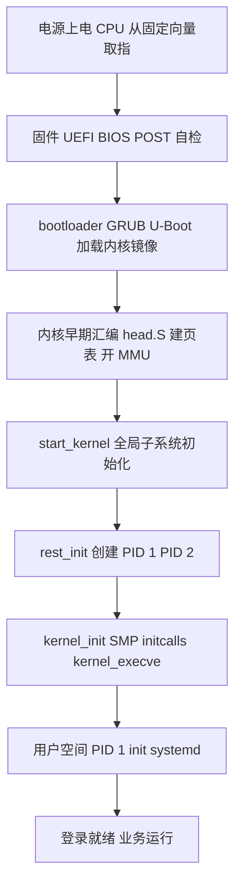
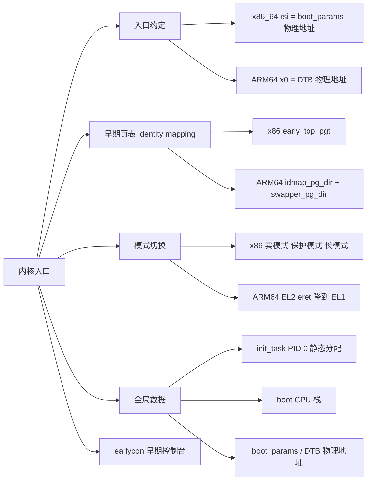
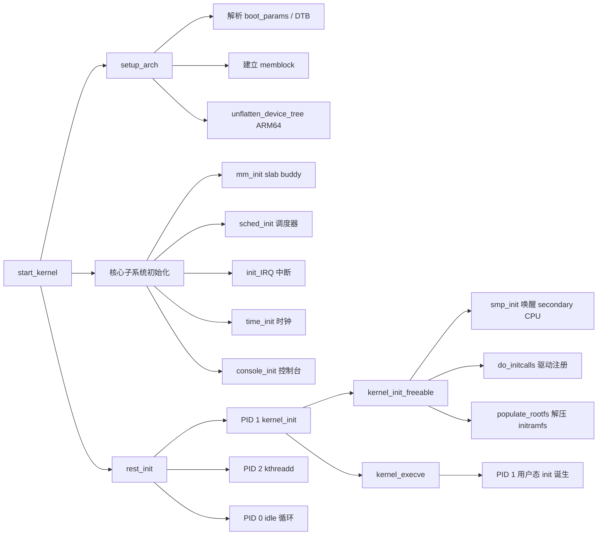
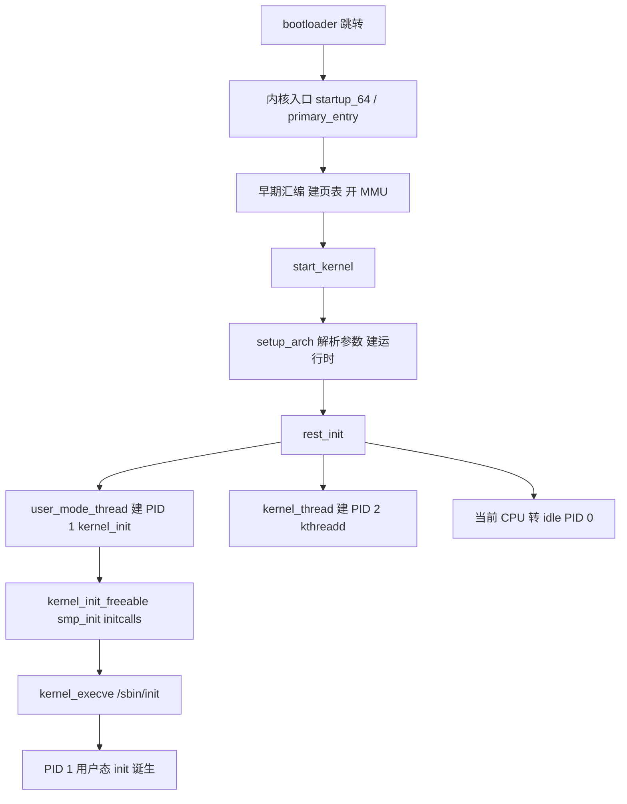
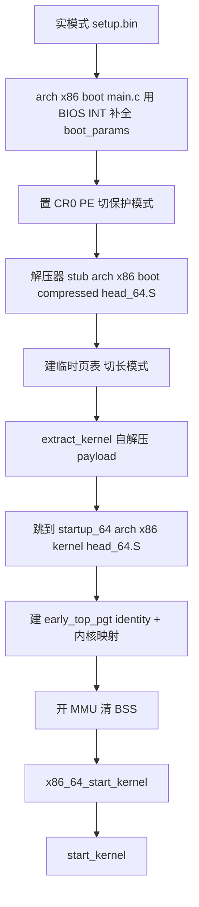
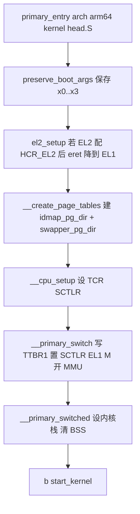
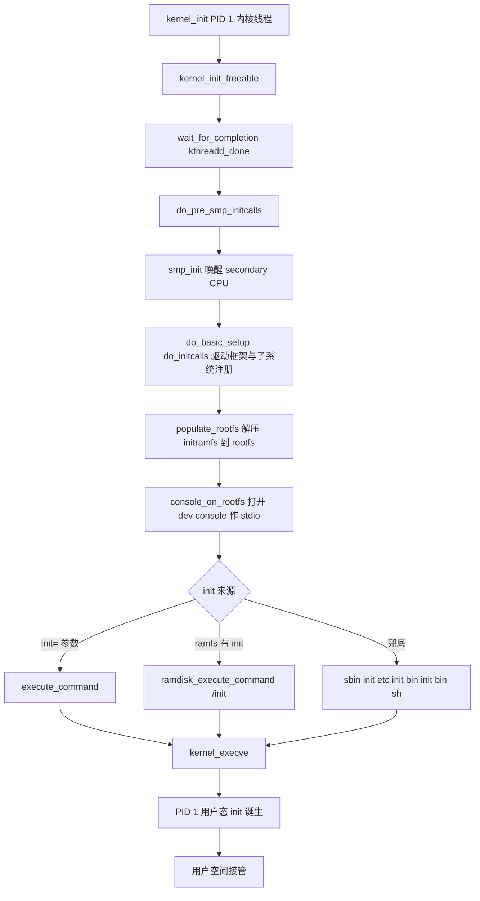

# Linux 系统启动流程（System Boot Flow）

> 适用范围：主线 Linux（2.6 ~ 6.x）。核心机制（`start_kernel` / `rest_init` / `kernel_init`）自 2.6 起保持稳定；部分 API 在 5.x/6.x 有重命名（如 `user_mode_thread` 取代旧的 `kernel_thread` 建 PID=1），文中已标注。
> 学习边界：以**内核启动流程**为主线（从 bootloader 跳进内核入口到第一个用户态进程诞生）。固件（UEFI/BIOS）与 bootloader（GRUB/U-Boot）只作为入口背景；systemd/SysVinit 只作为出口连接，不深入其内部。
> 阅读目标：10~20 分钟内建立"Linux 从电源上电到 PID=1 用户进程诞生"的整体认知，并掌握各阶段的关键调用链与全局数据结构。

---

## 1. 先建立整体认知

### 1.1 它是什么

**直觉理解**：按下电源后，CPU 从某个固定地址开始取指执行。但那个地址上的代码并不是 Linux——而是一段又一段"接力跑选手"：固件 → bootloader → 内核早期汇编 → `start_kernel` → `rest_init` → `kernel_init` → 第一个用户程序。每一段都完成自己那一小块初始化，然后把控制权与必要的参数（内存图、命令行、设备描述）交给下一段。Linux 系统启动流程，就是这条接力路径上**与 Linux 内核有关的那一段**——从内核入口被跳转开始，到 PID=1 用户进程诞生为止。

**严格定义**：Linux 系统启动流程（System Boot Flow）是指从 bootloader 将控制权交给内核入口（`startup_64` / `stext`）开始，经过早期汇编初始化、`start_kernel()` 全局子系统初始化、`rest_init()` 创建三个特殊进程（PID 0/1/2）、`kernel_init()` 完成 SMP bring-up 与 initcall 阶段，最终通过 `kernel_execve()` 产生第一个用户态进程（PID=1, init/systemd）的完整控制流与数据流。

### 1.2 阶段划分

```text
┌─────────────────────────────────────────────────────────────┐
│ 0. 固件阶段   UEFI / BIOS                                   │ ← 仅背景
│   POST 自检 → 选定启动设备 → 跳到 bootloader 入口            │
├─────────────────────────────────────────────────────────────┤
│ 1. bootloader 阶段   GRUB / U-Boot                          │ ← 仅入口
│   读取内核镜像 + initramfs → 构造 boot_params/DTB → 跳转    │
├─────────────────────────────────────────────────────────────┤
│ 2. 内核早期汇编阶段   head_64.S / head.S                    │ ← 核心
│   建临时页表 → 开 MMU → 清 BSS → 跳到 start_kernel         │
├─────────────────────────────────────────────────────────────┤
│ 3. start_kernel 阶段   init/main.c                          │ ← 核心
│   setup_arch → mm_init → sched_init → init_IRQ → rest_init  │
├─────────────────────────────────────────────────────────────┤
│ 4. rest_init 阶段   init/main.c                            │ ← 核心
│   建 PID=1 (kernel_init) + PID=2 (kthreadd) → idle 循环    │
├─────────────────────────────────────────────────────────────┤
│ 5. kernel_init 阶段   init/main.c                          │ ← 核心
│   SMP bring-up → initcalls → 解压 initramfs → kernel_execve │
├─────────────────────────────────────────────────────────────┤
│ 6. 用户空间 init 阶段   /sbin/init 或 systemd               │ ← 出口
│   PID=1 接管 → 拉起 units/services → 登录就绪              │
└─────────────────────────────────────────────────────────────┘
```

**关键边界**：阶段 2~5 是本文重点（Linux 内核自身启动流程）；阶段 0~1 只交代"内核入口被怎么进入"；阶段 6 只交代"内核态如何结束、用户态如何接管"。

### 1.3 为什么存在这样的分层设计

启动过程要解决三件本质上相互纠缠的事：

1. **硬件差异性**：不同 SoC / 主板的内存映射、外设分布完全不同。必须有人把这些差异"翻译"成统一描述。
2. **执行环境的连续性**：CPU 刚上电时往往处于最受限状态（实模式 / MMU 关 / 中断关 / 缓存关），而 Linux 期望运行在"分页开启、中断可用、调度器就绪"的环境。中间必须有一系列过渡代码逐步切换。
3. **特权级与地址空间的切换**：内核启动全程运行在内核态（最高特权级、内核地址空间），但 Linux 的设计目标是"用户态进程是系统常态"——因此启动流程必须以"产生第一个用户态进程"为终点。

分层的本质是**用每一段小而专的代码，解决一类问题，并把更复杂的环境交接给下一段**：

- 固件负责硬件自检和最小启动设备发现；
- bootloader 负责存储协议和加载策略，屏蔽存储介质差异；
- 内核早期汇编负责 CPU 模式切换和最最小内存映射；
- `start_kernel` 负责建立"可以调度、可以中断、可以分配内存"的运行时；
- `rest_init` 负责创建后续运行所必需的常驻进程；
- `kernel_init` 负责 SMP 与驱动子系统初始化，并最终跨过内核/用户边界。

一句话：**启动流程 = 把一个"刚通电的 CPU"逐步带到一个"正常运行的 Linux 系统"的过程，每一阶段只解决自己最擅长的问题。**

---

## 2. 在整个体系中的位置



- **本文聚焦区段**：D → G（内核启动流程本体），并交代 C 的尾端（bootloader 如何把参数交给内核）与 H 的入口（PID=1 诞生）。
- **横向对比**：设备树（DTB）/ e820 内存图、boot_params / DTB、earlycon、initcall 等概念是本流程的关键节点，它们各自连接到"Linux 驱动模块"、"Linux 设备树"、"Linux 平台总线"等其他主题。

---

## 3. 知识地图

由于知识点横跨"汇编早期"和"C 主流程"两大段，拆成两张图。

### 3.1 早期汇编阶段的知识地图



### 3.2 C 主流程阶段的知识地图



下面逐一展开。

---

## 4. 核心概念

### 4.1 boot_params 与 DTB：bootloader 与内核的参数桥梁

启动过程中最关键的"数据交接"是：bootloader 必须把"这台机器长什么样"告诉内核。两种主流方案：

| 项 | x86_64 | ARM64 |
| --- | --- | --- |
| 名称 | `struct boot_params`（零页 zero page） | Device Tree Blob（DTB / FDT） |
| 定义 | `arch/x86/include/uapi/asm/bootparam.h` | `devicetree-specification` 规范 |
| 装载位置 | bootloader 把它放在约定物理地址 | bootloader 把 DTB 物理地址放在 `x0` 寄存器 |
| 关键内容 | `setup_header`、`e820_table`（内存图）、`screen_info`、`efi_info`、`cmd_line_ptr`、`ramdisk_image/size`、`setup_data` 链表 | `/memory`、`/cpus`（含 `enable-method`）、`/chosen`（含 `bootargs`、`initrd-start/end`）、各外设节点 |
| 内核侧解析入口 | `x86_init.resources.probe_roms` / `setup_arch` 内逐字段解析 | `setup_arch → setup_machine_fdt → unflatten_device_tree` 把扁平 DTB 转成 `device_node` 树 |

**直觉理解**：boot_params 是一份"问答表"——bootloader 填好"内存有多大、命令行是什么、initramfs 在哪、视频模式是什么"，内核照表读；DTB 是一份"硬件描述书"——bootloader 只填地址，内核自己读这份树形描述来认识整台机器（CPU 几个、内存几段、外设挂哪）。

> 版本提示：旧 `initrd` 是块设备镜像（ext2 等），自 2.6.13 起 `initramfs`（cpio 归档，解压到 tmpfs）取而代之，但 `boot_params.ramdisk_image` 字段名沿用至今。ARM64 上 initramfs 地址通过 DTB `/chosen` 节点的 `initrd-start/end` 传递。

### 4.2 内核入口与早期页表

内核镜像的入口由架构决定：

- **x86_64**：`bzImage = setup.bin（16 位实模式设置代码） + vmlinux.bin（解压器 stub + 压缩内核 payload）`。setup 头部 magic 为 `HdrS`（0x53726448）。实模式代码先用 BIOS INT 调用补全 `boot_params`，再切保护模式 → 长模式 → 跳到 `startup_64`（`arch/x86/kernel/head_64.S`）。**内核内含自解压器**，压缩 payload 在 `extract_kernel()` 中解压到最终位置。
- **ARM64**：`Image` 是未压缩二进制；`Image.gz` 是 gzip 压缩。**ARM64 内核不含自解压器**，`Image.gz` 必须由 bootloader 解压。入口在 `arch/arm64/kernel/head.S` 的 `primary_entry`，CPU 必须处于：`MMU=off`、`D-cache=off`、`PSTATE.DAIF` 全屏蔽；`x0 = DTB 物理地址`；CPU 在 EL2（推荐）或非安全 EL1。

**早期页表（identity mapping）的必要性**：开启 MMU 的瞬间，PC 仍指向"开启前"那一条指令的物理地址。如果该物理地址在页表中没有"虚拟 = 物理"的恒等映射，取指会立即失败。因此 x86 与 ARM64 都在切 MMU 前先建好 `early_top_pgt` / `idmap_pg_dir` 这类恒等映射页表，把"开启 MMU 前后的执行流"在地址空间上接起来。

### 4.3 init_task（PID=0，swapper / idle）

- 中文名称：0 号进程；别名：**swapper**、idle task。
- 定义位置：`init/init_task.c`，静态分配，`INIT_TASK_DATA` 段。
- 作用：**唯一不经 `fork()` / `kernel_thread()` 产生的进程**。它在 `start_kernel` 之前就是"当前进程"（`current`），承载 boot CPU 的内核栈；在 `rest_init` 把控制流交给 PID=1 后，退化为每个 CPU 的 idle 进程（每个 CPU 一份 swapper/N 实例，N 是 CPU 编号）。
- 关键属性：不会出现在 `/proc` 中（不是 fork 出来的）；`start_kernel` 全程都在它的上下文里执行。

### 4.4 start_kernel 与 setup_arch

- 英文：`start_kernel`，定义于 `init/main.c`，签名 `asmlinkage __init __noreturn void start_kernel(void)`。
- 作用：**架构无关的内核主初始化函数**，约 80 次调用、顺序敏感。负责把"刚切完模式的内核"逐步变成"可以调度、可以响应中断、可以分配内存、可以打印日志"的运行时。
- 关键调用（顺序）：
  1. `set_task_stack_end_magic(&init_task)`：标记 0 号进程栈，防栈溢出检测就位。
  2. `setup_arch(&command_line)`：**架构相关大头**。x86 解析 `boot_params`、e820、EFI 信息；ARM64 解析 DTB、`unflatten_device_tree` 把 FDT 转 `device_node` 树；两者都建立 `memblock` 早期内存分配器。
  3. `trap_init()` / x86 `idt_setup()`：异常与中断向量表。
  4. `mm_init()`：slab/slub/slob + buddy 就绪，**此后才可 `kmalloc`**。
  5. `sched_init()`：调度器、per-CPU runqueue、idle task 就绪。
  6. `early_irq_init()` / `init_IRQ()` / `tick_init()` / `hrtimers_init()` / `time_init()`：中断与时间子系统。
  7. `local_irq_enable()`：**此后才开中断**。
  8. `vfs_caches_init()` / `fork_init()` / `signals_init()`：VFS、进程、信号基础设施。
  9. `rest_init()`：最后一个调用，**不返回**。

### 4.5 rest_init 与 kthreadd（PID=2）

- 英文：`rest_init`、`kthreadd`，定义于 `init/main.c`。
- 作用：`rest_init` 退出 `start_kernel`，完成"三个特殊进程"的诞生与当前 CPU 的转 idle。
- 三个动作（顺序）：
  1. `user_mode_thread(kernel_init, ...)`：创建 **PID=1 `kernel_init`**（最终会 execve 第一个用户程序）。源码注释明确："先建 PID 1 是为了抢占 pid 编号 1"，但它在 `kthreadd` 就绪前不会被调度。
  2. `kernel_thread(kthreadd, ...)`：创建 **PID=2 `kthreadd`**。这是所有内核线程的"父进程"，循环消费 `kthread_create_list`，按需创建 `kworker`、`ksoftirqd`、`migration` 等内核线程。
  3. `schedule_preempt_disabled()` + `cpu_startup_entry(CPUHP_ONLINE)`：当前 boot CPU 上下文（即 PID=0/swapper）转入 idle 循环，从此 boot CPU 在没有任务时空转。

> 版本提示：旧版本用 `kernel_thread(kernel_init, ...)` 创建 PID=1；新版（6.x）改用 `user_mode_thread()`，因为它从一开始就标记为"最终会进用户态"，避免在 `kernel_thread` 路径下被当作纯内核线程处理。

### 4.6 kernel_init 与 kernel_execve

- 英文：`kernel_init`、`kernel_execve` / `run_init_process`。
- 作用：PID=1 内核线程的执行体，完成 SMP bring-up、initcall、initramfs 处理，最终跨过内核/用户边界。
- 关键路径：
  1. `kernel_init_freeable()`：
     - `wait_for_completion(&kthreadd_done)`：等 `kthreadd` 就绪。
     - `do_pre_smp_initcalls()` → **`smp_init()`**：**secondary CPU 在此被唤醒**（不是在 `start_kernel` 阶段）。
     - `do_basic_setup()` / `do_initcalls()`：按 `initcall level` 依次调用所有 `module_init` / `subsys_initcall` 等注册的初始化函数（驱动框架、平台总线、设备模型在此就位）。
     - `console_on_rootfs()`：在 rootfs 上打开 `/dev/console` 作为 PID=1 的 stdin/stdout/stderr。
  2. initramfs 处理：`populate_rootfs` 在内核态把 initramfs（cpio 归档）解压到 rootfs（tmpfs）。若 ramfs 含 `/init`，内核将其作为早期用户态 init，由它挂载真实 rootfs 并 `switch_root`。
  3. 寻找 init 程序，依次尝试：
     - `execute_command`（命令行 `init=` 参数指定）
     - `ramdisk_execute_command`（默认 `/init`）
     - 兜底：`/sbin/init`、`/etc/init`、`/bin/init`、`/bin/sh`
     - 全部失败：`panic("No working init found.")`
  4. `kernel_execve()` / `run_init_process()`：从内核态 execve 第一个用户程序。**这一刻 PID=1 用户态 init 进程诞生**，此后所有用户进程都由它 `fork` 出来。

### 4.7 initramfs / initrd

- 中文名称：早期用户空间根文件系统；英文：**initramfs**（initram filesystem）/ 旧名 **initrd**（initial ramdisk）。
- 区别：旧 `initrd` 是块设备镜像（ext2 等），内核把它当块设备挂载；`initramfs` 是 cpio 归档，内核把它解压到 tmpfs（rootfs），无块设备语义。自 2.6.13 起 `initramfs` 取代 `initrd`，但配置字段名沿用 `ramdisk_image` / `initrd-start`。
- 作用：提供一个**最小但可执行的早期用户空间**，用来：
  - 加载真实 rootfs 所需的存储驱动（SCSI、NVMe、USB、mmc 等可能编译为模块）；
  - 解密加密根分区（LUKS）；
  - 从 NFS、iSCSI 等网络根启动；
  - 切换到真实 rootfs（`switch_root`）。
- 何时被加载：bootloader 与内核镜像一起加载到内存；x86 经 `boot_params.ramdisk_image/size` 传递地址，ARM64 经 DTB `/chosen` 节点 `initrd-start/end` 传递。
- 何时被消费：在 `kernel_init_freeable()` 阶段由 `populate_rootfs` 解压；若 ramfs 有 `/init`，它将取代 `/sbin/init` 成为第一个用户进程，并由它完成 `switch_root` 后真正进入用户空间。

---

## 5. 核心概念之间的关系

启动过程的核心关系是**两条链**：参数链（数据流）与控制链（控制流）。

### 5.1 参数链（数据流）

```text
bootloader 采集
    → boot_params / DTB
        → setup_arch 解析
            → memblock（早期内存）
                → mm_init（buddy + slab）
                    → 内核运行时
                    → /chosen 或 ramdisk_image 指向 initramfs
                        → populate_rootfs 解压到 rootfs
                            → kernel_execve 加载 /sbin/init 或 /init
```

### 5.2 控制链（控制流）



### 5.3 三个特殊进程的诞生与角色

| PID | 名称 | 诞生方式 | 角色 |
| --- | --- | --- | --- |
| 0 | swapper / idle | 静态分配（`init/init_task.c`） | 唯一非 fork 进程；`start_kernel` 全程运行在它上下文；之后退化为每 CPU idle |
| 1 | init / systemd | `user_mode_thread(kernel_init, ...)` | 第一个用户进程；所有用户进程的祖先；死亡触发 panic |
| 2 | kthreadd | `kernel_thread(kthreadd, ...)` | 所有内核线程的父进程；循环消费 `kthread_create_list` |

**诞生顺序的关键约束**：PID=1 先于 PID=2 创建（抢号），但 PID=1 在 `wait_for_completion(&kthreadd_done)` 之前不会真正运行——这保证 PID=1 进入用户态前，内核线程管理基础设施已经就绪。

---

## 6. 工作原理

### 6.1 阶段 0~1：固件与 bootloader（仅入口背景）

```text
电源上电
  → CPU 从固定向量取指（x86: 0xFFFF0; ARM: RVBAR/RESET_VEC）
  → 固件 POST 自检、初始化内存、选定启动设备
  → 加载 bootloader 到内存（UEFI: ESP 中的 .efi; BIOS: MBR 512B 到 0x7C00）
  → bootloader:
      - 读取内核镜像（bzImage / Image / Image.gz）+ initramfs
      - 构造参数（x86: struct boot_params; ARM64: DTB 物理地址放 x0）
      - 跳转到内核入口
```

UEFI 与传统 BIOS 的关键差异：

| 维度 | 传统 BIOS | UEFI |
| --- | --- | --- |
| 模式 | 16 位实模式 | 32/64 位保护模式，可直接执行 PE 格式 `.efi` |
| 分区表 | MBR（≤2TB） | GPT |
| 安全启动 | 不支持 | 支持 Secure Boot 校验签名 |
| 启动入口 | MBR 首 512B | ESP 分区中的 `.efi` 文件 |
| 与内核的接口 | 经 `boot_params.efi_info` 仍可传递 | 同上，且支持 UEFI Runtime Services |

GRUB 与 U-Boot 的共性：都负责"读内核镜像 + initramfs → 构造启动参数 → 跳转入口"。差异是 GRUB 面向 x86（按 boot protocol 填 `struct boot_params`），U-Boot 面向 ARM（按 booting.rst 约定把 DTB 放 `x0`，并负责解压 `Image.gz`）。

### 6.2 阶段 2：内核早期汇编（核心）

#### 6.2.1 x86_64 路径



#### 6.2.2 ARM64 路径



#### 6.2.3 BSP 与 AP 的区分

启动早期，**只有 BSP（Boot CPU / primary CPU）执行内核启动流程**；其他 CPU（AP, secondary CPU）都在"停车"：

- **ARM64**：根据 DT 中 `enable-method` 决定：
  - `spin-table`：AP 在保留区 `wfe` 轮询 `cpu-release-addr`，BSP 写入入口地址后 `sev` 唤醒。
  - `psci`：AP 留在内核外（典型为固件管理电源），BSP 调 `PSCI_CPU_ON` 唤醒。
- **x86**：AP 由 BSP 经 **INIT-SIPI-SIPI** 序列唤醒，执行 `trampoline_64.S` 后进入 parking loop，等 BSP 在 `smp_init()` 中 bring-up。

**AP 真正被 bring-up 的时机**：在 `kernel_init_freeable()` → `smp_init()`，而不是 `start_kernel` 阶段。这是初学时常记反的一点。

#### 6.2.4 earlycon：printk 之前的控制台

`printk` / tty console 在 `console_init()` 之前不可用——但启动早期经常要调试。`earlycon` / `earlyprintk` 用极简串口驱动（如直接写 8250 MMIO 寄存器）输出，在 printk 体系就绪前提供可见性。DT 系统传 `earlycon` 命令行参数即可由内核解析 DT 自动配置。

### 6.3 阶段 3：start_kernel 主初始化

参见 4.4 节调用序列。关键节奏：

```text
setup_arch → mm_init → sched_init → init_IRQ → time_init → console_init → rest_init
   架构相关     内存     调度器      中断       时钟        控制台     交班
```

**两大里程碑**：
- `local_irq_enable()` 之后：**中断可用**，内核开始能响应异步事件。
- `console_init()` 之后：**真正可见的控制台**，`printk` 输出到屏幕 / 串口稳定可见（在此之前只能用 earlycon）。

### 6.4 阶段 4：rest_init 与三个进程

参见 4.5 节。要点：

- `user_mode_thread(kernel_init)` **创建但暂不调度** PID=1。
- `kernel_thread(kthreadd)` 创建 PID=2 后，PID=1 才允许运行（经 `wait_for_completion(&kthreadd_done)` 同步）。
- 当前 CPU（boot CPU 的 PID=0 上下文）调用 `cpu_startup_entry(CPUHP_ONLINE)` 进入 idle。

### 6.5 阶段 5：kernel_init 完成 SMP + initcalls + 用户态



### 6.6 阶段 6：用户空间 init（出口，不深入）

PID=1 诞生后内核退居后台，启动逻辑由用户态 init 接管。常见实现：

| 实现 | 典型场景 | 启动入口 |
| --- | --- | --- |
| SysVinit | 传统发行版、Yocto Poky 默认 | `/etc/inittab` + rcN.d runlevel |
| systemd | 现代 x86 服务器/桌面主流 | `/etc/systemd/system/default.target`（通常指向 `graphical.target` 或 `multi-user.target`） |
| BusyBox init | Buildroot 默认、典型嵌入式 | `/etc/inittab` 简化版 |
| Android init | AOSP 自有实现 | 不属上述三者 |

systemd 作 PID=1 的关键职责（简要）：

- 读 `default.target`，按依赖拉起 unit（service / socket / target / mount）；
- 经 `local-fs.target` 处理 fstab 挂载；
- 经 `network.target` 起网络；
- 经 `getty.target` 起 getty/login。

**内核↔用户态的关键反馈通道**：

- **udevd**（systemd-udevd）监听 `NETLINK_KOBJECT_UEVENT`，据 uevent 在 `/dev` 创建节点；规则 `80-drivers.rules` 对 `MODALIAS` 执行 `kmod load`（即 modprobe）按需加载内核模块；
- 用户空间挂载 `/sys`（sysfs）、`/proc`（procfs）、`/dev`（devtmpfs）读取内核导出的设备与状态信息；
- 用户空间通过 ioctl / sysfs / `/proc` 与内核交互，反向请求内核服务。

**关键边界**：PID=1 死亡会触发内核 `panic("Attempted to kill init!")`（代码位于 `kernel/exit.c` 的 `exit_notify`，内核禁止杀 init）。这是用户态与内核态的"安全绳"。

---

## 7. 示例代码

### 7.1 boot_params 关键字段（x86_64）

```c
// arch/x86/include/uapi/asm/bootparam.h
struct boot_params {
    struct screen_info screen_info;          // 视频模式
    struct setup_header hdr;                // setup 协议头（magic=HdrS, version, cmd_line_ptr, ramdisk_image/size, ...）
    struct e820_table e820_table;           // 内存图（BIOS INT 15h e820 采集）
    struct efi_info efi_info;               // UEFI Runtime/Boot Services 信息
    __u8 _pad[...];
    struct setup_data *setup_data;          // 链表：扩展协议（如 SETUP_E820_EXT、SETUP_DTB）
};
```

字段用途对应 4.1 节"参数桥梁"。`hdr.cmd_line_ptr` 指向命令行字符串，`hdr.ramdisk_image/size` 指向 initramfs。

### 7.2 start_kernel 关键调用序列（伪代码）

```c
// init/main.c
asmlinkage __init __noreturn void start_kernel(void)
{
    set_task_stack_end_magic(&init_task);   // 0 号进程栈守卫
    setup_arch(&command_line);              // 解析 boot_params / DTB，建 memblock
    trap_init();                            // 异常/中断向量表
    mm_init();                              // slab + buddy
    sched_init();                           // 调度器
    early_irq_init();
    init_IRQ();                             // 中断子系统
    tick_init(); hrtimers_init(); time_init();  // 时间子系统
    local_irq_enable();                    // 开中断
    vfs_caches_init();
    fork_init();
    signals_init();
    /* ...其他子系统... */
    rest_init();                            // 不返回
}
```

### 7.3 rest_init 创建三个进程

```c
// init/main.c
noinline void __ref rest_init(void)
{
    struct task_struct *tsk;

    rcu_scheduler_starting();

    // 先建 PID=1：抢占 pid 编号 1（暂不调度）
    tsk = user_mode_thread(kernel_init, NULL, CLONE_FS);
    rcu_read_lock();

    // 建 PID=2：kthreadd，所有内核线程的父进程
    pid = kernel_thread(kthreadd, NULL, CLONE_FS | CLONE_FILES);
    rcu_read_unlock();

    complete(&kthreadd_done);               // 唤醒等在它上面的 kernel_init

    // 当前 boot CPU（PID=0）转 idle
    schedule_preempt_disabled();
    cpu_startup_entry(CPUHP_ONLINE);        // 进入 idle 循环，永不返回
}
```

**对应概念**：`user_mode_thread`/`kernel_thread` 创建线程，`complete` 是同步原语，`cpu_startup_entry` 让 CPU 进入 idle。

### 7.4 kernel_init 寻找 init 程序

```c
// init/main.c
static int __ref kernel_init(void *unused)
{
    kernel_init_freeable();                 // SMP + initcalls + console
    /* ...*/
    if (ramdisk_execute_command) {
        ret = run_init_process(ramdisk_execute_command);  // 通常 /init
        if (!ret) return 0;
    }
    if (execute_command) {                  // 命令行 init=
        ret = run_init_process(execute_command);
        if (!ret) return 0;
    }
    // 兜底
    if (!try_to_run_init_process("/sbin/init") ||
        !try_to_run_init_process("/etc/init") ||
        !try_to_run_init_process("/bin/init") ||
        !try_to_run_init_process("/bin/sh"))
        return 0;
    panic("No working init found.");
}
```

**对应概念**：`run_init_process` 内部调用 `kernel_execve`，从内核态 execve 用户程序——这是跨过内核/用户边界的关键一步。

### 7.5 用 init= 参数指定自定义 init（最小实验）

在 bootloader（如 GRUB）的命令行追加 `init=/bin/sh`，可绕过 systemd 直接进入 sh。内核会调用 `run_init_process("/bin/sh")`，PID=1 变成 sh。这常用于修复无法启动的系统：

```text
grub> linux /boot/vmlinuz-6.x root=/dev/sda1 init=/bin/sh
grub> initrd /boot/initramfs-6.x.img
grub> boot
```

---

## 8. 实际应用

### 8.1 调试启动问题时的可见性梯度

启动过程中"可见性"是逐步建立的，不同阶段要用不同手段：

```text
阶段                可见性手段
─────────────────────────────────────────────────────
固件                串口（嵌入式）/ 蜂鸣码（PC）
bootloader          bootloader 自身控制台（GRUB shell / U-Boot prompt）
内核早期汇编        earlycon / earlyprintk
start_kernel 早期   earlycon + printk（部分）
console_init 之后   正常 printk + dmesg
rest_init 之后      PID=1 的 stdout（重定向到 /dev/console）
```

工程实践：调试启动卡死时，先确认卡在哪个阶段。`earlycon` 几乎贯穿全程，是早期最重要的调试手段。

### 8.2 init= 与 initramfs 的工程现实

- `init=` 命令行参数优先于 initramfs 中的 `/init`，可绕过 systemd 修复系统。
- 嵌入式系统常用 `initramfs` 作为**唯一根文件系统**（不做 `switch_root`），整个用户空间打包进 cpio，由 bootloader 加载到内存。这种系统没有真实 rootfs，断电即丢失修改。
- 服务器场景：`initramfs` 用来加载存储驱动（如 NVMe over Fabrics、LVM、LUKS），加载完成后 `switch_root` 到真实根分区。

### 8.3 KASLR：内核地址随机化

较新内核支持 KASLR（Kernel Address Space Layout Randomization），在解压后把内核载入到一个随机物理/虚拟地址。这要求早期页表能处理"内核被搬走"的情况——ARM64 `head.S` 中 `x23` 寄存器保存 KASLR 偏移，x86 在 `startup_64` 中处理重定位。KASLR 增加调试难度（地址不再是固定的 `0xffffffff80000000` 附近），需要 `nokaslr` 关闭以便符号解析。

### 8.4 从启动到设备就绪的连接

启动流程连接到其他主题：

```text
内核启动
    ↓
smp_init + do_initcalls
    ↓
driver_init → 设备模型 / platform_bus / i2c_bus / usb_bus 等注册
    ↓
设备树展开 → platform_device 创建
    ↓
driver_register → probe → 设备节点出现
    ↓
udevd 收 uevent → 创建 /dev 节点 → modprobe 加载依赖模块
    ↓
用户空间可用业务
```

这条链把启动流程与"Linux 驱动模块"、"Linux 设备树"、"Linux 平台总线"等主题连起来。

---

## 9. 常见误区

### 误区 1：认为内核启动入口就是 `start_kernel()`

**为什么容易这样理解**：大部分教材从 `start_kernel` 讲起，因为它已经是 C 代码，易读易讲。

**正确理解**：`start_kernel` 之前还有一长段汇编（`head_64.S` / `head.S`），负责 CPU 模式切换、早期页表、解压、清 BSS 等。如果忽略这段，就解释不了"为什么 `start_kernel` 一进来就处在分页开启、中断关闭、调度器未就绪的状态"。

### 误区 2：认为 PID=1 就是 systemd

**为什么容易这样理解**：现代发行版的 PID=1 几乎都是 systemd，给人"PID=1 = systemd"的印象。

**正确理解**：PID=1 是"第一个用户态进程"的代号，具体是谁取决于命令行 `init=` 与 initramfs 配置。它可以是 `/sbin/init`（SysVinit）、`/init`（initramfs 中的早期 init）、`/bin/sh`（修复模式）、BusyBox init、systemd，甚至 Android 的自有 init。内核不关心它是谁，只关心"它是用户态进程"。

### 误区 3：认为所有 CPU 同时启动

**为什么容易这样理解**：SMP 系统最终看起来所有 CPU 都在跑，给人"一起启动"的错觉。

**正确理解**：只有 BSP 在启动早期运行；AP 在 `smp_init()` 阶段才被 bring-up。在那之前，AP 或停在固件管理的低功耗状态（PSCI），或在 spin-table 上 `wfe` 轮询。这是为了简化启动——在调度器和中断子系统就绪前，无法安全地处理多 CPU。

### 误区 4：混淆 initrd 与 initramfs

**为什么容易这样理解**：两者都叫"初始 ram disk/文件系统"，配置字段名仍叫 `ramdisk_image`，命令行参数仍叫 `initrd=`。

**正确理解**：

| 维度 | 旧 initrd | initramfs |
| --- | --- | --- |
| 格式 | 块设备镜像（ext2 等） | cpio 归档 |
| 加载方式 | 内核把它当块设备挂载 | 内核解压到 tmpfs（rootfs） |
| `/init` | 不需要 | 通常由它负责 switch_root |
| 取代关系 | 自 2.6.13 起被 initramfs 取代 | 现代标准 |

### 误区 5：认为 `kernel_execve` 之后内核就"结束"了

**为什么容易这样理解**：`kernel_execve` 之后 PID=1 进入用户态，给人"内核启动完成"的感觉。

**正确理解**：`kernel_execve` 只是**让 PID=1 跨入用户态**，内核本身仍然常驻——`kthreadd` 继续创建内核线程、调度器继续调度、所有系统调用由内核处理、所有中断由内核响应。内核从未"结束"，它从"启动模式"切换到"服务模式"。

---

## 10. 相关知识

```text
Linux 系统启动流程
├── Linux 驱动模块        initcall level 与 do_initcalls 关系
├── Linux 设备树          ARM64 setup_arch 的 DTB 解析
├── Linux 平台总线        driver_init 之后总线注册
├── Linux 字符设备        console_init 与 /dev/console 关系
├── Linux 并发与竞争      SMP bring-up 后 per-CPU 与锁就绪
├── udev                  用户态接收 uevent 创建 /dev 节点
├── systemd               PID=1 之后的服务管理
├── KASLR                 内核地址随机化
├── initcall              驱动注册机制
└── memblock              早期内存分配器（buddy 之前）
```

---

## 11. 知识脉络

```text
为什么会出现分层启动设计
    ↓
因为硬件差异大 CPU 初始状态受限
    ↓
所以用固件屏蔽硬件自检 用 bootloader 屏蔽存储协议
    ↓
但 bootloader 不能把 CPU 切到 Linux 期望的运行环境
    ↓
所以内核自带早期汇编 建页表 开 MMU 切模式
    ↓
但 MMU 开了之后 内存 调度 中断 还没就绪
    ↓
所以 start_kernel 按顺序逐个子系统初始化
    ↓
但单 CPU 跑不过来 需要内核线程和 idle
    ↓
所以 rest_init 创建 PID 1 PID 2 自己转 idle
    ↓
但 PID 1 是内核线程 不能跑用户业务
    ↓
所以 kernel_init 完成 SMP 与 initcalls
    ↓
但用户空间需要第一个进程作为入口
    ↓
所以 kernel_execve 把 PID 1 跨入用户态
    ↓
最终 PID 1 init 接管 整个用户空间诞生
```

这条因果链解释了**为什么必须有每一阶段**，而不只是"按顺序发生了这些事"。

---

## 12. 正式学习时重点关注

```text
1. bootloader 与内核之间的参数桥梁是什么？x86 与 ARM64 为何不同？
2. 早期页表（identity mapping）为什么必须先建？开 MMU 那一刻发生了什么？
3. BSP 与 AP 的区分在启动早期如何实现？AP 何时被 bring-up？
4. start_kernel 的调用顺序为什么敏感？哪些子系统必须先于哪些就绪？
5. local_irq_enable 与 console_init 两个里程碑分别意味着什么？
6. rest_init 中 PID 1 和 PID 2 谁先创建？为什么顺序如此？同步原语是什么？
7. kernel_execve 如何从内核态跨入用户态？这一步在地址空间、特权级上分别发生了什么？
8. initramfs 与旧 initrd 的本质区别是什么？为什么 initramfs 不需要块设备？
9. PID 1 死亡为什么会触发 panic？这条规则由哪段代码保证？
10. KASLR 如何影响早期页表与符号解析？
```

这些不是考试题，是帮助你在正式学习时知道**注意力应该放在哪里**。

---

## 13. 参考资料

### 官方文档（第一优先级）

- [Linux/x86 Boot Protocol (kernel.org)](https://www.kernel.org/doc/html/latest/arch/x86/boot.html) — x86 内核启动协议、`struct boot_params` 字段、setup header
- [Booting AArch64 Linux (kernel.org)](https://docs.kernel.org/6.4/arm64/booting.html) — ARM64 入口约定、`x0=DTB`、EL2/EL1、PSCI / spin-table
- [x86 Zero Page (boot_params) (kernel.org)](https://docs.kernel.org/7.0/arch/x86/zero-page.html) — `struct boot_params` 字段定义与用途
- [The initramfs documentation (kernel.org)](https://www.kernel.org/doc/html/latest/filesystems/ramfs-rootfs-initramfs.html) — initramfs 与旧 initrd 区别、rootfs 概念
- [init= parameter and "No working init found" (kernel.org)](https://www.kernel.org/doc/html/v6.17/admin-guide/init.html) — 内核寻找 init 程序的顺序与失败处理
- [x86 Early Printk (kernel.org)](https://kernel.org/doc/html/v5.7/x86/earlyprintk.html) — earlycon / earlyprintk 用法

### 内核源码（第一优先级）

- [`init/main.c`（torvalds/linux on GitHub）](https://github.com/torvalds/linux/blob/master/init/main.c) — `start_kernel` / `rest_init` / `kernel_init` 全部主流程
- [`arch/x86/kernel/head_64.S`](https://git.kernel.org/pub/scm/linux/kernel/git/torvalds/linux.git/tree/arch/x86/kernel/head_64.S) — x86_64 `startup_64` 入口
- [`arch/arm64/kernel/head.S`](https://git.kernel.org/pub/scm/linux/kernel/git/torvalds/linux.git/tree/arch/arm64/kernel/head.S) — ARM64 `primary_entry` 入口
- [`init/init_task.c`](https://git.kernel.org/pub/scm/linux/kernel/git/torvalds/linux.git/tree/init/init_task.c) — 0 号进程 `init_task` 静态定义
- [`kernel/exit.c`](https://git.kernel.org/pub/scm/linux/kernel/git/torvalds/linux.git/tree/kernel/exit.c) — `exit_notify` 与 "Attempted to kill init!" 保护

### 高质量技术文章（第二优先级）

- [The Linux Process Journey v6.0 (Sep 2023)](https://thelearningjourneyebooks.com/wp-content/uploads/2023/09/TheLinuxProcessJourney_v6_Sep2023.pdf) — PID 0/1/2 关系与诞生顺序
- [From Power-On to PID1: How the Linux Kernel Boots (readoss.com)](https://readoss.com/en/torvalds/linux/from-power-on-to-pid1-how-linux-kernel-boots) — `start_kernel` 逐段解析
- [Setting Up ARM Architecture (Linus Walleij, people.kernel.org)](https://people.kernel.org/linusw/) — `init_task` 与 ARM 早期启动

### 工程实践参考（第二优先级）

- [systemd.special(7) manpages (Debian)](https://manpages.debian.org/unstable/systemd/systemd.special.7.en.html) — `default.target` / `getty.target` 语义
- [Yocto: Selecting an Initialization Manager](https://www.yoctoproject.org/docs/5.0.11/dev-manual/init-manager.html) — SysVinit/BusyBox/systemd 场景对比
- [SLES udev chapter](https://documentation.suse.com/sles/15-SP7/html/SLES-all/cha-udev.html) — uevent / netlink / MODALIAS→modprobe
- [udev documentation (kernel.org)](https://www.kernel.org/pub/linux/utils/kernel/hotplug/udev/udev.html) — udevd 收 uevent 建 `/dev` 节点
