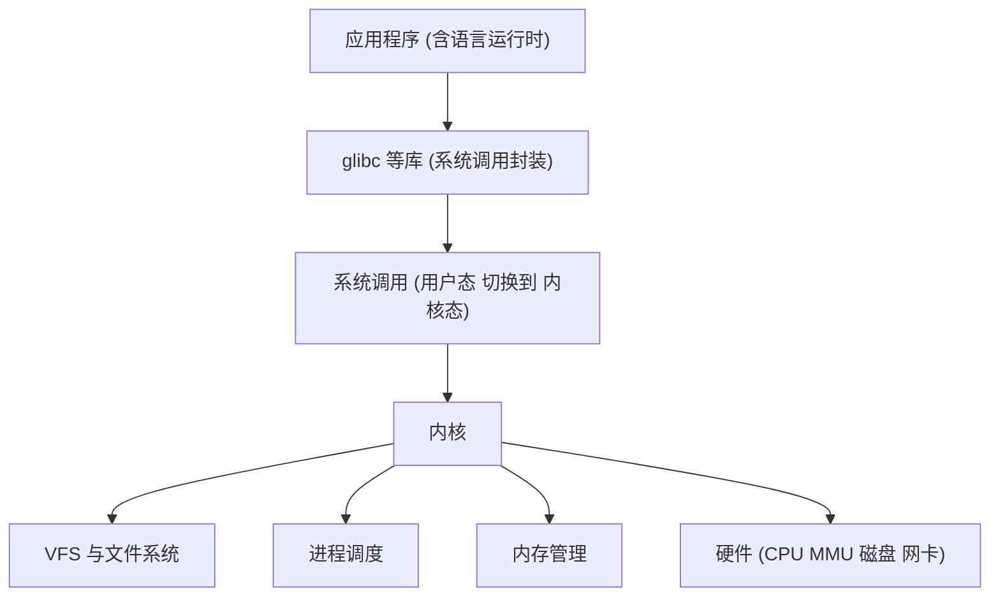
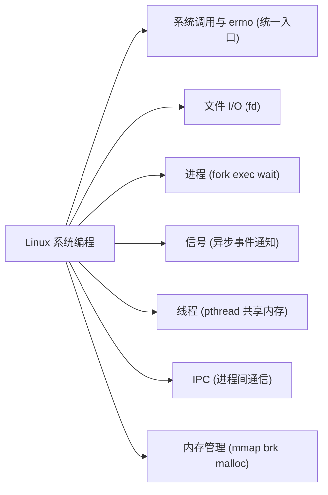
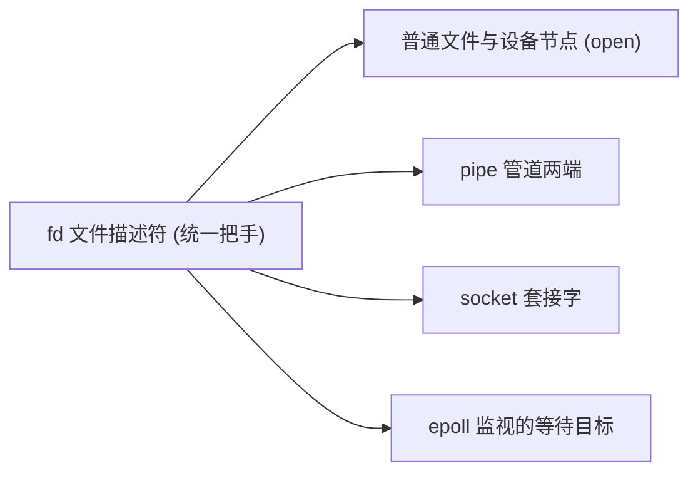
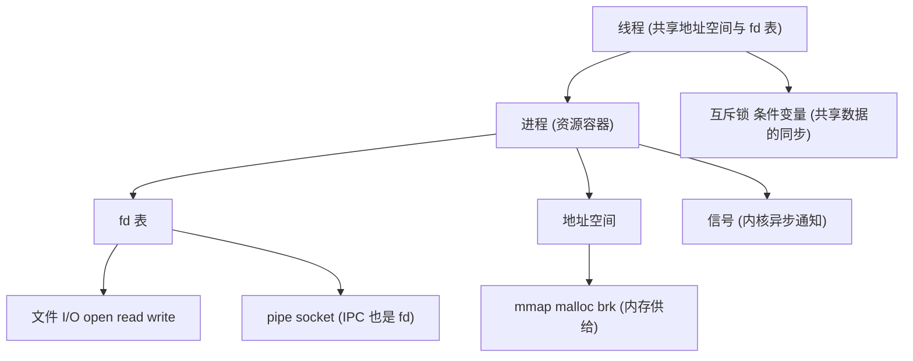
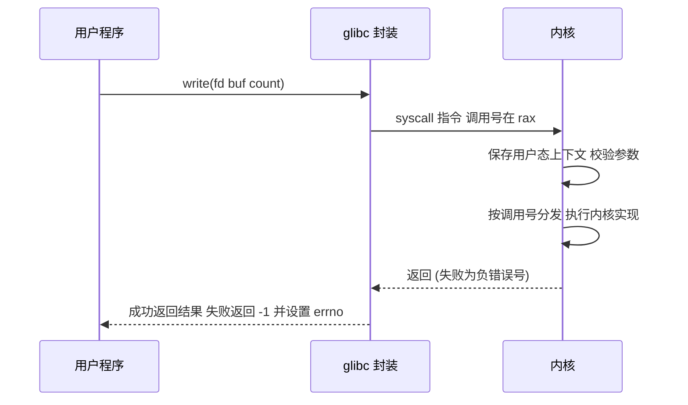
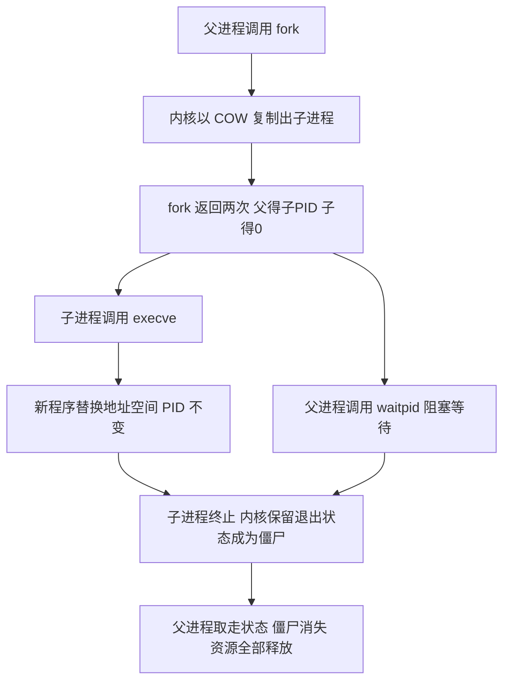

# Linux 系统编程（Linux System Programming）

> 适用范围：用户空间 Linux 系统编程（glibc / POSIX 视角）。核心 API（fd、fork/exec、signal、pthread、pipe、mmap）自 UNIX 时代以来数十年保持稳定，主线内核 2.6 ~ 6.x 均适用；个别接口存在版本差异，文中已标注。
> 学习边界：只讲"用户程序如何使用内核服务"。内核如何实现这些服务（调度器内部、VFS 内部、驱动）属于内核开发主题，见本仓库驱动系列笔记；网络协议本身不展开，socket 只讲"通信接口"定位。
> 阅读目标：10~20 分钟内建立"系统编程是什么、由哪几大块组成、块与块之间如何咬合、真实程序如何运用它们"的整体认知，并拿到一张进入正式学习的地图。

---

## 1. 先建立整体认知

### 1.1 它是什么

**直觉理解**：把操作系统内核想成一栋大楼的物业，你的程序是租户。普通应用开发好比待在自己房间里用家具（库、框架）干活；系统编程则是直接去物业窗口办事——申请房间（内存）、铺水管（管道）、登记住户（进程）、接收紧急广播（信号）。Linux 上"物业窗口"只有一个：**系统调用（system call，简称 syscall）**。

**类比边界**：物业办事有人工排队和商量余地，而系统调用是精确、快速、无状态的机器接口——只有"成功"或"一个错误码"两种结果，没有中间地带。

**严格定义**：Linux 系统编程指在用户空间编写**直接依赖操作系统内核服务**的程序。它的核心主题固定为六块：

| 主题 | 一句话定位 | 代表 API |
| -------- | ----------- | ----------- |
| 文件 I/O | 一切以文件描述符（fd）为中心的读写 | open / read / write / lseek / close |
| 进程 | 程序的运行实例，资源的容器 | fork / exec / wait |
| 信号 | 内核发给进程的异步事件通知 | sigaction / sigprocmask |
| 线程 | 进程内共享地址空间的执行流 | pthread_create / pthread_mutex_lock |
| IPC | 进程之间交换数据与同步 | pipe / shm / sem / socket |
| 内存管理 | 从内核获得和管理虚拟内存 | mmap / brk / malloc |

### 1.2 为什么存在

**为什么必须有系统调用**：

1. **特权级隔离**：CPU 区分用户态与内核态，用户态代码无权直接访问硬件，也无权访问其他进程的内存——这由硬件（MMU、特权级）强制执行，不是约定。
2. **内核是唯一特权软件**：所有"危险但必要"的能力（读写磁盘、创建新进程、收发网络包）都只能由内核代劳。
3. **统一入口带来统一抽象**：正因为所有服务都从同一个入口进出，UNIX 才能建立"一切皆文件（fd）"这样贯穿 50 年的抽象。

**为什么值得专门学**：

- shell 的 `|` 管道 = pipe + fork + dup2 + exec + wait 的组合。不懂系统编程，就看不懂 shell、Docker、nginx 这些工具的底层动作。
- 所有语言运行时的最底层都是这些调用：Python 的 `open()` → glibc `fopen()` → `open(2)` 系统调用。库和框架只是外壳。
- `strace`、守护进程、日志轮转、高并发服务器——工程日常问题全部落在六块主题之内。

一句话：**系统编程 = 学会说内核听得懂的话。**

---

## 2. 在整个体系中的位置



- **glibc 不是必须的**：可以用 `syscall(2)` 直接发起系统调用，但没人日常这么写。库的价值在于封装错误处理、提供 stdio 缓冲、保证跨架构可移植。
- **内核子系统对系统程序员是黑盒服务**：你不需要改它，但必须知道它的行为约定——例如 read 可能部分完成、信号可能在两次系统调用之间到达。
- 驱动开发（本仓库驱动系列笔记）在内核这一侧工作；系统编程在用户这一侧，两侧以系统调用为界。

---

## 3. 知识地图



第二个视角：**fd 是贯穿各主题的统一把手**——这也是"一切皆文件"在系统编程层的真实含义。



下面逐一展开这些核心概念。

---

## 4. 核心概念

### 4.1 系统调用与 errno（统一入口）

**一次系统调用的路径**：

```text
应用程序
    → glibc 封装函数 (如 write)   把系统调用号放入 rax 参数放入约定寄存器
    → syscall 指令 (x86-64)       陷入内核态  老的 i386 用 int 0x80
    → 内核按调用号分发给对应实现   校验参数 执行服务
    → 内核返回                    失败时返回负的错误号
    → glibc 封装                  把负数取正存入 errno  向调用者返回 -1
```

关键点：

- **两套错误约定必须分清**：内核内部返回负错误号（如 -EBADF）；用户空间看到的约定是"返回 -1 + errno 被设置为错误码"。这是同一条错误信息在边界的两侧的不同表达。
- **errno 是线程局部的 int**：每个线程各有一份；只在调用失败时有意义；**成功的调用不会把它清零**——所以错误处理前应先 `int saved = errno;` 再做别的事。
- `perror(3)` / `strerror(3)` 把 errno 转成可读文本。
- **EINTR（被信号打断）不是真错误**：惯例是重试；`sigaction` 的 `SA_RESTART` 标志可让大多数慢系统调用被信号打断后自动重启。
- **strace 是学习放大镜**：`strace ls` 能直接看到程序发起的每一次系统调用及其参数和返回值，比任何教材都直观。

### 4.2 文件描述符与文件 I/O

**fd 的三层模型**（理解它，fork 共享偏移、dup 重定向、进程间 fd 继承全部豁然开朗）：

```text
进程 fd 表 (每进程一份)      系统级打开文件描述 (内核)         磁盘文件
fd 0 (stdin)  ──┐
fd 1 (stdout) ──┼──→ 各自的指针 ──→ { 偏移量  状态标志 } ──→ inode ──→ 数据
fd 3          ──┘                  ↑
        dup 或 fork 产生的多个 fd 可以指向同一个打开文件描述
        因此它们共享偏移量 但不共享 close-on-exec 标志
```

- **fd 是"每进程 fd 表的索引"**：open 成功时返回当前未占用的最小编号；0/1/2 是 POSIX 惯例的 stdin/stdout/stderr。
- **open 的常用 flags**：

| flag | 作用 |
| ------ | ------ |
| O_RDONLY / O_WRONLY / O_RDWR | 三选一必填 |
| O_CREAT | 不存在则创建，权限 = mode & ~umask |
| O_APPEND | 偏移移动与写是**单个原子步骤**（多进程安全追加日志的原理） |
| O_TRUNC | 打开即清空 |
| O_NONBLOCK | 非阻塞（对普通文件无效，对管道/socket 有效） |
| O_CLOEXEC | exec 时自动关闭（内核 2.6.23+，消除竞态） |

- **部分读写是常态，不是异常**：read 返回值可能小于请求量（管道/终端/信号/EOF 都会造成），返回 0 表示 EOF；write 同样可能部分写。**正确惯例是循环读写直到处理完**。
- `lseek() + write()` 是两步操作，多进程并发时会互相覆盖；`O_APPEND` 才是原子的。
- **dup / dup2 与重定向**：shell 的 `cmd > file` 本质 = open + dup2 + close；dup2 的"关闭目标 fd 再复制"是原子操作。fcntl 提供 F_DUPFD、FD_CLOEXEC、F_SETFL 等控制。
- **openat(2) 与 *at 系列**（内核 2.6.16+）：相对目录 fd 解析路径，规避路径解析中的 TOCTOU 竞态；日常少直接用，但要认识。

**stdio 缓冲层与直接系统调用的关系**：

| 层 | 代表函数 | 缓冲位置 | 适用 |
| ---- | ---------- | ---------- | ------ |
| 系统调用层 | open/read/write | 无，每次调用都陷入内核 | 精确控制、二进制、实时性 |
| stdio 层 | fopen/fread/fprintf | 用户态缓冲区 | 文本处理、省 syscall 次数 |

- stdio 三种缓冲模式：全缓冲（默认用于普通文件）、行缓冲（默认用于终端）、无缓冲（**stderr 恒为无缓冲**，所以报错信息总能立刻出来）。`fflush` 强制刷出；**混用 stdio 与裸系统调用前先 fflush**，否则缓冲里的数据顺序会乱。

**文件属性与目录**：

- stat 家族（stat/fstat/lstat）：拿 `struct stat`——st_mode（类型+权限，配 S_ISDIR/S_ISREG 宏判断）、st_size、st_mtime 等；lstat 不跟随符号链接；新接口 statx（内核 4.11+）仅索引。
- 目录操作：opendir/readdir/closedir。注意 readdir 返回 NULL 既可能是"遍历完"也可能是"出错"——必须先清 errno 再调用才能区分。
- **unlink 是"删除名字"不是"删除文件"**：它把链接计数减一；只要还有进程打开着该文件，数据会保留到最后一个 fd 关闭（临时文件的经典实现技巧）。rename 是**原子替换**目标名。

### 4.3 进程：程序的运行实例

- **程序 vs 进程**：程序是磁盘上的可执行文件；进程是其运行实例，拥有独立虚拟地址空间和资源。
- **fork(2)**：一次调用两次返回——父进程得到子进程 PID，子进程得到 0。
  - **写时复制（COW, copy-on-write）**：fork 时不复制内存页，只复制页表；父子任一方写某页时才真正复制该页。这使"复制一个 1GB 的进程"瞬间完成，是 UNIX 进程模型的物理基础。
  - 继承与共享：子进程拿到 fd 的**副本**，但指向同一个"打开文件描述"（所以共享偏移量）；内存经 COW 后逻辑隔离；PID 不同。
- **exec 家族**：`execl/execv`（l=变参列表、v=argv 数组），加 `p` 按 PATH 搜索，加 `e` 显式传环境变量。execve 成功**不返回**——代码、数据、栈全部替换为新程序，但 PID 不变。默认 fd 跨 exec 保持打开，用 O_CLOEXEC/FD_CLOEXEC 控制。
- **终止**：`exit(3)` 按注册逆序调 atexit 函数并刷新 stdio；`_exit(2)` 立即终止什么都不做。退出码 0~255 交给父进程。
- **僵尸进程（zombie）**：已终止但退出状态还没被父进程读取的进程。内核只保留 PID + 退出状态 + 资源用量。它不是泄漏也不是错误，是父进程读取状态的必经状态；但**长期不收尸会耗尽进程表，导致系统无法创建新进程**。父进程先死时，僵尸被 init/systemd（或 subreaper）收养并自动收尸。
- **waitpid** 与状态宏：WIFEXITED（正常退出？）/ WEXITSTATUS（取退出码）/ WIFSIGNALED / WTERMSIG（被哪个信号杀死）。
- **地址空间布局**：

```text
高地址  ┌──────────────────────┐
        │ 命令行参数 argv 与环境变量 │
        ├──────────────────────┤
        │ 栈 (向下生长)             │
        │        ...              │
        │ 堆 (向上生长 malloc brk)  │
        ├──────────────────────┤
        │ bss 未初始化数据            │
        ├──────────────────────┤
        │ data 已初始化数据           │
        ├──────────────────────┤
低地址  │ text 代码段 (只读)          │
        └──────────────────────┘
```

- **环境变量**：`extern char **environ` 指向 `name=value` 数组；getenv/setenv/unsetenv 操作单个条目；fork 自动继承副本，execve 显式传递。

### 4.4 信号：内核的异步通知

信号（signal）= 内核向进程投递的"软件中断"，通知某事件发生了。类比边界：硬件中断由 CPU 投递给内核，信号由内核投递给进程——类比到此为止，两者机制完全不同。

**常见信号**：

| 信号 | 默认动作 | 典型来源 / 含义 |
| -------- | ---------- | ----------------- |
| SIGINT | 终止 | Ctrl+C "请你停下" |
| SIGTERM | 终止 | kill 默认信号，可捕获的"礼貌请求" |
| SIGKILL | 终止 | kill -9，**不可捕获不可忽略**，"直接枪毙" |
| SIGSEGV | 终止 + core | 非法内存访问 |
| SIGPIPE | 终止 | 向读端已全部关闭的管道写入 |
| SIGCHLD | 忽略 | 子进程终止，提醒父进程收尸 |
| SIGUSR1/2 | 终止 | 用户自定义用途 |

**两条铁律**：

1. SIGKILL / SIGSTOP 不可捕获、不可阻塞、不可忽略——系统给自己保留了最终控制权。
2. **标准信号不排队**：阻塞期间产生 100 次同种信号，解除后只投递 1 次。

**signal(2) vs sigaction(2)**：signal() 的语义在 UNIX 各流派（System V 重置处置、BSD 自动屏蔽+重启）之间摇摆，man 页明确警告其可移植性。**一律用 sigaction**：它显式指定语义，`SA_RESTART` 可让被中断的系统调用自动重启。

**信号集与阻塞**：sigemptyset/sigaddset 构造信号集；sigprocmask 设置阻塞掩码（信号延后投递）；sigpending 查看待决信号；sigsuspend 原子地"解除阻塞并挂起等待"——消除"检查标志与设掩码之间"的竞态窗口。

**handler 编程三条规则**：

1. handler 内只调用**异步信号安全（async-signal-safe）**函数（清单见 signal-safety(7)）；printf 和 malloc 都**不在**名单——它们的内部状态被中途打断再重入会损坏。
2. 与 handler 通信的共享变量声明为 `volatile sig_atomic_t`。
3. 惯用法：handler 只置一个标志，主循环里检查标志做实事。

信号送达时机：每次内核态返回用户态之前（系统调用返回时、线程被调度上 CPU 时）检查并投递。扩展索引：signalfd（内核 2.6.22+）把信号变成可 read、可 epoll 的 fd。

### 4.5 线程：进程内的执行流

线程（thread）= 同一地址空间里的多条执行流。Linux 内核视角线程与进程都是 task（NPTL 1:1 模型，经 clone(2) 创建——索引级了解即可）。

**共享 vs 私有**（这张表决定哪些数据要加锁）：

| 共享（须同步） | 私有（无需同步） |
| ---------------- | ------------------ |
| 全局内存（data、bss、堆） | 栈 |
| 打开的 fd 表 | 线程 ID |
| 信号处置 | 信号掩码 |
| 当前目录、umask | errno |

- 核心 API：pthread_create / pthread_join / pthread_detach / pthread_self。joinable 线程不 join 会积累"僵尸线程"耗尽资源——**join 或 detach 二选一**。
- 注意两个约定差异：pthread 函数**直接返回错误码、不设置 errno**（与系统调用 -1+errno 不同）；pthread_t 不可用 == 比较，要用 pthread_equal。
- 经典坑：给 pthread_create 传**局部变量**的地址——创建方函数返回后栈帧失效，新线程读到野数据。
- **互斥锁（mutex）**：保护临界区。`counter++` 实际是"读-加-写"三步，两个线程并发执行会丢更新。
- **条件变量（condition variable）**的标准惯用法：

```c
pthread_mutex_lock(&m);
while (条件不成立)                 /* 必须 while 不能 if */
    pthread_cond_wait(&c, &m);    /* 原子地 解锁+挂起 唤醒后重新加锁 */
/* 此处条件成立 使用数据 */
pthread_mutex_unlock(&m);
```

  - 为什么必须 while：POSIX 明文允许**虚假唤醒（spurious wakeup）**；多个线程可能被同时唤醒；条件在你被唤醒后可能又被别人改掉。wait 必须与 mutex 配对，否则"检查条件"与"进入等待"之间会产生丢失唤醒的竞态。

**线程 vs 进程取舍**：

| | 线程 | 进程 |
| ---- | ------ | ------ |
| 创建/切换开销 | 小 | 大（COW 已大幅缓解） |
| 内存关系 | 默认共享，需加锁 | 相互隔离，天然安全 |
| 崩溃影响 | 任一线程段错误 → 全进程死 | 一个进程死，其他不受影响 |
| 通信 | 直接读写共享变量 | 必须经过内核 IPC |
| 适合 | 计算密集、共享大量数据 | 需要隔离与健壮性（如 nginx worker） |

### 4.6 IPC：进程间通信

**按通信方式分三类**（这个分类比记 API 列表重要）：

```text
数据传输类   pipe FIFO 消息队列 socket    内容经过内核拷贝
共享内存类   shm mmap memfd              内容不经过内核 性能最高 但必须自配同步
同步类       信号量 文件锁               本身不传数据 只协调时序
```

| 机制 | 数据形态 | 使用限制 | 典型场景 |
| -------- | ---------- | ---------- | ---------- |
| pipe 匿名管道 | 单向字节流，无边界 | 仅限有共同祖先的进程 | shell 管道、父子进程 |
| FIFO 命名管道 | 字节流 | 任意进程，有文件名 | 简单本机通信 |
| 消息队列 | 消息，有类型/优先级 | 内核持久对象 | 保留消息边界的传递 |
| 共享内存 | 任意内存块 | 需自配同步 | 大数据量高频交换 |
| 信号量 | 计数器 | — | 同步、互斥、资源计数 |
| socket | 字节流 / 数据报 | 无 | 本机与跨机通用 |

细节要点：

- **pipe(2)**：pipefd[0] 读端、pipefd[1] 写端，数据由内核缓冲（2.6.11 起默认 64KB）。写端全部关闭 → 读端 read 返回 0（EOF）；读端全部关闭 → 写端收到 **SIGPIPE**（忽略该信号则 write 返回 EPIPE）。不超过 PIPE_BUF（Linux 为 4096 字节）的写是原子的。
- **FIFO**：mkfifo(3) 创建，I/O 语义与 pipe 完全一致，数据不落盘。
- **消息队列**：XSI 版（msgget/msgsnd/msgrcv）按 mtype 取消息；POSIX 版（mq_*，内核 2.6.6+）带优先级。对比 pipe 的本质差异：**保留消息边界**。
- **共享内存**：XSI（shmget/shmat）或 POSIX（shm_open + mmap，对象在 /dev/shm）。TLPI 定性：通常是最快的 IPC，因为数据不需要在用户空间与内核之间来回拷贝；代价是**必须自行加同步**（配信号量或互斥锁）。
- **信号量（semaphore）**：P/V 计数器语义，POSIX 版 sem_open/sem_wait/sem_post。与互斥锁的区别：互斥锁有所有权（谁加锁谁解锁），信号量只是计数器，可由不同进程分别操作；生产者-消费者中常"信号量管计数 + 互斥锁管互斥"分工。
- **socket 的定位**：唯一"既能本机又能跨机"的 IPC。AF_UNIX 用于本机（Docker daemon 的 /var/run/docker.sock、X11、systemd socket 激活都是真实案例）；AF_INET 面向网络。服务端流程 socket → bind → listen → accept，客户端 socket → connect。协议细节留给网络编程主题。

### 4.7 内存管理：从页到 malloc

**三层供给模型**：

```text
内核 (页为粒度 4KB 起)
    mmap    把一段虚拟地址映射到文件或匿名内存
    brk     移动堆的上边界
    ↑
C 库 (对象为粒度)
    malloc / free    把大块切成小块 空闲链表复用
    ↑
应用程序 (直接使用)
```

- **虚拟内存为什么存在**：每个进程独享一整套虚拟地址空间（隔离 + 简化链接布局）；MMU 查页表把虚拟页翻译到物理页；**按需调页（demand paging）**让内存页真正被访问时才分配。它是 COW、mmap、共享库的共同基础。x86-64 经典划分为用户空间 / 内核空间各约 128TB（四级页表；五级页表扩至 64PB，仅索引）。
- **mmap(2) 的四种用法**：

| 用法 | 标志 | 效果 |
| ------ | ------ | ------ |
| 把文件当内存读写 | MAP_SHARED + 文件 fd | 修改由内核回写文件 |
| 私有试验性修改 | MAP_PRIVATE | 写时复制，不影响原文件 |
| 匿名大块内存 | MAP_ANONYMOUS | 零初始化、无文件支撑 |
| 多进程共享内存 | MAP_SHARED + 匿名或 shm_open | 各进程映射同一物理页 |

  - mmap 返回时内核只登记了映射，**首次访问才触发缺页异常真正读入**；越出文件尾访问得 SIGBUS，写只读页得 SIGSEGV。
  - 与 read 的取舍：大文件随机/重复访问 mmap 占优；一次性顺序读用 read 往往更简单且不慢（TLPI ch49 立场）——不要无脑 mmap。
- **brk / sbrk**：堆边界操作；sbrk(0) 查询当前值；手册明确建议别直接用（这是 malloc 的内部工具）。
- **malloc 的实现层次**（理解"free 之后内存去哪了"）：

```text
malloc(128B)   → 堆内空闲链表切一块  不够用时 brk 扩堆
malloc(1MB)    → 直接 mmap 一段私有匿名映射 (默认阈值 128KB glibc 会动态调整)
free(小块)      → 归还空闲链表留给下次复用  不还给内核
free(mmap块)    → munmap 立即归还内核
```

---

## 5. 核心概念之间的关系

最核心的结构性洞察：**fd 是系统编程的统一把手**。文件、管道、socket 都表现为一个整数 fd；连"等待"本身（epoll）也是对 fd 集合的操作。六块主题不是并列的零散知识，而是围绕"进程"这个资源容器的不同侧面。



- **进程与线程**：线程共享容器的地址空间与 fd 表——通信零成本但必须加锁；进程之间相互隔离——通信必须经过内核（IPC）。
- **信号是各子系统的异步回执**：SIGCHLD（子进程终止）、SIGPIPE（管道读端关闭）、SIGSEGV（内存违规）——每块主题都会"顺带"遇到信号。
- **mmap 横跨内存管理与文件 I/O**：一块内存同时是文件内容的视图；MAP_SHARED 又是共享内存的实现——它是两大主题的交点。
- **errno / 返回值约定是全体系的通用语法**：六块主题的所有 API 都遵循同一套错误表达。

---

## 6. 工作原理

### 6.1 一次系统调用的完整旅程



### 6.2 fork + exec + wait 的生命周期



### 6.3 一条 shell 管道命令的背后

`ls -l | grep .c` 这条命令用到了本笔记的五个主题：

```text
1 shell 解析到 | 后调用 pipe(pip)          内核里创建管道 得到读端pip[0] 写端pip[1]
2 shell fork() 出子进程A                    将来运行 ls
3 shell fork() 出子进程B                    将来运行 grep
4 子进程A: close(pip[0]) dup2(pip[1] 1) close(pip[1]) exec ls -l
        把管道写端接到自己的 stdout
5 子进程B: close(pip[1]) dup2(pip[0] 0) close(pip[0]) exec grep .c
        把管道读端接到自己的 stdin
6 shell: 关闭自己的两端 wait 两个子进程收尸
数据流: ls 的 stdout == 管道写端 == 内核 64KB 缓冲 == 管道读端 == grep 的 stdin
```

这就是"shell 是系统编程的最佳教材"的原因：一条日常命令，串起 pipe、fork、dup2、exec、wait、fd 重定向、进程状态全部概念。

### 6.4 mmap 与缺页异常

```text
mmap() 返回后 内核只登记了一段虚拟地址区间 什么数据都没读
首次访问该区间某一页 → MMU 页表查不到 → 触发缺页异常 进入内核
内核按映射类型处理
    文件映射 → 分配物理页 从磁盘读入该页 填页表
    匿名映射 → 分配零页
返回用户态 重执行那条访问指令 程序完全无感知
之后 MAP_SHARED 的写页成为脏页由内核回写文件
     MAP_PRIVATE 的写页被 COW 成一份私有副本
```

---

## 7. 示例代码

三个最小示例分别对应知识地图的"文件 I/O""进程""线程"三个分支。

### 7.1 文件 I/O：一个最小的 cat

```c
/* minicat.c  把一个文件的内容写到标准输出
   知识地图位置: 文件 I/O (fd) 分支 */
#include <stdio.h>
#include <stdlib.h>
#include <string.h>
#include <fcntl.h>
#include <unistd.h>
#include <errno.h>

int main(int argc, char *argv[])
{
    char buf[4096];
    ssize_t n;

    if (argc != 2) {
        fprintf(stderr, "usage: %s <file>\n", argv[0]);
        exit(1);
    }

    int fd = open(argv[1], O_RDONLY);          /* 1. 申请 fd */
    if (fd == -1) {                            /* 2. 统一错误约定 -1 + errno */
        fprintf(stderr, "open %s: %s\n", argv[1], strerror(errno));
        exit(1);
    }

    while ((n = read(fd, buf, sizeof(buf))) != 0) {   /* 3. read 返回 0 即 EOF */
        if (n == -1) {
            if (errno == EINTR)                /* 4. 被信号打断 不是真错误 */
                continue;
            perror("read");
            exit(1);
        }
        ssize_t done = 0;
        while (done < n) {                     /* 5. 处理部分写 循环补齐 */
            ssize_t w = write(STDOUT_FILENO, buf + done, n - done);
            if (w == -1) {
                if (errno == EINTR) continue;
                perror("write");
                exit(1);
            }
            done += w;
        }
    }

    close(fd);                                 /* 6. 释放 fd */
    return 0;
}
```

**解释**：这段代码演示 fd 生命周期的完整闭环。open 返回最小编号 fd；read 返回 0 意味着 EOF，返回 -1 意味着出错查 errno，EINTR 需要重试；write 必须写循环因为部分写是常态；close 释放 fd 表槽位。整个程序没有任何魔法——用 `strace ./minicat file` 可以亲眼看到 open/read/write/close 的每次调用。

### 7.2 进程：自己实现一个简化版 system

```c
/* mysystem.c  fork + exec + wait 全家桶
   知识地图位置: 进程 分支 */
#include <stdio.h>
#include <stdlib.h>
#include <unistd.h>
#include <sys/wait.h>

int main(void)
{
    pid_t pid = fork();                    /* 1. 复制进程 一次调用两次返回 */
    if (pid == -1) { perror("fork"); exit(1); }

    if (pid == 0) {                        /* 2. 子进程走到这里 返回值 0 */
        execlp("ls", "ls", "-l", (char *)NULL);   /* 3. 换成新程序 p=搜PATH */
        perror("exec");                    /* 4. exec 成功则永远不会走到这里 */
        _exit(127);                        /* 5. 用 _exit 避免冲刷继承来的 stdio 缓冲 */
    }

    int status;                            /* 6. 父进程走到这里 返回值是子 PID */
    waitpid(pid, &status, 0);              /* 7. 等待并回收 消除僵尸 */
    if (WIFEXITED(status))
        printf("child exited with %d\n", WEXITSTATUS(status));
    return 0;
}
```

**解释**：fork 之后内存（含 stdio 缓冲区）是 COW 副本；exec 成功则原程序映像被整体替换、PID 不变、exec 后面的代码不再执行。子进程失败路径用 `_exit` 而不是 `exit`——因为 exit 会刷新 stdio 缓冲，而那份缓冲是从父进程复制来的，刷新会造成输出重复。waitpid 取走退出状态后僵尸消失；不 wait 子进程就变僵尸。

### 7.3 线程：互斥锁保护共享计数器

```c
/* counter.c  两个线程并发累加 用互斥锁保护共享数据
   知识地图位置: 线程 分支 */
#include <stdio.h>
#include <pthread.h>

static int counter = 0;                                /* 共享数据 */
static pthread_mutex_t lock = PTHREAD_MUTEX_INITIALIZER;

static void *worker(void *arg)
{
    for (int i = 0; i < 100000; i++) {
        pthread_mutex_lock(&lock);      /* 进入临界区 counter++ 实为 读加写 三步 */
        counter++;
        pthread_mutex_unlock(&lock);
    }
    return NULL;
}

int main(void)
{
    pthread_t t1, t2;
    pthread_create(&t1, NULL, worker, NULL);
    pthread_create(&t2, NULL, worker, NULL);
    pthread_join(t1, NULL);              /* join 或 detach 二选一 */
    pthread_join(t2, NULL);
    printf("counter = %d (期望 200000)\n", counter);
    return 0;
}
/* 编译: cc counter.c -o counter -pthread */
```

**解释**：counter++ 不是原子操作，去掉锁跑一下就能看到结果小于 200000（数据竞争）。这验证了线程模型的核心事实：地址空间共享是默认，同步是代价。pthread 函数直接返回错误码（不设 errno）；忘了 join 的 joinable 线程会积累成"僵尸线程"。把锁换成条件变量 + while 循环，就是生产者-消费者模板（见 4.5）。

---

## 8. 实际应用

| 场景 | 用到的设施 | 对应本笔记位置 |
| -------- | ------------ | ---------------- |
| shell 管道 `ls \| grep` | pipe + fork + dup2 + exec + wait | 6.3 |
| 用 strace 排查"程序卡在哪" | 观察系统调用序列 | 4.1 |
| 服务守护进程化（daemon） | fork + 重定向 fd 到 /dev/null（daemon(3) 已封装） | 4.2 / 4.3 |
| 日志轮转、nginx reload | SIGHUP 信号处理 | 4.4 |
| 高并发服务器（nginx、redis、node） | epoll 事件循环（对 fd 的等待） | 3 / 4.2 |
| 本机服务间通信 | AF_UNIX socket（docker、systemd） | 4.6 |
| 数据库 / 浏览器多进程架构 | 共享内存 mmap | 4.7 |
| 容器 | clone 的 namespace 标志（扩展索引） | 10 |

一个观察角度：服务器的三大并发模型——多进程（fork per connection）、多线程（pthread 池）、事件循环（epoll）——正好分别对应本笔记的"进程""线程""fd + 多路复用"三块。学完系统编程，你就具备了读懂 nginx（多进程 + epoll）、redis（单线程事件循环）、dockerd（Unix socket 服务）架构选型的词汇。

---

## 9. 常见误区

### 误区 1："fork 会复制全部内存，开销巨大"

- **为什么容易这样理解**：fork 直译是"复制"，直觉上以为逐字节拷贝。
- **正确理解**：COW 写时复制——fork 只复制页表和内核对象，内存页标记为只读共享；任何一方**写入时**才真正复制那一页。复制 1GB 的进程与复制 1KB 的进程成本几乎一样。

### 误区 2："read(fd, buf, n) 一定会返回 n 字节"

- **为什么容易这样理解**：读文件时大多数确实如此，让人形成错误预期。
- **正确理解**：部分读写是常态——管道数据未满、终端按行到达、信号打断、到达 EOF 都会造成短读。返回 0 是 EOF，返回 -1 查 errno，其余情况**继续循环**。网络和管道编程中不写循环是必修Bug。

### 误区 3："errno 是全局变量，随时可读"

- **为什么容易这样理解**：老教材和它的名字（error number）给人全局印象。
- **正确理解**：errno 是**线程局部**的；只在调用失败时有意义；成功的调用不会清零。在检查 errno 之前调用 printf 都可能把它冲掉——先保存再做别的。

### 误区 4："信号 handler 里可以像普通函数一样写代码"

- **为什么容易这样理解**：handler 看起来就是个普通 C 函数。
- **正确理解**：信号可能在程序任意两条指令之间到达，handler 里调用 printf/malloc 这类非异步信号安全函数会破坏内部状态。handler 只置 `volatile sig_atomic_t` 标志，主循环做实事。另外标准信号不排队——阻塞期间发 100 次只到 1 次。

### 误区 5："僵尸进程是出错了，kill 掉就好"

- **为什么容易这样理解**："僵尸"听起来像异常状态；ps 里看到 <defunct> 让人紧张。
- **正确理解**：僵尸是**已正常终止**、等待父进程读取退出状态的进程；kill 对它无效（它已经死了）。正确做法是父进程 wait/waitpid 收尸；父进程不管的话，自己退出后被 init/systemd 收养并自动收尸。长期僵尸堆积会耗尽进程表。

### 误区 6："mmap 一定比 read 快"

- **为什么容易这样理解**：mmap "少一次拷贝"的说法流传很广。
- **正确理解**：mmap 有缺页异常、页表、TLB 的隐性成本。大文件随机/重复访问确实占优；一次性顺序读大块 read 通常一样快甚至更简单。选型看访问模式，不是无脑 mmap。

### 误区 7："free 之后内存立刻还给操作系统"

- **为什么容易这样理解**：free 与 malloc 字面上是对称的。
- **正确理解**：小块 free 只是把内存放回 glibc 的空闲链表供下次复用；只有大块（mmap 分配的）free 时才 munmap 立即归还。程序"占着内存不用"常是正常现象，观察 RSS 判断泄漏时要知道这一点。

---

## 10. 相关知识

```text
Linux 系统编程
├── 内核子系统 (VFS 调度 内存管理)     实现侧视角 见本仓库驱动系列笔记
├── glibc 与 C 标准库                 系统调用之上的封装与缓冲层
├── POSIX 标准                        可移植性边界 (写跨 UNIX 平台代码时的依据)
├── 网络编程                          socket 的深入主题 (协议 TCP UDP)
├── 高性能 I/O                        epoll 实战 io_uring (内核 5.1+)
├── 容器与安全                        namespace cgroup capabilities 本质是 clone 的标志位
├── shell 与脚本                      fork exec pipe 的现成编排器
└── 调试与观测                         strace ltrace gdb perf /proc
```

- **与驱动系列笔记的衔接**：驱动笔记讲"内核侧如何实现服务"，本笔记讲"用户侧如何消费服务"，两侧以系统调用边界相接（例如字符设备笔记的 file_operations 正对应用户的 open/read/write/ioctl）。
- **POSIX 的角色**：fork、pthread、pipe 等都是 POSIX 标准 API；Linux man-pages 同时标注 POSIX 与 Linux 特有行为，读文档时注意区分。

---

## 11. 知识脉络

```text
1960s 计算机昂贵 一批用户排队独占整机
    ↓ 问题 CPU 大部分时间在等 I/O 利用率极低
多道程序与分时系统出现 多个程序同时驻留内存轮流执行
    ↓ 问题 进程之间会互相踩内存 一个程序崩溃拖垮所有人
CPU 特权级与虚拟内存出现 MMU 页表把用户程序关进笼子 内核成为唯一特权软件
    ↓ 笼子里的程序如何办事
系统调用成为唯一合法入口 (1970s UNIX 的陷阱机制 今日 x86-64 的 syscall 指令)
    ↓ 有了入口 服务如何分类
以 fd 为中心的一切皆文件 (open read write close 四个原语通吃文件与设备)
    ↓ 问题 程序不止读文件 还要创建协作的伙伴
进程模型 fork 复制自己 exec 换身体 wait 收尸 (每个系统调用只做一件事 组合出强大)
    ↓ 问题 伙伴之间如何交换数据
IPC 家族 pipe (1973 管道进入 shell) → SysV 补齐消息队列共享内存信号量 → socket 统一本机与跨机
    ↓ 问题 同时等大量 fd 或计算与 I/O 并行
I/O 多路复用 select → poll → epoll 与线程 pthread (共享地址空间的轻量执行流)
    ↓ 问题 单个进程一个信号一条网络包都要一个系统调用 太贵
异步与批量方向演化 io_uring (内核 5.1) signalfd memfd_create (扩展索引)
    ↓ 应用这层能力的典型形态
服务器三模型 (多进程 多线程 事件循环) 与容器 (namespace 即 clone 的标志位)
```

---

## 12. 正式学习时重点关注

1. 用户态/内核态切换的代价是什么？为什么系统编程鼓励"一次 syscall 干更多事"（如 writev、批量操作）？
2. fd 到底是什么？fd 表 → 打开文件描述 → inode 三层模型如何解释 dup、fork、重定向的行为？
3. read/write 为什么必须写成循环？哪些情况会造成部分读写？EINTR 如何正确处理？
4. COW 如何让 fork 变得廉价？它和 mmap 的 MAP_PRIVATE 有什么共同机制？
5. 为什么推荐 sigaction 而不是 signal？handler 里能做什么不能做什么？sig_atomic_t 解决什么问题？
6. 条件变量为什么要用 while 而不是 if？丢失唤醒和虚假唤醒分别是什么？
7. 各 IPC 机制分别适合什么数据形态（字节流 / 消息 / 大块内存）？共享内存为什么必须配同步？
8. mmap、brk、malloc 三层的分工边界在哪里？为什么 free 后 RSS 常常不降？
9. epoll 为什么能支撑海量连接？水平触发（LT）与边缘触发（ET）的区别是什么？

---

## 13. 参考资料

**第一优先级（官方文档与标准）**

1. Linux man-pages 项目（Michael Kerrisk 维护）：https://man7.org/linux/man-pages/ —— 所有系统调用的最终解释权。本笔记事实主要来源：open(2)、read(2)、write(2)、dup(2)、fcntl(2)、stat(2)、unlink(2)、rename(2)、readdir(3)、errno(3)、fork(2)、execve(2)、wait(2)、environ(7)、signal(7)、sigaction(2)、signal-safety(7)、signalfd(2)、pthreads(7)、nptl(7)、pthread_create(3)、pthread_join(3)、pthread_cond_wait(3)、select(2)、poll(2)、epoll(7)、unix(7)、pipe(7)、fifo(7)、sysvipc(7)、mq_overview(7)、shm_overview(7)、sem_overview(7)、mmap(2)、malloc(3)、syscall(2)、syscalls(2)、io_uring(7)
2. POSIX.1-2017 规范：https://pubs.opengroup.org/onlinepubs/9799919799/ —— 虚假唤醒、信号语义等规范原文
3. GNU C Library 手册：https://www.gnu.org/software/libc/manual/ —— stdio 缓冲、malloc 行为、EINTR 重试（TEMP_FAILURE_RETRY）
4. Linux Kernel 文档：https://docs.kernel.org/ —— x86_64 地址空间划分（arch/x86/x86_64/mm）、overcommit 策略（mm/overcommit-accounting）

**第二优先级（高质量书籍与文章）**

5. 《The Linux Programming Interface》（TLPI，Michael Kerrisk，No Starch Press 2010）—— 系统编程事实上的标准著作。章节对应：ch4~5 文件 I/O、ch13 缓冲、ch20~22 信号、ch24~28 进程、ch29~31 线程、ch43~54 IPC 与 mmap。目录：https://man7.org/tlpi/
6. LWN.net：https://lwn.net/ —— io_uring 等新机制的深度文章

**第三优先级（社区）**

7. Stack Overflow / man-pages 讨论列表 —— 用于裁决具体版本行为争议，不作为主要事实来源
