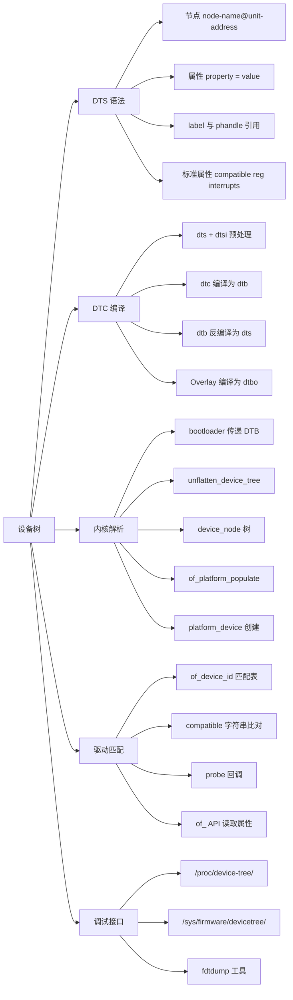
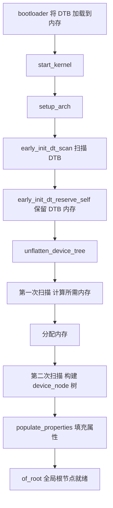
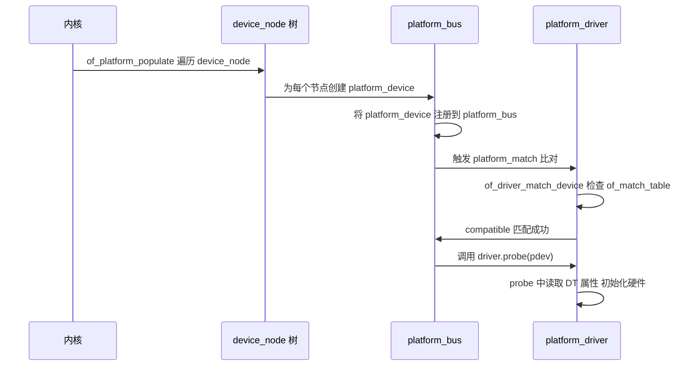
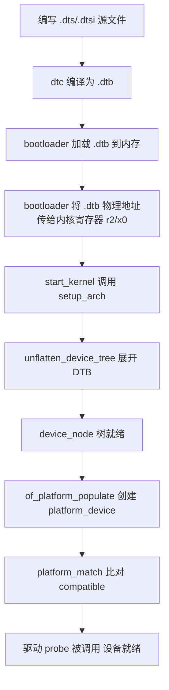

# Linux 设备树（Device Tree）

> 适用范围：Linux 3.7+（ARM 广泛采用）。核心机制（DTS 语法、DTB 格式、OF API、platform 匹配）自 3.x 起稳定；YAML schema 验证自 5.4 引入；Overlay 机制自 4.x 逐步成熟。
> 前置关联：建议先了解 Linux 驱动模块（module_init/exit、platform_driver）和字符设备（设备号、cdev、file_operations）。设备树不是驱动的一部分，而是"告诉内核硬件长什么样"的数据描述——驱动再通过 `compatible` 匹配找到自己的设备。
> 阅读目标：10~20 分钟内建立"设备树是什么、为什么存在、语法怎么写、内核怎么解析、驱动怎么匹配"的可靠整体认知。

---

## 1. 先建立整体认知

### 1.1 它是什么

**直觉理解**：你有一块 ARM 开发板，上面有 UART、I2C、SPI 控制器、GPIO、内存等各种外设。内核怎么知道这些外设的寄存器地址是多少？中断线连在哪里？时钟频率是多少？——答案是设备树。它是一个**数据文件**，用树状结构描述硬件信息，bootloader 在启动时把它传给内核，内核解析后为每个硬件节点创建对应的 `platform_device`，驱动再通过 `compatible` 属性匹配到自己的设备。

**严格定义**：Device Tree（DT）是一种**数据结构和语言**，源自 Open Firmware（IEEE 1275），用于描述硬件拓扑。Linux 在启动时从 bootloader 接收一个扁平二进制（Flattened Device Tree，FDT / DTB），将其展开为内核内部的 `struct device_node` 树，再转换为 `platform_device` 等设备对象，最后通过 `compatible` 属性与驱动绑定。

### 1.2 为什么存在

**在设备树出现之前**：内核代码中硬编码板级信息，称为"board file"。

```text
arch/arm/mach-xxx/board-myboard.c

static struct platform_device *myboard_devices[] __initdata = {
    &uart_device,    /* 基地址寄存器地址、IRQ 号写死在 C 代码里 */
    &i2c_device,
    &led_device,
};

static void __init myboard_init(void)
{
    uart_device.resource[0].start = 0x44E09000;  /* 硬编码地址 */
    uart_device.resource[0].end = 0x44E09000 + 0x100;
    uart_device.resource[1].start = 72;           /* 硬编码 IRQ */
    platform_add_devices(myboard_devices, ARRAY_SIZE(myboard_devices));
}
```

**问题**：每出一块新板子就要改内核 C 代码、重新编译内核。N 个芯片厂商 x M 个板子 = N x M 个 board file，内核源码膨胀且难以维护。

**设备树的解法**：把硬件描述从内核代码中抽出来，变成独立的**数据文件**（.dts）。同一个内核镜像可以适配不同板子，只需换一个 .dtb 文件。

```text
之前：                          之后：
内核代码 + board file.c         内核镜像（不变）
    ↓                              ↓
编译为一个内核镜像              bootloader 加载对应的 .dtb
    ↓                              ↓
只支持一种板子                  支持多种板子（换 .dtb 即可）
```

> 版本提示：设备树最初为 PowerPC 创建（2005 年），ARM 架构在 Linux 3.7（2012 年）开始大规模切换，移除了大量 board file。目前 arm64 从第一天起就完全依赖设备树，不再有 board file。

### 1.3 在整个体系中的位置

```text
硬件开发板
    |
bootloader (U-Boot / GRUB)
    | 加载 DTB 到内存 将物理地址传给内核
    v
Linux Kernel
    | start_kernel -> setup_arch -> unflatten_device_tree
    | DTB 二进制 blob -> struct device_node 树
    | of_platform_populate -> platform_device
    v
驱动（platform_driver）
    | of_match_table 中的 compatible 与 DT 节点的 compatible 比对
    | 匹配成功 -> probe() 被调用
    v
设备功能就绪
```

设备树不是驱动代码——它是数据。它不描述"怎么操作硬件"，只描述"硬件在哪里、长什么样"。

---

## 2. 在整个体系中的位置

与开发者工具链的关系：

| 组件 | 职责 | 与设备树的关系 |
| --- | --- | --- |
| `.dts` / `.dtsi` | 设备树源文件 | 板级 / SoC 级硬件描述 |
| `dtc` | Device Tree Compiler | 将 .dts 编译为 .dtb |
| `.dtb` | 设备树二进制 | bootloader 加载并传给内核 |
| `.dtbo` | 设备树 Overlay | 运行时叠加修改基础 DTB |
| bootloader | U-Boot / GRUB 等 | 加载 DTB 传给内核 |
| Linux OF 子系统 | Open Firmware 框架 | 解析 DTB 为内核数据结构 |
| platform_driver | 平台驱动 | 通过 compatible 匹配 DT 节点 |

---

## 3. 知识地图



---

## 4. 核心概念

### 4.1 DTS 文件结构

- 中文名称：设备树源文件
- 英文名称：Device Tree Source，缩写 DTS
- 一句话解释：以文本形式描述硬件拓扑的源文件，编译后生成 DTB 供内核使用。
- 在当前知识中的作用：开发者编写和修改的直接对象。

DTS 文件的基本结构：

```dts
/dts-v1/;

/ {
    model = "My Board";
    compatible = "myvendor,myboard", "myvendor,mysoc";

    #address-cells = <1>;
    #size-cells = <1>;

    cpus {
        #address-cells = <1>;
        #size-cells = <0>;
        cpu@0 {
            device_type = "cpu";
            reg = <0>;
        };
    };

    memory@80000000 {
        device_type = "memory";
        reg = <0x80000000 0x20000000>;
    };

    uart@44e09000 {
        compatible = "ti,am3352-uart", "ti,omap3-uart";
        reg = <0x44e09000 0x2000>;
        interrupts = <72>;
        clock-frequency = <48000000>;
        status = "okay";
    };
};
```

文件类型对比：

| 类型 | 扩展名 | 职责 | 类比 |
| --- | --- | --- | --- |
| DTS | `.dts` | 板级描述（具体某块板子） | C 语言的 `.c` |
| DTSI | `.dtsi` | SoC 级公共描述（被 .dts 包含） | C 语言的 `.h` |
| DTB | `.dtb` | 编译后的二进制 | 编译后的 `.o` |
| DTBO | `.dtbo` | Overlay 二进制（运行时叠加） | 补丁文件 |

### 4.2 节点（Node）

- 中文名称：节点
- 一句话解释：设备树的基本单元，描述一个设备或总线。
- 在当前知识中的作用：每个节点对应一个硬件设备，内核会为它创建对应的设备对象。

节点语法：

```dts
[label:] node-name[@unit-address] {
    [properties];
    [child nodes];
};
```

各部分说明：

| 部分 | 必需 | 说明 | 示例 |
| --- | --- | --- | --- |
| label | 否 | 节点别名 供 `&label` 引用 | `uart0:` |
| node-name | 是 | 设备类名 小写字母+数字+连字符 | `serial` |
| unit-address | 有 reg 时必须 | 寄存器基地址 十六进制 | `@44e09000` |
| properties | 否 | 属性键值对 | `compatible = ...` |
| child nodes | 否 | 子节点 | 总线下的从设备 |

> 版本提示：内核文档 `dts-coding-style.rst` 要求节点名和属性名只使用 `[a-z0-9-]`，label 只使用 `[a-z0-9_]`，unit-address 用小写十六进制且不补零。

### 4.3 属性（Property）

- 中文名称：属性
- 一句话解释：节点的键值对，描述设备的具体特征（地址、中断、时钟等）。
- 在当前知识中的作用：属性是设备树描述硬件的核心载体——内核和驱动通过读取属性获取硬件信息。

属性值的数据类型：

| 类型 | 语法 | 示例 |
| --- | --- | --- |
| 空属性 | `property-name;` | `interrupt-controller;` |
| 32 位整数 | `property-name = <0x1234>;` | `reg = <0x80000000 0x20000000>;` |
| 字符串 | `property-name = "string";` | `compatible = "ti,omap3-uart";` |
| 字符串列表 | `property-name = "str1", "str2";` | `compatible = "ti,am3352-uart", "ti,omap3-uart";` |
| 字节数组 | `property-name = [01 02 03];` | `mac-address = [00 0a 0b 0c 0d 0e];` |
| 引用 | `property-name = <&label>;` | `interrupt-parent = <&gic>;` |

### 4.4 标准属性

这些是设备树规范（devicetree.org）预定义的通用属性，适用于所有节点。

#### compatible

- 英文名称：compatible
- 一句话解释：字符串列表，标识设备类型和驱动匹配依据。格式为 `"厂商,型号"`。
- 在当前知识中的作用：**驱动绑定的核心依据**——驱动代码中声明 `of_match_table`，内核比对节点的 `compatible` 与驱动的匹配表，一致则触发 `probe()`。

```dts
uart@44e09000 {
    compatible = "ti,am3352-uart", "ti,omap3-uart";
};
```

匹配规则：从左到右逐个尝试。先试 `"ti,am3352-uart"`（最具体），再试 `"ti,omap3-uart"`（更通用）。第一个匹配成功的驱动胜出。

#### reg

- 英文名称：reg（register region）
- 一句话解释：设备的寄存器地址范围，格式由父节点的 `#address-cells` 和 `#size-cells` 决定。
- 在当前知识中的作用：告诉内核设备寄存器的物理地址和大小，驱动通过 `platform_get_resource()` 获取后做 `ioremap`。

```dts
parent {
    #address-cells = <1>;   /* address 用 1 个 cell */
    #size-cells = <1>;      /* size 用 1 个 cell */

    child@80000000 {
        reg = <0x80000000 0x1000>;  /* 地址 0x80000000 长度 0x1000 */
    };
};
```

#### #address-cells 和 #size-cells

- 一句话解释：父节点的这两个属性决定了子节点 `reg` 属性中每个字段的 cell 数量。
- 在当前知识中的作用：设备树地址描述的核心机制——不理解它就读不懂 `reg`。

```dts
soc {
    #address-cells = <1>;   /* 子节点 reg 的地址部分用 1 个 cell */
    #size-cells = <1>;      /* 子节点 reg 的长度部分用 1 个 cell */

    serial@44e09000 {
        reg = <0x44e09000 0x2000>;  /* 1 cell 地址 + 1 cell 长度 */
    };
};

cpus {
    #address-cells = <1>;
    #size-cells = <0>;      /* CPU 没有 size 概念 */

    cpu@0 {
        reg = <0>;          /* 只有地址 没有 size */
    };
};
```

#### interrupts 和 interrupt-parent

- 一句话解释：`interrupts` 描述设备使用的中断号和触发方式；`interrupt-parent` 指向中断控制器节点。
- 在当前知识中的作用：内核解析后通过 `platform_get_irq()` 传递给驱动。

```dts
gic: interrupt-controller@10484000 {
    compatible = "arm,cortex-a9-gic";
    #interrupt-cells = <3>;   /* 子节点 interrupts 用 3 个 cell */
    interrupt-controller;
    reg = <0x10484000 0x1000>, <0x10485000 0x1000>;
};

uart@44e09000 {
    interrupt-parent = <&gic>;
    interrupts = <0 72 4>;  /* type=0 SPI irq=72 flag=4 (高电平触发) */
};
```

`#interrupt-cells` 的值由中断控制器节点定义，决定 `interrupts` 属性用几个 cell。

#### status

- 一句话解释：控制设备是否启用。`"okay"` 表示启用，`"disabled"` 表示禁用。
- 在当前知识中的作用：内核只为 `status = "okay"`（或无 status 属性）的节点创建设备对象。

```dts
&uart0 {
    status = "okay";    /* 启用 */
};

&i2c1 {
    status = "disabled";  /* 禁用 内核不会为它创建设备 */
};
```

#### phandle 与 label

- 英文名称：phandle（pointer handle）
- 一句话解释：节点的全局唯一数字标识，由 dtc 编译时自动生成，用于跨节点引用。
- 在当前知识中的作用：实现设备树中节点间的交叉引用（如中断控制器的引用）。

```dts
/* 源文件中用 label 引用 */
gic: interrupt-controller@10484000 {
    /* ... */
};

uart@44e09000 {
    interrupt-parent = <&gic>;   /* &gic 编译后变成 phandle 数字 */
};

/* dtc 编译后自动生成 */
/* interrupt-controller@10484000 { phandle = <0x1>; ... }; */
/* uart@44e09000 { interrupt-parent = <0x1>; ... }; */
```

> label 和 phandle 的关系：label 是源码层面的别名（给人看），phandle 是编译后的数字 ID（给机器用）。`&label` 在 `<>` 内引用时编译为 phandle，在 `<>` 外引用时编译为路径字符串。

### 4.5 DTC 编译器

- 英文名称：Device Tree Compiler，缩写 DTC
- 一句话解释：将 .dts 编译为 .dtb 的工具，也能反向反编译。
- 在当前知识中的作用：连接源文件和运行时的桥梁。

```bash
# 编译 DTS 为 DTB
dtc -I dts -O dtb -o output.dtb input.dts

# 反编译 DTB 为 DTS（调试用）
dtc -I dtb -O dts -o output.dts input.dtb

# 在内核源码树中编译
make dtbs ARCH=arm CROSS_COMPILE=arm-linux-gnueabihf-

# 检查语法（不生成输出）
dtc -I dts -O dts input.dts

# 启用所有警告
dtc -W all input.dts
```

DTB 二进制格式结构：

```text
+------------------+
| fdt_header       |  元数据 (magic, version, sizes, offsets)
+------------------+
| memory reserve   |  预留内存区域列表
+------------------+
| structure block |  节点树结构 (tag + name + properties)
+------------------+
| strings block    |  属性名字符串池 (去重存储)
+------------------+
```

### 4.6 内核解析流程

这是设备树从数据到设备对象的核心转换过程。



`struct device_node` 是内核中表示设备树节点的数据结构：

```c
struct device_node {
    const char *name;           /* 节点名 */
    const char *type;          /* device_type 属性值 */
    phandle phandle;           /* phandle 值 */
    const char *full_name;     /* 完整路径 如 /soc/uart@44e09000 */
    struct property *properties;  /* 属性链表 */
    struct device_node *parent;   /* 父节点 */
    struct device_node *child;    /* 第一个子节点 */
    struct device_node *sibling;  /* 兄弟节点 */
    struct device_node *next;     /* 全局链表 供遍历用 */
    struct device_node *allnext;  /* 全局 allnext 链表 */
    /* ... */
};
```

### 4.7 设备创建与驱动匹配

内核解析 DTB 后得到 `device_node` 树，但 `device_node` 本身不是设备模型中的 `device`。还需要一步转换：



`platform_match()` 的匹配优先级（内核 4.x+）：

```text
1. driver_override（最高优先级 手动指定）
2. of_match_table（设备树 compatible 匹配）  <-- 本文重点
3. id_table（传统 platform_device_id 匹配）
4. driver.name（名称匹配 最老的方式）
```

### 4.8 of_ API

- 英文名称：Open Firmware API
- 一句话解释：内核提供给驱动代码读取设备树属性的一组函数。
- 在当前知识中的作用：驱动在 `probe()` 中用这些函数从 DT 节点获取硬件参数。

常用 of_ API：

| 函数 | 作用 |
| --- | --- |
| `of_find_node_by_name(from, name)` | 按节点名查找 |
| `of_find_node_by_phandle(phandle)` | 按 phandle 查找 |
| `of_get_property(np, propname, lenp)` | 获取属性原始值 |
| `of_property_read_string(np, propname, out)` | 读取字符串属性 |
| `of_property_read_u32(np, propname, out)` | 读取 32 位整数 |
| `of_property_read_u32_array(...)` | 读取整数数组 |
| `of_get_named_gpio(np, propname, index)` | 获取 GPIO 编号 |
| `of_irq_get(np, index)` | 获取中断号 |
| `of_address_to_resource(np, index, res)` | 获取 reg 资源 |
| `of_device_is_available(np)` | 检查 status 是否为 okay |
| `of_node_put(np)` | 释放节点引用计数 |

---

## 5. 工作原理

### 5.1 完整生命周期



### 5.2 DTS 与 DTSI 的包含关系

一个典型的 SoC 有多块板子使用，DTSI 描述 SoC 公共部分，DTS 描述板级差异：

```text
soc-vendor.dtsi          SoC 级描述（所有该 SoC 板子共用）
    |
    +-- board-a.dts      板级 A（include dtsi 并扩展/覆盖）
    +-- board-b.dts      板级 B（include 同一 dtsi 并扩展/覆盖）
```

```dts
/* board-a.dts */
/dts-v1/;

#include "soc-vendor.dtsi"    /* SoC 公共外设 */

/ {
    model = "Vendor Board A";
    compatible = "vendor,board-a", "vendor,soc-x";

    leds {
        compatible = "gpio-leds";
        led0 {
            label = "status";
            gpios = <&gpio1 12 0>;
        };
    };
};

/* 覆盖 dtsi 中的节点 */
&uart0 {
    status = "okay";          /* dtsi 中默认 disabled 这里改为 okay */
};
```

### 5.3 compatible 匹配机制详解

驱动代码中的匹配表：

```c
static const struct of_device_id my_driver_match[] = {
    { .compatible = "ti,am3352-uart", .data = &am3352_uart_data },
    { .compatible = "ti,omap3-uart", .data = &omap3_uart_data },
    { /* sentinel */ }
};
MODULE_DEVICE_TABLE(of, my_driver_match);

static struct platform_driver my_driver = {
    .probe  = my_probe,
    .remove = my_remove,
    .driver = {
        .name = "my-uart-driver",
        .of_match_table = my_driver_match,
    },
};
module_platform_driver(my_driver);
```

匹配过程：

```text
DT 节点: compatible = "ti,am3352-uart", "ti,omap3-uart"

驱动 of_match_table:
    [0] .compatible = "ti,am3352-uart"
    [1] .compatible = "ti,omap3-uart"

匹配逻辑：
    遍历 DT 节点的 compatible 列表
        "ti,am3352-uart" --> 在驱动表中找到 [0] 匹配
    第一个匹配成功 停止搜索
    调用 probe() 传入 platform_device
```

> 版本提示：`MODULE_DEVICE_TABLE(of, ...)` 宏让 depmod 在编译时提取 compatible 字符串，生成 `modules.alias`。这样用户态 udev 在设备树节点出现时可以自动加载对应驱动模块。

---

## 6. 示例：最小设备树 + 驱动

### 6.1 DTS 文件

```dts
/* myboard.dts - 最小设备树示例 */
/dts-v1/;

/ {
    model = "My Minimal Board";
    compatible = "myvendor,myboard";
    #address-cells = <1>;
    #size-cells = <1>;

    cpus {
        #address-cells = <1>;
        #size-cells = <0>;
        cpu@0 {
            device_type = "cpu";
            reg = <0>;
        };
    };

    memory@80000000 {
        device_type = "memory";
        reg = <0x80000000 0x08000000>;   /* 128MB RAM */
    };

    /* 我们的自定义 LED 设备 */
    myled: led@44000000 {
        compatible = "myvendor,myled";   /* 驱动匹配的字符串 */
        reg = <0x44000000 0x1000>;       /* 寄存器地址和大小 */
        myvendor,led-count = <4>;        /* 自定义属性 4 个 LED */
        status = "okay";
    };
};
```

### 6.2 驱动代码

```c
/* myled.c - 对应的 platform 驱动 */
#include <linux/module.h>
#include <linux/platform_device.h>
#include <linux/of.h>
#include <linux/of_device.h>
#include <linux/io.h>

struct myled_dev {
    void __iomem *base;
    u32 led_count;
};

static const struct of_device_id myled_match[] = {
    { .compatible = "myvendor,myled", .data = NULL },
    { /* sentinel */ }
};
MODULE_DEVICE_TABLE(of, myled_match);

static int myled_probe(struct platform_device *pdev)
{
    struct device_node *np = pdev->dev.of_node;
    struct resource *res;
    struct myled_dev *dev;
    u32 count;
    int ret;

    dev = devm_kzalloc(&pdev->dev, sizeof(*dev), GFP_KERNEL);
    if (!dev)
        return -ENOMEM;

    /* 从设备树获取 reg 资源并映射 */
    res = platform_get_resource(pdev, IORESOURCE_MEM, 0);
    dev->base = devm_ioremap_resource(&pdev->dev, res);
    if (IS_ERR(dev->base))
        return PTR_ERR(dev->base);

    /* 从设备树读取自定义属性 */
    ret = of_property_read_u32(np, "myvendor,led-count", &count);
    if (ret) {
        dev_warn(&pdev->dev, "led-count not found using default\n");
        count = 1;
    }
    dev->led_count = count;

    dev_info(&pdev->dev, "probed at %pr led-count=%d\n",
             res, dev->led_count);

    platform_set_drvdata(pdev, dev);
    return 0;
}

static int myled_remove(struct platform_device *pdev)
{
    dev_info(&pdev->dev, "removed\n");
    return 0;
}

static struct platform_driver myled_driver = {
    .probe  = myled_probe,
    .remove = myled_remove,
    .driver = {
        .name = "myled",
        .of_match_table = myled_match,
    },
};
module_platform_driver(myled_driver);

MODULE_AUTHOR("Example");
MODULE_DESCRIPTION("Minimal DT-based LED Driver");
MODULE_LICENSE("GPL");
```

### 6.3 Makefile

```makefile
obj-m := myled.o

KDIR := /lib/modules/$(shell uname -r)/build

all:
	make -C $(KDIR) M=$(PWD) modules

clean:
	make -C $(KDIR) M=$(PWD) clean
```

### 6.4 编译与验证

```bash
# 编译设备树
dtc -I dts -O dtb -o myboard.dtb myboard.dts

# 编译驱动模块
make

# 将 dtb 和 .ko 复制到目标板后
# 加载驱动
insmod myled.ko

# 检查设备树节点（在目标板上）
ls /proc/device-tree/led@44000000/

# 查看驱动是否绑定成功
dmesg | grep myled
# 预期输出: myled led@44000000: probed at [mem 0x44000000-0x44000fff] led-count=4
```

> 这组示例展示了从 DTS 描述到驱动匹配再到 probe 读取属性的完整链路。注意驱动代码中没有任何硬编码地址——所有硬件信息来自设备树。

---

## 7. 常见误区

### 误区 1：设备树是驱动代码的一部分

```text
错误理解：设备树是驱动的一部分 驱动代码中包含设备树。
    ↓ 为什么容易这样理解：学驱动时经常 DTS 和 .c 一起写。
正确理解：设备树是数据 驱动是代码。设备树描述"硬件在哪里" 驱动描述"怎么操作硬件"。
         两者通过 compatible 属性松耦合。同一个驱动可以匹配不同设备树节点。
```

### 误区 2：compatible 字符串可以随便写

```text
错误理解：compatible 写什么都行 只要和驱动代码一致。
    ↓ 为什么容易这样理解：匹配确实只要两边一致。
正确理解：compatible 必须遵循 "厂商,型号" 格式 且厂商前缀必须在内核
         Documentation/devicetree/bindings/vendor-prefixes.yaml 中注册。
         上游内核会用 YAML schema 验证 compatible 是否合法。
```

### 误区 3：忘记 #address-cells 和 #size-cells

```text
错误理解：reg = <0x80000000 0x1000> 就是地址和大小。
    ↓ 为什么容易这样理解：大多数示例确实如此。
正确理解：reg 的含义由父节点的 #address-cells 和 #size-cells 决定。
         如果 #address-cells = <2> 则前两个 cell 是地址 第三个才是 size。
         不看父节点定义就猜 reg 含义会导致地址解析错误。
```

### 误区 4：修改了 DTS 不需要重新编译

```text
错误理解：改了 .dts 文件后重启就生效。
    ↓ 为什么容易这样理解：.dts 是文本 像配置文件。
正确理解：.dts 必须用 dtc 编译为 .dtb 才能被内核使用。
         修改后需要 dtc 编译 然后替换 bootloader 使用的 .dtb 文件。
         如果用内核源码编译 则 make dtbs 重新编译。
```

### 误区 5：unit-address 可以省略

```text
错误理解：节点名后面的 @地址可以不写。
    ↓ 为什么容易这样理解：有些节点确实没有 @地址。
正确理解：如果节点有 reg 属性 则必须有 @unit-address 且值必须与 reg 第一个地址一致。
         没有 reg 属性的节点（如 /cpus /chosen）才省略 @unit-address。
         dtc -W 会对此发出警告。
```

---

## 8. 相关知识连接

```text
Linux 设备树
|
+-- DTS 语法与规范
|   +-- devicetree.org Specification
|   +-- kernel Documentation/devicetree/bindings/
|   +-- YAML schema 验证（5.4+）
|
+-- 编译工具链
|   +-- dtc (Device Tree Compiler)
|   +-- C 预处理器（#include / #define）
|   +-- make dtbs
|
+-- 内核框架
|   +-- OF (Open Firmware) 子系统
|   +-- drivers/of/fdt.c (早期 FDT 解析)
|   +-- drivers/of/base.c (of_ API)
|   +-- drivers/of/platform.c (device_node -> platform_device)
|
+-- 驱动匹配
|   +-- platform_driver / platform_device
|   +-- of_device_id / of_match_table
|   +-- compatible 字符串
|
+-- 设备树 Overlay
|   +-- .dtbo 文件
|   +-- 运行时动态修改 DTB
|   +-- Raspberry Pi HAT / BeagleBone Cape
|
+-- 调试接口
|   +-- /proc/device-tree/
|   +-- /sys/firmware/devicetree/base/
|   +-- fdtdump / dtc 反编译
|
+-- 与前序笔记的衔接
    +-- Linux 驱动模块: module_platform_driver 封装 init/exit
    +-- Linux 字符设备: DT 节点 -> platform_device -> cdev 注册
    +-- Linux 并发与竞争: DT 描述的设备共享资源需要锁保护
```

---

## 9. 正式学习时重点关注

```text
1. unflatten_device_tree 为什么要扫描两遍（第一遍计算大小 第二遍填充）？
2. device_node 树和 platform_device 是什么关系？不是所有 device_node 都会变成 platform_device 为什么？
3. of_platform_populate 的匹配规则是什么？哪些节点会被转换为 platform_device？
4. compatible 字符串的匹配顺序是什么？多个驱动都匹配时谁优先？
5. #address-cells 和 #size-cells 的继承规则是什么？子节点能覆盖父节点的值吗？
6. phandle 是如何在编译时自动生成的？如果有循环引用怎么处理？
7. interrupt-parent 的查找路径是怎样的？中断控制器嵌套时怎么传递？
8. YAML schema 验证（make dtbs_check）解决了什么问题？和 dtc -W 有什么区别？
9. Device Tree Overlay 的应用场景是什么？运行时加载 overlay 的内核接口是什么？
10. of_platform_default_populate_init 和 of_platform_bus_notify 之间的时序关系？
```

---

## 10. 参考资料

- [Linux and the Devicetree - 内核官方使用模型文档](https://www.kernel.org/doc/html/latest/devicetree/usage-model.html)
- [DeviceTree Kernel API - 内核 OF API 文档](https://www.kernel.org/doc/html/latest/devicetree/kernel-api.html)
- [DTS Coding Style - 内核编码风格](https://www.kernel.org/doc/html/latest/devicetree/bindings/dts-coding-style.rst)
- [Platform Devices and Drivers - 内核驱动模型文档](https://www.kernel.org/doc/html/latest/driver-api/driver-model/platform.html)
- [Device Tree Specification v0.4 - devicetree.org](https://www.devicetree.org/specifications/)
- [Device Tree For Dummies - Thomas Petazzoni ELC 2014](https://elinux.org/Device_Tree_What_It_Is)
- [Devicetree kernel internals and practical troubleshooting - Frank Rowand 2014](http://events17.linuxfoundation.org/sites/events/files/slides/dt_internals.pdf)
- [dtc man page](https://linuxcommandlibrary.com/man/dtc)
- [Device Tree Guide - GitHub](https://github.com/mykhani/device-tree-guide)
- [Introduction to Linux kernel driver programming - Bootlin ELCE 2019](https://bootlin.com/pub/conferences/2019/elce/opdenacker-kernel-programming-device-model/opdenacker-kernel-programming-device-model.pdf)
- [Linux 内核源码 drivers/of/fdt.c](https://git.kernel.org/pub/scm/linux/kernel/git/torvalds/linux.git/tree/drivers/of/fdt.c)
- [Linux 内核源码 drivers/of/platform.c](https://git.kernel.org/pub/scm/linux/kernel/git/torvalds/linux.git/tree/drivers/of/platform.c)
