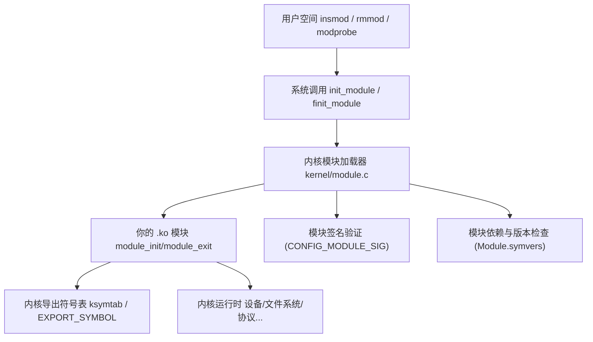
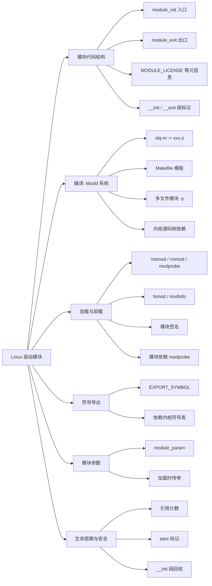
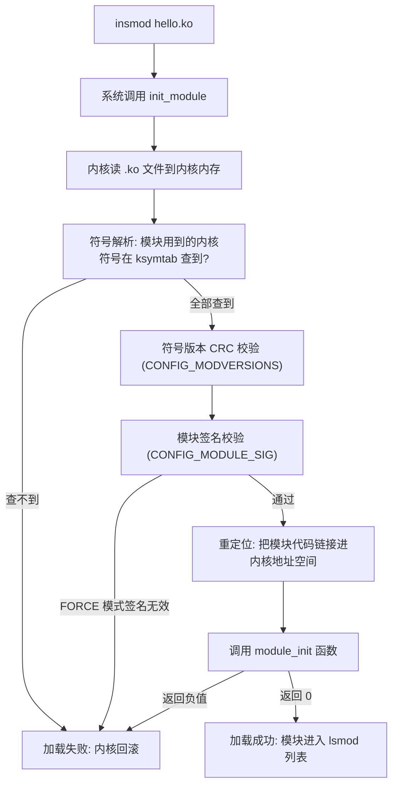
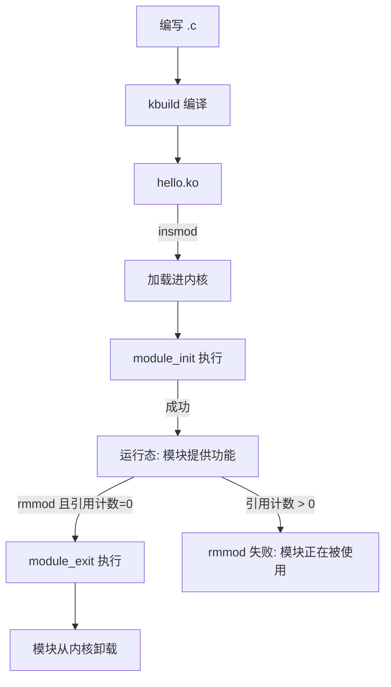

# Linux 驱动模块（Loadable Kernel Module）

> 适用范围：主线 Linux（2.6 ~ 6.x）。核心机制（模块加载/卸载、module_init/module_exit、kbuild、符号导出）长期稳定；模块签名、压缩加载等特性为后期增强，文中已标注。
> 前置关联：建议先建立《Linux 字符设备》《Linux 并发与竞争》认知——模块是它们的"载体"，字符设备的注册代码就放在模块的 init 函数里，模块卸载时需要逆序清理。
> 阅读目标：10~20 分钟内建立"模块是什么、为什么存在、怎么写、怎么编译、怎么加载、生命周期如何、和内核什么关系"的可靠整体认知。

---

## 1. 先建立整体认知

### 1.1 它是什么

**直觉理解**：Linux 内核就像一部出厂只装了"必备基础功能"的手机系统，模块就是可以"热插拔"的 App——系统运行时点一下就装上去（`insmod`），不用了再点一下卸载（`rmmod`），不用重启整机。你在前两篇笔记里看到的字符设备驱动、自旋锁保护的代码，最终都要打包成一个 `.ko` 模块文件，才能被加载进内核运行。

**严格定义**：可加载内核模块（Loadable Kernel Module，LKM）是 Linux 内核在**运行时**动态插入或移除的**目标代码对象**（`.ko` 文件），它运行在内核态，能调用内核导出的接口，扩展内核能力而无需重新编译内核或重启系统。

### 1.2 三种内核设计哲学对比

| 设计 | 优点 | 缺点 | Linux 的选择 |
| ------ | ------ | ------ | ------------- |
| 宏内核（monolithic） | 性能高、调用直接 | 体积大、扩展需重编 | 基础架构 |
| 微内核（microkernel） | 模块化好、故障隔离 | IPC 开销大 | 未采用 |
| **宏内核 + 可加载模块** | **兼得性能与灵活** | 模块 bug 会拖垮全内核 | ✅ **Linux 方案** |

Linux 的哲学：内核本体保持宏内核的高性能，但通过模块机制获得"接近微内核的运行时可扩展性"。官方文档原话："a monolithic kernel with module support — a hybrid approach"。

### 1.3 为什么存在

1. **灵活性**：嵌入式/服务器场景驱动繁多，全编进内核会让镜像膨胀；模块化让"按需加载"成为可能。
2. **开发效率**：改一行驱动代码只需重编 `.ko` 然后 `rmmod`/`insmod`，不用每次重启整机调试——这是驱动开发能进行的前提。
3. **许可证隔离**：闭源厂商驱动可以独立模块形式加载，不必混入 GPL 内核源码树（但有 taint 标记）。
4. **资源节约**：不常用的文件系统、协议、驱动只在用时加载，节省内存。

一句话：**模块 = "让宏内核在运行时具备微内核式可扩展能力"的机制。**

---

## 2. 在整个体系中的位置



模块加载是一个从用户空间命令出发、穿过系统调用、由内核模块加载器执行、最终把代码"链接"进运行中内核的过程。理解这条链，才能理解模块代码的运行环境。

---

## 3. 知识地图



---

## 4. 核心概念

### 4.1 模块代码结构

一个最小模块（来自官方 lkmpg）：

```c
// hello.c
#include <linux/module.h>    // 模块必需的头文件: MODULE_LICENSE 等
#include <linux/kernel.h>    // pr_info / printk
#include <linux/init.h>      // __init / __exit 宏

static int __init hello_init(void)
{
    pr_info("Hello, world\n");
    return 0;                  // 返回 0 成功; 返回负值(如 -ENOMEM)表示失败, 模块不会被加载
}

static void __exit hello_exit(void)
{
    pr_info("Goodbye, world\n");
}

module_init(hello_init);     // 告诉内核: 加载时调用哪个函数
module_exit(hello_exit);     // 告诉内核: 卸载时调用哪个函数

MODULE_LICENSE("GPL");       // 必需: 声明许可证
MODULE_AUTHOR("Your Name");
MODULE_DESCRIPTION("A simple hello module");
MODULE_VERSION("1.0");
```

关键组成：

| 组成 | 作用 | 为什么需要 |
| ------ | ------ | ----------- |
| `module_init(fn)` | 声明模块加载入口 | 内核需要知道"代码插进来后从哪开始执行" |
| `module_exit(fn)` | 声明模块卸载入口 | 卸载时执行清理（逆序回收 init 里申请的资源） |
| `MODULE_LICENSE("GPL")` | 声明许可证 | 内核据此决定是否允许该模块使用 GPL-only 导出符号；不声明会打印 warning 且只能用非 GPL 符号 |
| `__init` / `__exit` | 段标记属性 | `__init` 函数在加载完成后**内存被回收**（只执行一次）；`__exit` 在编进内核(非模块)时会被丢弃（因为不会卸载） |
| `pr_info` / `printk` | 内核日志 | 模块没有 stdio，这是模块给外界"打印"的唯一通道（见 4.5） |

> 语义约束：init 函数返回 int（0 成功，负值失败）；exit 函数返回 void；两者都在**进程上下文**执行（可睡眠，但 init 失败时必须完全回滚已申请的资源）。

### 4.2 kbuild 编译系统

Linux 内核用自研的 **kbuild** 系统（基于 make）编译模块。官方文档（Documentation/kbuild/modules.rst）是权威来源。

**核心规则**：

```makefile
# Kbuild / Makefile 中最关键的一行:
obj-m := hello.o
#  ↑ m = module (编成 .ko)
#    obj-y 则是编进内核本体 built-in.a

# 多文件模块: hello.ko 由 a.o + b.o 组成
obj-m := hello.o
hello-y := a.o b.o
```

**外部模块的完整 Makefile 模板**（官方推荐写法）：

```makefile
# 文件名: Makefile
ifneq ($(KERNELRELEASE),)
    # ---- kbuild 部分: 内核构建系统会读到这一段 ----
    obj-m  := hello.o
    # hello-y := a.o b.o          # 多文件时列出
else
    # ---- 普通 make 部分: 用户在命令行 make 时执行 ----
    KDIR ?= /lib/modules/$(shell uname -r)/build

    default:
        $(MAKE) -C $(KDIR) M=$(PWD) modules
    clean:
        $(MAKE) -C $(KDIR) M=$(PWD) clean
endif
```

**编译命令**（内核文档原话）：

```bash
make -C /lib/modules/$(uname -r)/build M=$PWD modules
```

参数解释：

| 参数 | 含义 |
| ------ | ------ |
| `-C <内核源码路径>` | make 先切到内核源码目录执行（读内核顶层 Makefile 拿到编译器配置） |
| `M=$PWD` | 告诉 kbuild "外部模块在 `$PWD` 目录" |
| `modules` | 目标名（外部模块默认目标） |

产物：`hello.ko`（可加载的内核模块对象）。嵌入式开发还需指定 `ARCH=` 和 `CROSS_COMPILE=`（交叉编译）。

> **为什么必须用 kbuild 而不是直接 gcc？** 模块需要内核的编译选项（如 `-D__KERNEL__`、内联宏、匹配内核版本的 ABI）、内核头文件路径、以及符号版本信息。kbuild 把这些全部处理好；手写 gcc 命令几乎无法正确编译模块。

### 4.3 模块加载与卸载

| 命令 | 作用 | 底层 |
| ------ | ------ | ------ |
| `insmod hello.ko` | 直接加载指定 .ko 文件，不处理依赖 | 系统调用 `init_module`/`finit_module` |
| `rmmod hello` | 卸载模块（按名字，不带 .ko） | 内核调用 module_exit |
| `modprobe hello` | **智能加载**：自动解析依赖、加载依赖模块、按 `/lib/modules/...` 查找 | 读取 `modules.dep` |
| `modprobe -r hello` | 智能卸载（连同无人使用的依赖一起卸） | — |
| `lsmod` | 列出已加载模块（来自 `/proc/modules`） | — |
| `modinfo hello.ko` | 查看 .ko 的元信息（license、author、参数、依赖等） | 读 .ko 的 .modinfo 段 |

**load 的内部过程**：



### 4.4 模块参数

模块加载时可传入参数，用 `module_param` 宏声明：

```c
static int howmany = 1;              // 默认值
module_param(howmany, int, 0644);     // 类型 int, 权限 0644(出现在 /sys/module/.../parameters/)
MODULE_PARM_DESC(howmany, "How many times to print");  // 描述

static char *whom = "world";
module_param(whom, charp, 0644);     // charp = 字符串指针

// 加载时:
// insmod hello.ko howmany=3 whom="Linux"
```

权限 `0644` 让参数出现在 `/sys/module/hello/parameters/` 下，可在运行时读取（甚至按权限修改）。

### 4.5 printk 与日志等级

模块没有 stdio，唯一输出通道是 `printk`（推荐用 `pr_info`/`pr_err`/`pr_warn`/`pr_debug` 等封装）。

```c
printk(KERN_ERR "fatal: %d\n", err);    // 带日志等级
pr_err("fatal: %d\n", err);             // 等价, 更推荐
```

8 个日志级别（0 最高，7 最低）：

| 宏 | 级别 | 含义 |
| ---- | :---: | ------ |
| `KERN_EMERG` | 0 | 系统不可用 |
| `KERN_ALERT` | 1 | 必须立即处理 |
| `KERN_CRIT` | 2 | 严重条件 |
| `KERN_ERR` | 3 | 错误 |
| `KERN_WARNING` | 4 | 警告 |
| `KERN_NOTICE` | 5 | 正常但值得关注 |
| `KERN_INFO` | 6 | 信息 |
| `KERN_DEBUG` | 7 | 调试 |

**控制台过滤**：`cat /proc/sys/kernel/printk` 显示 4 个数：当前控制台等级、默认、最小、启动时等级。**只有消息级别数值 < 控制台等级，才会在终端上显示**。`dmesg` 则显示所有级别的内核日志（环形缓冲区）。

### 4.6 符号导出与模块间依赖

模块要调用内核里的函数，这些函数必须被**导出**。

```c
// 在内核或某个模块里:
int my_public_func(int x) { return x * 2; }
EXPORT_SYMBOL(my_public_func);          // 导出给所有模块(含非 GPL)
// 或:
EXPORT_SYMBOL_GPL(my_public_func);      // 只导出给 GPL 许可的模块
```

- 导出的符号进入内核符号表 `ksymtab`，可通过 `/proc/kallsyms` 查看所有导出符号。
- 模块 B 依赖模块 A 导出的符号 → B 必须在 A 之后加载，A 在 B 卸载前不能卸载（引用计数保护）。
- `modprobe` 通过 `modules.dep` 自动处理这种依赖；`insmod` 不会，缺符号就报 `Unknown symbol`。

### 4.7 模块签名（安全增强）

启用 `CONFIG_MODULE_SIG` 后，模块可在编译时签名、加载时验签：

- `CONFIG_MODULE_SIG_FORCE=y`：强制只加载签名有效的模块（生产安全场景）
- `CONFIG_MODULE_SIG_FORCE=n`（默认）：签名无效仅 taint 内核，仍允许加载
- 签名密钥默认 `certs/signing_key.pem`，构建时自动生成

这是模块机制在现代内核（4.x 起）的重要安全增强，但对初学驱动开发不是必学项。

### 4.8 引用计数与 taint

**引用计数**：每个模块有使用计数，被其他模块或内核子系统依赖时 +1。`lsmod` 的 "Used by" 列就是这个计数。**计数 > 0 时 `rmmod` 会失败**（防止悬挂引用）——这是模块安全卸载的基石。

**taint 标记**：内核维护一个 taint 位图，加载非 GPL 模块、签名无效模块、发生 oops 等情况都会置位。`cat /proc/sys/kernel/tainted` 查看数值，非 0 表示内核"被污染"——社区 bug 报告时通常要求 taint=0。

### 4.9 内核编程约束

官方《Unreliable Guide To Hacking The Linux Kernel》强调的几条铁律（驱动模块同样适用）：

| 约束 | 说明 |
| ------ | ------ |
| 无内存保护 | 模块写错指针 → 整机崩溃，没有"段错误退出进程"的安全垫 |
| 无浮点 | FPU 上下文不保存，模块里用 `float`/`double` 会破坏其他进程的 FPU 状态 |
| 栈很小 | 内核栈约 14KB（64 位），禁递归深递归，禁大数组局部变量 |
| 不能用 libc | 没有 `printf`/`malloc`/`free`，只有 `printk`/`kmalloc`/`kfree` 等内核等价物 |
| 当前任务可查 | 进程上下文里 `current` 指针有效，指向当前任务 |

---

## 5. 核心概念之间的关系

```text
【编译时关系】
hello.c  ──(kbuild: obj-m)──>  hello.o  ──(链接 + 重定位信息)──>  hello.ko
                                                                  ↓
                                                          内核导出符号表
                                                          Module.symvers
                                                          (符号版本 CRC)

【加载时关系】
insmod hello.ko
    → init_module 系统调用
        → 内核读 .ko
            → 符号解析(查 ksymtab)
                → 签名校验
                    → 重定位链接
                        → 调用 hello_init()
                            → (通常)注册字符设备/安装中断/...
                                → 模块"活"了

【卸载时关系】
rmmod hello
    → 引用计数 == 0 ?
        → 调用 hello_exit()
            → (通常)cdev_del / free_irq / 逆序清理
                → 内核卸载代码段, 归还内存
```

- **编译产物 .ko** 依赖**内核源码树**（拿编译选项和符号版本信息）
- **加载** 依赖**内核运行时符号表**（ksymtab）做符号解析
- **init/exit** 是模块与内核之间的"握手协议"——init 把功能注册进内核，exit 逆序回收
- **符号导出** 决定模块能否调用内核或其他模块的函数——这是模块"接入内核生态"的接口

---

## 6. 工作原理

### 6.1 模块生命周期



### 6.2 init 失败的回滚

init 函数可能申请多个资源（设备号、cdev、中断、内存……）。若中途某步失败，**必须按逆序回滚已申请的资源**，否则内核留下泄漏。惯用法：

```c
static int __init my_init(void)
{
    int ret;

    ret = alloc_chrdev_region(&devno, 0, 1, "mydev");   // step 1
    if (ret)
        goto err_devno;

    ret = request_irq(irq, my_isr, 0, "mydev", &my_dev); // step 2
    if (ret)
        goto err_irq;

    cdev_init(&my_cdev, &my_fops);                       // step 3
    ret = cdev_add(&my_cdev, devno, 1);
    if (ret)
        goto err_cdev;

    return 0;                                            // 成功

err_cdev:
    free_irq(irq, &my_dev);                              // 回滚 step 2
err_irq:
    unregister_chrdev_region(devno, 1);                  // 回滚 step 1
err_devno:
    return ret;
}
```

exit 函数则**严格按 init 的逆序**释放：

```c
static void __exit my_exit(void)
{
    cdev_del(&my_cdev);              // 对应 step 3
    free_irq(irq, &my_dev);          // 对应 step 2
    unregister_chrdev_region(devno, 1); // 对应 step 1
}
```

这与上一篇字符设备笔记的注册/卸载流程完全衔接——模块只是把这些注册代码装进 init/exit 这个"壳"里。

### 6.3 多文件模块

实际驱动常拆成多个 .c 文件。kbuild 用 `<模块名>-y` 列出所有组成：

```makefile
# Kbuild
obj-m := mydriver.o
mydriver-y := main.o irq.o buffer.o
```

产物是单个 `mydriver.ko`。多个独立模块也可在一个 Makefile 里同时编译：

```makefile
obj-m := foo.o bar.o
foo-y := foo_core.o foo_ioctl.o
bar-y := bar_main.o
```

---

## 7. 示例代码

### 7.1 最小可运行模块（完整版）

```c
// hello.c —— 带参数的最小模块
#include <linux/module.h>
#include <linux/kernel.h>
#include <linux/init.h>

static int times = 1;
module_param(times, int, 0644);
MODULE_PARM_DESC(times, "Number of times to print hello");

static char *target = "world";
module_param(target, charp, 0644);
MODULE_PARM_DESC(target, "Target name");

static int __init hello_init(void)
{
    int i;
    for (i = 0; i < times; i++)
        pr_info("Hello, %s!\n", target);
    return 0;
}

static void __exit hello_exit(void)
{
    pr_info("Goodbye, %s\n", target);
}

module_init(hello_init);
module_exit(hello_exit);

MODULE_LICENSE("GPL");
MODULE_AUTHOR("Learner");
MODULE_DESCRIPTION("Parameterized hello module");
MODULE_VERSION("1.0");
```

### 7.2 对应的 Makefile

```makefile
ifneq ($(KERNELRELEASE),)
    obj-m := hello.o
else
    KDIR ?= /lib/modules/$(shell uname -r)/build
    # 嵌入式交叉编译时:
    # ARCH ?= arm64
    # CROSS_COMPILE ?= aarch64-linux-gnu-
    # KDIR ?= /path/to/kernel-source

    default:
        $(MAKE) -C $(KDIR) M=$(PWD) modules
    clean:
        $(MAKE) -C $(KDIR) M=$(PWD) clean
endif
```

### 7.3 实验步骤

```bash
make                          # 生成 hello.ko
modinfo hello.ko              # 看元信息: license / 参数 / 依赖
sudo insmod hello.ko          # 加载, 用默认参数
sudo insmod hello.ko times=3 target="Linux"  # 带参数加载
dmesg | tail                  # 查看内核日志输出
lsmod | grep hello            # 确认模块已加载, 查看引用计数
cat /sys/module/hello/parameters/target  # 运行时读参数
sudo rmmod hello              # 卸载
dmesg | tail                  # 看到 Goodbye
```

**对应知识地图**：Makefile 的 `obj-m` 是 kbuild 规则；`module_param` 是参数机制；`dmesg` 看 `pr_info` 输出；`lsmod` 看引用计数；`modinfo` 读 `.modinfo` 段——每个步骤都对应一个核心概念。

### 7.4 与字符设备笔记的衔接（多文件示例）

把前两篇笔记的字符设备驱动组装成模块形态：

```c
// chr_demo_main.c
#include <linux/module.h>
#include <linux/fs.h>
#include <linux/cdev.h>
#include <linux/uaccess.h>
#include <linux/spinlock.h>
#include "chr_demo.h"

// 导出给其他模块用的函数 (示范 EXPORT_SYMBOL)
int chr_demo_get_count(struct chr_demo_dev *dev)
{
    int n;
    spin_lock(&dev->lock);
    n = atomic_read(&dev->cnt);
    spin_unlock(&dev->lock);
    return n;
}
EXPORT_SYMBOL(chr_demo_get_count);

static const struct file_operations my_fops = {
    .owner   = THIS_MODULE,        // 关键: 指向本模块, 防止模块被使用时卸载
    .open    = chr_demo_open,
    .read    = chr_demo_read,
    .release = chr_demo_release,
};

static int __init chr_demo_init(void)
{
    int ret;
    /* ... alloc_chrdev_region / cdev_init / cdev_add ... */
    return 0;
}

static void __exit chr_demo_exit(void)
{
    /* ... cdev_del / unregister_chrdev_region ... */
}

module_init(chr_demo_init);
module_exit(chr_demo_exit);
MODULE_LICENSE("GPL");
```

```makefile
obj-m := chr_demo.o
chr_demo-y := chr_demo_main.o chr_demo_irq.o
```

注意 `.owner = THIS_MODULE`——这是模块与字符设备的关键连接点：当设备处于打开状态时，它让模块的引用计数 +1，防止"设备正用着模块却被 rmmod"的灾难。

---

## 8. 实际应用

| 模块类型 | 典型例子 | 加载方式 |
| --------- | --------- | --------- |
| 字符设备驱动 | 自定义硬件、I2C/SPI 设备 | `insmod xxx.ko` 或 udev 自动 |
| 块设备驱动 | SD 卡、nand 驱动 | modprobe |
| 网络协议 | tcp_bbr、ipv6 | modprobe |
| 文件系统 | ext4、ntfs、nfs | mount 时自动加载 |
| 安全模块 | SELinux、AppArmor | 启动加载 |
| 虚拟化 | kvm-intel | 按需加载 |

`lsmod` 在任何 Linux 系统上都能看到大量已加载模块——你日常用的 ext4 网卡驱动几乎都是模块。嵌入式开发中，把外设驱动做成模块是标准做法：出厂内核精简，按板载外设动态加载驱动。

---

## 9. 常见误区

**误区 1：模块和用户态程序差不多，写错只是退出。**

- 正确理解：模块运行在内核态，**无内存保护**。一个空指针解引用就是整机崩溃（oops/panic），没有"段错误退出进程"的退路。

**误区 2：模块里可以用 printf / malloc / free。**

- 正确理解：内核没有 libc。输出用 `printk`/`pr_info`，分配用 `kmalloc`/`kfree`、`vmalloc`/`vfree`，字符串用内核的 `strscpy`/`snprintf`。

**误区 3：不声明 MODULE_LICENSE 没关系。**

- 后果：内核打印 "module license unspecified, tainting kernel"；且无法调用 `EXPORT_SYMBOL_GPL` 导出的符号（大量核心 API 是 GPL-only），导致符号解析失败加载不了。

**误区 4：init 里某步失败就直接 return，不用回滚。**

- 后果：已申请的设备号/中断/内存泄漏在内核里，无法回收。
- 正确理解：init 必须用 goto 逆序回滚（见 6.2）。

**误区 5：模块正在被使用时 rmmod 能强制卸载。**

- 正确理解：引用计数 > 0 时 `rmmod` 返回 `Module is in use`。强制卸载（`-f` 或 `--force`）留给内核调试场景，生产环境绝不能用——必然崩溃。

**误区 6：模块可以不依赖内核源码树独立编译。**

- 正确理解：kbuild 必须读内核源码树拿编译选项、头文件路径、符号版本信息。`make -C <内核源码路径>` 是必需的。发行版通常提供 `linux-headers-$(uname -r)` 包来满足这个需求。

**误区 7：改了模块代码，insmod 就能更新。**

- 正确理解：必须先 `rmmod` 卸载旧模块，重新 `make` 编译，再 `insmod`。正在运行的旧模块不会被自动替换。

---

## 10. 相关知识（扩展索引，本文不展开）

- **模块签名**：`CONFIG_MODULE_SIG`，生产环境的安全加固，初学可跳过。
- **模块压缩加载**：6.x 内核支持 xz/zstd 压缩的 .ko 直接加载。
- **模块版本一致性**：`CONFIG_MODVERSIONS`，符号 CRC 校验防止 ABI 不匹配。
- **devtmpfs / udev**：模块加载后自动创建设备节点的机制（见字符设备笔记）。
- **内核线程**：模块可创建 kthread 运行后台任务。
- **工作队列 workqueue**：模块里做"可睡眠的延迟工作"的标准机制。
- **debugfs / procfs / sysfs**：模块向用户空间暴露状态/参数的接口。
- **ftrace / kprobe / kgdb**：内核/模块调试工具链。
- **DKMS**：发行版管理"多版本内核自动重编模块"的框架（如 NVIDIA 驱动）。

---

## 11. 知识脉络（一页因果链）

```text
宏内核性能好, 但扩展要重编重启
    ↓ 引入"运行时可加载模块"机制
模块 = .ko 目标文件, 运行在内核态, 通过 module_init/exit 与内核握手
    ↓ 要让模块可编译, 需要一套和内核一致的构建系统
kbuild: obj-m + make -C 内核源码树 M=$PWD → hello.ko
    ↓ 要让模块加载进内核, 需要解析符号、校验、链接
insmod → init_module 系统调用 → 符号解析(ksymtab) → 签名校验 → 重定位 → 调用 init
    ↓ init 注册功能(设备/中断/...), 内核从此"多了一份能力"
模块运行, 引用计数保护(被用着不能卸)
    ↓ 卸载要逆序清理
rmmod → 引用计数=0 → exit 逆序回收 → 内核卸载代码段
    ↓ 模块和内核/其他模块通过符号表协作
EXPORT_SYMBOL / EXPORT_SYMBOL_GPL 决定谁能用谁; modprobe 处理依赖
    ↓ 纪律
无内存保护 / 无浮点 / 无 libc / 栈小 / init 失败必回滚 / MODULE_LICENSE 必声明
    ↓ 最终效果
驱动代码以模块形式动态接入内核, 改一行代码 rmmod+insmod 即可更新, 不重启系统
```

---

## 12. 正式学习时重点关注

带着这些问题进入教材/内核文档，理解效率最高：

1. 宏内核 + 模块机制相比纯宏内核和微内核各解决了什么问题？
2. `module_init` / `module_exit` 宏到底做了什么？（提示：编进内核时它们变成 `__initcall`；编成模块时记录入口指针供加载器调用）
3. `__init` 和 `__exit` 段标记如何帮内核回收内存？为什么 `__exit` 在非模块编译时会被丢弃？
4. kbuild 为什么必须 `make -C <内核源码>`？`obj-m` 和 `obj-y` 的区别是什么？多文件模块 `-y` 怎么写？
5. `insmod` 到 `module_init` 被调用之间，内核模块加载器做了哪些步骤？哪一步失败会导致 "Unknown symbol"？
6. `MODULE_LICENSE("GPL")` 不写会怎样？`EXPORT_SYMBOL` 和 `EXPORT_SYMBOL_GPL` 的区别如何影响模块能否调用内核 API？
7. `modprobe` 和 `insmod` 的区别？模块依赖（modules.dep）是怎么产生的？
8. init 函数中途失败为什么必须 goto 逆序回滚？exit 为什么必须和 init 严格逆序？
9. `.owner = THIS_MODULE` 在 file_operations 里有什么作用？它和模块引用计数什么关系？（衔接字符设备笔记）
10. 模块参数 `module_param` 的权限参数（0644）控制什么？参数如何出现在 `/sys/module/.../parameters/`？
11. 内核栈有多小？为什么模块里不能用递归深递归、不能用 float、不能用 printf？

---

## 13. 参考资料

1. [Kernel Documentation — Building External Modules (kbuild/modules.rst)](https://docs.kernel.org/kbuild/modules.html) —— 官方外部模块编译权威文档
2. [Kernel Documentation — Linux Kernel Makefiles (kbuild/makefiles.rst)](https://docs.kernel.org/kbuild/makefiles.html) —— kbuild Makefile 语法完整说明
3. [Kernel Documentation — Unreliable Guide To Hacking The Linux Kernel](https://docs.kernel.org/kernel-hacking/hacking.html) —— 内核代码基本规则（无内存保护、上下文、`__init`/`__initcall` 等）
4. [Kernel Documentation — Kernel module signing facility](https://docs.kernel.org/admin-guide/module-signing.html) —— 模块签名机制
5. [The Linux Kernel Module Programming Guide (lkmpg, 维护中的现代版)](https://sysprog21.github.io/lkmpg/) —— 模块入门标准教材
6. Jonathan Corbet 等《Linux Device Drivers, 3rd Edition》第 2 章 "Building and Running Modules"（免费在线：[lwn.net/Kernel/LDD3](https://lwn.net/Kernel/LDD3/)）
