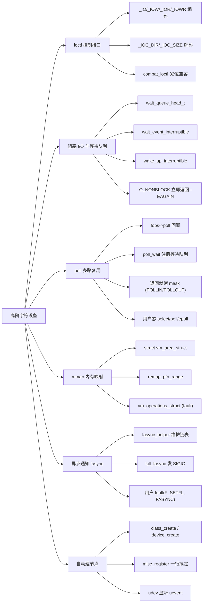
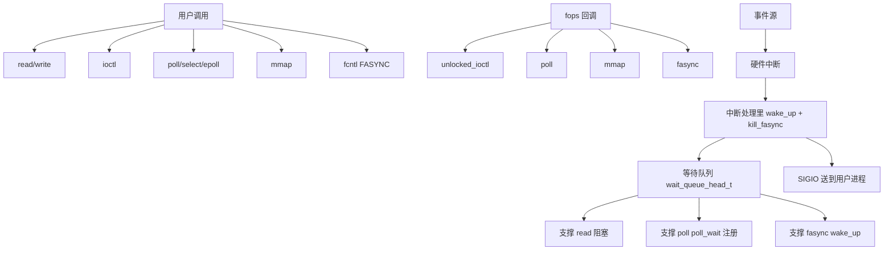

# Linux 高阶字符设备

> 适用范围：主线 Linux（2.6 ~ 6.x）。本文建立在 [Linux 字符设备](./Linux字符设备.md) 已掌握的基础上，只讲"基础 cdev + file_operations 之上"的进阶能力：ioctl 命令编码、阻塞 I/O 与等待队列、poll/epoll 多路复用、mmap 内存映射、异步通知（SIGIO/fasync）、misc 框架与自动建节点。
> 前置关联：必须先掌握 cdev、设备号、`file_operations`、`struct file` / `struct inode`、`copy_to_user` / `copy_from_user`、open 调用链。这些在 [Linux 字符设备](./Linux字符设备.md) 第 4~6 节已建立。
> 阅读目标：10~20 分钟内建立"高阶字符设备在基础 fops 之上扩展了哪些能力、每项能力解决什么问题、如何在驱动里实现、各能力之间如何配合"的可靠整体认知。

---

## 1. 先建立整体认知

### 1.1 它是什么

**直觉理解**：[Linux 字符设备](./Linux字符设备.md) 讲的是"怎么让一个设备能 open/read/write/close"。但真实硬件访问远不止读写两个字：要**设置波特率 / 切换模式 / 查询寄存器**（控制类操作），要**等待数据到来再读**（不能空转），要**同时监听多个设备谁先就绪**，要**把设备寄存器或帧缓冲直接映射到用户空间**（避免 copy），还要**让硬件主动通知应用"数据来了"**而不是应用不停轮询。这些都不是"额外的花样"，而是真实驱动几乎必须具备的能力。本笔记讲的就是这些"在基础 fops 之上的扩展能力"。

**严格定义**：高阶字符设备能力指 `file_operations` 中除 open/read/write/release 之外的进阶回调，以及围绕它们的内核机制：

| 能力 | fops 回调 | 解决的问题 |
| --- | --- | --- |
| 控制接口 | `unlocked_ioctl` / `compat_ioctl` | 除读写外的设备控制（设置参数、查询状态） |
| 多路复用 | `poll` | 让用户用 select/poll/epoll 等待"任一设备就绪" |
| 阻塞 I/O | （read/write 实现） | 数据未就绪时让进程睡眠，不空转 |
| 内存映射 | `mmap` | 设备内存/寄存器直接映射到用户空间，零拷贝 |
| 异步通知 | `fasync` | 硬件事件主动 SIGIO 通知应用 |
| 自动建节点 | class_create / device_create | 加载即出现 `/dev/xxx`，无需手动 mknod |
| misc 框架 | misc_register | "就一个简单字符设备"的快速封装 |

### 1.2 为什么存在

基础 fops 只能"被动响应"应用的 read/write。但真实场景下：

- 硬件速度远慢于 CPU，应用 `read()` 时数据可能还没到，**不能让 CPU 空转等**。
- 一个进程可能要同时监听多个设备，**不能阻塞在任一个上**。
- 大块数据（帧缓冲、视频帧）每次 read/write 都走 copy 太浪费，**最好让用户空间直接看到设备内存**。
- 硬件有事件（按键、数据到达）时，应用希望**被动收通知**而不是主动轮询。
- 驱动加载后让用户手动 `mknod` 不现实，**应该自动出现节点**。

一句话：**高阶字符设备能力 = 让字符设备"能控制、能等、能并行、能零拷贝、能主动通知、能自动出现"。**

### 1.3 在整个体系中的位置

```text
用户程序
   ↓ open/read/write/ioctl/poll/mmap
ALSA... 不, 这里是 VFS
   ↓
VFS (file->f_op 转发)
   ↓
file_operations 进阶回调
   ├─ unlocked_ioctl   → 控制命令解码 + copy_from/to_user
   ├─ poll             → poll_wait 注册等待队列 + 返回就绪 mask
   ├─ mmap             → remap_pfn_range 建页表
   └─ fasync           → fasync_helper 维护信号接收链
        ↓
内核机制支撑
   ├─ 等待队列 wait_queue_head_t   (阻塞 I/O + poll + fasync 共用)
   ├─ vm_area_struct / 页表         (mmap)
   ├─ misc 框架 / class / device   (自动建节点)
   └─ 信号 SIGIO                   (异步通知)
        ↓
硬件 (寄存器 / DMA / 中断)
```

---

## 2. 知识地图



下面逐一展开这些核心概念。

---

## 3. 核心概念

### 3.1 ioctl：除读写外的控制接口

- 中文名称：设备控制接口；英文：I/O control；缩写：ioctl。
- 作用：**处理除 read/write 之外的设备控制命令**——设置波特率、切换模式、查询寄存器、命令设备做动作。
- fops 回调：`int (*unlocked_ioctl)(struct inode *, struct file *, unsigned int cmd, unsigned long arg)`。`cmd` 是命令编号，`arg` 是用户空间传来的参数（通常是指针或整数）。

**命令编码（关键且容易写错）**：不要随便挑一个数字当 cmd，必须用 `<linux/ioctl.h>` 提供的宏编码，让命令字**全局唯一、自带方向和大小**：

```text
cmd 32 位布局（asm-generic，多数架构）：
┌──────┬────────────┬──────────┬─────────┐
│ 31-30│   29-16    │   15-8   │   7-0   │
│ dir  │   size     │   type   │   nr    │
└──────┴────────────┴──────────┴─────────┘
  00 无参   参数字节数  驱动标识   命令序号
  01 _IOW  (sizeof(类型))  (ASCII 字符)
  10 _IOR
  11 _IOWR
```

四个编码宏（用户态和内核态共用同一套 `<linux/ioctl.h>`）：

```c
// type: 8 位驱动标识（如 'k'），nr: 8 位命令序号（如 0x01, 0x02）
// datatype: 参数的数据类型（注意写类型名，不是 sizeof）
_IOC(type, nr, datatype)        // 无方向参数（推荐仅用于无参命令）
_IOR(type, nr, datatype)         // 内核 → 用户 (read，应用读，copy_to_user)
_IOW(type, nr, datatype)         // 用户 → 内核 (write，应用写，copy_from_user)
_IOWR(type, nr, datatype)        // 双向
```

**方向是从用户视角看的**：`_IOR` 表示"应用读取"，内核用 `copy_to_user`；`_IOW` 表示"应用写入"，内核用 `copy_from_user`。这与系统调用 read/write 的方向命名一致，但容易记反。

**驱动里解码**：

```c
#include <linux/ioctl.h>

#define MY_IOC_TYPE 'k'
#define MY_GET_VAL  _IOR(MY_IOC_TYPE, 0x01, int)
#define MY_SET_VAL  _IOW(MY_IOC_TYPE, 0x02, int)
#define MY_RESET    _IO(MY_IOC_TYPE, 0x03)

static long my_ioctl(struct file *file, unsigned int cmd, unsigned long arg)
{
    int val;
    switch (cmd) {
    case MY_GET_VAL:
        val = my_get_value();
        if (copy_to_user((int __user *)arg, &val, sizeof(val)))
            return -EFAULT;
        return 0;
    case MY_SET_VAL:
        if (copy_from_user(&val, (int __user *)arg, sizeof(val)))
            return -EFAULT;
        return my_set_value(val);
    case MY_RESET:
        return my_reset_hw();
    default:
        return -ENOTTY;   // 未知命令必须返回 -ENOTTY (不是 -EINVAL)
    }
}
```

> 版本/惯例提示：
> - 老式 `ioctl`（带大内核锁）早已被 `unlocked_ioctl` 取代（2.6.36 前后），读老教材时注意。
> - 未知命令应返回 `-ENOTTY` 或 `-ENOIOCTLCMD`（VFS 会转成 `-ENOTTY` 给用户）。返回 `-EINVAL` 是历史错误写法，内核文档明确反对。
> - 32 位用户态跑在 64 位内核上时，命令字布局不同，必须实现 `compat_ioctl` 回调处理兼容，否则 32 位应用调用 ioctl 会失败。

### 3.2 阻塞 I/O 与等待队列

- 中文名称：等待队列；英文：wait queue；类型 `wait_queue_head_t`。
- 作用：**让进程在"数据未就绪"时去睡眠，事件发生时被唤醒**。这是阻塞 I/O 的实现基础，也是 poll 和 fasync 共用的底层机制。

**核心 API**（`<linux/wait.h>`）：

```c
// 声明 + 初始化
DECLARE_WAIT_QUEUE_HEAD(my_wq);          // 静态
wait_queue_head_t my_wq;                 // 动态：init_waitqueue_head(&my_wq)

// 睡眠（让调用进程进入 TASK_INTERRUPTIBLE，可被信号打断）
wait_event(wq, condition);               // 不可中断（不推荐）
wait_event_interruptible(wq, condition); // 推荐：信号打断返回 -ERESTARTSYS
wait_event_timeout(wq, condition, jiffies); // 带超时

// 唤醒
wake_up(&wq);                            // 唤醒所有（含不可中断）
wake_up_interruptible(&wq);              // 只唤醒可中断睡眠者（推荐配对使用）
```

**关键认知**：`wait_event_interruptible(wq, condition)` 是**循环检查 + 睡眠**的封装，**不是"睡到 condition 成立"那么简单**——它内部是 `while (!condition) schedule()`，所以**唤醒后必须再次检查 condition**。这就是为什么用 `wait_event` 系列而不是老的 `sleep_on`（老 API 有竞态：唤醒信号可能丢失）。

**阻塞 read 的标准模式**：

```c
static ssize_t my_read(struct file *file, char __user *buf, size_t len, loff_t *off)
{
    struct my_dev *dev = file->private_data;

    // 1. 非阻塞且无数据：立即返回 -EAGAIN
    if (kfifo_is_empty(&dev->fifo) && (file->f_flags & O_NONBLOCK))
        return -EAGAIN;

    // 2. 阻塞等待数据
    if (wait_event_interruptible(dev->rq, !kfifo_is_empty(&dev->fifo)))
        return -ERESTARTSYS;             // 被信号打断，让 VFS 重启系统调用

    // 3. 取数据并 copy_to_user
    return kfifo_to_user(&dev->fifo, buf, len, &copied);
}
```

**write 端**：往 fifo 写完数据后调用 `wake_up_interruptible(&dev->rq)` 唤醒 reader。

> 边界提示：调用 `wait_event_*` 时**不能持有自旋锁**（睡眠会触发调度，调度会要求可睡眠上下文）。临界区里需要的不是自旋锁而是互斥锁（mutex），详见 [Linux 并发与竞争](./Linux并发与竞争.md)。

### 3.3 poll：多路复用支持

- 中文名称：多路复用查询；fops 回调：`__poll_t (*poll)(struct file *, struct poll_table_struct *)`。
- 作用：**让用户空间的 select/poll/epoll 能查询"这个设备现在能不能读/写"**。一个进程可以同时监听多个 fd，谁先就绪就处理谁。

**驱动实现两件事**：

1. 调用 `poll_wait(file, &wq, wait)` 把本设备的等待队列**登记到 poll_table**——这样当设备无数据时，VFS 知道把进程挂到这个等待队列上睡眠。
2. 返回**当前就绪状态的位掩码**（`POLLIN | POLLRDNORM` 表示可读，`POLLOUT | POLLWRNORM` 表示可写，`POLLERR` / `POLLHUP` 表示异常/对端关闭）。

```c
#include <linux/poll.h>

static __poll_t my_poll(struct file *file, struct poll_table_struct *wait)
{
    struct my_dev *dev = file->private_data;
    __poll_t mask = 0;

    poll_wait(file, &dev->rq, wait);     // 1. 注册等待队列（无数据时 VFS 在此睡眠）

    if (!kfifo_is_empty(&dev->fifo))     // 2. 当前状态
        mask |= POLLIN | POLLRDNORM;
    if (!kfifo_is_full(&dev->fifo))
        mask |= POLLOUT | POLLWRNORM;

    return mask;
}
```

**调用链**：用户 `poll()` → VFS → `do_pollfd` → `fops->poll`（每个 fd 都调一次）。如果**所有 fd 都不就绪**，VFS 把进程挂到所有 fd 注册的等待队列上睡眠；任一设备 `wake_up` 时，进程被唤醒后**重新调用所有 fd 的 poll** 检查谁就绪了。

**select / poll / epoll 三代对比**：

| 世代 | API | 内核开销 | 适用场景 |
| --- | --- | --- | --- |
| 第一代 | select | 每次调用拷贝整个 fd 集合 + 内核线性扫描全部 fd；FD_SETSIZE 上限（默认 1024） | 兼容老系统，少量 fd |
| 第二代 | poll | 同 select 但无 1024 上限 | fd 数中等 |
| 第三代 | epoll（2.6+） | 注册一次，内核维护**持久兴趣集**；`epoll_wait` 只返回就绪 fd，开销与监控总数无关 | 高并发海量连接 |

> 版本提示：epoll 自 Linux 2.6（2003 年）引入，`epoll_create1` 自 2.6.27，`EPOLLET` 边沿触发模式需配合非阻塞 fd 使用。select/poll 只支持水平触发。

**驱动端只写一次 `fops->poll`**——三个用户 API 都走同一个内核入口，驱动无需关心用户用哪个。

### 3.4 mmap：把设备内存映射到用户空间

- 中文名称：内存映射；fops 回调：`int (*mmap)(struct file *, struct vm_area_struct *)`。
- 作用：**让用户空间直接访问设备内存（寄存器、帧缓冲、DMA buffer）**，跳过 read/write 的 copy，是大块数据场景的标准做法。

**核心结构 `struct vm_area_struct`（VMA）**：代表用户进程地址空间的一段连续虚拟内存区。每次 `mmap()` 系统调用创建一个 VMA，驱动在 `fops->mmap` 里**建页表**把这段虚拟地址映射到设备物理内存。

**两个建映射的 API**：

```c
// 把 [pfn, pfn+size) 这段物理页映射到 VMA 的虚拟地址
int remap_pfn_range(struct vm_area_struct *vma, unsigned long addr,
                    unsigned long pfn, unsigned long size, pgprot_t prot);

// 把内核 kmalloc 得到的内存映射到 VMA（内部按页处理）
int vm_iomap_memory(struct vm_area_struct *vma, void *addr, unsigned long size);
```

**典型用法**：映射设备寄存器（如帧缓冲）：

```c
static int my_mmap(struct file *file, struct vm_area_struct *vma)
{
    unsigned long pfn = virt_to_phys((void *)dev_regs) >> PAGE_SHIFT;
    vma->vm_page_prot = pgprot_noncached(vma->vm_page_prot);   // 寄存器：禁用 cache
    vma->vm_flags |= VM_IO | VM_DONTEXPAND | VM_DONTDUMP;      // 内存映射 IO 标志

    return remap_pfn_range(vma, vma->vm_start, pfn,
                           vma->vm_end - vma->vm_start,
                           vma->vm_page_prot);
}
```

**关键认知**：
- `remap_pfn_range` 是**建页表**，不是"拷贝数据"。映射建立后，用户态访问那段虚拟地址 → MMU 翻译 → 直接打到设备物理内存，**完全不经驱动 read/write**。
- 寄存器映射必须 `pgprot_noncached`——寄存器读写要立刻到达硬件，不能被 cache 吞掉。
- `VM_IO` 告诉内核"这是 IO 映射区，别参与 swap/常驻统计"。
- 物理地址→PFN 是 `phys >> PAGE_SHIFT`；内核虚拟地址→物理地址是 `virt_to_phys`（仅对低地址区/线性映射区有效）。

> 进阶选项 `vm_operations_struct`：除了 `remap_pfn_range` 一次性建表，还可以挂 `vm_ops` 的 `.fault` 回调，**按需缺页建立**。这对"映射大小未知 / 按需加载"场景更省内存，但复杂度高，简单寄存器映射用 `remap_pfn_range` 即可。

### 3.5 异步通知 fasync：硬件主动 SIGIO

- 中文名称：异步通知；fops 回调：`int (*fasync)(int fd, struct file *, int on)`。
- 作用：**硬件事件发生时，内核主动向应用发 SIGIO 信号**，应用不用 poll 也不用阻塞等。

**三方协作**：
1. 用户应用：`fcntl(fd, F_SETOWN, getpid())`（设置接收进程）+ `fcntl(fd, F_SETFL, FASYNC)`（开启异步，触发驱动 fasync 回调）+ `sigaction(SIGIO, ...)`（注册信号处理）。
2. 驱动 `fops->fasync`：调 `fasync_helper(fd, file, on, &dev->fasync)` 维护一个接收链表。
3. 事件发生时（如中断处理里）：`kill_fasync(&dev->fasync, SIGIO, POLL_IN)` 向链表上所有 fd 发信号。

```c
struct my_dev {
    struct fasync_struct *fasync;   // 接收链表头
    ...
};

static int my_fasync(int fd, struct file *file, int on)
{
    struct my_dev *dev = file->private_data;
    return fasync_helper(fd, file, on, &dev->fasync);  // 增删链表
}

// 在中断或数据到达处调用：
kill_fasync(&dev->fasync, SIGIO, POLL_IN);
```

**fasync vs poll**：poll 是**应用主动问**，fasync 是**内核主动通知**。fasync 适合"事件稀疏、需要低延迟响应"的场景（按键、串口数据到达）；poll 适合"应用需要批量处理多路就绪"的场景。两者可共存。

> 注意：SIGIO 默认行为是终止进程，必须先用 `sigaction` 注册处理函数再开 FASYNC，否则信号一来进程就死了。

### 3.6 自动建节点：class + device

- 中文名称：自动设备节点创建。
- 作用：**驱动加载后立即在 `/dev` 下出现设备节点，无需手动 mknod**。原理是驱动把设备注册进设备模型 → 内核发 uevent → 用户空间 `udev` 监听后自动 `mknod`。

**两步法**：

```c
struct class *my_class;
struct device *this_dev;

my_class = class_create(THIS_MODULE, "myclass");     // 1. 创建 class
this_dev = device_create(my_class, NULL, devno, NULL, "mydev");  // 2. 建设备 + 发 uevent
// → udev 收到后自动 mknod /dev/mydev
```

> 版本提示：6.4 起 `class_create` 不再接受模块参数（移除了 `owner` 形参），写成 `class_create("myclass")`。早期版本写 `class_create(THIS_MODULE, "myclass")`，老教材照抄在新内核会编译失败。

**清理顺序**：`device_destroy` → `class_destroy` → `cdev_del` → `unregister_chrdev_region`。

### 3.7 misc 框架：一行注册简单字符设备

- 中文名称：misc 设备框架；英文：miscellaneous device；固定 major=10。
- 作用：**对"就一个简单字符设备"的场景，一行 `misc_register` 替代 alloc_chrdev_region + cdev_init + cdev_add + device_create 全套样板**。

```c
#include <linux/miscdevice.h>

static const struct file_operations my_fops = {
    .owner = THIS_MODULE, .read = my_read, /* ... */
};

static struct miscdevice my_misc = {
    .minor = MISC_DYNAMIC_MINOR,   // 动态分配 minor
    .name  = "mydev",
    .fops  = &my_fops,
};

module_misc_init: misc_register(&my_misc);    // 自动建节点 /dev/mydev
module_misc_exit: misc_deregister(&my_misc);
```

**便利点**：misc 框架内部用 major=10 共享，按 minor 区分设备，**自动建节点**、**自动管理 cdev 样板**、`open()` 时默认把 `miscdevice` 指针塞进 `file->private_data`（驱动可不实现 open）。日常大量"就一个简单接口"的设备都用 misc。

> 注意：misc 共用 major=10，minor 由框架分配。驱动只需关心 `name`、`fops`、`minor`（一般填 `MISC_DYNAMIC_MINOR`）。

---

## 4. 核心概念之间的关系



**关键关系**：
- **等待队列是公共底座**：read 的阻塞、poll 的睡眠、fasync 的信号触发，背后都是同一个等待队列机制。
- **poll 与 read 共用等待队列**：poll_wait 注册的就是 read 阻塞时睡的那个 `wq`，所以 write 端 `wake_up_interruptible` 会同时唤醒 poll 和 read。
- **fasync 与信号**：fasync_helper 维护的链表记录"哪些 fd 想收信号"，kill_fasync 在中断/事件处发 SIGIO，应用从用户态 sigaction 接收。
- **mmap 独立**：建一次页表后用户态直接访问设备内存，不再走 fops 的 read/write，但 mmap 仍由 fops 暴露。

---

## 5. 工作原理 / 工作流程

### 5.1 阻塞 read 的完整生命周期

```text
应用 read(fd, buf, n)
    ↓
VFS: 进入 fops->read
    ↓
驱动: 检查 O_NONBLOCK
    ├─ 有 O_NONBLOCK 且无数据 → return -EAGAIN（立即返回）
    └─ 无 O_NONBLOCK 或有数据
        ↓
驱动: wait_event_interruptible(rq, !empty)
    ↓ 进程进入 TASK_INTERRUPTIBLE，调度走开
    ↓ (此时 CPU 给别的进程用)
[另一上下文: 中断/DMA 完成数据写入 fifo]
    ↓ wake_up_interruptible(&rq)
进程被唤醒，重新检查 condition
    ↓
!empty 成立 → 取数据 → copy_to_user → 返回字节数
```

### 5.2 poll 的调用链（用户 epoll 为例）

```text
应用 epoll_wait(epfd, events, max, timeout)
    ↓
VFS: 遍历兴趣集每个 fd → fops->poll(file, wait)
    ↓
驱动 poll():
    1. poll_wait(file, &rq, wait)   ← 把 rq 登记到 wait 的等待队列集合
    2. 返回当前 mask（无数据返 0）
    ↓
若所有 fd 都不就绪 → VFS 把进程挂到所有登记的等待队列上睡眠
    ↓ (等待)
任一设备 wake_up → 进程唤醒
    ↓
VFS 重新遍历 fd → 调 fops->poll → 收集就绪的 mask
    ↓ 返回就绪 fd 列表给用户
```

### 5.3 mmap 建立过程

```text
应用 mmap(NULL, size, PROT_READ|PROT_WRITE, MAP_SHARED, fd, offset)
    ↓
VFS: 分配 VMA [vm_start, vm_end)
    ↓
VFS: 调 fops->mmap(file, vma)
    ↓
驱动: remap_pfn_range(vma, addr, pfn, size, prot)
    ↓
页表建立: vma 虚拟地址 → 设备物理页
    ↓
返回用户态映射起始地址
    ↓ 之后用户直接读写这段地址 = 直接访问设备内存 (不走 fops->read/write)
```

### 5.4 fasync 异步通知流程

```text
用户: fcntl(fd, F_SETOWN, pid) + fcntl(fd, F_SETFL, FASYNC)
    ↓
VFS: 调 fops->fasync(fd, file, 1)
    ↓
驱动: fasync_helper(...) → 把 fd 加入接收链表
    ↓ (之后某时刻硬件事件)
中断处理: kill_fasync(&fasync, SIGIO, POLL_IN)
    ↓
内核向链表上所有 fd 的进程发 SIGIO
    ↓
用户 sigaction 处理函数被调用 (si_band 区分读/写)
```

---

## 6. 示例代码

把多项能力串成一个"带 kfifo 缓冲、阻塞、poll、fasync 的 misc 设备"：

```c
// adv_chr_demo.c
#include <linux/module.h>
#include <linux/miscdevice.h>
#include <linux/fs.h>
#include <linux/uaccess.h>
#include <linux/kfifo.h>
#include <linux/wait.h>
#include <linux/poll.h>
#include <linux/ioctl.h>

struct adv_dev {
    struct kfifo fifo;
    wait_queue_head_t rq;          // 阻塞读 + poll 共用
    struct fasync_struct *fasync;  // 异步通知链表
};
static struct adv_dev dev;

#define IOC_TYPE 'k'
#define IOC_GET_LEN _IOR(IOC_TYPE, 0x01, int)   // 查询 fifo 中字节数
#define IOC_RESET   _IO(IOC_TYPE, 0x02)         // 清空 fifo

static ssize_t adv_read(struct file *file, char __user *buf, size_t len, loff_t *off)
{
    int copied;
    if (kfifo_is_empty(&dev.fifo)) {
        if (file->f_flags & O_NONBLOCK) return -EAGAIN;
        if (wait_event_interruptible(dev.rq, !kfifo_is_empty(&dev.fifo)))
            return -ERESTARTSYS;
    }
    if (kfifo_to_user(&dev.fifo, buf, len, &copied))
        return -EFAULT;
    return copied;
}

static ssize_t adv_write(struct file *file, const char __user *buf, size_t len, loff_t *off)
{
    int copied;
    if (kfifo_from_user(&dev.fifo, buf, len, &copied))
        return -EFAULT;
    wake_up_interruptible(&dev.rq);              // 唤醒读者 + poll 等待者
    if (dev.fasync)
        kill_fasync(&dev.fasync, SIGIO, POLL_IN); // 通知异步监听者
    return copied;
}

static __poll_t adv_poll(struct file *file, struct poll_table_struct *wait)
{
    __poll_t mask = 0;
    poll_wait(file, &dev.rq, wait);
    if (!kfifo_is_empty(&dev.fifo)) mask |= POLLIN | POLLRDNORM;
    return mask;
}

static long adv_ioctl(struct file *file, unsigned int cmd, unsigned long arg)
{
    switch (cmd) {
    case IOC_GET_LEN: {
        int n = kfifo_len(&dev.fifo);
        return copy_to_user((int __user *)arg, &n, sizeof(n)) ? -EFAULT : 0;
    }
    case IOC_RESET:
        kfifo_reset(&dev.fifo);
        return 0;
    default:
        return -ENOTTY;
    }
}

static int adv_fasync(int fd, struct file *file, int on)
{
    return fasync_helper(fd, file, on, &dev.fasync);
}

static const struct file_operations adv_fops = {
    .owner = THIS_MODULE,
    .read  = adv_read, .write = adv_write,
    .poll  = adv_poll, .unlocked_ioctl = adv_ioctl,
    .fasync = adv_fasync,
};

static struct miscdevice adv_misc = {
    .minor = MISC_DYNAMIC_MINOR, .name = "adv_chr", .fops = &adv_fops,
};

static int __init adv_init(void)
{
    INIT_KFIFO(dev.fifo);
    init_waitqueue_head(&dev.rq);
    return misc_register(&adv_misc);   // 自动建节点 /dev/adv_chr
}
static void __exit adv_exit(void)
{
    misc_deregister(&adv_misc);
}
module_init(adv_init); module_exit(adv_exit);
MODULE_LICENSE("GPL");
```

**对应知识地图的位置**：

| 代码块 | 位置 | 作用 |
| --- | --- | --- |
| `DECLARE_WAIT_QUEUE_HEAD` / `init_waitqueue_head` | 3.2 等待队列 | read 阻塞 + poll 注册共用 |
| `wait_event_interruptible` | 3.2 阻塞 I/O | 数据未到时睡眠 |
| `wake_up_interruptible` | 3.2 唤醒 | write 后唤醒 reader/poll 等待者 |
| `poll_wait` + 返回 mask | 3.3 poll | 让 select/epoll 能监控本设备 |
| `fasync_helper` / `kill_fasync` | 3.5 fasync | 维护信号接收链 + 事件发生时发 SIGIO |
| `unlocked_ioctl` + `_IOR/_IO` | 3.1 ioctl | 控制接口，命令字自编码 |
| `misc_register` | 3.7 misc | 一行替代 alloc/cdev/device 全套样板 |
| `file->f_flags & O_NONBLOCK` | 3.2 非阻塞 | 支持非阻塞模式 |

**用户空间测试**：

```bash
# 阻塞读 (另一终端 echo 数据进 fifo)
cat /dev/adv_chr

# 非阻塞读
exec 3<> /dev/adv_chr
cat /dev/adv_chr <&3 &         # 阻塞
# 轮询版可用 python select.epoll() 监听

# ioctl 查询/重置
# 用户态用相同的 _IOR/_IO 宏编码命令
```

---

## 7. 实际应用

### 7.1 各能力的典型使用场景

| 能力 | 典型场景 |
| --- | --- |
| ioctl | 串口设波特率、v4l2 切换格式、i2c 读寄存器、按键去抖配置 |
| 阻塞 I/O + 等待队列 | 串口/传感器等"数据什么时候来不确定"的设备 |
| poll | 监控多路输入（多串口、多按键、网络+设备混用） |
| mmap | 帧缓冲 `/dev/fb0`、视频帧 V4L2、PCI 设备寄存器、DMA buffer |
| fasync | 按键中断、串口数据到达、电源键 |
| misc + 自动建节点 | 几乎所有"简单字符接口"驱动（按键、LED、看门狗等） |

### 7.2 真实设备节点

| 设备 | 用到的能力 |
| --- | --- |
| `/dev/fb0`（帧缓冲） | mmap 帧缓冲 + ioctl 控制分辨率 |
| `/dev/input/eventN`（输入设备） | 阻塞 read + poll + fasync |
| `/dev/i2c-N` | ioctl 读写寄存器 |
| `/dev/videoN`（V4L2） | mmap 视频帧 + ioctl 流控制 |
| `/dev/watchdog` | ioctl 设置超时、write 喂狗 |

### 7.3 工程路径

```text
应用
   ↓ (按需求选 I/O 模型)
   ├─ 控制需求     → ioctl
   ├─ 等待/批量    → 阻塞 read 或 poll
   ├─ 大块数据     → mmap (零拷贝)
   └─ 事件稀疏    → fasync (SIGIO)
   ↓
file_operations 进阶回调
   ↓
等待队列 / VMA / 信号 / 设备模型 (内核机制支撑)
   ↓
硬件 (寄存器 / 中断 / DMA)
```

---

## 8. 常见误区

### 误区 1：ioctl 命令字随便挑个数字

- **错误理解**：`#define MY_CMD 0x1234`，反正驱动自己解析就行。
- **为什么容易这样想**：内核确实允许任意 32 位数字。
- **正确理解**：必须用 `_IO/_IOW/_IOR/_IOWR` 编码。原因：(1) 命令字全局唯一能防止"调用错驱动的 ioctl 还成功"的静默错误；(2) strace 能自动解码；(3) 编码自带方向和大小，便于驱动校验。**老式手挑数字的代码不能学**。

### 误区 2：未知 ioctl 返回 -EINVAL

- **正确理解**：应返回 `-ENOTTY`（或 `-ENOIOCTLCMD`，VFS 转 -ENOTTY）。返回 -EINVAL 是历史错误惯例，内核文档明确反对。这让用户态能把"命令不存在"和"参数非法"区分开。

### 误区 3：wait_event 后不重新检查 condition

- **错误理解**：`wait_event_interruptible(wq, cond)` 返回后 cond 一定成立。
- **正确理解**：它内部就是 `while (!cond) schedule()`，唤醒后**重新检查了** cond——但你**自己写的 condition 表达式**如果在睡眠期间被改了又改回来，可能错过事件。所以 condition 必须用**可重复检查、幂等**的表达式（如 `!kfifo_is_empty()`），不要用"读一次标志"。

### 误区 4：持有自旋锁时调用 wait_event

- **正确理解**：`wait_event_*` 会触发调度，调度要求可睡眠上下文。持有自旋锁时不能调度（否则可能死锁）。阻塞路径需要的同步原语是 mutex，不是 spinlock。详见 [Linux 并发与竞争](./Linux并发与竞争.md)。

### 误区 5：poll 不调 poll_wait

- **错误理解**：只返回当前 mask 就行，poll_wait 是可选的。
- **正确理解**：不调 poll_wait，VFS 就不知道把进程挂到哪里睡眠——结果是"无数据时 epoll_wait 永远不阻塞、立刻返回 0"，变成轮询，CPU 飙升。

### 误区 6：mmap 后还用 read/write 访问同一段

- **正确理解**：mmap 建的是"用户虚拟地址 → 设备物理内存"的直接映射，用户访问**完全绕过** fops 的 read/write。两套访问同一段内存会让缓存/同步语义混乱，应当二选一。

### 误区 7：开了 FASYNC 却没注册 sigaction

- **正确理解**：SIGIO 默认行为是终止进程。必须先 `sigaction(SIGIO, ...)` 注册处理函数，再 `fcntl(F_SETFL, FASYNC)` 开启异步通知，否则信号一来进程就死了。

### 误区 8：misc 设备就不能用 poll/mmap/fasync

- **正确理解**：misc 只是封装了 cdev 注册样板，`file_operations` 完整支持所有回调。poll/mmap/fasync/ioctl 都可以正常挂上去。

---

## 9. 相关知识

```text
Linux 高阶字符设备
├── Linux 字符设备 (基础 cdev/fops, 前置)
├── Linux 并发与竞争 (自旋锁/mutex, 阻塞路径必须用 mutex)
├── Linux 中断与下半部 (中断里 wake_up + kill_fasync)
├── Linux 内存管理 (VMA/页表/kmalloc/vmalloc, mmap 底层)
├── DMA 与 dma-buf (大块数据零拷贝, 现代 mmap 替代)
├── Linux 设备模型 (kobject/class/device, 自动建节点底层)
├── udev / devtmpfs (用户空间设备节点管理)
├── V4L2 / I2C / Input 子系统 (字符设备框架的具体应用)
└── io_uring (5.x+ 异步 I/O 新框架, 高并发场景)
```

相关知识只做索引，不自动展开。

---

## 10. 知识脉络

```text
基础 cdev 只能被动 read/write
    ↓ 真实硬件需要控制、等待、并行、零拷贝、主动通知
引入高阶 fops 回调
    ↓
为什么需要等待队列?
    ↓ 阻塞 read 不能空转, poll 也需要睡眠
wait_queue_head_t 作为公共底座
    ↓ read 阻塞 + poll 注册 + fasync 唤醒 都用它
各能力如何协作?
    ↓ write 完成 → wake_up_interruptible(读+poll 同时唤醒) + kill_fasync(发 SIGIO)
mmap 为什么独立?
    ↓ 建页表后用户直接访问设备内存, 绕过 read/write, 大块数据场景
自动建节点为什么必要?
    ↓ 用户不应手动 mknod; class+device+udev 让节点自动出现
misc 框架解决什么?
    ↓ 把"alloc+cdev+device"样板封装成一行, 简单设备快速上线
最终效果
    ↓ 字符设备能控制、能等、能并行、能零拷贝、能主动通知、能自动出现
```

---

## 11. 正式学习时重点关注

1. `_IO/_IOW/_IOR/_IOWR` 的方向为什么是从**用户视角**命名？`_IOR` 时内核该用 `copy_to_user` 还是 `copy_from_user`？
2. cmd 32 位布局中 type、nr、size、dir 各占几位？为什么 size 用 13~14 位编码限制了 ioctl 参数大小（≤8191 字节）？
3. 32 位用户态在 64 位内核上跑时，为什么命令字布局会不同？`compat_ioctl` 不实现会怎样？
4. `wait_event_interruptible` 返回非 0 时为什么是 `-ERESTARTSYS` 而不是 `-EINTR`？VFS 收到后会做什么？
5. 为什么 `wait_event_*` 不能在持有自旋锁时调用？阻塞路径该用什么同步原语？
6. `poll_wait` 把等待队列登记到 poll_table 后，VFS 是怎么用这张表的？为什么 wake_up 能同时唤醒 read 和 poll 的等待者？
7. epoll 相比 select/poll 的核心改进是什么？为什么"持久兴趣集"能避免每次都拷贝 fd 集合？
8. `remap_pfn_range` 建页表 vs `vm_ops->fault` 按需缺页，两者在内存占用、复杂度上的取舍？
9. 映射设备寄存器时为什么必须 `pgprot_noncached` + `VM_IO`？如果开了 cache 会发生什么？
10. fasync 链表里存的是 fd 还是 file？为什么 kill_fasync 能跨进程把信号送给正确的接收者？
11. `class_create` 在 6.4 前后签名变化反映了什么设计趋势？为什么移除 owner 参数？
12. misc 框架共享 major=10 的取舍是什么？什么场景下不该用 misc 而要用完整 cdev 注册？

这些问题不是考试题，而是正式学习时应该把注意力放过去的地方。

---

## 12. 参考资料

1. [Linux Kernel Documentation — ioctl based interfaces](https://www.kernel.org/doc/html/latest/driver-api/ioctl.html) — `_IO/_IOW/_IOR/_IOWR` 编码规则、compat_ioctl、返回码。
2. [Linux Kernel Documentation — Decoding an IOCTL Magic Number](https://www.kernel.org/doc/html/latest/userspace-api/ioctl/ioctl-decoding.html) — cmd 32 位布局权威表。
3. [Linux Kernel Documentation — Ioctl Numbers](https://www.kernel.org/doc/Documentation/ioctl/ioctl-number.txt) — type 字符分配官方清单（新驱动应查此避免冲突）。
4. [Linux Kernel Documentation — Miscellaneous Devices](https://www.kernel.org/doc/html/latest/driver-api/misc_devices.html) — `misc_register` / `misc_deregister` 权威说明。
5. [Linux Kernel Documentation — Memory Mapping (Linux Kernel Labs)](https://linux-kernel-labs.github.io/master/so2/lab6-memory-mapping.html) — VMA、`remap_pfn_range`、`vm_operations_struct` 实验讲解。
6. [Linux Kernel Documentation — Memory Management APIs](https://docs.kernel.org/core-api/mm-api.html) — `remap_pfn_range` / `vm_iomap_memory` 签名。
7. [Linux/UNIX IPC Programming — Alternative I/O Models: epoll (Michael Kerrisk)](https://linuxman7.org/training/download/ipc_epoll_slides-mkerrisk-man7.org.pdf) — epoll 三代对比、边沿/水平触发。
8. [Linux Device Drivers, 3rd Edition, Chapter 6 "Advanced Char Drivers"](https://lwn.net/Kernel/LDD3/) — ioctl/poll/mmap/fasync 经典讲解（部分 API 已演进，需对照新内核）。
9. [The Linux Kernel Module Programming Guide](https://sysprog21.github.io/lkmpg/) — 现代维护版，含 misc 设备示例。
10. 内核源码：`fs/char_dev.c`、`drivers/char/misc.c`、`include/linux/wait.h`、`include/linux/poll.h`、`include/linux/ioctl.h`、`include/linux/fs.h`（file_operations 定义）。
