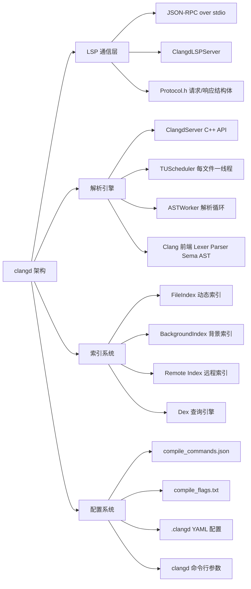
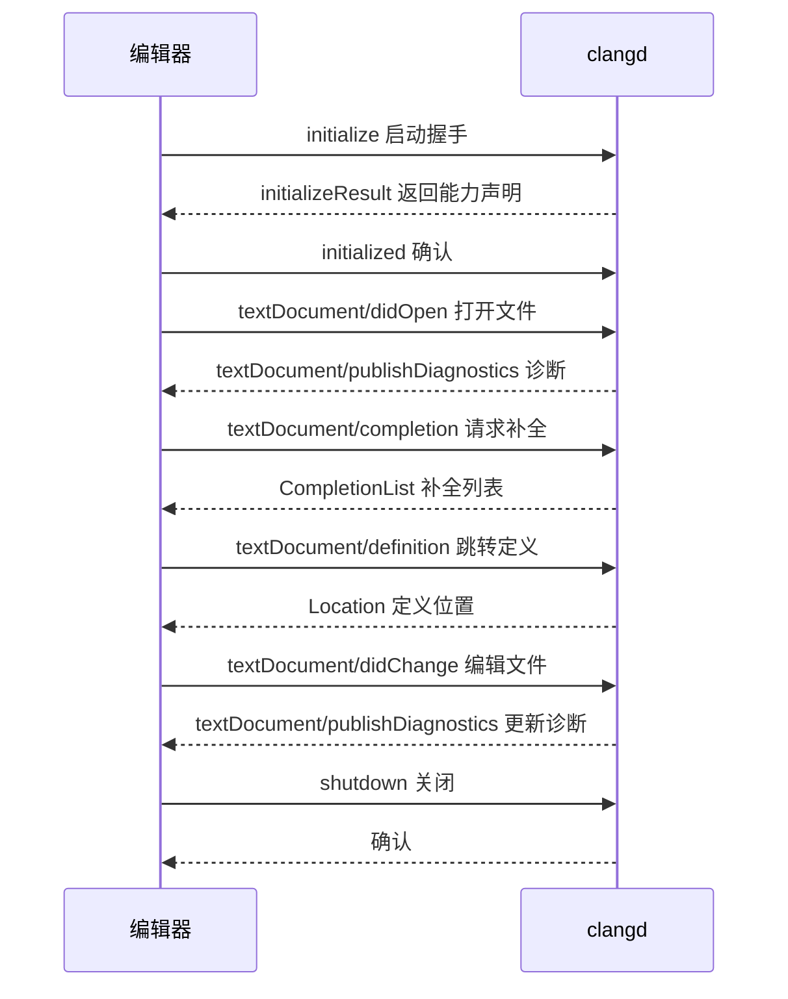
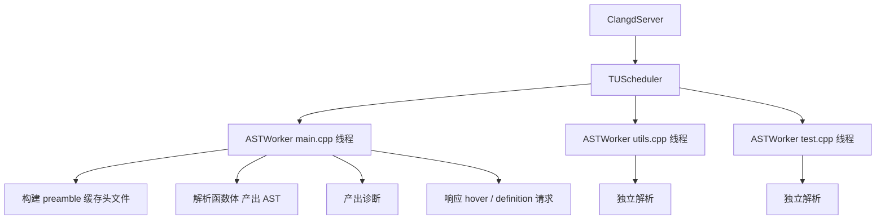
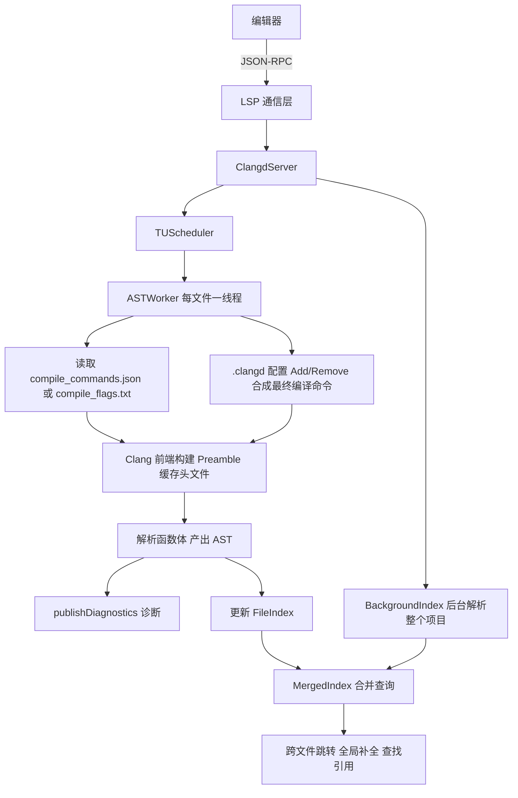
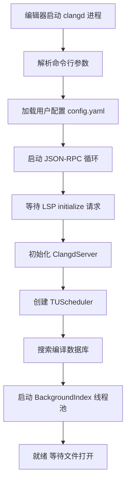
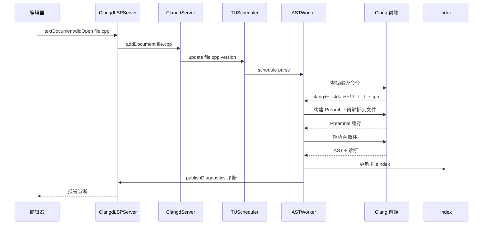
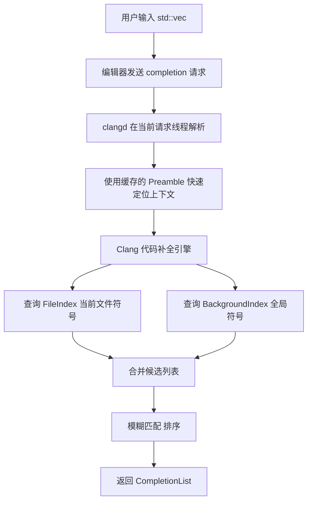

# clangd (C/C++ Language Server)

> 适用范围：LLVM 7 ~ 18+。核心机制（LSP 通信、AST 解析、编译数据库、索引）自 7 起稳定；YAML 配置系统（`.clangd` 文件）自 11 引入；背景索引默认开启自 14 前后。
> 前置关联：建议先了解 C/C++ 编译流程（预处理 → 编译 → 链接）和编辑器 LSP 基本概念。如果你写过 Linux 驱动模块或字符设备，可以把 clangd 类比为"编辑器的内核子系统"——它替编辑器管理代码理解能力，就像内核替用户程序管理硬件。
> 阅读目标：10~20 分钟内建立"clangd 是什么、为什么存在、由什么组成、如何工作、怎么配置、嵌入式场景怎么落地"的可靠整体认知。

---

## 1. 先建立整体认知

### 1.1 它是什么

**直觉理解**：你在 VSCode / Neovim 写 C/C++ 时，编辑器怎么知道你打 `std::vec` 后该补全哪些方法？怎么知道第 42 行少了个分号？怎么实现"按住 Ctrl 点函数名就跳到定义"？答案就是 clangd——一个后台运行的"代码理解引擎"，编辑器通过一个标准协议（LSP）向它提问，它回答补全列表、错误位置、定义位置等。

**严格定义**：clangd 是基于 Clang 编译器前端的 **Language Server**（语言服务器），属于 LLVM 项目的 `clang-tools-extra` 子模块。它实现了 Language Server Protocol（LSP），为 C / C++ / Objective-C 提供代码补全、诊断、跳转、查找引用、格式化、重构等 IDE 语义功能。

### 1.2 为什么存在

在 LSP 出现之前，每个编辑器要独立实现 C++ 语义功能：

```text
       Vim          Emacs         VSCode        Sublime
        |              |             |             |
   vim-cpp      emacs-clang     cpptools       easyclang
   (各自解析)    (各自调用)     (自研引擎)      (各自实现)
```

这导致：N 个编辑器 × M 种语言 = N×M 套插件，重复造轮子且质量参差不齐。

LSP（微软 2016 年提出）的解法：定义一个标准协议，编辑器只实现客户端，语言方只实现服务端：

```text
  编辑器 (LSP Client)              语言服务器 (LSP Server)
  VSCode  ─┐                     ┌─ clangd (C/C++)
  Neovim  ─┤  JSON-RPC over stdio├─ jdt.ls (Java)
  Emacs   ─┤                     ├─ gopls (Go)
  Vim     ─┘                     └─ pyright (Python)
```

clangd 就是 C/C++ 那一栏的服务端。它选择基于 Clang 而非自研解析器，是因为 Clang 的 AST 本身就包含完整的语义信息（类型推导、模板实例化、宏展开），不需要重新造一个"准编译器"。

### 1.3 在整个体系中的位置

```text
用户写代码
    ↓
编辑器 (VSCode / Neovim / Emacs)
    ↓ LSP (JSON-RPC over stdio)
clangd (Language Server)
    ├── 读取编译数据库 (compile_commands.json)
    ├── 用 Clang 前端解析源码 → AST
    ├── 查询索引 (FileIndex + BackgroundIndex)
    └── 返回补全/诊断/跳转结果
    ↓
Clang / LLVM 库 (libclang, AST, Lexer, Parser, Sema)
```

clangd **不是编译器**——它不生成目标代码。它是"借用编译器前端的解析能力来回答编辑器提问"的中间层。这一条直接区分了下面三个工具：

| 工具 | 作用 | 是否生成程序 |
| --- | --- | --- |
| `clang` | 编译 C 源码 | 是 |
| `clang++` | 编译 C++ 源码并自动链接 C++ 标准库 | 是 |
| `clangd` | 为编辑器提供补全、跳转、诊断和重构等功能 | 否 |

> **备注：** 嵌入式工程的真实编译器往往是 `arm-none-eabi-gcc` 或厂商交叉 GCC，而不是 `clang`。安装 `clangd` 不会改变构建系统使用的编译器，clangd 只是借用 Clang 前端"理解"代码。

### 1.4 两条互不替代的工作链路

```text
编辑器分析：
VSCode -> clangd 扩展 -> clangd
                         |
                         +-> compile_commands.json
                         +-> .clangd

真实构建：
SCons / Make / CMake -> 交叉 gcc -> 目标文件 / 固件
```

`compile_commands.json` 和 `.clangd` 只影响编辑体验，不参与真实构建。即使 clangd 没有启动，构建系统仍可正常编译；反过来，状态栏显示 `clangd: idle` 也不代表工程一定能成功构建。

---

## 2. 知识地图



---

## 3. 核心概念

### 3.1 LSP（Language Server Protocol）

- 中文名称：语言服务器协议
- 英文名称：Language Server Protocol，缩写 LSP
- 一句话解释：编辑器与语言服务器之间的通信标准，基于 JSON-RPC，通常通过进程的 stdin/stdout 传输。
- 在当前知识中的作用：clangd 的"对外接口"——编辑器发请求，clangd 回响应。

核心交互流程：



### 3.2 编译数据库（Compilation Database）

- 英文名称：Compilation Database
- 一句话解释：告诉 clangd "每个源文件应该用什么编译选项编译"的映射表。
- 在当前知识中的作用：clangd 正确解析代码的前提——没有编译选项，clangd 不知道头文件在哪、用 C 还是 C++、宏定义是什么。

两种形式：

| 形式 | 文件名 | 特点 | 适用场景 |
| --- | --- | --- | --- |
| JSON 格式 | `compile_commands.json` | 每个文件一条完整编译命令 | 正式项目，由构建系统生成 |
| 纯文本格式 | `compile_flags.txt` | 所有文件共用同一组 flags | 小型项目，手写 |

`compile_commands.json` 示例：

```json
[
  {
    "directory": "/home/user/project",
    "arguments": [
      "clang++",
      "-std=c++17",
      "-I./include",
      "-DDEBUG=1",
      "-c",
      "src/main.cpp",
      "-o", "build/main.o"
    ],
    "file": "src/main.cpp"
  }
]
```

`compile_flags.txt` 示例：

```text
-std=c++17
-I./include
-DDEBUG=1
```

> **备注：** 查找策略——clangd 从源文件所在目录开始，逐级向上搜索父目录，直到找到编译数据库为止。如果数据库不在源码目录的祖先链上（例如位于另一个分支），必须在 `.clangd` 中用 `CompilationDatabase` 显式指定。

生成方式：

```bash
# CMake 项目（最常见）
cmake -DCMAKE_EXPORT_COMPILE_COMMANDS=ON -B build -S .

# Makefile 项目（用 compiledb 工具）
pipx install compiledb
compiledb make -j4          # 实际编译并生成
compiledb -n make -j4        # 干跑，只生成数据库

# Bear（拦截编译器调用，生成数据库，支持 SCons / Make）
bear -- make -j4
bear scons                   # Bear 2.x 旧版语法，不带 --
```

> **备注：** 编译数据库是生成文件，不建议直接手工修改。需要补充或删除少量参数时，应使用 `.clangd`。

### 3.3 AST（Abstract Syntax Tree）

- 中文名称：抽象语法树
- 英文名称：Abstract Syntax Tree，缩写 AST
- 一句话解释：Clang 解析源码后产生的树状中间表示，每个节点对应一个语法构造（声明、语句、表达式）。
- 在当前知识中的作用：clangd 的所有语义功能都基于 AST——补全从 AST 中取符号、跳转从 AST 中找声明、诊断是解析时顺便产生的。

```text
源码: int x = 1 + 2;

AST:
  VarDecl (int x)
    └── BinaryOperator (+)
          ├── IntegerLiteral (1)
          └── IntegerLiteral (2)
```

clangd 不是每次请求都重新解析整个文件。它在文件打开或修改后重新构建 AST，然后把 AST 缓存在内存中，后续请求（hover、跳转等）直接查询已有的 AST。

### 3.4 TUScheduler 与 ASTWorker

- 英文名称：Translation Unit Scheduler
- 一句话解释：clangd 为每个打开的文件分配一个独立的工作线程（ASTWorker），在线程上循环执行"解析 → 产出诊断 → 缓存 AST → 响应请求"。
- 在当前知识中的作用：解释了为什么 clangd 多文件操作互不阻塞。



> **备注：** clangd 早期版本（7 之前）使用不同线程模型。D42573 重构为"每文件一线程 + 每请求一线程"模型。

### 3.5 索引（Index）

- 英文名称：Index
- 一句话解释：clangd 维护的项目级符号数据库，弥补单文件 AST 无法回答"跨文件跳转"和"全局补全"的问题。
- 在当前知识中的作用：AST 只知道当前文件的信息。索引知道整个项目哪里有 `class Foo`、谁引用了它。

索引存储的数据：

| 数据类型 | 内容 | 示例 |
| --- | --- | --- |
| Symbol（符号） | 函数/变量/类/宏，有唯一 ID | `llvm::StringRef` → ID, 名称, 位置 |
| Ref（引用） | 符号在哪里被使用 | 调用 `dropFirst()` 的位置 |
| Relation（关系） | 符号间的关系 | 类 A 继承类 B |

索引的三层实现：

```text
MergedIndex (合并查询)
    ├── FileIndex (动态索引)
    │   ├── 当前打开文件的符号
    │   └── 实时更新，随解析产出
    │
    ├── BackgroundIndex (背景索引)
    │   ├── 后台解析整个项目
    │   ├── 缓存到 .cache/clangd/index/*.idx
    │   └── 启动时加载缓存，增量更新
    │
    └── Remote Index (远程索引，可选)
        ├── 超大项目用（LLVM / Chromium 级别）
        └── 独立服务器提供索引查询
```

### 3.6 .clangd 配置文件

- 版本提示：YAML 配置系统自 clangd 11 引入。11 之前，`.clangd` 是一个目录名（用于临时存储），现已废弃。
- 一句话解释：项目级和用户级的 YAML 配置文件，控制编译选项、诊断、补全、索引等行为。

配置文件位置：

| 类型 | 路径 | 作用域 |
| --- | --- | --- |
| 项目配置 | 项目目录下 `.clangd` | 当前项目，可提交到版本控制 |
| 用户配置 | `~/.config/clangd/config.yaml`（Linux） | 全局，个人偏好 |

配置示例：

```yaml
CompileFlags:
  Add: [-xc++, -std=c++17, -Wall]
  Remove: [-W*]

Diagnostics:
  ClangTidy:
    Add: [performance*, modernize*, readability*]
    Remove: [modernize-use-trailing-return-type]

Index:
  Background: BuiltBackgroundIndex

InlayHints:
  Enabled: Yes
  ParameterNames: Yes
  DeducedTypes: Yes
```

> **备注：** 工程相关配置应优先放在仓库内的 `.clangd`，不要把某个工程的绝对路径写入全局配置。

### 3.7 clangd 最终编译参数的合成

```text
clangd 最终参数
= compile_commands.json 中该文件的命令
+ .clangd 的 CompileFlags.Add
- .clangd 的 CompileFlags.Remove
```

| 字段 | 含义 |
| --- | --- |
| `CompileFlags.CompilationDatabase` | `compile_commands.json` 所在目录。`.` = `.clangd` 所在目录（项目根） |
| `CompileFlags.Compiler` | 把编译命令里的编译器（`argv[0]`）替换成指定的交叉 gcc，配合 `--query-driver` 提取工具链真实系统头文件路径和内置宏 |
| `CompileFlags.Add` | 往编译命令**末尾追加**参数（如 `--target=armv7-linux-musleabihf`） |
| `CompileFlags.Remove` | 从编译命令**移除** clang 不认识的 GCC 专属参数。`*` 后缀是前缀通配 |
| `If.PathMatch` | 正则匹配文件的**相对**路径，命中才应用该块（注意：相对路径，正则别要求前导 `/`） |
| `If.PathExclude` | 正则排除（如宿主工具目录） |
| `Diagnostics.UnusedIncludes` | "未使用头文件"诊断：`None` = 关，`Strict` = 开（默认） |

---

## 4. 核心概念之间的关系



关键关系：

- **编译数据库 + `.clangd` 合成** → 决定 clangd 用什么参数解析。
- **Preamble 缓存** → 大幅降低重复解析头文件的代价（秒级 → 毫秒级）。
- **AST（单文件） + Index（跨文件）** → 联合回答编辑器的语义请求。
- **TUScheduler** → 让多文件解析并行、互不阻塞。

---

## 5. 工作原理

### 5.1 启动流程



### 5.2 文件打开时的解析流程



> **备注：** Preamble 是 clangd 的重要优化：`#include` 的头文件解析结果会被缓存，只有函数体部分每次重新解析。这把大文件的解析时间从秒级降到毫秒级。

### 5.3 代码补全流程

代码补全是 clangd 的核心功能，也是架构上最特殊的部分——它不走 ASTWorker 线程，而是在请求线程上同步执行：



> **备注：** 排序时考虑：查询匹配度、符号使用频率、类型信息、代码距离。例如输入 `uniq` 时，`unique_ptr`（1504 次使用）排第一，`make_unique`（403 次）排第二。

---

## 6. clangd 的功能

| 功能 | LSP 方法 | 实现方式 |
| --- | --- | --- |
| 诊断 | `textDocument/publishDiagnostics` | Clang 解析时自动产出 |
| 代码补全 | `textDocument/completion` | Clang 补全引擎 + Index |
| 跳转定义 | `textDocument/definition` | AST 符号查找 |
| 跳转声明 | `textDocument/declaration` | AST 符号查找 |
| 查找引用 | `textDocument/references` | Index 查询 |
| Hover 信息 | `textDocument/hover` | AST + 文档注释解析 |
| 签名帮助 | `textDocument/signatureHelp` | AST 函数签名 |
| 格式化 | `textDocument/formatting` | 内嵌 clang-format |
| 重命名 | `textDocument/rename` | AST + Index 全局替换 |
| 语义高亮 | `textDocument/semanticTokens` | AST 语义分类 |
| 代码操作 | `textDocument/codeAction` | Clang fix-it + clang-tidy |
| Inlay Hints | `textDocument/inlayHint` | AST 类型推导 |
| 切换头/源文件 | `textDocument/switchSourceHeader` | 文件名匹配（扩展协议） |

> **备注：** clangd 还实现了多个 LSP 扩展协议（非标准 LSP），如文件状态通知、AST 导出、内存使用报告等。详见 [clangd Protocol Extensions](https://clangd.llvm.org/extensions)。

---

## 7. 示例：最小项目配置

### 7.1 项目结构

```text
my_project/
├── .clangd                 # 项目配置
├── compile_flags.txt       # 编译数据库（简单项目）
├── include/
│   └── math.h
├── src/
│   └── main.cpp
└── .clang-format            # 格式化规则
```

### 7.2 源码

`include/math.h`：

```c
#pragma once

int add(int a, int b);
```

`src/main.cpp`：

```cpp
#include "math.h"

int main()
{
    int result = add(1, 2);
    return result;
}
```

### 7.3 配置文件

`compile_flags.txt`（告诉 clangd 怎么解析）：

```text
-xc++
-std=c++17
-I./include
```

`.clangd`（项目级配置）：

```yaml
CompileFlags:
  Add: [-Wall, -Wextra]

Diagnostics:
  ClangTidy:
    Add: [modernize*, readability*]

InlayHints:
  Enabled: Yes
  DeducedTypes: Yes
```

### 7.4 代码与正文对应关系

下面的 `add()` 调用对应"用户空间入口 → 跳转到声明"的 clangd 行为；`-I./include` 对应编译数据库告诉 clangd 去哪找头文件；`.clangd` 的 `InlayHints` 让编辑器在 `result` 旁边显示推导类型 `int`。三者各司其职：

- `compile_flags.txt`：决定"怎么解析"。
- `.clangd`：决定"还要附加什么 / 移除什么"。
- `.clang-format`：决定"格式化风格"。

### 7.5 验证

```bash
# 检查 clangd 版本
clangd --version

# 命令行测试（不启动编辑器）
clangd --check=src/main.cpp

# 查看详细日志
clangd --log=verbose
```

> **备注：** 这组配置让你在编辑器中打开 `main.cpp` 时获得：补全 `add` 函数、诊断缺分号、hover 显示参数类型、Inlay Hints 显示推导类型。

---

## 8. 实际应用场景

### 8.1 CMake 项目

最常见的场景：

```bash
# 生成编译数据库
cmake -DCMAKE_EXPORT_COMPILE_COMMANDS=ON -B build -S .

# 软链接到项目根目录（clangd 默认在父目录搜索）
ln -s build/compile_commands.json .
```

### 8.2 嵌入式项目（交叉编译）

嵌入式项目通常用 `arm-none-eabi-gcc` 或厂商交叉 GCC 编译，但用 clangd 做编辑器智能。完整数据库示例：

```json
[
  {
    "directory": "/home/user/project",
    "arguments": [
      "arm-none-eabi-gcc",
      "-c",
      "-mcpu=cortex-m4",
      "-mthumb",
      "-DUSE_HAL_DRIVER",
      "-DSTM32F412Cx",
      "-ICore/Inc",
      "-IDrivers/CMSIS/Include",
      "Core/Src/main.c",
      "-o", "build/main.o"
    ],
    "file": "Core/Src/main.c"
  }
]
```

> **备注：** clangd 默认不识别非 clang 的编译器（如 `arm-none-eabi-gcc`）的系统头文件路径。使用 `--query-driver` 选项让 clangd 查询该编译器的系统路径。仅支持 GCC 兼容工具链。

```bash
# 允许 clangd 查询指定路径下的编译器
clangd --query-driver=/usr/bin/arm-none-eabi-gcc
```

### 8.3 大型项目

```bash
# 启用背景索引
clangd --background-index

# 限制线程数
clangd -j=4

# 禁用 clang-tidy（大型项目加速）
clangd --clang-tidy=false
```

---

## 9. 嵌入式 SDK 配置实战

下面整合两个真实嵌入式工程的配置经验：

- **案例 A**：Tina-Linux SDK（Allwinner T113 / F133，ARM Cortex-A7 + musl libc，构建系统 Make + bear）。
- **案例 B**：RT-Thread rk2118（U4320，ARM Cortex-M，构建系统 SCons + bear）。

两者放在一起，是因为它们共享同一条配置链路：**装新版 clangd → 装扩展 → 生成编译数据库 → 写 `.clangd` → 写 `.vscode/settings.json` → 验证**。差异只在工具链路径、目标三元组、构建命令上。

### 9.1 配置流程（六步）

| 步骤 | 做什么 | 目的 |
| --- | --- | --- |
| 1. 装新版 clangd | 下载 clangd ≥15（案例 A 用 22.1.6；案例 B 用 17）。**系统 clangd 10 不能用** | 交叉编译支持完善、正确注入 `--target` |
| 2. 装 VS Code 扩展 | `llvm-vs-code-extensions.vscode-clangd`，然后 **Reload Window** | 让 VS Code 有 clangd 客户端（光有二进制不装扩展不会跑） |
| 3. 生成 `compile_commands.json` | 构建时收集编译命令（见 9.2） | 它是 clangd 的"地图"，告诉 clangd 每个文件用什么参数解析 |
| 4. 写 `.clangd` | 项目根配置：声明目标 / 用哪个交叉编译器 / 哪些目录豁免 | 让 clangd 按正确架构解析 target 包 / 内核 / 练习代码 |
| 5. 写 `.vscode/settings.json` | 指定 `clangd.path`、`--query-driver`、禁用 MS C/C++ IntelliSense | 让扩展用对版本、允许查询工具链、避免抢语义 |
| 6. 验证 | Reload 后打开任意文件看状态栏 clangd 图标；或命令行 `clangd --check=<文件>` | 确认生效 |

### 9.2 生成编译数据库

案例 A（Tina-Linux，Make）：

```bash
bear --append -o ~/Tina-Linux/compile_commands.json make
```

案例 B（RT-Thread rk2118，SCons）：

```bash
cd bsp/rockchip/rk2118
scons -c
scons --useconfig=.config
bear scons -j$(nproc)
```

> **备注：** Bear 不同大版本的命令行语法不同。Bear 2.4.3 使用 `bear scons`，不接受 `bear -- scons` 的分隔符；Bear 3.x 使用 `bear -- scons`。执行前必须查看本机版本（`bear --version`）。

> **备注：** 为什么先 `scons -c`：Bear 只能记录实际启动的编译器进程。如果工程已是最新，SCons 直接提示 `done building targets`，Bear 捕获不到编译命令，生成的数据库为空或不完整。

生成后检查：

```bash
test -s compile_commands.json && echo "compile database OK"
grep -n '"file".*rkplayer' compile_commands.json | head
```

只有本次构建真正编译的源文件才会有条目。头文件通常不会单独出现，clangd 会借用包含它的源文件命令。条件编译未启用的源文件不会有条目——这是正常现象，不是 Bear 或 clangd 故障。

### 9.3 案例 A：`.clangd` 完整配置（Tina-Linux）

```yaml
# =====================================================================
# Tina-Linux (Allwinner T113 / F133) — ARM Cortex-A7 (armv7-a) + musl libc
#
# 需要 clangd 15+。VS Code 装 vscode-clangd 扩展会自动下载最新版 clangd。
# =====================================================================

# ---------- 块 1：全局默认（所有文件生效）----------
CompileFlags:
  CompilationDatabase: .          # compile_commands.json 所在目录
  # 全局移除 clang 不认识的 GCC 专属参数（出现在内核 / 推断编译命令里）
  Remove:
    - -fplugin*                   # GCC plugin 插件
    - --param=*                   # GCC 参数
    - -fconserve-stack
    - -fno-ipa-sra
    - -fno-var-tracking-assignments
    - -fno-guess-branch-probability
    - -Werror
Diagnostics:
  UnusedIncludes: None            # 关掉"未使用头文件"噪音（默认 Strict）

# ---------- 块 2：交叉编译文件（target 包 / kernel / package 源码）----------
---
If:
  PathMatch:
    - '.*compile_dir/target/.*'   # busybox、openssl、kernel 包等
    - '.*lichee/linux-5\.4/.*'    # kernel 源码树
    - '.*package/.*'              # 个别直接编源码的包（hostapd 等）
  PathExclude:
    - '.*compile_dir/target/host/.*'   # 这是宿主 x86 工具，排除
CompileFlags:
  Compiler: /home/hzen/Tina-Linux/prebuilt/gcc/linux-x86/arm/toolchain-sunxi-musl/toolchain/bin/arm-openwrt-linux-muslgnueabi-gcc
  Add:
    - --target=armv7-linux-musleabihf   # 关键：声明目标架构/ABI

# ---------- 块 3：student/ 内核模块练习（不在构建数据库）----------
---
If:
  PathMatch: '.*student/.*'
CompileFlags:
  Compiler: /home/hzen/Tina-Linux/prebuilt/gcc/linux-x86/arm/toolchain-sunxi-musl/toolchain/bin/arm-openwrt-linux-muslgnueabi-gcc
  Add:
    - --target=armv7-linux-musleabihf
    - -D__KERNEL__
    - -DMODULE
    # 内核头文件路径（绝对路径，不依赖 clangd 自动推断）
    - -I/home/hzen/Tina-Linux/lichee/linux-5.4/arch/arm/include
    - -I/home/hzen/Tina-Linux/lichee/linux-5.4/arch/arm/include/generated
    - -I/home/hzen/Tina-Linux/lichee/linux-5.4/arch/arm/include/uapi
    - -I/home/hzen/Tina-Linux/lichee/linux-5.4/arch/arm/include/generated/uapi
    - -I/home/hzen/Tina-Linux/lichee/linux-5.4/include
    - -I/home/hzen/Tina-Linux/lichee/linux-5.4/include/uapi
    - -I/home/hzen/Tina-Linux/lichee/linux-5.4/include/generated/uapi
```

三个块的分工：

- **块 1（全局）**：所有文件生效——数据库位置 + 全局移除 GCC 专属参数 + 关掉未使用头文件噪音。
- **块 2**：命中 target 包 / kernel / package 源码 → 注入 ARM target（数据库内文件已有 `-I`，只需 target）。
- **块 3**：命中 `student/` → 注入 ARM target + 内核模块宏 + 内核头文件路径（数据库外文件全靠手动给）。

### 9.4 案例 B：`.clangd` 配置（RT-Thread rk2118）

```yaml
CompileFlags:
  CompilationDatabase: bsp/rockchip/rk2118
  Compiler: /opt/arm-gnu-toolchain-13.2.Rel1-x86_64-arm-none-eabi/bin/arm-none-eabi-gcc
```

两个配置项的含义：

- `CompilationDatabase`：显式告诉 clangd 去哪里读取编译数据库。rkplayer 源码位于 `components/...`，数据库位于 `bsp/...`，它不是源码目录的祖先，因此不能依赖默认向上查找。
- `Compiler`：把编译命令中的 `argv[0]` 替换成 ARM GCC 的绝对路径，帮助 clangd 正确识别编译器类型和目标平台，也能与后面的 `--query-driver` 匹配。

> **备注：** `.clangd` 中的相对路径以该配置文件所在目录为基准。

### 9.5 `.vscode/settings.json`

案例 A（Tina-Linux）：

```json
{
    "clangd.path": "/home/hzen/.local/lib/clangd-22.1.6/clangd_22.1.6/bin/clangd",
    "clangd.arguments": [
        "--query-driver=/home/hzen/Tina-Linux/prebuilt/**",
        "--header-insertion=never"
    ],
    "C_Cpp.intelliSenseEngine": "Disabled",
    "C_Cpp.intelliSenseEngineFallback": "Disabled"
}
```

案例 B（RT-Thread rk2118）：

```json
{
  "clangd.arguments": [
    "--query-driver=/opt/arm-gnu-toolchain-13.2.Rel1-x86_64-arm-none-eabi/bin/arm-none-eabi-*"
  ]
}
```

参数速查：

| 参数 | 含义 |
| --- | --- |
| `clangd.path` | clangd 可执行文件绝对路径。**不设/设错会退回系统 clangd 10（不可用）**；留空则扩展自动下载最新版 |
| `clangd.arguments` | 传给 clangd 的 CLI 参数 |
| `--query-driver=<glob>` | **关键配套**：允许 clangd 运行匹配 glob 的编译器（工具链里的 gcc）来提取系统头文件和宏。**没有它，`.clangd` 里的 `Compiler` 覆盖不会真正被调用**。该参数会执行匹配到的程序，因此只应填写可信工具链路径 |
| `--header-insertion=never` | 禁止 clangd 自动插入 `#include`（省心） |
| `C_Cpp.intelliSenseEngine` / `...Fallback` | 禁用微软 C/C++ 扩展的 IntelliSense，避免两个扩展抢 C/C++ 语义（调试器不受影响） |

### 9.6 何时需要重新生成数据库

需要重新生成：

- 修改 `.config`、Kconfig 或 SCons 配置；
- 增删参与构建的源文件；
- 修改头文件路径、宏、CPU、ABI 等编译选项；
- 切换工具链或构建目标；
- 数据库缺失、为空或明显不完整。

通常不需要重新生成：

- 只修改现有 `.c`、`.cpp` 或 `.h` 的代码内容；
- 编译参数和参与构建的文件列表都没有变化。

重新生成后建议执行一次 `clangd: Restart language server`。

### 9.7 新文件 / 新目录怎么办

```text
新文件 / 新目录
├── ① 已在覆盖目录里（student/、compile_dir/target/、lichee/linux-5.4/、package/）
│      → 0 操作，自动生效（clangd 文件监听 + 配置作用域自动套用）
├── ② 新目录且是"正式编译目标"（要编进固件）
│      → 把代码放进规范包位置（package/xxx 等）
│      → 重新构建： bear --append -o ~/Tina-Linux/compile_commands.json make
│      → 数据库更新后 clangd 自动获得全精度命令
└── ③ 新目录且只是"练习 / 临时代码"（像 student/）
       → 打开 .clangd，在对应 PathMatch 加一行： - '.*你的新目录/.*'
       → 保存，clangd 自动重载，立即生效
```

> **备注：** 练习代码一律放 `student/` 下（`.*student/.*` 递归覆盖所有子目录），以后新建 `student/02/xxx.c` 不用动任何配置。

### 9.8 验证方法

命令行快速验证（不依赖 VS Code）：

```bash
CLANGD=/home/hzen/.local/lib/clangd-22.1.6/clangd_22.1.6/bin/clangd
$CLANGD --check=/home/hzen/Tina-Linux/student/01/hello_drv.c
# 期望输出: All checks completed, 0 errors
# 看到 error: unknown target CPU 'armv7-a' 说明 target 没注入，配置没生效
```

VS Code 验证：

- 状态栏出现 **clangd** 图标；
- 打开文件无满屏红、补全/跳转/诊断可用；
- 有问题看 `View → Output` 面板 → 下拉选 **clangd** 的日志。

> **备注：** `idle` 只表示语言服务器当前空闲，不代表编译数据库和交叉编译参数一定正确。出现大量误报时，优先查看 clangd 日志中的实际编译命令。

---

## 10. 常见误区

### 误区 1：clangd 就是 clang 编译器

```text
错误理解：clangd 是编译器，可以直接编译代码。
    ↓ 为什么容易这样理解：名字里有 clang，而且它内部确实调用 Clang 库。
正确理解：clangd 只借用 Clang 的前端（Lexer + Parser + Sema）来解析代码生成 AST，
         不做优化、不生成目标代码。它是"编辑器辅助工具"，不是编译器。
```

### 误区 2：有了 CMakeLists.txt 就够了

```text
错误理解：项目里有 CMakeLists.txt，clangd 就能正常工作。
    ↓ 为什么容易这样理解：CMakeLists.txt 描述了编译规则，clangd 应该能读懂。
正确理解：clangd 不解析 CMakeLists.txt，不执行构建逻辑，不猜测编译选项。
         它只消费编译数据库（compile_commands.json）。
         必须用 cmake -DCMAKE_EXPORT_COMPILE_COMMANDS=ON 显式导出。
```

### 误区 3：编译数据库中可以用任意编译器名

```text
错误理解：compile_commands.json 里写 "arm-none-eabi-gcc" 就行。
    ↓ 为什么容易这样理解：编译数据库就是记录真实编译命令。
正确理解：clangd 内部用 Clang 解析。对于非 clang 的编译器，
         clangd 不知道该编译器的系统头文件路径。
         需要用 --query-driver 让 clangd 查询该编译器的系统路径，
         或手动在 .clangd 配置中添加 -isystem 路径。
```

### 误区 4：clangd 能看到整个项目是因为它解析了所有文件

```text
错误理解：clangd 打开一个文件时自动解析所有文件。
    ↓ 为什么容易这样理解：跳转定义能跨文件。
正确理解：单文件解析只产出当前文件的 AST。
         跨文件能力来自索引（Index）——BackgroundIndex 在后台解析整个项目，
         FileIndex 收集已打开文件的符号。
         没有索引，clangd 只能跳转到当前文件内的符号。
```

### 误区 5：状态栏 `clangd: idle` 就代表工程配置正确

```text
错误理解：状态栏显示 idle，说明工程一定能成功构建。
    ↓ 为什么容易这样理解：clangd 不报错就万事大吉。
正确理解：idle 只表示语言服务器当前空闲，不代表编译数据库和交叉编译参数一定正确。
         真实构建由 SCons / Make / CMake 调用交叉 gcc 完成，与 clangd 完全独立。
         出现大量误报时，优先查看 clangd 日志中的实际编译命令。
```

### 误区 6：`compile_commands.json` 可以手工修改

```text
错误理解：缺少 -I 或 -D 就直接改 compile_commands.json。
    ↓ 为什么容易这样理解：它就是文本文件。
正确理解：编译数据库是构建过程生成的，下次构建会被覆盖。
         少量参数修正应通过 .clangd 的 CompileFlags.Add / Remove 完成。
         真实缺失的宏和路径应通过修改构建配置（Kconfig / SConscript）让构建系统重新生成。
```

---

## 11. 常见坑与排错

| 现象 | 原因 | 处理方法 |
| --- | --- | --- |
| `unknown target CPU 'armv7-a'` | clangd 用 x86_64 宿主目标解析 | `.clangd` 注入 `--target=armv7-linux-musleabihf`，确保 clangd ≥ 15 |
| `No such file or directory: '--'` | Bear 2.4.3 不接受该分隔符 | 使用 `bear scons -j$(nproc)` |
| SCons 只显示 `done building targets` | 没有实际编译过程可供 Bear 捕获 | 先执行 `scons -c` |
| clangd 找不到编译数据库 | 数据库位于源码目录的另一个分支 | 在 `.clangd` 设置 `CompilationDatabase` |
| 工程头文件全部报错 | 数据库为空、不完整或未加载 | 检查 JSON 大小、文件条目和 clangd 日志 |
| ARM 系统头文件找不到 | clangd 未查询交叉编译器默认路径 | 配置绝对 `Compiler` 和 `--query-driver` |
| 出现 x86_64 目标相关误报 | clangd 使用了主机后备命令或错误编译器 | 检查日志中的 `argv[0]`、目标和数据库 |
| 某个条件编译源文件没有条目 | 当前配置没有编译该文件 | 启用对应功能后重新完整构建 |
| 同一行出现两套诊断 | clangd 与微软 IntelliSense 同时运行 | 禁用其中一套语言服务 |
| 扩展下载的 clangd 无法启动 | 下载版本与系统运行库不兼容 | 在 WSL / Linux 内安装确定版本的 clangd |
| Bear 报 `LD_PRELOAD` 或 `libear.so` 错误 | 某些旧版 Bear 的拦截库路径不正确 | 用 `find /usr -name libear.so` 查找后，按该版本帮助使用 `bear -l` 指定 |
| clangd 锁死老版本 | `clangd.path` 指向系统 clangd 10 | 留空让扩展自动下载，或指向新版绝对路径 |
| 光装扩展不 Reload | 扩展状态没刷新 | VS Code 执行 `Reload Window` |
| `.clangd` PathMatch 不生效 | 正则要求前导 `/` | 用相对路径正则，如 `.*student/.*` |
| host 工具被注入 ARM target | `compile_dir/target/host/` 是 x86 | 用 `PathExclude` 排除 |

> **备注：** 内核源码（`.c`）通常不在数据库，clangd 22 会自动推断相似文件命令并套用块 2 配置，能正确按 ARM 解析；要全精度需单独给 kernel 生成 `compile_commands.json`（`make LLVM=1 C=1` 或 `scripts/clang-tools/gen_compile_commands.py`）。

---

## 12. 相关知识

```text
clangd
├── LSP (Language Server Protocol)
│   ├── JSON-RPC
│   └── 通用协议，支持所有语言
├── Clang / LLVM
│   ├── Clang 前端 (Lexer, Parser, Sema)
│   ├── AST (抽象语法树)
│   └── libclang (C 接口，clangd 不使用，直接用 C++ API)
├── 构建系统
│   ├── CMake (CMAKE_EXPORT_COMPILE_COMMANDS)
│   ├── Make / SCons (compiledb / bear 生成数据库)
│   └── Bazel (需要第三方工具生成)
├── 编辑器集成
│   ├── VSCode (llvm-vs-code-extensions.vscode-clangd)
│   ├── Neovim (nvim-lspconfig 或 clangd_extensions.nvim)
│   ├── Vim (coc-clangd 或 ale)
│   └── Emacs (lsp-mode 或 eglot)
├── clangd 生态工具
│   ├── clangd-indexer (离线索引工具)
│   ├── clangd-indexer-monitor (索引监控)
│   └── clangd-vscode (VSCode 扩展)
└── 替代方案
    ├── ccls (活跃，基于 libclang)
    ├── cquery (已停止维护)
    └── YouCompleteMe (老牌，使用 libclang)
```

> **备注：** 版本提示——cquery 已停止维护，ccls 仍活跃但社区已逐步转向 clangd。Google 内部也在使用 clangd。

相关知识只做必要索引，不展开：

- **PCH（Precompiled Header）**：clangd 的 Preamble 缓存借鉴了 PCH 思路，后续学习编译加速时深入。
- **libclang**：Clang 的 C 接口，很多老工具（YCM）用它；clangd 不用，直接用 Clang 的 C++ API。
- **模块（C++20 Modules）**：clangd 已开始支持，但与 PCH / 编译数据库的关系仍在演进，后续跟踪官方文档。

---

## 13. 配置原则

1. 头文件路径、宏和编译选项以真实构建生成的 `compile_commands.json` 为准。
2. `.clangd` 只做路径定位和少量必要修正，不手工维护大批 `-I`。
3. 不直接修改生成的 `compile_commands.json`，否则下次生成就会被覆盖。
4. 使用 `--query-driver` 获取可信交叉工具链的默认目标和系统头文件路径。
5. 编译数据库异常时先检查构建是否真的执行，再检查 clangd 是否加载了正确文件。
6. VSCode、clangd 和工具链必须运行在同一个环境（同在 WSL / 同在 Linux）中，避免混用 Windows 与 Linux 路径。

---

## 14. 知识脉络

```text
问题：编辑器要理解 C++ 语义，但每个编辑器都自己造轮子
    ↓
方案：LSP 协议把"编辑器客户端"和"语言服务端"解耦
    ↓
clangd 选择：基于 Clang 前端（不重新造解析器）
    ↓
关键依赖：编译数据库（告诉 clangd 每个文件怎么解析）
    ↓
解析模型：Preamble 缓存 + 函数体增量解析 → AST
    ↓
并发模型：TUScheduler 每文件一线程 + 每请求一线程
    ↓
跨文件能力：FileIndex（动态） + BackgroundIndex（后台） → MergedIndex
    ↓
嵌入式落地：--query-driver + .clangd 注入 --target + Compiler 覆盖
    ↓
验证：clangd --check / VSCode 状态栏 / 日志面板
    ↓
最终结果：编辑器内获得补全 / 诊断 / 跳转 / 引用，且不干扰真实构建
```

---

## 15. 正式学习时重点关注

```text
1. LSP 的 initialize 握手流程为什么这样设计？能力声明的作用是什么？
2. compile_commands.json 的 arguments 和 command 字段有什么区别？
3. Preamble 缓存了什么？为什么能大幅加速重复解析？
4. TUScheduler 为什么给每个文件分配独立线程？文件关闭时线程怎么回收？
5. FileIndex 和 BackgroundIndex 的数据是怎么合并的？查询时谁优先？
6. 代码补全为什么不走 ASTWorker 线程？同步执行会不会阻塞？
7. --query-driver 是怎么"查询"一个非 clang 编译器的系统路径的？
8. .clangd 配置中的 If/PathMatch 条件是怎么作用到不同文件的？
9. clangd 的诊断和直接运行 clang -fsyntax-only 的诊断有什么区别？
10. Remote Index 在什么规模的项目下才值得用？延迟如何？
11. 嵌入式工程里，clangd 用 Clang 前端解析却用 GCC 编译，两者语义差异会在哪些地方暴露？
12. 条件编译文件在 compile_commands.json 中缺失，clangd 的"推断相似文件命令"机制是怎么工作的？会不会产生误报？
```

---

## 16. 参考资料

- [clangd 官方网站](https://clangd.llvm.org/)
- [clangd 安装指南](https://clangd.llvm.org/installation)
- [clangd 功能列表](https://clangd.llvm.org/features)
- [clangd 设计文档](https://clangd.llvm.org/design/)
- [clangd 代码导读](https://clangd.llvm.org/design/code)
- [clangd 配置文档](https://clangd.llvm.org/config)
- [clangd 协议扩展](https://clangd.llvm.org/extensions)
- [clangd FAQ](https://clangd.llvm.org/faq)
- [clangd 索引设计](https://clangd.llvm.org/design/indexing)
- [编译数据库格式](https://clangd.llvm.org/design/compile-commands)
- [JSON Compilation Database 格式](https://clang.llvm.org/docs/JSONCompilationDatabase.html)
- [LLVM 项目仓库](https://github.com/llvm/llvm-project/tree/main/clang-tools-extra/clangd)
- [clangd 独立发布](https://github.com/clangd/clangd/releases)
- [EuroLLVM 2018: clangd 架构演讲](https://llvm.org/devmtg/2018-04/slides/Biryukov-Global%20code%20completion%20and%20architecture%20of%20clangd.pdf)
