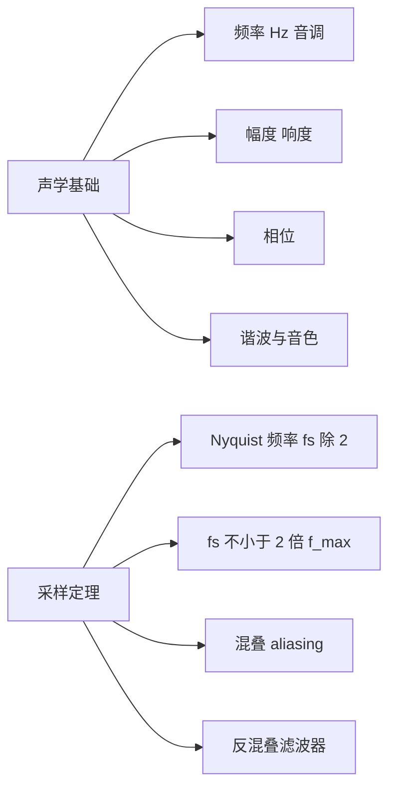
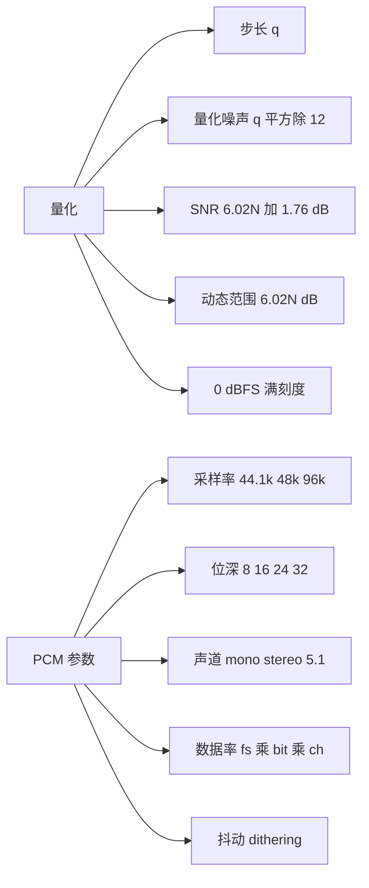
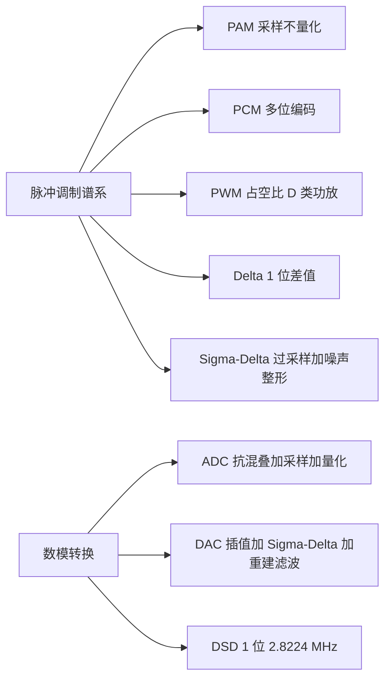
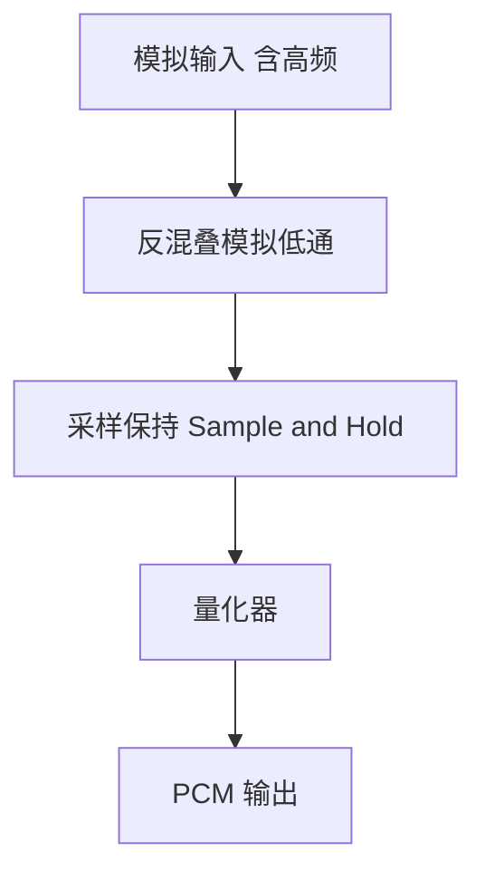
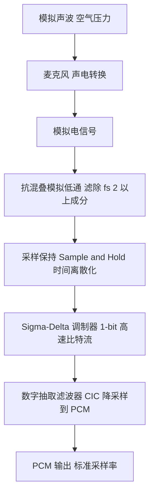
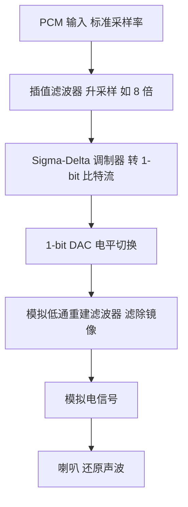

# 数字音频基础（Digital Audio Fundamentals）

> 适用范围：通用数字音频理论（声学基础、采样定理、量化、PCM、脉冲调制、AD/DA 转换）。核心数学结论（Nyquist 定理、SNR=6.02N+1.76 dB、DR=6.02N dB）自 1940 年代 Shannon 采样定理、1970 年代 ΣΔ 调制以来稳定；具体硬件实现随工艺演进，文中已标注。
> 学习边界：只讲"模拟声音如何变成数字 PCM、再变回模拟"这条主线。**不深入**：有损/无损编码算法（MP3/AAC/Opus/FLAC，见姊妹笔记《音频编码层与封装层》）、容器格式（WAV/MP4）、物理传输协议（SPDIF/I2S/DMIC，见姊妹笔记《音频协议SPDIF-I2S-DMIC》）、内核音频子系统（见姊妹笔记《Linux ALSA》）。这些笔记把 PCM 当作输入或输出，本笔记讲 PCM 本身从何而来。
> 阅读目标：15~25 分钟内建立"声音是什么、采样为什么要大于 2 倍频、位深为什么决定动态范围、抖动为什么必要、DSD 与 PCM 本质差异、DAC/ADC 内部做了什么"的可靠整体认知。

---

## 1. 先建立整体认知

### 1.1 它是什么

**直觉理解**：声音是空气压力的连续波动。要让计算机处理声音，必须把这条连续的"压力曲线"变成一连串数字。这个变换分两步：先在时间上**采样**（每隔一小段时间取一个压力值），再在幅度上**量化**（把连续压力值四舍五入到最近的离散电平）。经过"采样 + 量化 + 编码"得到的数字序列就是 **PCM（Pulse Code Modulation，脉冲编码调制）**——几乎所有数字音频的共同起点。

**严格定义**：数字音频是用离散时间、离散幅度的数字序列表示连续声音信号的技术。核心变换链为：

```text
模拟声波 (连续时间 连续幅度)
    ↓ 采样 (Sampling): 时间离散化, 幅度仍连续
PAM 脉冲幅度调制 (离散时间 连续幅度)
    ↓ 量化 (Quantization): 幅度离散化
PCM 脉冲编码调制 (离散时间 离散幅度, N 位二进制)
```

PCM 是数字音频的"母语"：所有压缩编码（MP3/AAC/Opus）都以 PCM 为输入，所有 DAC（数模转换器）都以 PCM 为输入。

### 1.2 为什么存在

**在数字音频出现之前**，声音只能用模拟方式存储和传输（黑胶、磁带、模拟广播），存在三个根本问题：

1. **复制劣化**：模拟信号每复制一次就叠加一次噪声，无法无损复制；数字信号可以无限次精确复制。
2. **抗干扰差**：模拟信号在传输中叠加的噪声无法去除；数字信号只要没被误码，就能完全还原。
3. **处理能力弱**：模拟处理（均衡、混音、降噪）依赖电路，精度受限；数字处理是数学运算，精度任意、算法任意。

数字音频的解法对应了这三个痛点：

1. **采样定理**保证：只要采样率足够高（>2 倍最高频率），离散采样能**完全等价**还原原始连续信号——没有信息损失。
2. **量化**用有限位数近似连续幅度，用可控的量化噪声换取数字存储。
3. **PCM** 把声音变成纯数字序列，使一切信号处理（压缩、均衡、混音、空间音频）成为可能。

一句话：**数字音频 = "用采样定理保证时间无损、用量化把幅度数字化"的声音表示方法。**

### 1.3 在整个音频体系中的位置

```text
物理声波 (空气压力波动)
    ↓ 麦克风 声-电转换
模拟电信号
    ↓ 本笔记: ADC 模数转换 (采样 + 量化 + 编码)
PCM 数字音频流        ← 本文终点, 也是所有上层的起点
    ├── 编码层 (MP3 / AAC / Opus / FLAC)      姊妹笔记
    ├── 封装层 (WAV / MP4 / MKV)               姊妹笔记
    ├── 传输协议 (SPDIF / I2S / DMIC)          姊妹笔记
    ├── 软件栈 (Linux ALSA / ASoC)             姊妹笔记
    └── DAC 数模转换 (本笔记后段)
            ↓
模拟电信号 → 喇叭 → 声波
```

本笔记是所有音频技术的**地基**：其他笔记处理的都是 PCM 之后（或传输中）的事，本笔记处理的是"模拟→PCM"和"PCM→模拟"这两个端点。

---

## 2. 在整个体系中的位置要点

| 层次 | 位置 | 职责 |
| --- | --- | --- |
| 声学层 | 空气压力波动 | 声音的物理本质：频率、幅度、相位 |
| 模拟前端 | 麦克风、话放、抗混叠滤波器 | 声→电、调理信号、限制带宽 |
| **数字音频基础** | **采样 + 量化 + PCM** | **模拟↔数字的桥梁（本文主题）** |
| 编码层 | MP3/AAC/Opus/FLAC | 压缩 PCM 为更小的基本流 |
| 封装层 | WAV/MP4/MKV | 组织多路流 + 时间戳 |
| 传输层 | SPDIF/I2S/DMIC | 设备/芯片间传输 PCM |
| 软件层 | ALSA/ASoC | 操作系统中的音频子系统 |

关键判断：**PCM 是音频世界的"通用语"**。无论你用什么编码、什么容器、什么协议、什么操作系统，最终都要回到 PCM 才能播放或录音。理解 PCM 的产生（采样+量化）和消亡（DAC 重建）是理解一切音频技术的前提。

---

## 3. 知识地图

概念较多，拆成三张图。

**图 1：声学基础与采样**



**图 2：量化与 PCM 参数**



**图 3：脉冲调制与数模转换**



下面逐一展开。

---

## 4. 核心概念

### 4.1 声学基础：声音是什么

- **频率（frequency, Hz）**：每秒振动次数，决定**音调**。人耳可听范围约 20 Hz ~ 20 kHz（随年龄下降）。
- **幅度（amplitude）**：振动的强度，决定**响度**（响度是主观感知，与幅度的对数近似）。
- **相位（phase）**：振动的起始角度，在多声道/立体声中决定声像定位。
- **谐波（harmonics）与音色**：任何非正弦周期波都是基频 + 各次谐波的叠加，谐波的幅度分布决定**音色**（为什么小提琴和钢琴奏同一个音听起来不同）。

> 必要关联：这四个量是后面所有数字处理的对象。采样在**时间**维度离散化，量化在**幅度**维度离散化，频率则通过采样定理约束采样率。

### 4.2 采样定理（Nyquist-Shannon Sampling Theorem）

**精确表述**：对于一个带宽限制在 `f_max` 以内的连续时间信号，当且仅当采样率 `f_s > 2 * f_max` 时，该信号可以由其采样序列 `x(nT)`（`T = 1/f_s`）经 sinc 插值**唯一且无失真**地重建。`f_N = f_s / 2` 称为 **Nyquist 频率**。

```text
信号: x(t), 带宽 <= f_max
采样: x[n] = x(nT), T = 1/f_s
重建: x(t) = Σ x[n] * sinc((t - nT) / T)
条件: f_s > 2 * f_max
```

**为什么是 2 倍？** 直观理解：一个正弦波至少需要两个采样点（一个正半周、一个负半周）才能确定其频率。如果采样率恰好等于 2f_max，只能抓住峰值——任何相位偏移都会导致无法重建。所以定理要求 **严格大于**，实际工程中要留更多余量。

**常见采样率与对应的最高可还原频率**：

| 采样率 | Nyquist 频率 | 典型用途 |
| --- | --- | --- |
| 8 kHz | 4 kHz | 电话（语音足够） |
| 22.05 kHz | 11.025 kHz | 早期多媒体 |
| 44.1 kHz | 22.05 kHz | CD（覆盖人耳 20 kHz 上限） |
| 48 kHz | 24 kHz | 视频/广播/专业音频 |
| 96 kHz | 48 kHz | 高解析音频（Hi-Res） |
| 192 kHz | 96 kHz | 高解析音频 |

### 4.3 混叠（Aliasing）与反混叠滤波器

如果信号中含有高于 Nyquist 频率 `f_s/2` 的成分，采样时这些高频成分会被**折叠**回基带，产生虚假的低频信号——这就是**混叠**。

**折叠公式**：

```text
f_alias = |n * f_s - f|    取使结果落在 [0, f_s/2] 的整数 n
```

例如 `f_s = 48 kHz`，信号中 30 kHz 的成分会折叠为 `|1*48k - 30k| = 18 kHz`，与基带信号叠加，产生失真。

**反混叠滤波器（anti-aliasing filter）**：在 ADC 之前加一个模拟低通滤波器，把高于 `f_s/2` 的成分滤掉。



> 关键认知：**理想矩形低通滤波器不可实现**（需要无穷阶、有非因果响应）。实际滤波器有**过渡带**（transition band），从通带到阻带需要一段频率范围逐步衰减。因此采样率必须**大于** `2*f_max`，留出过渡带的余量——这就是为什么 CD 用 44.1 kHz 而非 40 kHz（2×20 kHz）。

### 4.4 量化（Quantization）

采样把时间离散化了，但每个采样的幅度还是连续的（理论上有无穷多个可能值）。**量化**把连续幅度映射到有限个离散电平。

**均匀量化（uniform quantization）**：把满幅范围 `[-V_ref, +V_ref]` 等分成 `2^N` 个电平（N = 位深），相邻电平的差叫**量化步长**：

```text
q = (2 * V_ref) / (2^N) = V_ref / (2^(N-1))
```

例如 16 位、满幅 1V 时，q = 2V / 65536 ≈ 30.5 μV。

**量化噪声（quantization noise）**：量化把真实值舍入到最近电平，误差 `e` 落在 `[-q/2, q/2]`。假设误差均匀分布，其方差（功率）为：

```text
σ_q² = ∫_{-q/2}^{q/2} e² * (1/q) de = q² / 12
```

> 直觉理解：量化噪声是"四舍五入"产生的误差，功率只跟步长 q 有关，位深 N 每增加 1 位，q 减半，噪声功率降到 1/4（即 -6.02 dB）。

### 4.5 信噪比（SNR）与动态范围（DR）

这是衡量量化质量的两个核心指标，必须精确区分：

**动态范围（Dynamic Range, DR）**：最大不失真信号功率与量化噪声功率之比，是器件的**理论极限**。

```text
DR_dB = 20 * log10(2^N) = 6.0206 * N  dB
```

- 16 位：DR ≈ 96.3 dB
- 24 位：DR ≈ 144.5 dB

**满刻度正弦波 SNR**：当输入是满刻度正弦波时，信号功率为 `(V_ref/√2)² = V_ref²/2`，与量化噪声 `q²/12` 的比值：

```text
SNR_dB = 10 * log10( (V_ref²/2) / (q²/12) )
       = 10 * log10( 3 * 2^(2N-1) )
       = 6.0206 * N + 1.761  dB
```

- 16 位正弦波 SNR ≈ 98.1 dB
- 24 位正弦波 SNR ≈ 146.3 dB

**DR 与 SNR 的关系**：`SNR_正弦 = DR + 1.76 dB`。这 1.76 dB 来自正弦波的峰均比（crest factor = √2，即 3.01 dB）与均匀分布噪声功率的组合。

> 常见误区：很多资料说"16 位动态范围是 98 dB"——这是把正弦波 SNR 当成了 DR。严格说 16 位 DR = 96.3 dB，满刻度正弦波 SNR = 98.1 dB。工程上常混用，但做精确测量时必须区分。

**0 dBFS（dB Full Scale）**：数字音频的满刻度电平，即量化器能表示的最大值。正弦波达到 ±V_ref 时其 RMS 为 0 dBFS - 3.01 dB（因为正弦波 RMS = 峰值/√2）。

### 4.6 PCM 参数：采样率、位深、声道

PCM 流由三个参数完全确定：

| 参数 | 含义 | 常见取值 |
| --- | --- | --- |
| **采样率**（sample rate） | 每秒采样数，决定频率上限 | 8k / 44.1k / 48k / 96k / 192k Hz |
| **位深**（bit depth） | 每个采样的位数，决定动态范围 | 8 / 16 / 24 / 32 位 |
| **声道数**（channels） | 并行的音频通道数 | 1(mono) / 2(stereo) / 6(5.1) / 8(7.1) |

**数据率（bit rate）计算**：

```text
bit_rate = sample_rate × bit_depth × channels    (bps)
```

典型值：

| 格式 | 采样率 | 位深 | 声道 | 数据率 |
| --- | --- | --- | --- | --- |
| 电话 | 8 kHz | 8 | 1 | 64 kbps |
| CD | 44.1 kHz | 16 | 2 | **1411.2 kbps** |
| DAT | 48 kHz | 16 | 2 | 1536 kbps |
| DVD-Audio | 96 kHz | 24 | 2 | 4608 kbps |
| Blu-ray | 192 kHz | 24 | 2 | 9216 kbps |

> 计算示例：CD = 44100 × 16 × 2 = 1,411,200 bps = 1411.2 kbps。一分钟 CD 立体声 ≈ 1411.2 kbps × 60 / 8 = 10.584 MB——这就是为什么需要编码压缩（见姊妹笔记《音频编码层与封装层》）。

### 4.7 PCM 的存储细节：有符号/无符号、字节序、对齐

这些是工程实现中常踩坑的点：

**有符号 vs 无符号**：
- 16/24/32 位整数 PCM 几乎都用**有符号二补码**，0 = 静音。
- 8 位 PCM 例外，WAV 中 8 位用**无符号**（offset binary），范围 0~255，静音 = 128 (0x80)。

**字节序（endianness）**：
- WAV 默认小端（little-endian，RIFF 容器），大端用 RIFX。
- AIFF 默认大端。
- ALSA 中用 `SNDRV_PCM_FORMAT_S16_LE`（小端）/ `_BE`（大端）区分。

**24 位对齐**（最容易出错）：
- `S24_3LE`：3 字节紧凑存储，每采样占 3 字节，处理时需手动拼接。
- `S24_LE`：4 字节容器，低 3 字节有效，高 1 字节 padding。对齐友好但浪费 25% 空间。

**交错（interleaved）vs 非交错（planar）**：
- 交错：`L1 R1 L2 R2 L3 R3 ...`（WAV 默认，ALSA `RW_INTERLEAVED`）
- 非交错：`L1 L2 L3 ...` + `R1 R2 R3 ...`（FFmpeg `AV_SAMPLE_FMT_S16P`，部分处理更高效）

### 4.8 抖动（Dithering）

**问题**：直接把高位深 PCM 截断/舍入到低位深时，量化误差与信号相关，会产生**可闻的谐波失真和颗粒噪声**（尤其在低电平衰减尾音处）。

**解法**：在量化前加入**极小的随机噪声**（抖动），打破量化误差与信号的相关性，把周期性失真转化为均匀的白噪声。

```text
高位深 PCM (24 bit)
    ↓ 加抖动噪声 (TPDF 三角分布 幅度 ±1 LSB)
    ↓ 量化到 16 bit
低位深 PCM (16 bit)  含白噪声底 但无谐波失真
```

**抖动类型**：
- **RPDF**（矩形概率密度）：单个均匀分布噪声，简单但有噪声调制。
- **TPDF**（三角概率密度）：两个均匀分布噪声叠加，是专业母带的**标准选择**，无噪声调制，无需噪声整形。
- **噪声整形（noise shaping）**：配合抖动，把量化噪声推到人耳不敏感的高频带，进一步降低可闻噪声。代表算法 POW-r、UV22。

> 何时抖动：**只在最终位深缩减时抖动一次**。例如 24 位混音 → 16 位 CD 母带时抖动。中间处理（24→32 位浮点→24 位）不需要抖动，因为没有信息损失。多次抖动会累积噪声。

### 4.9 脉冲调制谱系

数字音频有多种"把模拟变数字"的调制方式，核心区别是**用几位、编码什么**：

| 调制方式 | 位深 | 编码对象 | 关键特征 |
| --- | --- | --- | --- |
| **PAM**（脉冲幅度调制） | 连续 | 采样瞬间的幅度 | 只采样不量化，幅度仍连续（未数字化），是 PCM 的中间步骤 |
| **PCM**（脉冲编码调制） | N 位 | 采样值的绝对值 | 采样+量化+二进制编码，CD/主流音频 |
| **PWM**（脉冲宽度调制） | 1 位 | 脉冲宽度（占空比） | 占空比正比信号幅度，D 类功放核心 |
| **Delta Modulation**（增量调制） | 1 位 | 相邻采样差值的符号 | 比较器+积分器负反馈，有斜率过载问题 |
| **Sigma-Delta**（ΣΔ 调制） | 1 位 | 经噪声整形的比特流 | 过采样+积分+负反馈，把量化噪声推到高频 |

**PAM → PCM 的关系**：PAM 是"采样但还没量化"的中间状态；PCM = PAM + 量化 + 编码。很多 ADC 芯片内部先做 PAM（采样保持）再量化输出 PCM。

### 4.10 Sigma-Delta（ΣΔ）调制与 DSD

Sigma-Delta 是现代音频 ADC/DAC 的**核心架构**，理解它才能理解为什么 1-bit DSD 能达到高动态范围。

**一阶 ΣΔ 环路**：

```text
输入 X ──→ (-) ──→ 积分器 Σ ──→ 1-bit 量化器 ──→ 输出 Y
                ↑                        │
                └──── 1-bit DAC ←────────┘
```

频域传递函数：`Y(z) = X(z) + (1 - z⁻¹) · E(z)`

- 信号 `X(z)` 直通（低频增益→1，无失真）
- 量化噪声 `E(z)` 经过 `(1 - z⁻¹)` 高通整形，被推到高频带外

**过采样（oversampling）**配合噪声整形：
- 过采样 K 倍后，总量化噪声功率不变，但分布在更宽的频带，带内噪声降低 `10*log10(K)` dB。
- ΣΔ 的噪声整形进一步把噪声推高频，N 阶环路带内噪声按 `OSR^(2N+1)` 下降。
- 典型过采样率 OSR = 64 / 128 / 256。

**DSD（Direct Stream Digital）**：SACD 采用的格式，本质是**不经过抽取降采样的 1-bit ΣΔ 比特流**。

| DSD 格式 | 采样率 | 过采样率 |
| --- | --- | --- |
| DSD64 | 2.8224 MHz | 64 × 44.1 kHz |
| DSD128 | 5.6448 MHz | 128 × 44.1 kHz |
| DSD256 | 11.2896 MHz | 256 × 44.1 kHz |

**DSD vs PCM 本质差异**：
- DSD 恒为 1-bit，**无位深概念**，靠极高采样率 + 噪声整形获得动态范围。
- PCM 靠多位深（16/24）获得动态范围，采样率适中。
- DSD 不能直接做混音/EQ（1-bit 无法做乘法），**适合播放不适合制作**；制作必须在 PCM 域完成。

---

## 5. 核心概念之间的关系

```text
【模拟到数字的因果链】
连续声波
    ↓ 麦克风: 声压 → 电压
模拟电信号 (连续时间 连续幅度)
    ↓ 抗混叠滤波器: 限制带宽 < fs/2
带宽受限模拟信号
    ↓ 采样 (Sampling): 时间离散化
PAM (离散时间 连续幅度)
    ↓ 量化 (Quantization): 幅度离散化 引入 q²/12 噪声
PCM (离散时间 离散幅度 N 位)
    ↓ 编码: 二进制表示
PCM 比特流

【参数之间的约束关系】
采样率 fs  →  决定可还原最高频率 f_max < fs/2  (Nyquist)
位深 N     →  决定动态范围 DR = 6.02N dB  量化噪声功率 q²/12
采样率 × 位深 × 声道  →  数据率 (存储空间/带宽需求)
抖动       →  位深缩减时消除谐波失真 代价是增加白噪声底
过采样     →  降低带内量化噪声 为 ΣΔ 噪声整形奠基

【PCM 与各调制方式的关系】
PAM (采样不量化)
    ↓ +量化 +编码
PCM (主流)
    ↑ 1-bit 过采样 + 噪声整形
Sigma-Delta / DSD
PWM → D 类功放 (PCM → 占空比 → 模拟)
```

- 采样解决**时间**离散化，量化解决**幅度**离散化，二者合起来是 ADC 的本质。
- 采样率约束频率上限，位深约束动态范围，二者正交（互不影响）。
- 抖动是位深缩减的**必要代价**——用白噪声换取无谐波失真。
- ΣΔ 是 PCM 的"高速 1-bit 变种"，通过噪声整形把 1-bit 的高量化噪声推到不可闻频段。

---

## 6. 工作原理

### 6.1 一次完整的 ADC（模数转换）流程



现代音频 ADC 几乎都用 **ΣΔ 架构**：前端 1-bit ΣΔ 调制器以极高速度（数十 MHz）运行，后端数字抽取滤波器（CIC + FIR）把比特流降采样到目标 PCM 采样率。这样做的好处是：
1. 模拟抗混叠滤波器要求极低（因为前端采样率极高，过渡带极宽）；
2. ΣΔ 噪声整形把量化噪声推到高频，由抽取滤波器滤除。

### 6.2 一次完整的 DAC（数模转换）流程



**为什么 DAC 端要过采样（插值升采样）？**
1. **放宽重建滤波器**：过采样 K 倍后，镜像频谱移到 `K*fs` 附近，模拟低通的过渡带要求大幅降低（阶数从 10 阶降到数阶）。
2. **噪声整形**：配合 ΣΔ 调制器把量化噪声推高频。
3. **减少镜频能量**：插值使采样点更密，零阶保持输出的 sinx/x 滚降更小。

> 区分：ADC 端过采样是"先高速采样再降采样"（目的：放宽模拟抗混叠 + 噪声整形）；DAC 端过采样是"先升采样插值再输出"（目的：放宽模拟重建 + 噪声整形）。方向相反，原理相通。

### 6.3 采样率 44.1 kHz 的历史由来

44.1 kHz 不是一个"好看"的整数，它来自**用 U-matic 录像带存储数字音频**的历史妥协：

```text
NTSC (525 行, 60 场):  245 行/场 × 60 场/秒 × 3 采样/行 = 44,100 Hz
PAL  (625 行, 50 场):  294 行/场 × 50 场/秒 × 3 采样/行 = 44,100 Hz
```

Sony 和 Philips 在制定 CD 标准时，为了让数字音频能同时录在 NTSC 和 PAL 的 U-matic 录像带上做母带，选择了这个对两种制式都整除的采样率。48 kHz 则是视频/广播标准（48000 = 1600×30 = 1920×25，与 30/25 fps 帧同步）。

### 6.4 量化噪声的频谱与抖动原理

```text
【无抖动 直接截断】
信号: 缓慢上升的斜坡
量化: 阶梯状输出
误差: 与信号同步的周期性方波 → 产生谐波失真 (难听)

【加 TPDF 抖动后】
信号: 缓慢上升的斜坡 + ±1 LSB 随机噪声
量化: 随机提前或滞后跳变
误差: 与信号无关的白噪声 → 听感自然 (噪声底)
```

抖动的本质是**用随机化打破量化误差与信号的相关性**。代价是噪声底抬高约 3 dB（TPDF），但消除了所有谐波失真——这是值得的，因为白噪声比谐波失真可接受得多。

---

## 7. 示例代码

### 7.1 最小 PCM 生成：正弦波合成

```python
"""生成 1 秒 440 Hz 正弦波的 16 位 PCM, 对应知识地图 4.6 数据率与 4.4 量化"""
import numpy as np
import wave

fs = 44100          # 采样率: 44.1 kHz (CD)
duration = 1.0      # 1 秒
freq = 440.0        # A4 音
n_samples = int(fs * duration)

# 生成正弦波, 幅度 0.5 (留 6 dB 余量防削波), 采样 = 幅度量化
t = np.arange(n_samples) / fs
signal = 0.5 * np.sin(2 * np.pi * freq * t)   # 范围 [-0.5, 0.5]

# 量化到 16 位有符号整数: [-32768, 32767]
# 这一步就是 Quantization, 引入 q²/12 量化噪声
pcm_16 = (signal * 32767).astype(np.int16)

# 写入 WAV (16 位有符号小端, 单声道)
with wave.open("sine_440hz.wav", "wb") as wf:
    wf.setnchannels(1)
    wf.setsampwidth(2)        # 2 字节 = 16 位
    wf.setframerate(fs)
    wf.writeframes(pcm_16.tobytes())

print(f"采样数: {n_samples}")
print(f"数据率: {fs * 16 * 1} bps = {fs*16/1000:.1f} kbps")
print(f"动态范围: {6.02 * 16:.1f} dB")
print(f"正弦波 SNR: {6.02*16 + 1.76:.1f} dB")
```

**代码解释**：
1. **做什么**：合成 440 Hz 正弦波并编码为 16 位 PCM WAV 文件。
2. **位于知识地图哪里**：覆盖 4.2（采样率 44100）、4.4（量化：`*32767` 把连续值映射到 16 位整数）、4.5（DR/SNR 打印）、4.6（数据率计算）、4.7（16 位有符号小端 WAV）。
3. **为什么需要这一步**：`(signal * 32767).astype(np.int16)` 这一行就是**量化**——连续浮点值被舍入到最近的 16 位整数，引入 `q²/12` 的量化噪声。没有这一步就不是数字音频。
4. **执行后发生什么**：生成 1 秒正弦波 WAV，数据率 705.6 kbps（单声道），可直接用 `aplay sine_440hz.wav` 播放。
5. **关键概念对应**：`fs` ↔ 采样率；`*32767` ↔ 量化到 16 位满刻度；`np.int16` ↔ 有符号二补码；`setsampwidth(2)` ↔ 2 字节/采样。

### 7.2 位深缩减 + TPDF 抖动

```python
"""24 位 PCM 缩减到 16 位, 加 TPDF 抖动 vs 不加抖动的对比"""
import numpy as np

def reduce_to_16bit(pcm_24, dither=True):
    """pcm_24: float32 范围 [-1, 1] 表示 24 位满刻度"""
    target_levels = 32768.0   # 16 位有符号
    if dither:
        # TPDF: 两个均匀分布噪声叠加, 幅度 ±1 LSB
        noise = (np.random.rand(*pcm_24.shape) - 0.5) + \
                (np.random.rand(*pcm_24.shape) - 0.5)
        pcm_24 = pcm_24 + noise / target_levels
    # 量化 (舍入) 到 16 位
    return np.clip(np.round(pcm_24 * target_levels), -32768, 32767).astype(np.int16)

# 测试: 低电平正弦波 (-60 dBFS), 直接截断会有明显谐波失真
fs, n = 44100, 44100
t = np.arange(n) / fs
low_sine = 0.001 * np.sin(2 * np.pi * 440 * t)   # -60 dBFS

no_dither = reduce_to_16bit(low_sine, dither=False)
with_dither = reduce_to_16bit(low_sine, dither=True)

print("不加抖动: 量化误差与信号相关, 产生谐波失真")
print("加 TPDF 抖动: 量化误差白噪声化, 无谐波失真")
```

**代码解释**：
1. **做什么**：对比 24→16 位缩减时，加 TPDF 抖动与直接截断的差异。
2. **位于知识地图哪里**：覆盖 4.8（抖动原理、TPDF 双均匀分布叠加）。
3. **为什么需要这一步**：低电平信号（-60 dBFS）直接截断时，量化台阶相对信号很大，误差与信号强相关产生谐波。TPDF 抖动用 ±1 LSB 的随机噪声打破相关性。
4. **执行后发生什么**：不加抖动的样本在频域可见 440 Hz 的谐波峰；加抖动后谐波消失，代之以均匀白噪声底。
5. **关键概念对应**：`noise = rand + rand` ↔ TPDF（三角分布）；`/ target_levels` ↔ 噪声幅度为 ±1 LSB；`np.round` ↔ 量化舍入。

---

## 8. 实际应用

数字音频基础在真实系统中的出现位置：

```text
消费电子
  ├── 手机/智能音箱: DMIC (ΣΔ ADC) → SoC PCM → 编码 → 网络
  ├── CD 播放器: 16bit/44.1kHz PCM → DAC (ΣΔ) → 模拟 → 喇叭
  ├── 蓝牙耳机: PCM → SBC/AAC 编码 → 蓝牙传输 → 解码 → DAC
  └── Soundbar: SPDIF/I2S 输入 PCM → DSP → DAC

专业音频
  ├── 录音棚: 24bit/96kHz PCM 多轨录制 → 32bit 浮点混音 → 16bit/44.1kHz 抖动母带
  ├── 现场调音: 32bit 浮点处理防削波 → 24bit 输出
  └── 母带制作: 抖动 + 噪声整形 + 响度标准化 (ITU-R BS.1770)

嵌入式
  ├── 数字麦克风 DMIC: 内置 ΣΔ ADC, 输出 PDM 1-bit 流
  ├── Codec 芯片: 集成 ADC/DAC, I2S 接口传输 PCM
  └── D 类功放: PCM → PWM → LC 滤波 → 喇叭
```

调试入口：`sox --i file.wav` 看 PCM 参数，`ffmpeg -f lavfi -i sine=frequency=440:duration=1` 生成测试音，Audacity 频谱分析看谐波失真和噪声底。

---

## 9. 常见误区

### 误区 1：以为采样率正好等于 2 倍最高频率就够

**错误理解**：采样定理说 fs ≥ 2f_max，那我要录 20 kHz 声音用 40 kHz 采样率就行。

**为什么容易这样理解**：定理的数学表述是 `fs > 2f_max`，直觉上"刚好 2 倍"应该满足。

**正确理解**：定理要求 **fs 严格大于 2f_max**，且实际工程中因为**反混叠滤波器有过渡带**，必须留更多余量。如果 fs = 2f_max，理想矩形滤波器才能工作，但理想滤波器不可实现。CD 用 44.1 kHz 而非 40 kHz，就是为了给 20 kHz~22.05 kHz 之间留过渡带。高解析音频（96k/192k）的核心价值之一就是让反混叠过渡带极宽、相位失真极小。

### 误区 2：以为位深翻倍动态范围也翻倍

**错误理解**：16 位 96 dB，32 位就是 192 dB。

**为什么容易这样理解**：位深翻倍直觉上"精度翻倍"。

**正确理解**：动态范围 `DR = 6.02 * N`，是**线性关系不是翻倍**。位深每增加 1 位，DR 增加 6.02 dB。16 位 = 96 dB，24 位 = 144 dB（增加 8 位 = 48 dB），32 位定点 = 192 dB。16→24 位增加了 256 倍电平分辨率（2^8），但 DR 只增加 48 dB——因为 dB 是对数刻度。

### 误区 3：以为 24 位音频一定比 16 位好听

**错误理解**：位深越高音质越好，24 位碾压 16 位。

**为什么容易这样理解**：参数越大越好是直觉。

**正确理解**：24 位的 144 dB 动态范围远超人耳听阈（约 120 dB）和消费电子的本底噪声。如果录音环境本底噪声高于 -96 dBFS（绝大多数情况），16 位已经能完整记录，24 位的低位只是记录了噪声。24 位的真正价值在**制作环节**（混音时增益调整不损失精度、避免削波），而非最终播放。

### 误区 4：以为抖动会降低音质

**错误理解**：加噪声进去肯定让声音变差。

**为什么容易这样理解**："噪声"直觉上是坏事。

**正确理解**：抖动加的噪声极小（±1 LSB，-96 dBFS 量级），且把**难听的谐波失真**换成了**好听的白噪声**。不加抖动的低电平信号会有明显的谐波失真和颗粒感（尤其在衰减尾音处），加抖动后变成平滑的噪声底。专业母带制作**必须**抖动，不加才是错误。

### 误区 5：以为 DSD 比 PCM 更"高保真"因为是 1 位

**错误理解**：1 位直接记录模拟波形，没有量化台阶，比 PCM 多位量化更原始更保真。

**为什么容易这样理解**："1 位 = 最接近模拟"的直觉。

**正确理解**：DSD 也是量化（1 位量化的量化噪声极大，理论 SNR 仅 ~8 dB），只是靠**极高过采样率 + ΣΔ 噪声整形**把噪声推到高频。DSD 的动态范围来自过采样和噪声整形，不是来自"1 位"。DSD 和 PCM 是两种不同的数字表示，听感差异来自实现而非本质优劣，且 DSD 无法做数学运算（不能混音/EQ），制作必须在 PCM 域完成。

---

## 10. 相关知识

```text
数字音频基础 (本文)
├── 姊妹笔记 (PCM 之后的处理)
│   ├── 音频编码层与封装层     (PCM → MP3/AAC/Opus → WAV/MP4 容器)
│   ├── 音频协议 SPDIF-I2S-DMIC (PCM/PDM 在设备/芯片间传输, DMIC 内部 ΣΔ ADC)
│   ├── Linux ALSA            (PCM 在内核中的抽象: snd_pcm SNDRV_PCM_FORMAT)
│   └── Linux ASoC            (嵌入式音频驱动, Codec 内 ADC/DAC 控制)
│
├── 必要关联
│   ├── 信号与系统 (傅里叶变换 频谱 卷积 滤波器)
│   ├── 概率论与数理统计 (均匀分布 方差 白噪声 抖动)
│   ├── FFmpeg samplefmt      (AV_SAMPLE_FMT_S16 U8 FLT, interleaved vs planar)
│   └── ALSA SNDRV_PCM_FORMAT_* (S16_LE S24_3LE S32_LE FLOAT_LE 等)
│
└── 扩展 (仅索引)
    ├── 心理声学模型 (编码层笔记展开 掩蔽效应)
    ├── 响度标准化 ITU-R BS.1770 (LKFS 计量)
    ├── 空间音频 Ambisonics / 双耳
    ├── SACD 与 DSD 生态
    ├── D 类功放 PWM 滤波设计
    └── MQA / Hi-Res Audio 认证
```

---

## 11. 知识脉络（因果链）

```text
声音是连续的空气压力波动
    ↓
计算机只能处理离散数字
    ↓
如何把连续变离散 且不丢信息?
    ↓
Nyquist 采样定理: fs 不小于 2 倍 f_max 可无损重建
    ↓
时间离散化了 (采样), 幅度还是连续的
    ↓
如何把连续幅度变离散?
    ↓
量化: 把 [-Vref, Vref] 切成 2^N 个电平
    ↓
量化引入噪声: 功率 q²/12, 动态范围 6.02N dB
    ↓
采样 + 量化 + 编码 = PCM (数字音频的通用语)
    ↓
PCM 的三要素: 采样率(频率上限) + 位深(动态范围) + 声道(空间)
    ↓
位深缩减时量化误差与信号相关 → 谐波失真
    ↓
抖动 (TPDF): 用极小随机噪声把谐波失真变白噪声
    ↓
1 位量化噪声太大怎么办?
    ↓
Sigma-Delta: 过采样 + 噪声整形把噪声推高频
    ↓
DSD: 不抽取的 ΣΔ 比特流 (适合播放 不适合制作)
    ↓
PCM 如何还原成模拟?
    ↓
DAC: 插值升采样 → ΣΔ 调制 → 模拟低通重建滤波
```

---

## 12. 正式学习时重点关注

1. **采样定理的数学本质**：为什么是 2 倍？理解频域延拓（采样=频谱周期化）和 sinc 插值重建，而不是死记"fs > 2f_max"。这是混叠、反混叠滤波器、过采样一切的基础。

2. **量化噪声公式推导**：`σ_q² = q²/12` 来自均匀分布误差的方差积分，`SNR = 6.02N + 1.76` 来自正弦波功率与噪声功率之比。能手推这两个公式，就真正理解了位深与动态范围的关系，而不是背数字。

3. **DR 与 SNR 的区别**：DR = 6.02N（理论极限），满刻度正弦波 SNR = 6.02N + 1.76。很多资料混用，做测量和编码时必须分清。0 dBFS 定义也是基础。

4. **ΣΔ 噪声整形原理**：`Y(z) = X(z) + (1-z⁻¹)E(z)` 这个传递函数是理解现代 ADC/DAC、DMIC、DSD 的钥匙。信号直通、噪声被高通整形到高频——一句话讲清为什么 1-bit 系统能达到高动态范围。

5. **抖动的必要性与时机**：理解"相关性导致谐波失真"这个核心，就知道为什么位深缩减必须抖动、为什么只在最终输出抖动一次。TPDF 是标准选择，噪声整形是进阶优化。

6. **采样率选择的工程逻辑**：44.1k（U-matic 历史妥协 + CD）、48k（视频同步）、96k/192k（Hi-Res，主要价值是滤波器过渡带和制作余量而非可闻频率上限）。不要迷信"越高越好"。

---

## 13. 参考资料

### 第一优先级（权威教材与标准）

- **Oppenheim & Schafer, Discrete-Time Signal Processing (3rd ed.)** — 采样定理（§4.2）、量化噪声（§4.8）、多采样率信号处理，数字信号处理领域标准教材
- **Analog Devices MT-001** — *Taking the Mystery out of the Infamous Formula, "SNR = 6.02N + 1.76 dB"*（量化噪声公式权威推导）https://www.analog.com/media/en/training-seminars/tutorials/MT-001.pdf
- **Analog Devices MT-022** — *Sigma-Delta ADCs Basics*（ΣΔ 调制原理、噪声整形传递函数）
- **ITU-R BS.1770** — *Algorithms to measure audio programme loudness and true-peak audio level*（dBFS 与响度计量标准）
- **ITU-R BS.775** — *Multichannel stereophonic sound system with and without accompanying picture*（5.1 声道布局标准）
- **Sony/Philips SACD Technology Overview (2001)** — DSD 格式与 ΣΔ 原理官方白皮书
- **Wikipedia**：Nyquist–Shannon sampling theorem / Aliasing / Quantization (signal processing) / Pulse-code modulation / Audio bit depth / Dither (audio) / Delta-sigma modulation / Direct Stream Digital / 44,100 Hz / 48 kHz

### 第二优先级（高质量技术资料）

- **TI SLAA701A** — *Class-D LC Filter Design*（PWM 音频与 D 类功放）
- **Cirrus Logic WAN0263** — *Interfacing WM72xx Digital Microphone*（DMIC 中 ΣΔ ADC 与 PDM）
- **Audio Precision** — *Understanding PDM Digital Audio*（PDM 与 ΣΔ 关系）
- **FFmpeg 源码** `libavutil/samplefmt.h` / `libavutil/samplefmt.c` — `AV_SAMPLE_FMT_U8/S16/S32/FLT`、interleaved/planar 定义
- **ALSA UAPI** `include/uapi/sound/asound.h` — `SNDRV_PCM_FORMAT_*` 枚举（S16_LE、S24_3LE、S32_LE、FLOAT_LE 等）
- **soundfile.sapp.org** — WAV 文件格式规范（8 位无符号、16/24/32 位有符号约定）

### 第三优先级（社区与工程实践）

- **AES (Audio Engineering Society) 论文库** — 抖动、噪声整形、高解析音频的学术研究
- **Stack Exchange Signal Processing** — 量化、采样、滤波器实现问题
- **audioscene.org / audioutils.com** — 抖动与母带处理实践

### 关键数值速查

| 位深 N | 动态范围 (6.02N) | 满刻度正弦 SNR (6.02N+1.76) |
| --- | --- | --- |
| 8 位 | 48.2 dB | 49.9 dB |
| 16 位 | 96.3 dB | 98.1 dB |
| 24 位 | 144.5 dB | 146.3 dB |
| 32 位定点 | 192.7 dB | 194.4 dB |

| 采样率 | 数据率 (16bit 立体声) | 数据率 (24bit 立体声) |
| --- | --- | --- |
| 44.1 kHz | 1411.2 kbps | 2116.8 kbps |
| 48 kHz | 1536 kbps | 2304 kbps |
| 96 kHz | 3072 kbps | 4608 kbps |
| 192 kHz | 6144 kbps | 9216 kbps |

---

> 姊妹笔记：
> - [音频编码层与封装层.md](./音频编码层与封装层.md) — PCM 之后的压缩与容器（MP3/AAC/Opus、WAV/MP4）
> - [音频协议SPDIF-I2S-DMIC.md](./音频协议SPDIF-I2S-DMIC.md) — PCM/PDM 在设备间的物理传输（DMIC 内部 ΣΔ ADC）
> - [LinuxALSA.md](./LinuxALSA.md) — PCM 在内核中的抽象（`snd_pcm`、`SNDRV_PCM_FORMAT_*`、ring buffer）
> - [Linux ASoC.md](./Linux%20ASoC.md) — 嵌入式音频驱动（Codec 内 ADC/DAC 控制）
