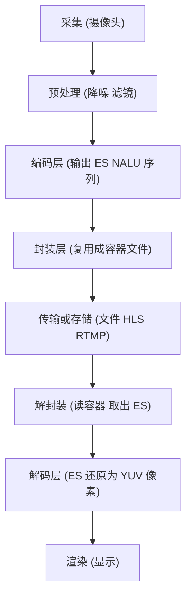
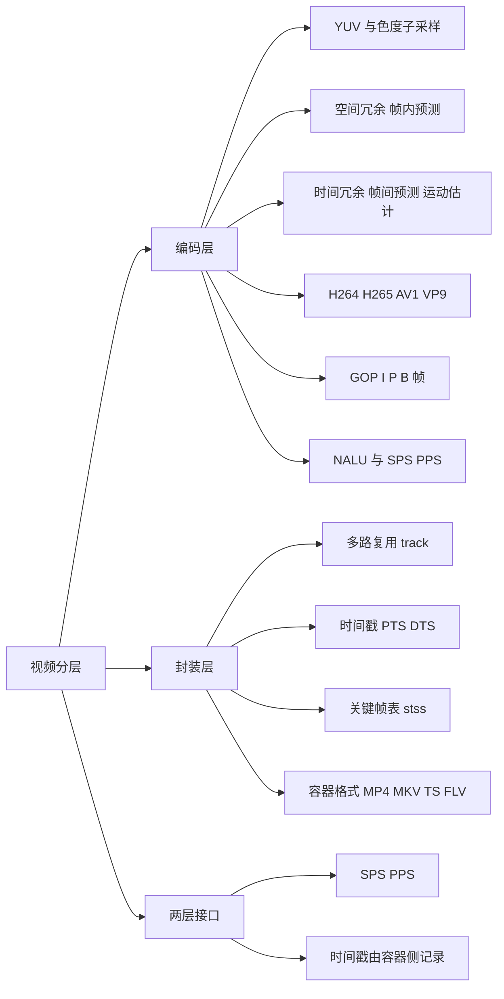
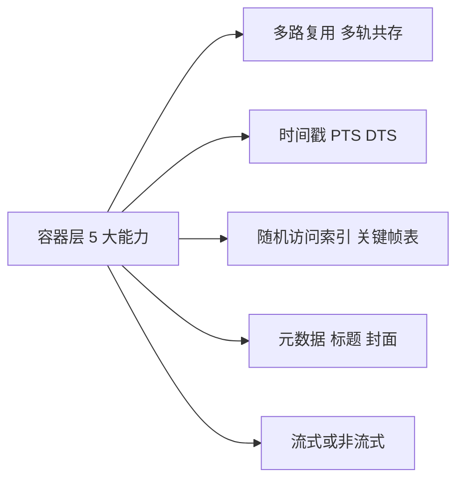
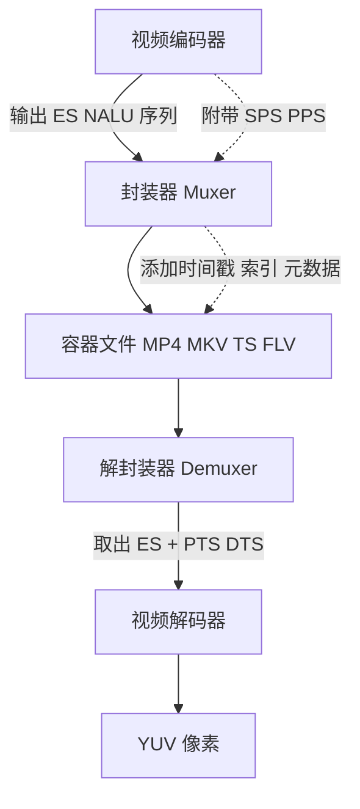
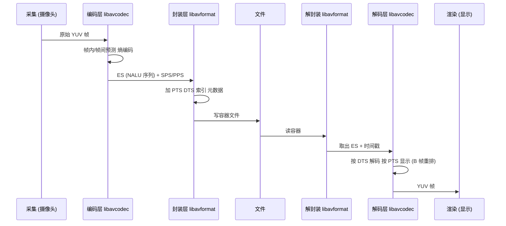
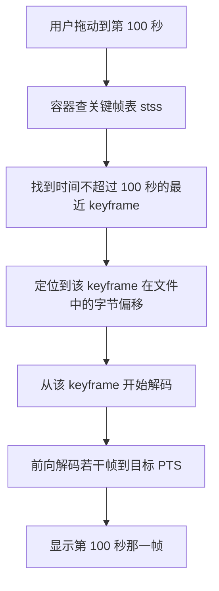
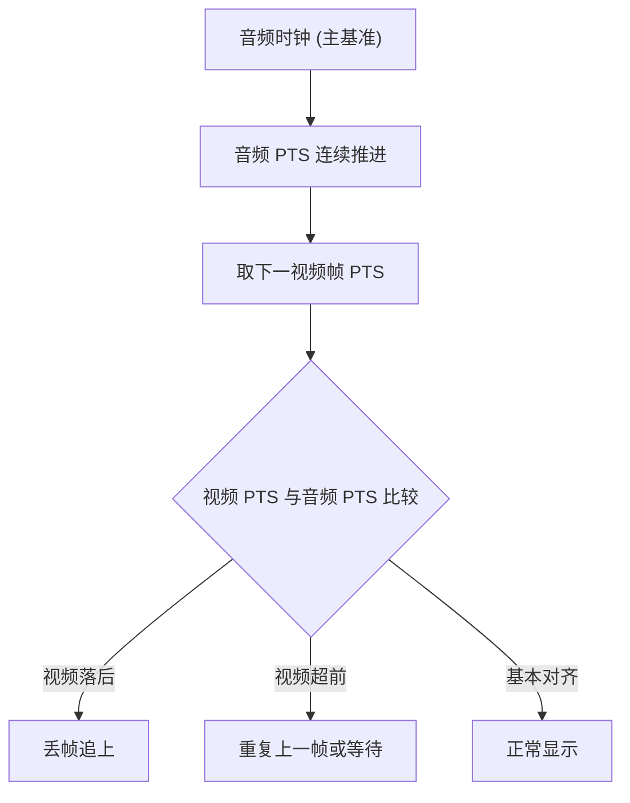

# 视频编码层与封装（容器）层

> 适用范围：通用视频技术（H.264 / H.265 / AV1 / VP9 等编码；MP4 / MKV / FLV / MPEG-TS / WebM 等容器）。核心机制（ES、NALU、PTS/DTS、GOP、box、sample table）自 2000 年代以来保持稳定；个别接口存在版本差异，文中已标注。
> 学习边界：只讲"压缩后的视频基本流如何被组织进容器"这条分层主线。编码算法内部（DCT 公式、运动估计算法）、传输协议本身（HLS / DASH / RTMP）、播放器 UI 实现不属于本笔记；音频侧的概念只在对比时简要提及，详见姊妹笔记《音频编码层与封装层》。
> 阅读目标：10~20 分钟内建立"视频为什么分两层、两层如何咬合、B 帧如何让封装层变复杂、容器到底比裸流多了什么"的整体认知，并拿到一张进入正式学习的地图。

---

## 1. 先建立整体认知

### 1.1 它是什么

**直觉理解**：1080p60 的原始视频一秒约 186 MB，传输和存储都不可行。要让它在手机、网页、卫星、蓝光上都能用，必须做两件完全独立的事：

1. **压扁**：用算法把数据量降到原来的百分之一甚至更少——这是**编码层**。
2. **装盒**：把压扁后的视频流（可能还有音频、字幕、时间戳、索引、封面……）统统装进一个文件——这是**封装层**（也叫**容器层**）。

**类比及其边界**：编码像"压缩衣服抽真空"，封装像"把衣服、袜子、领带分类放进旅行箱并贴标签"。真空压缩与装箱是两件事，可以独立选择——但类比到此为止：编码和封装都是数字信号处理，不是物理动作。

**严格定义**：

- **编码层（Coding Layer / Compression Layer）**：用帧内/帧间预测消除空间与时间冗余、用熵编码消除统计冗余，输出**基本流（Elementary Stream, ES）**——一段连续的、已被压缩但**没有时间戳和索引**的字节序列。
- **封装层（Container Layer / Muxer Layer）**：把一路或多路 ES 加上**时间戳、索引、元数据、多路复用结构**，组织成可独立存储、传输、随机访问的文件格式（MP4 / MKV / FLV / TS / WebM 等）。

### 1.2 为什么存在

**为什么必须分两层**：

1. **关注点不同**：编码解决"小而清晰"，封装解决"可定位、可同步、可携带元数据"。混在一起会让任何一边的演进绑死另一边。
2. **解耦带来演化自由**：H.264 → H.265 → AV1 三代视频编码共用同一套 MP4 容器；MP4 → MKV → fMP4 容器演进也不用重写编码器。如果不分层，每出一个新编码就要重做文件格式。
3. **组合爆炸的现实**：4 种主流视频编码 × 5 种主流容器 = 20 种组合（再加音频更多）。分层让"编码器插件"和"复用器插件"独立存在，FFmpeg 才能用几十个模块组合出上千种转换路径。
4. **工程价值直接可见**：`ffmpeg -i in.mp4 -c:v copy out.mkv` 是**换盒子不重新压缩视频**，瞬间完成；只有 `ffmpeg -i in.mp4 -c:v libx265 out.mkv` 才会重新编码（耗时）。这条命令的存在本身就是分层的产物。

一句话：**编码层回答"数据怎么变小"，封装层回答"变小的数据怎么被组织使用"。**

---

## 2. 在整个体系中的位置



- **ES 是两层之间的契约**：编码器只产 ES（H.264 的 NALU 序列 / AV1 的 OBU 序列），不关心它最终被装进什么容器；封装器只消费 ES，不关心它是怎么被压出来的。
- **两层各自独立可换**：左侧换编码器，右侧换容器，互不影响。FFmpeg 的 `libavcodec`（编码）与 `libavformat`（封装）正是这条边界的代码化身。
- **传输协议在更上层**：HLS / DASH / RTMP 用"切片后的容器片段"传输，属于封装层之上。本笔记只索引不展开。

---

## 3. 知识地图





下面逐一展开这些核心概念。

---

## 4. 核心概念

### 4.1 YUV 与色度子采样：视频编码前的数据基础

视频编码前，原始像素通常以 **YUV** 表示（不是 RGB）。YUV 把亮度（Y）与色度（U/V）分离，利用人眼对亮度敏感、对色度迟钝的特性压缩。

- **YUV420**：每 2×2 个亮度采样共享一组色度采样，数据量 = RGB 的 1/2。
- **1080p60 YUV420 原始数据量** = 1920×1080×1.5 字节×60 ≈ **186 MB/s ≈ 1.49 Gbps**。
- 编码后通常压到 2~8 Mbps（100:1 量级压缩比）。

YUV 与色度子采样属于"采集/预处理"层，不是编码层；但编码器以 YUV 为输入，所以理解它是理解视频编码的起点。

### 4.2 编码层：消除三类冗余

**视频编码的三类冗余**（三者分工配合，缺一不可）：

| 冗余类型 | 来源 | 编码对策 | 代表技术 |
| -------- | ------ | -------- | ------- |
| 空间冗余 | 同一帧内相邻像素相似（一片蓝天） | 帧内预测（intra prediction） | H.264 对 4×4 块定义 9 种方向模式 + DC |
| 时间冗余 | 相邻帧画面高度相似 | 帧间预测（inter prediction）/ 运动估计 | 记录运动向量 + 残差，H.264 支持 1/4 像素精度 |
| 统计冗余 | 码字出现频率不均 | 熵编码（entropy coding） | CABAC（High Profile，比 CAVLC 省 10~15% 码率） |

**三者配合**：帧内/帧间预测产生预测残差 → 残差经变换+量化 → 量化系数由熵编码压成最终码流。

**帧间预测的核心直觉**：相邻两帧画面大部分相同，只是物体移动了。编码器不存"第二帧的完整画面"，而是存"第二帧相对第一帧，这块区域向右移了 5 像素"——这就是运动向量。残差（实际画面与预测的差异）通常很小，熵编码后极省空间。

### 4.3 GOP / I / P / B 帧：视频编码的结构骨架

视频编码不是逐帧独立压缩的，而是组织成 **GOP（Group of Pictures，图像组）**——两个关键帧之间的帧序列。

| 帧类型 | 全称 | 参考关系 | 大小 | 用途 |
| ------ | ---- | -------- | ---- | ---- |
| I 帧 | Intra-coded | 仅参考自身 | 最大 | GOP 入口、随机访问点、seek 锚点 |
| P 帧 | Predictive | 参考前向已解码的 I/P 帧 | 中（I 的 20~50%） | 主力压缩 |
| B 帧 | Bidirectional | 参考前向和后向帧 | 最小 | 极致压缩，但需缓存未来帧 |

- **GOP 长度 = 关键帧间隔**：长 GOP 压缩更优，短 GOP 便于 seek/剪辑/直播低延迟。直播常用 1~2 秒 GOP（即 30~60 帧一个 I 帧）。
- **IDR（Instantaneous Decoding Refresh，NAL type 5）** 是特殊的 I 帧：解码时立即清空参考帧缓冲，其后的帧不再参考 IDR 之前的帧——IDR 是 GOP 的硬边界。普通 I 帧不一定切断依赖链。
- **B 帧导致 DTS ≠ PTS 的根本原因**：B 帧需"未来帧"才能解码，所以码流的**传输顺序（解码顺序 DTS）** 与 **显示顺序（PTS）** 不一致，需要重排缓冲。详见 4.6。

### 4.4 码率控制：CBR / VBR / CRF

| 模式 | 全称 | 行为 | 典型场景 |
| ---- | ---- | ---- | -------- |
| CBR | Constant Bitrate | 每秒码率近似恒定，靠逐帧调整 QP | RTMP 直播（需稳定缓冲） |
| VBR | Variable Bitrate | 目标平均码率，复杂场景多分配 | 两遍编码、本地存档 |
| CRF | Constant Rate Factor | 恒定感知质量，码率随内容变化 | VOD 存档（x264 默认 23，x265 默认 28） |

CRF 与 VBR 的本质区别：CRF 是"恒定质量"——简单场景码率自动降低、复杂场景自动升高；VBR 是"恒定平均码率"——总码率达标但单段可能波动。

### 4.5 主流视频编码格式对比

| 编码 | 发布年份 | 标准 | 压缩效率 | 专利/授权 | 典型场景 |
| ---- | -------- | ---- | -------- | --------- | -------- |
| H.264/AVC | 2003 | ITU-T H.264 / ISO/IEC 14496-10 | 基准 | MPEG-LA 专利池收费 | 蓝光、流媒体、所有主流设备 |
| H.265/HEVC | 2013 | ITU-T H.265 / ISO/IEC 23008-2 | 同质量比 H.264 码率减半 | 多专利池收费更复杂 | 4K 蓝光、卫星、部分流媒体 |
| VP9 | 2013 | Google | 与 H.265 相当 | 免版税 | YouTube、Chrome |
| AV1 | 2018 | AOMedia | 比 HEVC 节省约 30% 码率 | 免版税 | 现代流媒体、WebRTC |

- **效率相对关系**：同质量下码率 H.264 > H.265 ≈ VP9 > AV1（AV1 最优）。
- **专利差异**：H.264/H.265 由 MPEG-LA 等多个专利池授权收费；VP9/AV1 免版税。这是开源生态（Firefox/Chrome）倾向 VP9/AV1 的根本原因。
- **硬件解码普及度**：H.264 几乎所有 SoC 都支持；H.265 自 2015+ 设备普及；AV1 硬件解码仍在普及（RTX 40 系列、Intel Arc、AMD RDNA3、Apple A17 Pro/M3+ 起）。

### 4.6 PTS 与 DTS：封装层的核心创新（视频侧的复杂度来源）

这是本笔记最重要的概念之一。**编码层不存时间戳**——时间戳是封装层的发明。

- **DTS（Decoding Time Stamp，解码时间戳）**：何时解码该帧。
- **PTS（Presentation Time Stamp，显示时间戳）**：何时显示该帧给用户。

**为什么需要两个**：因为 B 帧。B 帧依赖"未来帧"才能解码，所以解码顺序与显示顺序不一致。

```text
显示顺序 (PTS):   I0  B1  B2  P3  B4  B5  P6 ...
解码顺序 (DTS):   I0  P3  B1  B2  B4  B5  P6 ...
                  ↑   ↑               ↑
                  先解 I  再解 P 才能解它依赖的 B
```

- 没有 B 帧时 DTS == PTS。
- **对比音频**：音频帧"帧间独立"（无 B 帧概念），按时序解码即按时序显示，几乎总是 DTS == PTS——这是音频在封装层比视频简单的根本原因（详见姊妹笔记《音频编码层与封装层》）。
- **时间戳用整数 timescale + delta 表示**：MP4 的 stts 表存 (sample_count, sample_delta) 对，timescale 在 mdhd box 里（如 timescale=24000 表示 1 秒 = 24000 个时间单位）；MKV 用 Timestamp + BlockDuration。用整数避免浮点累计误差。
- **容器中没有原生 "fps" 字段**：fps 是从时间戳序列推导的——相邻视频帧 PTS 差值的倒数。MP4 通过 mvhd timescale + stts 推算；MKV 无原生 fps 字段；FLV 的 onMetaData 里有 framerate 但只是编码器提示值，可能不准，应以 PTS 差值倒数为准。

### 4.7 NALU 与 SPS/PPS：H.264 的网络友好设计

H.264 的码流由 **NALU（Network Abstraction Layer Unit，网络抽象层单元）** 组成。这是 H.264 相对早期编码（如 MPEG-2）的关键创新——让码流对网络传输友好。

- **为什么需要 NALU**：把 VCL（Video Coding Layer）数据封装为适合网络/存储传输的单元，提供头信息区分不同类型。
- **起始码**：3 字节 `0x000001` 与 4 字节 `0x00000001`；SPS/PPS 与 Access Unit 首个 NALU 用 4 字节，多 slice 帧的后续 slice 用 3 字节。
- **NALU 头**：1 字节 = forbidden_zero_bit(1) + nal_ref_idc(2) + nal_unit_type(5)。常见类型：

| NAL type | 含义 |
| -------- | ---- |
| 1 | 非 IDR 的 SLICE（P/B 帧） |
| 5 | IDR SLICE（特殊 I 帧，GOP 边界） |
| 6 | SEI（补充增强信息） |
| 7 | SPS（Sequence Parameter Set） |
| 8 | PPS（Picture Parameter Set） |
| 9 | AUD（Access Unit Delimiter） |

- **SPS（Sequence Parameter Set，NAL type 7）与 PPS（Picture Parameter Set，type 8）**：携带 profile、level、分辨率、可选帧率等编码参数——解码器读 SPS/PPS 就能初始化。这是编码层与封装层契约的一部分。

### 4.8 Annex B vs AVCC：H.264 的两种打包方式

H.264 有两种 NALU 打包方式，决定它怎么进容器：

| 打包方式 | NALU 边界标识 | 特点 | 典型容器 |
| -------- | ------------ | ---- | -------- |
| Annex B | 起始码 `0x000001`/`0x00000001` | 流式扫描定位 NALU 边界，无需外部索引 | TS、MKV、广播传输 |
| AVCC | 1/2/4 字节长度前缀（MP4 典型 4 字节大端） | 按长度随机访问，节省起始码开销 | MP4 |

- **为什么需要两种**：Annex B 便于流式扫描定位 NALU 边界（无需外部索引），适合未知长度的传输流；AVCC 便于容器按 sample 索引随机访问，配合 MP4 的 box 结构。
- **FFmpeg 的 `h264_mp4toannexb` 比特流滤镜**专门做这种转换——把 MP4 的 AVCC 格式 H.264 转成 TS 的 Annex B 格式。

### 4.9 基本流（ES）：编码层的产物

ES（Elementary Stream）= 编码器输出的连续字节流，**没有任何时间戳和索引信息**。

- 视频编码后是 **NALU 序列**（H.264/H.265）或等价的 OBU 序列（AV1）；每个 NALU 是一个独立的网络抽象单元。
- **ES 自身不知道"第几秒该显示"**：它只有"第几个帧"。时间戳是封装层补上的。

ES 的自描述能力是封装层与编码层契约的一部分：

- **H.264/H.265 的 SPS（NAL type 7）与 PPS（type 8）**：携带 profile、level、分辨率、可选帧率等编码参数——解码器读 SPS/PPS 就能初始化。MP4 的 `avcC`/`hvcC` box、FLV 的 AVC sequence header、MKV 的 CodecPrivate 都存放它。

### 4.10 封装层的五大能力

裸 ES 缺什么，封装层就补什么：

| 能力 | 裸 ES 的缺陷 | 封装层的补法 |
| ---- | ----------- | ----------- |
| 多路复用 | 一条 ES 只能装一路视频 | 容器允许视频/音频/字幕/多音轨共存（MP4 的 trak、MKV 的 TrackEntry、TS 的 PID） |
| 时间戳 | ES 不知道"第几秒显示" | 容器为每个 sample 写 PTS/DTS |
| 随机访问索引 | ES 不能 seek | 容器记录关键帧位置表（MP4 stss、MKV Cues） |
| 元数据 | ES 无标题/作者/封面 | 容器支持元数据 box（MP4 udta/ilst、MKV Tags/Attachments） |
| 流式传输 | ES 不可边下边播 | 部分容器天然可流式（TS、MKV），MP4 需 moov 在头部或用 fMP4 |

**视频 seek 比音频复杂**：视频帧通常不是独立可解码的（P/B 帧依赖其他帧），seek 时必须从最近 keyframe 前向解码若干帧到目标 PTS。这就是为什么视频播放器拖动进度条会有短暂卡顿。

### 4.11 容器格式：MP4 的 box 结构（视频视角）

理解了 MP4，其他容器都是变体。MP4 由嵌套的 **box**（也叫 atom）组成，每个 box 有 4 字节类型码 + 4 字节长度 + 内容。

```text
ftyp    文件类型标识 (品牌 兼容列表 版本)
moov    元数据索引盒子 (整部电影的所有索引)
  mvhd  全局信息 (timescale 时长)
  trak  视频轨道
    tkhd  轨道头 (分辨率 等)
    mdia  媒体描述
      mdhd  媒体头 (本轨 timescale)
      hdlr  处理器类型 (vide)
      minf  媒体信息
        stbl  样本表 (核心!)
          stsd  编码配置 (avcC hvcC 等存 SPS PPS)
          stts  DTS 到 sample 增量表 (时间戳)
          ctts  PTS 偏移表 (B 帧重排 视频非零!)
          stsc  sample 到 chunk 映射
          stsz 每个 sample 大小
          stco  chunk 在文件中的偏移 (定位数据)
          stss 关键帧 sample 编号表 (seek 用)
  trak  第二条轨道 (通常音频) ...
mdat    实际媒体数据 (NALU 序列的真正存放地)
```

视频轨的关键信号：
- `mdhd` 的 timescale 通常是帧率的倍数（如 24000 对应 24fps）。
- `stsd` 里的 `avc1`/`hvc1` + `avcC`/`hvcC` 存放 SPS/PPS——这是编码层契约。
- `ctts` **非零**说明有 B 帧（PTS 偏移不为 0，需要重排）——这是视频区别于音频的关键信号。
- `stss`（Sync Sample Box）记录哪些 sample 是关键帧——seek 的索引依据。
- `stts` 的 delta 与 mdhd 的 timescale 算出帧率（如 delta=1001, timescale=24000 → 23.976fps）。

### 4.12 ISOBMFF：MP4 的家族规范

**ISOBMFF（ISO Base Media File Format，ISO/IEC 14496-12）** 是基础规范，MP4 是它的派生。整个家族共享 box 结构：

| 派生格式 | 标准号 | 用途 |
| -------- | ------ | ---- |
| MP4 | ISO/IEC 14496-14 | 通用视频文件 |
| MOV | QuickTime（ISOBMFF 的祖先） | 苹果系 |
| 3GP/3G2 | 3GPP 系列 | 移动通信早期 |
| HEIF/HEIC | ISO/IEC 23008-12 | 单张/多张/序列图片 |
| AVIF | AV1 静态图 | 现代图片格式 |
| CMAF / fMP4 | 14496-12 流式扩展 | HLS / DASH 分片 |

**关键洞察**：HEIF 表明容器格式可以装图片，不只是音视频。同一套 box 结构既能装一段视频，也能装一组照片——这就是"容器"这个抽象的力量。

### 4.13 容器与编码的解耦

**同一个容器可以装多种视频编码，同一个视频编码可以装进多种容器**：

| 容器 | 可装视频编码 |
| ---- | ---------- |
| MP4 | H.264（avc1）/ H.265（hvc1）/ AV1（av01）/ VP9（vp09） |
| MKV | 几乎任意（V_MPEG4/ISO/AVC 等） |
| WebM | VP8 / VP9 / AV1（限子集） |
| FLV | H.264（原生）/ HEVC/AV1（2023 Enhanced RTMP V2 补丁） |
| MPEG-TS | H.264 / H.265 / AV1 / MPEG-2 |

**判断"能不能播"要两步**：

1. 解复用器（demuxer）支持该容器格式吗？
2. 解码器（decoder）支持容器里装的编码吗？（容器用 fourcc / codec_id 标识编码）

两者都要支持，缺一不可。这就是为什么"装 H.265 的 MP4 在老播放器上能打开但播不了"——解复用器认识 MP4，但解码器不认识 H.265。

---

## 5. 核心概念之间的关系



- **编码层与封装层的契约**：编码层产 ES + 编码参数（SPS/PPS）；封装层加时间戳 + 索引 + 元数据。**时间戳不在编码层**——这是两层职责的最清晰分界。
- **GOP / I P B / PTS DTS / 关键帧表** 四个概念咬合在一起：B 帧让 DTS ≠ PTS，关键帧让 seek 可行，GOP 长度决定压缩效率与 seek 灵活度的权衡。
- **MP4 的 stbl 子盒** 把 PTS/DTS、关键帧、数据偏移全部结构化记录——它就是"封装层五大能力"的代码化身。
- **H.264 的 Annex B vs AVCC** 是编码层为不同容器做的适配：Annex B（起始码 0x000001）用于 TS/MKV（流式扫描），AVCC（长度前缀）用于 MP4（按 sample 索引）。FFmpeg 的 `h264_mp4toannexb` 比特流滤镜专门做这种转换。

---

## 6. 工作原理

### 6.1 一次完整转码的层次流



### 6.2 seek 的完整流程



- seek 不是瞬间完成，因为目标帧通常是 P/B 帧，必须从它依赖的前一个 keyframe 开始解码到目标 PTS。
- 关键帧间隔越长，seek 越慢；这就是直播用 1~2 秒短 GOP 的原因之一。

### 6.3 音视频同步（A/V Sync）中的视频追赶逻辑



- **音频是主时钟**：因为人耳对音频抖动远比视频敏感（几十毫秒音频不同步就能听出来，视频差一帧几乎无感）。FFmpeg 的 ffplay 默认 `AV_SYNC_AUDIO_MASTER`。
- 视频侧的同步策略：视频落后音频→丢帧；视频超前→重复上一帧或等待。这就是为什么播放器卡顿时视频会"跳"但音频流畅。
- 视频解码器需维护重排缓冲（B 帧的 PTS 大于 DTS，解码后不能立即显示，要按 PTS 排序）——这是视频侧独有的复杂度。

### 6.4 -c copy 为什么瞬间完成

```text
普通转码 (耗时):
  in.mp4 → 解封装 → 解码 (H.264→YUV) → 编码 (YUV→H.265) → 封装 → out.mp4
                libavformat  libavcodec          libavcodec     libavformat

remux (瞬间):
  in.mp4 → 解封装 → 直接复制 packet → 封装 → out.mkv
            libavformat    (无编解码)     libavformat
```

`-c:v copy` 跳过解码与编码，只做容器层面的拆包与重装。编码层完全不动，所以 `ffmpeg -i in.mp4 -c:v copy out.mkv` 几乎瞬间完成——这正是分层架构的工程价值最直接的体现。

---

## 7. 示例代码

### 7.1 用 ffprobe 观察视频分层

```bash
# 1. 看容器层信息 (封装层视角)
ffprobe -show_format input.mp4
# 输出包含: format_name=mp4 duration bitrate 等

# 2. 看视频轨道的编码 (编码层视角)
ffprobe -select_streams v -show_streams input.mp4
# 输出包含: codec_name=h264 profile width height
#           codec_tag_string=avc1 (FourCC 标识编码)

# 3. 看关键帧分布 (GOP 结构)
ffprobe -select_streams v -show_frames -show_entries frame=pict_type,key_frame input.mp4
# pict_type=I 的是关键帧, 看两个 I 之间的距离就是 GOP 长度

# 4. 看 PTS 与 DTS 的差异 (B 帧重排证据)
ffprobe -select_streams v -show_packets -show_entries packet=pts_time,dts_time,flags input.mp4
# 当 dts_time < pts_time 时, 该包是 B 帧
```

**解释**：上述命令对应知识地图的"封装层"与"编码层"两个分支。`-show_format` 看容器元数据，`-select_streams v -show_streams` 看视频轨道的编码信息（这是"判断能不能播"的两步法的命令版本），`-show_frames` 的 pict_type 暴露 GOP 结构，`-show_packets` 的 pts/dts 差异直接验证 B 帧重排。

### 7.2 remux 与 transcode 的对比

```bash
# remux: 换容器不重编码视频 (瞬间完成, 分层架构的直接证据)
ffmpeg -i input.mp4 -c:v copy output.mkv

# transcode: 换视频编码 (耗时, 因为要走解码+编码全流程)
ffmpeg -i input.mp4 -c:v libx265 -c:a copy output.mp4

# 只换视频编码, 音频直接复制 (常见混合用法)
ffmpeg -i input.mp4 -c:v libx265 -c:a copy output.mp4

# 把 MP4 的 H.264 从 AVCC 格式转成 Annex B (比特流滤镜)
ffmpeg -i input.mp4 -codec copy -bsf:v h264_mp4toannexb output.ts
```

**解释**：`-c:v copy` 跳过编解码层；`-c:v libx265` 走完整解码-编码链路；`-c:a copy` 只重编码视频，音频直接复制；`-bsf:v h264_mp4toannexb` 是编码层为容器适配的典型操作——MP4 用 AVCC（长度前缀），TS 用 Annex B（起始码），换容器时需要这种比特流转换。

### 7.3 MP4 视频 box 结构的肉眼观察

```bash
# 用 MP4Box (gpac) 或 ffmpeg 查看 box 结构
MP4Box -info input.mp4

# 简化输出示意 (视频轨部分):
# ftyp: major_brand=isom minor_version=512
# moov:
#   mvhd: timescale=1000 duration=60000 (60 秒)
#   trak[0] (video):
#     mdhd: timescale=24000 (1 秒=24000 时间单位)
#     hdlr: vide (视频处理器)
#     stbl:
#       stsd: avc1 (H.264) + avcC (SPS/PPS)
#       stts: 1500 samples, delta=1001 (即 24000/1001=23.976fps)
#       ctts: 非零 (说明有 B 帧, PTS 偏移)
#       stss: 25 个关键帧 (即每 60 帧一个 I 帧, GOP=60)
#       stco: 1500 个 chunk 偏移
# mdat: 实际媒体数据 (NALU 序列)
```

**解释**：这个输出直接对应 4.11 节的视频 box 结构。注意几个关键信号——`stts` 的 delta=1001 与 mdhd 的 timescale=24000 算出 23.976fps；`ctts` 非零说明有 B 帧；`stss` 的关键帧数除以总帧数就是 GOP 长度；`stsd` 里的 avcC 存放编码层契约（SPS/PPS）。

---

## 8. 实际应用

| 场景 | 选什么 | 为什么 |
| ---- | ------ | ------ |
| 网页视频点播 | MP4（H.264 + AAC） | 浏览器原生支持 H.264 解码与 MP4 解复用 |
| 高效存档 | MP4（H.265/AV1 + AAC） | H.265/AV1 同质量码率更低，MP4 兼容性好 |
| 开源/多字幕/多音轨电影 | MKV | MKV 支持无限多轨、章节、附件（可挂字体） |
| 直播推流（旧） | FLV over RTMP | 历史主流，但 FLV 原生不支持 HEVC |
| 直播推流（新） | fMP4 over HLS / LL-HLS | fMP4 支持 HEVC/AV1，HLS 走 HTTP 兼容性好 |
| 广电/卫星 | MPEG-TS | 188 字节固定包、容错强、PCR 全局时钟 |
| WebRTC 实时通信 | VP8/AV1 | 免版税，WebRTC 支持 |
| 4K/8K 高效编码 | H.265 或 AV1 | H.265 硬件解码普及，AV1 更先进但硬件仍在普及 |
| 长时间无中断录制 | MKV / TS | MP4 录制中断会丢失 moov，MKV/TS 更鲁棒 |

观察角度：选容器的核心问题是"在哪里用"——浏览器/移动端/广电/直播各有所好；选编码的核心问题是"压到多小 + 谁来解码"——H.264 兼容性最好、AV1 最先进但硬件解码仍在普及。

---

## 9. 常见误区

### 误区 1："MP4 是一种视频编码格式"

- **为什么容易这样理解**：日常说"这是一个 MP4 视频"，MP4 听起来像"视频的样子"。
- **正确理解**：MP4 是**容器格式**，不是编码。同一个 MP4 文件可以装 H.264，也可以装 H.265，也可以装 AV1。"MP4 视频"是俗称，技术上应该说"H.264 装在 MP4 里的视频"。

### 误区 2："H.264 比 MP4 旧所以 MP4 是为 H.264 设计的"

- **为什么容易这样理解**：H.264 与 MP4 经常一起出现。
- **正确理解**：MP4 基于 ISOBMFF（ISO/IEC 14496-12），是一种通用容器，与具体编码无关。H.264（2003）和 MP4（2001）几乎同期诞生但独立设计——MP4 通过 stsd box 里的 FourCC 标识编码，新增编码只需注册新的 FourCC，不动容器结构。

### 误区 3："换容器就要重新编码"

- **为什么容易这样理解**：直觉上"格式变了内容也得变"。
- **正确理解**：`ffmpeg -i in.mp4 -c:v copy out.mkv` 是 **remux**（重新封装），瞬间完成，不经过编解码。只有换**编码**（如 H.264 → H.265）才需要 transcode（耗时）。容器与编码独立演化的根本原因就是分层。

### 误区 4："容器里的 fps 字段就是真实帧率"

- **为什么容易这样理解**：FLV 的 onMetaData 确实有 framerate 字段，让人以为这是权威值。
- **正确理解**：MP4 / MKV 没有原生 fps 字段，fps 从时间戳序列推导（相邻 PTS 差值的倒数）。FLV 的 framerate 只是编码器提示值，可能不准。代码里读 fps 应该用 PTS 差值计算，而不是信 metadata。

### 误区 5："B 帧越多越好，因为它最小"

- **为什么容易这样理解**：B 帧体积最小，看似"压缩最多"。
- **正确理解**：B 帧引入解码延迟（需缓存未来帧）和重排复杂度（DTS ≠ PTS）。直播场景刻意不用 B 帧以降低延迟；VOD 场景才用 B 帧追求压缩率。B 帧数量是延迟与压缩率的权衡。

### 误区 6："MP4 文件损坏就完全不能播了"

- **为什么容易这样理解**：实际确实经常遇到 MP4 录制中断后打不开。
- **正确理解**：MP4 默认结构 `ftyp | mdat | moov`，moov 在尾部，录制中断时 moov 没写则索引全丢——这是 MP4 的设计弱点，不是容器通病。MKV 的 Cluster 自描述、TS 的固定包结构都更鲁棒。长时间录制应选 MKV 或 TS。

### 误区 7："容器支持某编码就一定能播"

- **为什么容易这样理解**：网上常看到"MP4 支持 HEVC"。
- **正确理解**：能播要两步都满足——解复用器支持该容器 + 解码器支持该编码。装 HEVC 的 MP4 在老版本 Chrome 上能解复用但播不了（缺 HEVC 解码器）。"容器支持"和"解码器支持"是两个独立维度。

### 误区 8："H.265 一定比 H.264 好"

- **为什么容易这样理解**：H.265（2013）比 H.264（2003）新，标称同质量码率减半。
- **正确理解**：H.265 在同质量下确实码率更低，但代价是编码/解码计算复杂度大幅上升（编码约 5~10 倍、解码约 2~3 倍 H.264）。且 H.265 专利池比 H.264 更复杂，开源生态回避。低端设备可能没有 H.265 硬件解码。选型看场景：4K 流媒体选 H.265，兼容性优先选 H.264。

---

## 10. 相关知识

```text
视频分层 (编码层 + 封装层)
├── 视频编码算法内部 (DCT 公式 运动估计算法 帧内预测模式)   算法侧 不属本笔记
├── 音频编码与封装                                         姊妹笔记 详见《音频编码层与封装层》
├── 音视频同步 (A/V Sync)                                  音频主时钟 已在本笔记 6.3 节
├── 传输协议 (HLS DASH RTMP SRT)                           封装层之上 用切片容器传输
├── CMAF / fMP4                                            ISOBMFF 的流式扩展 用于 HLS DASH
├── 播放器架构 (解码器 渲染器 重排缓冲)                     应用侧
├── 硬件编解码 (NVENC QuickSync V4L2)                      编码层的硬件加速
├── FFmpeg 架构                                            分层的代码化身
│   ├── libavcodec  (编码层)
│   ├── libavformat (封装层)
│   ├── libavfilter (预/后处理 如缩放)
│   └── libswscale  (像素格式转换 YUV RGB)
└── DRM 与加密                                             封装层的扩展能力 (CENC)
```

- **与音频笔记的边界**：音频的心理声学、AAC/Opus、ADTS/ASC、音频 DTS==PTS 等概念是音频侧独有，详见姊妹笔记《音频编码层与封装层》。
- **与编码算法的边界**：DCT 公式、运动估计算法、帧内预测模式细节属于编码算法内部，本笔记只到"消除三类冗余"的层面。

---

## 11. 知识脉络

```text
1980s 模拟电视 录像带 一切都是模拟信号 没有分层概念
    ↓ 问题 数字时代来了 视频数据量爆炸 1080p60 一秒 186MB 怎么存怎么传
1990s MPEG-1 (1993) 视频压缩出现 但仍在广播域 需要面向存储的格式
    ↓ 问题 压缩后的码流只是一串字节 怎么同步音视频 怎么 seek
MPEG-2 Systems (1995) 引入 PES 与 TS 引入 PTS DTS 时间戳 (90kHz 时钟)
    ↓ 问题 TS 面向广播不够通用 需要面向文件的容器
QuickTime (1991) 的 atom 结构被 ISO 采纳演化成 ISOBMFF (14496-12)
    ↓ 2001 MP4 (14496-14) 2003 H.264 (14496-10) 几乎同期 独立设计
H.264 NALU 设计让编码流对网络友好 Annex B 与 AVCC 两种打包方式
    ↓ 问题 专利费 H.264 由 MPEG-LA 收费 开源生态想要免版税
VP8 (2010) VP9 (2013) AV1 (2018) 免版税路线 WebM 容器随之诞生
    ↓ 问题 直播从 FLV/RTMP 想迁移到 HEVC/AV1 但 FLV 原生不支持
2023 Enhanced RTMP V2 给 FLV 补 HEVC AV1 VP9 FourCC 生态迁移中
    ↓ 同时 HLS/DASH 用 fMP4 分片 走 HTTP 渐进取代 RTMP
今天: 视频编码层 (H264 H265 AV1) 与封装层 (MP4 MKV TS fMP4) 独立演化
      FFmpeg 用 -c:v copy 瞬间 remux 直接证明分层架构的工程价值
```

---

## 12. 正式学习时重点关注

1. 为什么"编码"和"封装"必须分成两层？如果合成一层会有什么问题？
2. YUV 与色度子采样为什么能减少一半数据量？人眼为什么对色度迟钝？
3. 视频编码的三类冗余（空间/时间/统计）分别如何消除？为什么帧间预测比帧内预测省得多？
4. B 帧如何让 DTS ≠ PTS？画一张图说明显示顺序与解码顺序的差异。
5. GOP 长度如何在压缩效率与 seek 灵活度、直播延迟之间权衡？
6. IDR 与普通 I 帧的区别是什么？为什么 IDR 是 GOP 的硬边界？
7. MP4 的 stbl 子盒（stts/ctts/stss/stco）分别承担什么职责？为什么 ctts 非零说明有 B 帧？
8. 容器与编码的"两步判断"（解复用器支持 + 解码器支持）如何解释"能打开但播不了"的现象？
9. H.264 的 Annex B 与 AVCC 两种打包方式分别用于什么容器？为什么需要两种？
10. `-c:v copy` 为什么瞬间完成？它跳过了哪些步骤，没跳过哪些？
11. 同一个 ISOBMFF 基础规范如何同时支撑 MP4 / HEIF / fMP4？这说明了"容器"这个抽象的什么力量？

---

## 13. 参考资料

**第一优先级（官方标准与规范）**

1. ISO/IEC 14496-12:2022 ISOBMFF（基础容器规范）：https://www.iso.org/obp/ui/#!iso:std:83102:en —— MP4/MOV/HEIF/CMAF 共同的 box 结构基础
2. ISO/IEC 14496-14:2020 MP4 文件格式：https://www.iso.org/obp/ui/#!iso:std:83102:en —— MP4 对 ISOBMFF 的派生规范
3. ISO/IEC 13818-1:2022 MPEG-2 Systems（TS/PES/PTS/DTS）：https://www.iso.org/obp/ui/fr/#!iso:std:83239:en —— 188 字节 TS 包与 PES 头定义
4. ITU-T H.264 / ISO/IEC 14496-10 AVC：https://www.itu.int/rec/T-REC-H.264 —— 视频编码规范，含 NALU 与 Annex B
5. ITU-T H.265 / ISO/IEC 23008-2 HEVC：https://www.itu.int/ITU-T/recommendations/rec.aspx?rec=11885 —— 2013-04 批准
6. AOMedia AV1 比特流规范：https://aomediacodec.github.io/av1-spec/ —— AV1 编码规范（2018-03-28 发布）
7. IETF RFC 9559 Matroska 容器：https://www.ietf.org/rfc/rfc9559.html —— 2024 年正式成为 RFC
8. Adobe FLV File Format Spec v10.1：https://ossrs.net/lts/zh-cn/assets/files/flv_v10_1-5244d3059e5425eb03a15eb24537bd59.pdf —— FLV Video Tag 结构
9. ISO/IEC 23008-12 HEIF：https://www.iso.org/obp/ui/#!iso:std:83650:en —— 容器格式装图片的范例
10. Enhanced RTMP V2（FLV HEVC/AV1 补丁）：https://veovera.org/docs/enhanced/enhanced-rtmp-v2.pdf —— 2023 年给 FLV 引入新编码 FourCC

**第二优先级（高质量文档与文章）**

11. FFmpeg 官方文档（libavcodec/libavformat 架构、Streamcopy、比特流滤镜）：https://ffmpeg.org/ffmpeg.html —— 分层架构的代码化身
12. Matroska 技术规范：https://www.matroska.org/technical/basics.html —— MKV 设计哲学
13. MDN Web Media Codecs 指南：https://developer.mozilla.org/en-US/docs/Web/Media/Guides/Formats/Video_codecs —— 浏览器编码支持现状
14. Library of Congress 数字格式描述（MP4 / TS / HEIF）：https://www.loc.gov/preservation/digital/formats/ —— 格式档案
15. SWGDE H.264 与 MP4 帧时序实践指南：https://www.swgde.org/19-v-005/ —— 基于 14496-12 的 stts/ctts/stss 实战解析
16. SWGDE H.264 NALU 指南：https://www.swgde.org/19-v-001/ —— NALU 类型与 SPS/PPS 实战

**第三优先级（社区与实践）**

17. FFmpeg Wiki 与 Cookbook（moov atom、faststart）：https://ffmpeg-cookbook.com/en/articles/moov-atom/ —— MP4 moov 在头还是在尾的工程实践
18. H.264 AVC 视频编码完全指南：https://kaijuconverter.com/guides/h264-avc-video-codec-complete-guide —— 帧内/帧间预测与 GOP 详解
