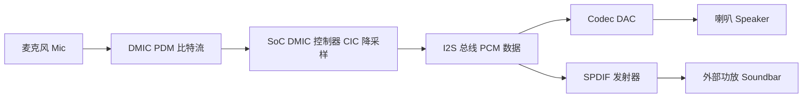
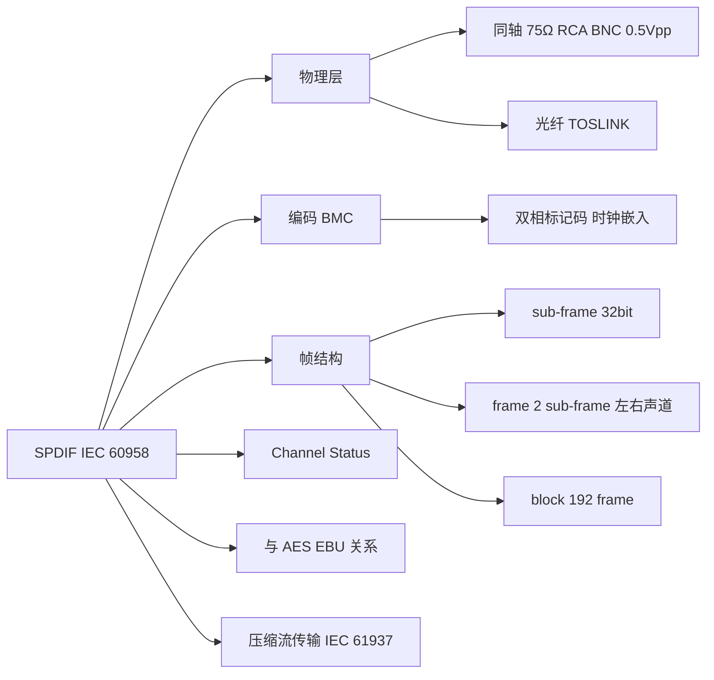
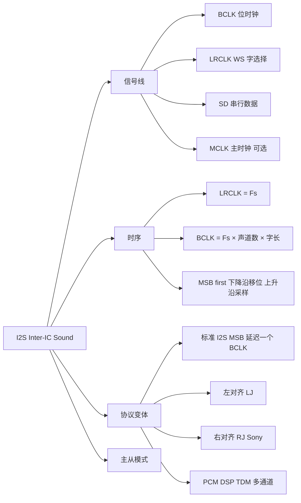
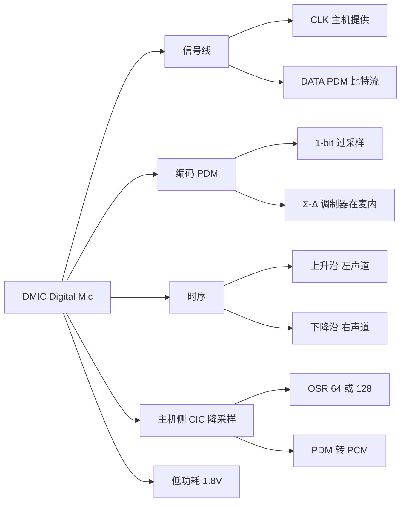
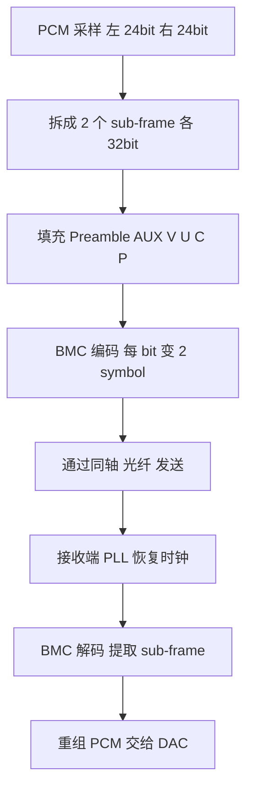
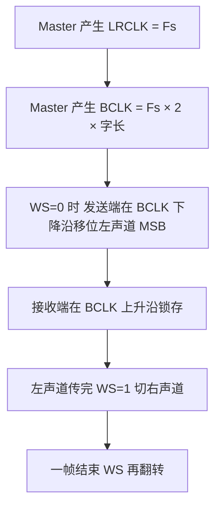
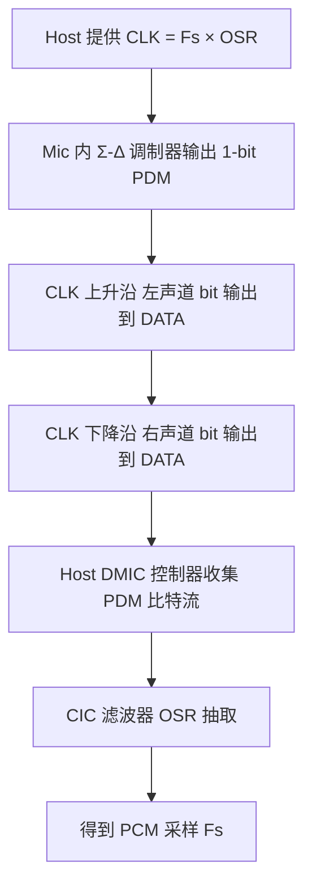
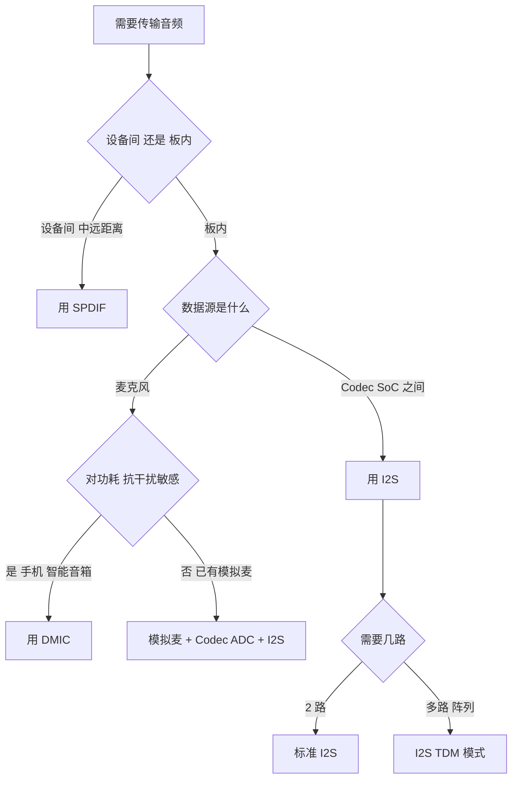

# 常见音频协议 SPDIF、I2S、DMIC

> 适用范围：嵌入式 Linux / SoC 音频系统开发。核心机制稳定，不受内核版本剧烈影响；I2S 规范经历 1986/1996/2022 三版，主流行为一致。
> 学习边界：聚焦三种协议的**物理层、编码、帧结构、时序与选型对比**；不深入 codec 内部的 ΔΣ 调制器算法、ASoC 驱动框架实现（可参考《Linux ASoC》）。
> 阅读目标：15~25 分钟内建立"三种协议分别解决什么问题、如何传输音频数据、何时用哪个"的整体认知，并掌握关键时序与选型维度。

---

## 1. 先建立整体认知

### 1.1 它们是什么

**直觉理解**：音频数据从麦克风到喇叭，需要在芯片之间、设备之间传递。但不同场景对"传多远、传几路、抗不抗干扰、功耗多低"的要求完全不同，于是诞生了三种各有侧重的接口：

- **SPDIF**：消费级设备之间的数字音频传输（CD 机到功放、电视到 Soundbar），用同轴或光纤传"已经编码好的音频流"，**不需要单独时钟线**，抗干扰强但只能双声道。
- **I2S**：电路板上芯片之间传音频（SoC 到 codec、MCU 到 DAC），用三根线（时钟+字选+数据）传**未编码的 PCM 采样**，简单灵活、支持多声道，是板内音频事实上的标准。
- **DMIC**：数字麦克风接口，只用两根线（时钟+数据）传 1-bit PDM 比特流，**麦克风内置 ADC**，省去模拟走线，抗干扰、低功耗，是手机/智能音箱麦克风阵列的首选。

**严格定义**：

| 协议 | 全称 | 规范 | 定位 |
| --- | --- | --- | --- |
| **SPDIF** | Sony/Philips Digital Interface | IEC 60958（旧名 IEC 958） | 设备间串行数字音频传输，消费级 |
| **I2S** | Inter-IC Sound | NXP UM11732（原 Philips I2S bus spec） | 芯片间串行音频总线，板内 |
| **DMIC** | Digital Microphone | 各厂商数据手册（PDM 约定） | 数字麦克风接口，板内 |

### 1.2 为什么需要三种不同的协议

音频传输的核心矛盾是**场景差异**：

| 场景 | 痛点 | 对应的协议 |
| --- | --- | --- |
| 两台消费设备互连（客厅音响） | 线缆长、有地环路干扰、用户不会接时钟线 | SPDIF（自时钟、隔离、抗干扰） |
| 同一块板上 SoC ↔ codec | 线短、要传多路、要简单 | I2S（多线、PCM、灵活） |
| 麦克风到 SoC（手机/智能音箱） | 体积小、功耗低、抗干扰、要多麦阵列 | DMIC（2 线、PDM、内置 ADC） |

一句话：**没有最好的协议，只有最适合场景的协议。** 三者各解决一类传输问题，互不取代。

### 1.3 三者的本质差异

```text
SPDIF  = 把音频"编码"成自时钟串行流，适合设备间中距离传输
I2S   = 把音频按"PCM 采样 + 同步时钟"传输，适合板内芯片间
DMIC  = 把音频"过采样成 1-bit PDM"传输，麦克风端极简
```

---

## 2. 在整个音频系统中的位置



- **DMIC** 位于**音频采集前端**：把麦克风的模拟信号在麦克风内部转成 PDM 比特流送入 SoC。
- **I2S** 位于**板内主数据通路**：SoC 与 codec/DAC 之间传 PCM，是系统内部的"主干道"。
- **SPDIF** 位于**设备间输出**：把 I2S 上的 PCM 重新编码成自时钟串行流，送到外部设备。

三者可以串联工作：DMIC 采 → I2S 传 → SPDIF 输出。

---

## 3. 知识地图

由于三个协议并列，知识地图拆成三张，每张聚焦一个协议的核心结构。

### 3.1 SPDIF 知识地图



### 3.2 I2S 知识地图



### 3.3 DMIC 知识地图



---

## 4. 核心概念

### 4.1 SPDIF：自时钟串行音频流

#### 4.1.1 物理层

SPDIF 有两种物理介质，协议层完全相同：

| 介质 | 连接器 | 阻抗 | 信号电平 | 传输距离 |
| --- | --- | --- | --- | --- |
| 同轴（Coaxial） | RCA / BNC | 75Ω | 0.4–0.6 Vpp（典型 0.5Vpp） | 约 10m |
| 光纤（TOSLINK） | JIS F05 方口 | — | 红光 LED，~650nm | 约 5~10m（塑料光纤） |

- **消费级 SPDIF** 是单端不平衡传输（IEC 60958 Type 2）；**AES/EBU** 是其专业平衡版（Type 1，110Ω XLR，3–10Vpp），协议层相同仅电气层不同。
- BMC 编码无 DC 分量，故可**电容耦合或变压器隔离**——变压器隔离能切断地环路、降低前级地噪声，是高保真系统的常见做法。

#### 4.1.2 BMC 编码：时钟嵌入数据

SPDIF 最核心的设计是 **BMC（Biphase Mark Code，双相标记码）**：

- 每个比特由两个连续二进制态（symbol）表示；
- 符号边界必有跳变（保证接收端 PLL 能恢复时钟）；
- 比特为 **0**：次态与首态**相同**（符号内无中间跳变）；
- 比特为 **1**：次态与首态**相反**（符号内有中间跳变）。

```text
比特 1 的 BMC：  ┌─┐ ┌─┐     (符号内有跳变)
               ─┘ └─┘ └─
比特 0 的 BMC：  ┌───┐ ┌───┐  (符号内无跳变)
               ─┘   └─┘   └─
```

**关键价值**：因为每个比特至少有一次边沿跳变，接收端用 PLL/CDR（时钟数据恢复）就能从数据中提取时钟，**无需单独时钟线**。这是 SPDIF 能只用一根线传音频的根本原因。

- UI（Unit Interval，单位间隔）= 一个比特单元的一半 = 1/(2×比特率)。48kHz 时 UI ≈ 163ns。

#### 4.1.3 帧结构

```text
1 Sub-frame (32 bit)
┌──────┬──────┬──────────────┬───┬───┬───┬───┐
│ Pream│ AUX  │  Audio Data  │ V │ U │ C │ P │
│ 4bit │ 4bit │   20 bit     │ 1 │ 1 │ 1 │ 1 │
└──────┴──────┴──────────────┴───┴───┴───┴───┘

1 Frame = 2 Sub-frame (左 A + 右 B)
1 Block = 192 Frame = 384 Sub-frame
```

- **Preamble（前导码）**：4 bit，用于帧同步。三种类型——**B/Z**（Block 起始且为 A 通道）、**M/X**（A 通道非块起始）、**W/Y**（B 通道）。BMC 不会出现连续 3 个相同态，借此区分前导码与数据。
- **Audio Data**：20 bit 音频 + 4 bit AUX，可扩展到 24 bit 音频（AUX 被借用）。
- **V（Validity）**：0 表示本 sub-frame 音频有效；1 表示无效（接收端应静音）。
- **U（User）**：用户数据位，192 帧攒成 192 bit 用户字。
- **C（Channel Status）**：通道状态位，192 帧攒成 192 bit 状态字，编码**采样率、字长、版权（SCMS）、emphasis、非音频标志**等。消费/专业模式由首 bit 区分。
- **P（Parity）**：bit 4–31 的偶校验。

#### 4.1.4 采样率与比特率

比特率 = Fs × 64（每 sub-frame 32 bit × 每 bit 2 个 BMC 状态）：

| Fs | 比特率 |
| --- | --- |
| 32 kHz | 2.048 Mbps |
| 44.1 kHz | 2.8224 Mbps |
| 48 kHz | 3.072 Mbps |
| 96 kHz | 6.144 Mbps |
| 192 kHz | 12.288 Mbps |

支持的采样率源自 CD（44.1k）、DAT（48k）、DSR（32k），标准支持至 192k。

#### 4.1.5 压缩流传输（IEC 61937）

SPDIF 原本设计传 PCM，但通过 **IEC 61937** 可把压缩音频（Dolby Digital AC-3、DTS）伪装成 PCM 传输：压缩数据填入原本 PCM 的音频位，Channel Status 中相应 bit 标识为非音频数据，接收端识别后交给解码器而非 DAC。

### 4.2 I2S：板内 PCM 音频总线

#### 4.2.1 信号线

I2S 是**同步串行总线**，由主设备提供所有时钟：

| 信号 | 别名 | 方向 | 作用 |
| --- | --- | --- | --- |
| **SCK / BCLK** | 位时钟、Serial Clock | Master → Slave | 每 1 个 BCLK 移位 1 bit 数据 |
| **WS / LRCLK** | 字选择、Word Select | Master → Slave | 区分左右声道，频率 = 采样率 Fs |
| **SD** | Serial Data | 双向 | 串行音频数据，MSB first |
| **MCLK**（可选） | 主时钟、Master Clock | Master → Slave | codec 内部 ΔΣ 调制器时钟，通常 256Fs/384Fs |

> 注意：MCLK **不属于 I2S 标准本身**，但多数 codec 需要它来驱动内部过采样滤波器。没有 MCLK 的 codec 可以从 BCLK 恢复时钟，但会限制可用采样率。

电气：LVCMOS/LVTTL，3.3V 或 5V 推挽输出。

#### 4.2.2 时序

```text
LRCLK (WS) ──────┐                  ┌──────
                 └──────────────────┘
                  < 左声道 N 采样 >  < 右 >

BCLK      ┌─┐ ┌─┐ ┌─┐        ┌─┐ ┌─┐
          ┘ └─┘ └─┘ └─ ... ──┘ └─┘ └─
          MSB                      LSB

SD        [ 左声道 16/24bit ] [ 右声道 16/24bit ]
```

- **LRCLK 频率 = Fs**（如 48kHz）。
- **BCLK = Fs × 声道数 × 字长**。16bit 立体声 48kHz → BCLK = 48k × 2 × 16 = 1.536MHz；24bit 立体声 48kHz → 2.304MHz。
- 数据**二进制补码、MSB first**；发送端在 BCLK 一个边沿移位，接收端在**相反边沿锁存**（常见为下降沿移位、上升沿采样）。
- WS=0 表示左声道、WS=1 表示右声道；WS 在 MSB 传输前一个 BCLK 周期变化。

#### 4.2.3 协议变体

| 变体 | MSB 对齐方式 | 特点 |
| --- | --- | --- |
| **标准 I2S（Philips）** | MSB 在 WS 变化后**第二个** BCLK 有效（延迟一个 BCLK） | 最常见，NXP 规范默认 |
| **左对齐（LJ / MSB-justified）** | MSB 与 WS 变化**同步**对齐 | 无延迟，可自适应 16–32bit 字长 |
| **右对齐（RJ / Sony / EIAJ）** | LSB 对齐下一次 WS 边沿 | 接收端需预知字长 |
| **PCM / DSP 模式** | 左右声道数据在一帧内**连续相邻**传输（时分复用），无半帧间隔 | 可在一条 SD 线上传 8/16/32 通道（TDM） |

> I2S 是**物理层接口标准**，PCM 是**数据表示方式**；I2S 总线上传输的就是 PCM 采样。TDM 是 I2S 的多通道扩展。

#### 4.2.4 主从模式

- **Controller（Master）**：产生 SCK 与 WS，主设备可以是发送端、接收端或第三方控制器。
- **Target（Slave）**：接收时钟，在时钟节拍上收发数据。
- 半双工/全双工：取决于具体 SoC 的 I2S 控制器实现（STM32 早期 SPI/I2S 仅单工，新型号支持全双工）。

### 4.3 DMIC：数字麦克风接口

#### 4.3.1 物理层

DMIC 是**最简洁的音频接口**，仅需 2 根信号线：

| 信号 | 方向 | 作用 |
| --- | --- | --- |
| **CLK** | Host → Mic | 主机提供的 PDM 时钟 |
| **DATA** | Mic → Host | 麦克风输出的 1-bit PDM 比特流 |

- 电源典型 **1.8V**（部分型号支持 1.65–3.6V 或 1.8V/1.2V 双电源），LVCMOS 电平。
- 低功耗：典型型号在 3.072MHz 时钟下约 1mA，低功耗模式可到 360μW，适合电池设备。
- **立体声复用**：两个麦克风共用一根 DATA 线，CLK 上升沿输出左声道、下降沿输出右声道（通过麦克风的 SELECT 引脚选择左右角色）。

#### 4.3.2 PDM 编码：1-bit 过采样

DMIC 不直接输出 PCM，而是输出 **PDM（Pulse Density Modulation，脉冲密度调制）** 1-bit 比特流：

- 麦克风内部有 **Σ-Δ（Sigma-Delta）调制器**，把模拟音频转换成 1-bit 过采样比特流。
- 信息编码在 **1 的密度**上：声压增大 → 1 的密度增大。
- 采样率远高于音频采样率：典型 3.072MHz（对 48kHz 音频，过采样比 64）。

> **PDM vs PWM**：PDM 调制的是脉冲的**密度**（1 出现的频率），PWM 调制的是脉冲的**宽度**。PDM 用 1-bit 即可表示，硬件极简。

#### 4.3.3 主机侧：CIC 降采样

PDM 比特流不能直接用，主机（codec/SoC 的 DMIC 控制器）需要用 **CIC（Cascaded Integrator-Comb，级联积分梳状）滤波器**做抽取降采样，把 PDM 转 PCM：

- 典型 OSR（Over-Sampling Ratio，过采样比）= **64**（3.072MHz → 48kHz）或 128。
- CIC 后常接 IIR/FIR 补偿滤波器（去直流、校正频响）。
- Linux ASoC 中 DMIC 驱动作为 DAI，负责时钟、OSR、通道数配置，只支持 record。

#### 4.3.4 为什么用 PDM 而非直接 PCM

- 麦克风内部**无需 PCM 接口时序与多 bit 并/串转换**，硬件极简、成本低。
- 1-bit 数字信号抗干扰强，PCB 走线简单。
- 部分型号（如 Knowles SPH0645）也提供 I2S 输出变种，把 PDM 转 I2S 在芯片内完成。

---

## 5. 核心概念之间的关系

三者并非竞争关系，而是在音频系统的**不同位置**各司其职：

```text
采集端                          板内处理                        输出端
┌────────┐   PDM    ┌──────────────┐   PCM    ┌─────────┐   SPDIF    ┌──────────┐
│ DMIC   │ ───────► │ SoC DMIC ctrl│ ───────► │  I2S 总 │ ─────────► │ 外部功放  │
│ 麦克风 │          │ (CIC 降采样)  │          │  线干道  │            │ Soundbar │
└────────┘          └──────────────┘          └────┬────┘            └──────────┘
                                                   │ PCM
                                              ┌────▼────┐
                                              │ Codec   │
                                              │ DAC ADC │
                                              └────┬────┘
                                                   │ 模拟
                                              ┌────▼────┐
                                              │ 喇叭/麦  │
                                              └─────────┘
```

- **DMIC** 解决"模拟信号在哪数字化"的问题——答案是在麦克风内部数字化，避免模拟走线的干扰。
- **I2S** 解决"板内 PCM 怎么传"的问题——用同步时钟 + 数据线，简单灵活。
- **SPDIF** 解决"设备间音频怎么传"的问题——用自时钟串行流，抗干扰、无需时钟线。

三者的关系是**串联**而非**互斥**：一个完整系统可以同时用到三种协议。

---

## 6. 工作原理

### 6.1 SPDIF 传输一帧音频的过程



关键点：BMC 编码使时钟嵌入数据，接收端无需时钟线。

### 6.2 I2S 传输一帧音频的过程



关键点：时钟和数据分离，所有设备共享同一个 BCLK/LRCLK，保证同步。

### 6.3 DMIC 采集一帧音频的过程



关键点：PDM 是过采样的 1-bit 流，主机必须降采样才能得到可用的 PCM。

---

## 7. 三者对比与选型

### 7.1 核心参数对比

| 维度 | SPDIF | I2S | DMIC |
| --- | --- | --- | --- |
| **规范** | IEC 60958 | NXP UM11732 | 厂商数据手册 |
| **信号线数** | 1（数据+时钟嵌入） | 3（BCLK+LRCLK+SD）+ 可选 MCLK | 2（CLK+DATA） |
| **传输介质** | 同轴 75Ω / 光纤 | PCB 走线 | PCB 走线 |
| **传输距离** | ~10m | 板内（<30cm） | 板内（<10cm） |
| **数据格式** | BMC 编码串行流 | PCM 采样（MSB first） | PDM 1-bit 比特流 |
| **时钟来源** | 接收端从数据中恢复 | Master 提供 BCLK/LRCLK | Host 提供 CLK |
| **声道数** | 2（立体声） | 2（标准）/ 多通道（TDM） | 1~2（单 DATA）/ 多麦阵列 |
| **典型字长** | 16/20/24 bit | 16/20/24/32 bit | 1 bit PDM → 16/24 bit PCM（降采样后） |
| **典型采样率** | 44.1k/48k/96k/192k | 8k~192k | 8k~48k（PDM 时钟 1~4MHz） |
| **电平** | 0.5Vpp 单端 / 光信号 | LVCMOS 3.3V/5V | LVCMOS 1.8V |
| **抗干扰** | 强（隔离/光纤） | 弱（板内） | 中（数字信号） |
| **功耗** | 中 | 中 | 低 |
| **方向** | 通常单向（可双向） | 全双工/半双工 | 单向（只采集） |

### 7.2 选型决策树



### 7.3 典型应用场景

| 场景 | 推荐协议 | 理由 |
| --- | --- | --- |
| 电视 → Soundbar | SPDIF（光纤） | 中距离、抗干扰、无需时钟线 |
| 手机/智能音箱麦克风阵列 | DMIC | 2 线、低功耗、抗干扰、多麦易同步 |
| SoC → codec 板内传输 | I2S | 简单、灵活、PCM 直传 |
| 专业音频设备互连 | AES/EBU（SPDIF 平衡版） | 长距离、平衡抗干扰 |
| 多通道音频接口（8/16 路） | I2S TDM | 一条 SD 线时分复用多通道 |
| CD 机 → 功放 | SPDIF（同轴） | 消费级标准、抗地环路 |

---

## 8. 实际应用

### 8.1 嵌入式 Linux 音频系统中的位置

在 Linux ASoC 框架中，这三种协议对应不同的 DAI（Digital Audio Interface）：

```text
ASoC 框架
  ├── CPU DAI（SoC 侧）
  │     ├── I2S 控制器（驱动 I2S codec）
  │     ├── SPDIF 控制器（输出 SPDIF 流）
  │     └── DMIC 控制器（接收 PDM，CIC 降采样）
  ├── Codec DAI（codec 侧）
  │     └── I2S / DSD / SPDIF out
  └── Platform（DMA 等）
```

- **I2S**：最常见的 CPU DAI，对接 codec 的 I2S 接口。
- **DMIC**：作为 CPU DAI 接入 PDM 麦克风，只支持 record 路径。
- **SPDIF**：作为 CPU DAI 或 codec DAI，把 PCM 编码成 SPDIF 输出。

### 8.2 多麦克风阵列的时钟同步

智能音箱常用 4~8 麦阵列做波束成形。DMIC 方案的优势：

- 所有麦克风共用同一个 CLK，**天然采样同步**（无需额外同步机制）。
- 8 通道方案用 4 组 CLK/DATA（每组 2 声道）。
- 时钟抖动直接影响阵列性能，需确保 CLK 源干净。

### 8.3 SPDIF 的工程注意事项

- **变压器选型**：影响低频响应与抖动，高品质变压器（如 Jensen）能降低地噪声。
- **光纤 vs 同轴**：光纤无地环路但有时延和抖动；同轴延迟低但有地环路风险。
- **SCMS 版权保护**：Channel Status 中的 SCMS bit 会限制数字复制，专业设备常需关闭。

---

## 9. 常见误区

### 误区 1：认为 SPDIF、I2S、DMIC 是竞争关系

**为什么容易这样理解**：都叫"音频协议"，看起来像同类。

**正确理解**：三者面向**完全不同的位置**——DMIC 在采集前端、I2S 在板内主干道、SPDIF 在设备间出口。一个完整系统可以同时用三种，它们是串联而非竞争。

### 误区 2：认为 I2S 需要 4 根线

**为什么容易这样理解**：很多资料把 MCLK 算进去说成 4 线。

**正确理解**：I2S 标准本身是 **3 线**（BCLK、LRCLK、SD）。MCLK 是 codec 的需求，不属于 I2S 标准。有些 codec 能从 BCLK 恢复内部时钟，此时不需要 MCLK。

### 误区 3：认为 SPDIF 只能传 2 声道

**为什么容易这样理解**：IEC 60958 帧结构就是左右两个 sub-frame。

**正确理解**：PCM 模式下确实是 2 声道，但通过 IEC 61937 封装，可以传 Dolby Digital（5.1）、DTS 等压缩多声道流——接收端解码后得到多声道。所以"SPDIF 能传 5.1"指的是压缩流，不是 6 个独立 PCM 通道。

### 误区 4：认为 DMIC 直接输出 PCM

**为什么容易这样理解**：叫"数字麦克风"，容易以为输出的就是数字音频。

**正确理解**：DMIC 输出的是 **1-bit PDM 比特流**，不是 PCM。主机必须用 CIC 滤波器降采样才能得到 PCM。如果直接看 DATA 线的波形，是高频噪声样的 0/1 跳变，不是可识别的音频波形。

### 误区 5：认为 I2S 的 MSB 一定和 WS 对齐

**为什么容易这样理解**：看左对齐模式的波形图容易误以为是通用规则。

**正确理解**：**标准 I2S（Philips 模式）的 MSB 比 WS 边沿延迟一个 BCLK**，这是 NXP 规范的默认。只有左对齐（MSB-justified）模式才是 MSB 与 WS 同步对齐。移植驱动时必须确认 codec 期望的对齐方式，否则会有一个 BCLK 的相位偏差导致噪声。

---

## 10. 相关知识

```text
SPDIF I2S DMIC
├── Linux ASoC              三种协议在 ASoC 框架中的 DAI 实现
├── Codec                   DAC ADC 数字模拟转换
├── PDM PCM                 1-bit 过采样 vs 多 bit 采样
├── ΔΣ 调制器               DMIC 和 codec 内部的模数转换
├── CIC 滤波器              PDM 转 PCM 的抽取降采样
├── TDM                     I2S 的多通道时分复用扩展
├── AES EBU                 SPDIF 的专业平衡版
├── IEC 61937               SPDIF 上传输压缩音频的封装
└── 时钟同步                多麦阵列 多设备间的时钟同步
```

---

## 11. 知识脉络

```text
音频要在芯片间 设备间传递
    ↓
不同场景的痛点不同
    ↓
设备间 线缆长 有地环路 用户不会接时钟线
    → 所以有 SPDIF BMC 编码 时钟嵌入数据 一根线搞定
板内 SoC 到 codec 要传多路 PCM 要简单
    → 所以有 I2S 时钟数据分离 3 线 灵活
麦克风端要极简 抗干扰 低功耗 多麦阵列
    → 所以有 DMIC 2 线 PDM 1-bit 过采样 麦内置 ADC
    ↓
三者各解决一类问题 在系统中串联工作
    ↓
DMIC 采集 → I2S 板内传输 → SPDIF 设备间输出
```

---

## 12. 正式学习时重点关注

```text
1. SPDIF 的 BMC 编码如何实现时钟嵌入？为什么不需要单独时钟线？
2. SPDIF 的 sub-frame 结构中 Preamble 如何区分三种类型？
3. SPDIF 与 AES/EBU 的本质区别是什么（协议层还是电气层）？
4. I2S 的 BCLK 频率如何计算？与 Fs 声道数 字长的关系？
5. I2S 标准模式与左对齐模式的 MSB 相位差是多少（几个 BCLK）？
6. I2S 的 WS 极性如何判断左右声道？
7. DMIC 的 PDM 比特流如何通过 CIC 滤波器转成 PCM？OSR 是什么？
8. DMIC 的立体声复用如何实现（哪个边沿是左声道）？
9. 三种协议分别适用于什么场景？选型时最关键的判断维度是什么？
10. I2S TDM 模式如何在一条 SD 线上传多个通道？
```

---

## 13. 参考资料

### 官方规范（第一优先级）

- [NXP UM11732 I2S Bus Specification Rev. 3.0 (2022)](https://www.readkong.com/page/um11732-i2s-bus-specification-rev-3-0-17-february-2022-3601907) — I2S 总线规范最新版
- [Philips I2S bus spec (PDF via TI)](https://e2echina.ti.com/cfs-file/__key/communityserver-discussions-components-files/42/5618.I2SBUS1.pdf) — 原始 I2S 规范
- [IEC 60958-1:2021](https://webstore.iec.ch/publication/71031) — SPDIF 数字音频接口规范
- [IEC 61937-1/-3](https://webstore.iec.ch/) — SPDIF 上传输压缩音频的封装规范

### 厂商应用笔记与数据手册（第一优先级）

- [ST AN5073 SPDIF 应用笔记](https://www.st.com/resource/en/application_note/dm00431633-...) — SPDIF 帧结构与 BMC 编码
- [STM32 AN4309 I2S codec 接口](https://www.st.com/resource/en/application_note/dm00087544-interfacing-an-stm32l1xx-microcontroller-with-an-external-i2s-audio-codec-to-play-audio-files-stmicroelectronics.pdf) — I2S 时序与模式
- [STM32 AN2739 I2S 播放音频](https://www.st.com/resource/en/application_note/cd00190749-how-to-use-the-high-density-stm32f103xx-microcontroller-to-play-audio-files-with-an-external-i-s-audio-codec-stmicroelectronics.pdf)
- [Knowles SPG18P4HM4H-1 数据手册](https://media.digikey.com/pdf/Data%20Sheets/Knowles%20Acoustics%20PDFs/SPG18P4HM4H-1_DS.pdf) — DMIC PDM 麦克风
- [Knowles SPH0645LM4H-B I2S 数字麦](https://pdf.directindustry.com/pdf/knowles-electronics-llc/sph0645lm4h-b-i2s-output-digital-microphone/127265-630002.html) — I2S 输出数字麦
- [NXP UDA1352TS 数据手册](https://www.manualslib.com/manual/812685/Nxp-Semiconductors-Uda1352ts.html) — SPDIF 比特率验证
- [TI TLV320AIC3107 数据手册](https://www.ti.com/document-viewer/TLV320AIC3107/datasheet/detailed_description.html) — I2S/TDM 模式

### Linux / 软件文档（第二优先级）

- [Linux ASoC DPCM 文档](https://kernel.org/doc/html/v4.20/sound/soc/dpcm.html) — ASoC 动态 PCM
- [NVIDIA Jetson ASoC DMIC](https://docs.nvidia.com/jetson/archives/r36.4.4/DeveloperGuide/SD/Communications/AudioSetupAndDevelopment.html) — DMIC OSR 配置
- [ESP-IDF I2S 文档](https://docs.espressif.com/projects/esp-idf/en/stable/esp32h4/api-reference/peripherals/i2s.html) — MCLK 256/384Fs
- [全志 Linux Audio 开发指南](https://bbs.aw-ol.com/assets/uploads/files/1669352109491-linux_audio_development_guide.pdf) — DMIC 驱动配置
