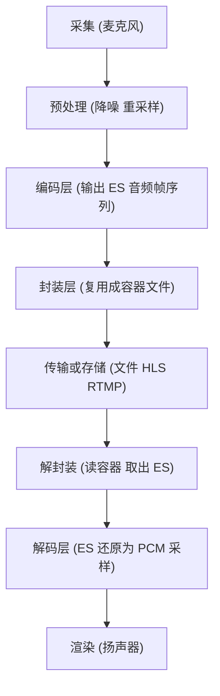
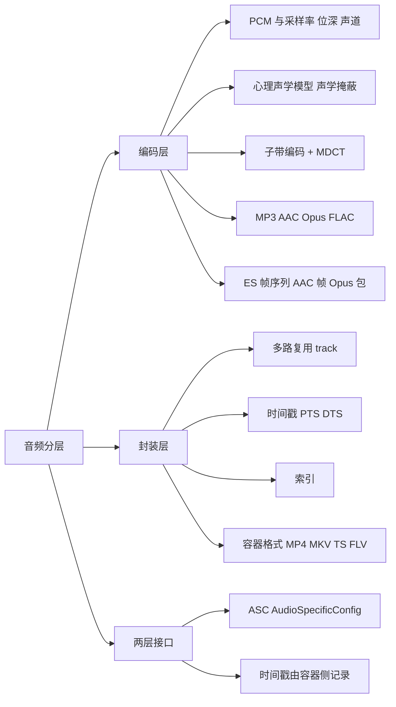
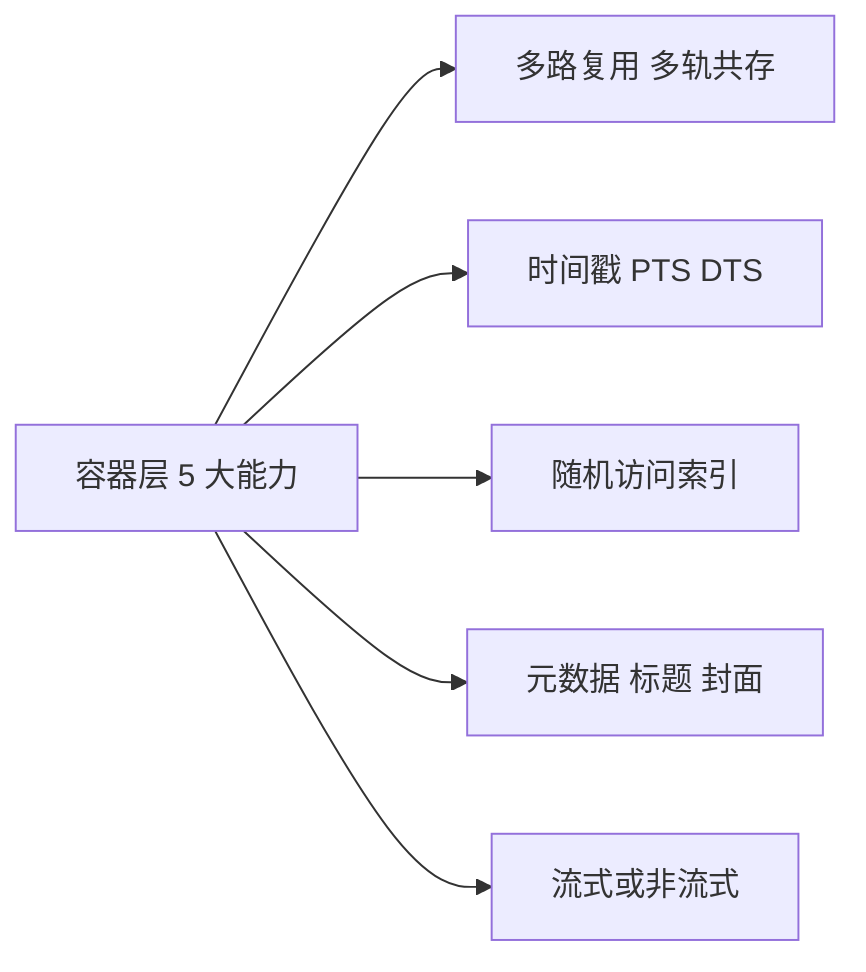
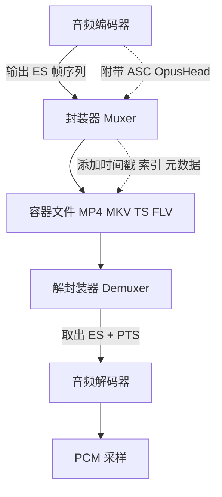
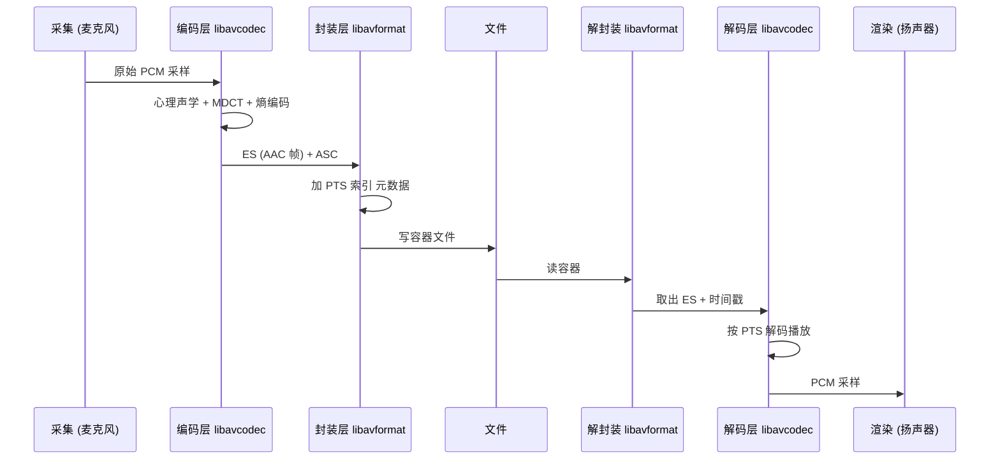
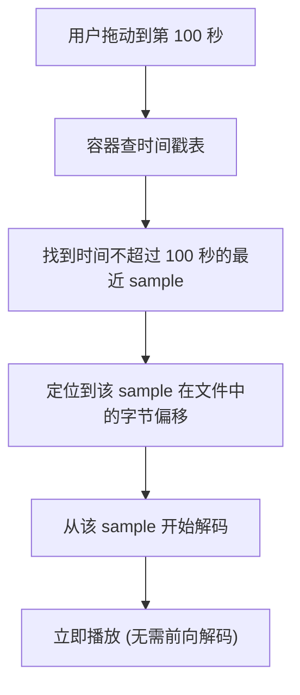
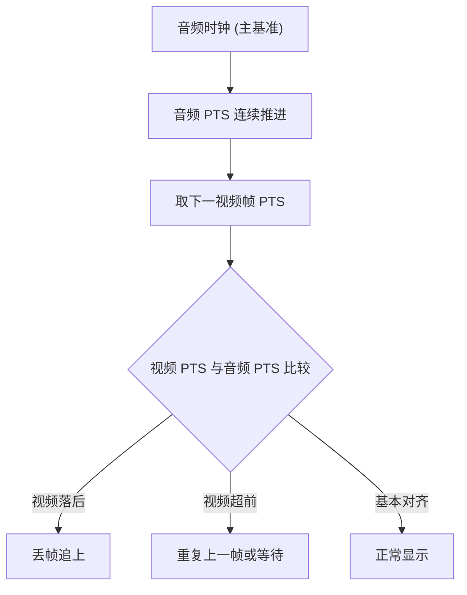

# 音频编码层与封装（容器）层

> 适用范围：通用音频技术（MP3 / AAC / Opus / FLAC 等编码；MP4 / MKV / FLV / MPEG-TS / WebM 等容器）。核心机制（ES、PTS/DTS、box、sample table）自 2000 年代以来保持稳定；个别接口存在版本差异，文中已标注。
> 学习边界：只讲"压缩后的音频基本流如何被组织进容器"这条分层主线。编码算法内部（MDCT 公式、心理声学模型推导）、传输协议本身（HLS / DASH / RTMP）、播放器 UI 实现不属于本笔记；视频侧的 GOP / B 帧等概念只在对比时简要提及，详见姊妹笔记《视频编码层与封装层》。
> 阅读目标：10~20 分钟内建立"音频为什么分两层、两层如何咬合、容器到底比裸流多了什么、为什么音频在封装层比视频简单"的整体认知，并拿到一张进入正式学习的地图。

---

## 1. 先建立整体认知

### 1.1 它是什么

**直觉理解**：CD 上一分钟立体声音乐大约 10 MB，传输和存储都太贵。要让它在手机、网页、卫星、流媒体上都能用，必须做两件完全独立的事：

1. **压扁**：用算法把数据量降到原来的十几分之一甚至更少——这是**编码层**。
2. **装盒**：把压扁后的音频流（可能还有视频、字幕、时间戳、索引、封面……）统统装进一个文件——这是**封装层**（也叫**容器层**）。

**类比及其边界**：编码像"压缩衣服抽真空"，封装像"把衣服、袜子、领带分类放进旅行箱并贴标签"。真空压缩与装箱是两件事，可以独立选择——但类比到此为止：编码和封装都是数字信号处理，不是物理动作。

**严格定义**：

- **编码层（Coding Layer / Compression Layer）**：用心理声学模型消除感知冗余、用子带/变换编码消除频域冗余、用熵编码消除统计冗余，输出**基本流（Elementary Stream, ES）**——一段连续的、已被压缩但**没有时间戳和索引**的字节序列。
- **封装层（Container Layer / Muxer Layer）**：把一路或多路 ES 加上**时间戳、索引、元数据、多路复用结构**，组织成可独立存储、传输、随机访问的文件格式（MP4 / MKV / FLV / TS / WebM 等）。

### 1.2 为什么存在

**为什么必须分两层**：

1. **关注点不同**：编码解决"小而清晰"，封装解决"可定位、可同步、可携带元数据"。混在一起会让任何一边的演进绑死另一边。
2. **解耦带来演化自由**：MP3 → AAC → Opus 三代音频编码共用同一套 MP4 容器；MP4 → MKV → fMP4 容器演进也不用重写编码器。如果不分层，每出一个新编码就要重做文件格式。
3. **组合爆炸的现实**：3 种主流音频编码 × 5 种主流容器 = 15 种组合（再加视频更多）。分层让"编码器插件"和"复用器插件"独立存在，FFmpeg 才能用几十个模块组合出上千种转换路径。
4. **工程价值直接可见**：`ffmpeg -i in.mp4 -c:a copy out.mkv` 是**换盒子不重新压缩音频**，瞬间完成；只有 `ffmpeg -i in.mp4 -c:a aac out.mkv` 才会重新编码（耗时）。这条命令的存在本身就是分层的产物。

一句话：**编码层回答"数据怎么变小"，封装层回答"变小的数据怎么被组织使用"。**

---

## 2. 在整个体系中的位置



- **ES 是两层之间的契约**：编码器只产 ES（AAC 的帧序列 / Opus 的包），不关心它最终被装进什么容器；封装器只消费 ES，不关心它是怎么被压出来的。
- **两层各自独立可换**：左侧换编码器，右侧换容器，互不影响。FFmpeg 的 `libavcodec`（编码）与 `libavformat`（封装）正是这条边界的代码化身。
- **传输协议在更上层**：HLS / DASH / RTMP 用"切片后的容器片段"传输，属于封装层之上。本笔记只索引不展开。

---

## 3. 知识地图





下面逐一展开这些核心概念。

---

## 4. 核心概念

### 4.1 PCM：一切的起点

PCM（Pulse Code Modulation，脉冲编码调制）是**未压缩的原始数字音频表示**。理解 PCM 就理解了"编码前"的世界。

- **三个核心参数**：

| 参数 | 含义 | 常见值 |
| ---- | ---- | ------ |
| 采样率（sample rate） | 每秒采样次数 | 44.1 kHz（CD）/ 48 kHz（专业、视频伴音）/ 8 kHz（电话）|
| 位深（bit depth） | 每个采样的位数 | 16 bit（CD）/ 24 bit（专业）/ 8 bit（电话） |
| 声道数（channels） | 1=单声道 2=立体声 | 1 / 2 / 5.1 / 7.1 |

- **PCM 码率 = 采样率 × 位深 × 声道数**：CD 音质（44.1 kHz / 16 bit / 立体声）= 44100 × 16 × 2 = 1,411,200 bps ≈ **1411 kbps ≈ 176 KB/s**，每分钟约 10.1 MB。
- **采样率/位深/声道属于 PCM 层**：它们是原始信号的属性；编码层"继承"这些参数作为输入，但编码后的码率与采样率/位深不再一一对应（如 MP3 128 kbps 与 PCM 1411 kbps 同样来自 44.1 kHz / 16 bit / 立体声输入）。

### 4.2 编码层：消除三类冗余

**为什么必须编码**：CD 音质每秒 176 KB，传输和存储都太贵。在保留可接受感知质量的前提下，音频通常压到 64~320 kbps（5~20:1 压缩比）。

**音频编码的三类冗余**（思路与视频完全不同）：

| 冗余类型 | 来源 | 编码对策 |
| -------- | ------ | -------- |
| 感知冗余 | 强音附近弱音听不见（声学掩蔽 masking） | 心理声学模型计算掩蔽阈值，按阈值分配比特 |
| 频域冗余 | 信号能量集中在某些频段 | 子带编码 + MDCT（修正离散余弦变换）分解 |
| 统计冗余 | 码字出现频率不均 | 熵编码（Huffman / 算术编码） |

**三者配合**：时域 → 频域变换（子带/MDCT）→ 心理声学模型计算每子带的最小可觉噪声（掩蔽阈值）→ 按阈值分配比特，对人耳不敏感的部分粗量化或丢弃 → 熵编码压成最终码流。

**声学掩蔽的核心直觉**：人耳像一台"动态范围自适应"的传感器——强音出现时，附近的弱音被"掩蔽"听不见。编码器丢弃这些听不见的弱音，听感上无损但码率大幅下降。这就是"有损压缩"听上去仍然清晰的根本原因。

### 4.3 有损 / 无损 / 未压缩的层级关系

```text
PCM (未压缩 原始)
    ↓ 封装为容器
WAV (RIFF) / AIFF (IFF)    本质是 PCM 的容器封装 未压缩
    ↓ 无损压缩 (可逆 还原位级一致)
FLAC / ALAC / WavPack       减小体积但不丢任何信息
    ↓ 有损压缩 (丢弃感知不敏感信息 不可逆)
MP3 / AAC / Opus / Vorbis   压缩比最高 但无法还原原始 PCM
```

- **WAV 不是编码格式**：WAV 是 RIFF 容器，通常装 PCM（未压缩），但也能装 ADPCM 等编码。"WAV 文件"在多数场景下等价于"PCM 装在 RIFF 容器里"。
- **FLAC 与 MP3 的本质区别**：FLAC 是无损（可还原原始 PCM 位级），MP3 是有损（丢弃了感知不敏感信息）。FLAC 适合存档，MP3/AAC/Opus 适合传输。

### 4.4 主流音频编码格式对比

| 编码 | 发布年份 | 标准 | 压缩效率 | 专利/授权 | 典型场景 |
| ---- | -------- | ---- | -------- | --------- | -------- |
| MP3 | 1993 | ISO/IEC 11172-3 (MPEG-1 Layer III) | 128 kbps 约 CD 1/11 | 专利 2017-04 已到期 | 早期数字音乐、播客 |
| AAC | 1997 | ISO/IEC 14496-3 (MPEG-4) | AAC-LC 96 kbps 略优于 MP3 128 kbps | 仍有专利池（Via Licensing） | 流媒体、移动端、MP4 伴音 |
| Opus | 2012 | IETF RFC 6716 | 低码率最优（24 kbps 语音 ≈ MP3 64 kbps） | 免版税 BSD 许可 | WebRTC、实时通信、低延迟 |

- **效率相对关系**：同质量下码率 AAC < MP3（AAC 更优），Opus 在低码率（<32 kbps）下全面领先；高码率（>128 kbps）三者听感差异变小。
- **MP3 专利已到期**：2017-04-23 Fraunhofer/Technicolor 终止 MP3 专利许可计划，MP3 现已完全自由使用。
- **AAC 仍有专利池**：Via Licensing Alliance 的 AAC 联合专利许可仍在运营，费用按件计 $0.10~$0.98。
- **Opus 免版税**：参考实现 BSD 许可，这是 WebRTC 强制实现 Opus 的法律基础。

### 4.5 AAC 的关键概念

AAC（Advanced Audio Coding）是 MP4 流媒体时代的主力音频编码。

- **Profile（档位）**：AAC 有 Main / LC / SSR / LTP / LD / ELD / HE-AAC（含 SBR）/ HE-AAC v2（含 PS）/ xHE-AAC 等。主流消费电子使用 **LC**（Low Complexity）；HE-AAC 用于低码率（数字广播），向下兼容（HE-AAC 解码器可解码 AAC-LC）。
- **AAC 帧**：AAC-LC 每帧 **1024 个采样**（约 23 ms @ 44.1 kHz）；HE-AAC 因 SBR 实际 2048 采样。这个"固定帧时长"是音频在封装层比视频简单的物理基础之一。
- **ADTS（Audio Data Transport Stream）vs raw AAC**：这是 AAC 两种打包方式，决定它怎么进容器。

| 打包方式 | 帧头 | 自同步 | 配置信息来源 | 典型容器 |
| -------- | ---- | ------ | ------------ | -------- |
| ADTS | 7 字节（无 CRC）或 9 字节（带 CRC） | 有（12 bit 同步字 0xFFF） | 帧头自带（profile/采样率/声道） | TS、.aac 文件、流式 |
| raw AAC | 无 | 无 | 容器外部提供 ASC | MP4（esds box）、FLV（AAC sequence header）、MKV（CodecPrivate） |

- **ASC（AudioSpecificConfig）**：raw AAC 的配置信息块，携带采样率、声道、profile——它是封装层与编码层契约的一部分，由容器负责存放。

### 4.6 Opus 的特殊定位

Opus 是 IETF 标准化的现代音频编码，专为低延迟实时通信设计。

- **可变码率**：6~510 kbps；采样率 8/12/16/24/48 kHz；帧时长 2.5~60 ms。
- **低延迟**：典型 20 ms 帧 + 前视 ≈ 26.5 ms 总算法延迟；CELT 模式可低至 5 ms。
- **SILK + CELT 双模式**：SILK（来自 Skype，线性预测 LPC，擅长语音低频）+ CELT（来自 Xiph.Org，MDCT，擅长音乐高频）+ Hybrid 模式（SILK 处理低频 + CELT 高频），按内容/码率动态切换。
- **WebRTC 强制实现**：WebRTC 规范将 Opus 列为 mandatory-to-implement，所有合规浏览器必须支持。天然适配实时通信（低延迟、内置 FEC/DTX、带宽自适应）。

### 4.7 基本流（ES）：编码层的产物

ES（Elementary Stream）= 编码器输出的连续字节流，**没有任何时间戳和索引信息**。

- 音频编码后是**帧序列**：AAC 每帧 1024 个采样（约 23 ms @ 44.1 kHz），MP3 每帧 1152 个采样，Opus 帧时长 2.5~60 ms 可变。
- **ES 自身不知道"第几秒该播放"**：它只有"第几个帧"。时间戳是封装层补上的。

ES 的自描述能力是封装层与编码层契约的一部分：

- **AAC 的 ASC（AudioSpecificConfig）**：携带采样率、声道、profile——MP4 的 esds box、FLV 的 AAC sequence header、MKV 的 CodecPrivate 都存放它。
- **Opus 的 OpusHead**：携带声道数、采样率（Opus 固定 48 kHz 输出，但可内部降采样）、增益——Ogg/Opus 与 WebM 各有存放位置。

### 4.8 PTS 与 DTS：封装层的核心创新

这是本笔记最重要的概念之一。**编码层不存时间戳**——时间戳是封装层的发明。

- **DTS（Decoding Time Stamp，解码时间戳）**：何时解码该帧。
- **PTS（Presentation Time Stamp，显示时间戳）**：何时播放该帧给用户。

**音频的关键简化：DTS 几乎总是 == PTS**。原因：

1. **音频帧"帧间独立"**——每帧只依赖自身，无 B 帧概念（视频的 B 帧需双向参考，导致重排）。
2. **按时序解码即按时序播放**——解码顺序与显示顺序一致。
3. **MP4 的 ctts（PTS 偏移表）对音频轨几乎总是 0**。

这是**音频在封装层比视频简单**的根本原因——无需重排缓冲、ctts 偏移为 0、seek 时无需前向解码若干帧。

- **时间戳用整数 timescale + delta 表示**：MP4 的 stts 表存 (sample_count, sample_delta) 对，timescale 在 mdhd box 里（如 timescale=44100 表示 1 秒 = 44100 个时间单位）；MKV 用 Timestamp + BlockDuration。用整数避免浮点累计误差。
- **容器中没有原生 "fps" 概念**：音频没有"帧率"字段，相邻帧 PTS 差值的倒数即帧率，但音频工程上关心的是"每帧时长"而非 fps。

### 4.9 封装层的五大能力

裸 ES 缺什么，封装层就补什么：

| 能力 | 裸 ES 的缺陷 | 封装层的补法 |
| ---- | ----------- | ----------- |
| 多路复用 | 一条 ES 只能装一路音频 | 容器允许音频/视频/字幕/多音轨共存（MP4 的 trak、MKV 的 TrackEntry、TS 的 PID） |
| 时间戳 | ES 不知道"第几秒播放" | 容器为每个 sample 写 PTS/DTS |
| 随机访问索引 | ES 不能 seek | 容器记录关键帧位置表（音频通常每帧都可 seek） |
| 元数据 | ES 无标题/作者/封面 | 容器支持元数据 box（MP4 udta/ilst、MKV Tags/Attachments） |
| 流式传输 | ES 不可边下边播 | 部分容器天然可流式（TS、MKV），MP4 需 moov 在头部或用 fMP4 |

**音频 seek 比视频简单**：音频帧通常都是独立可解码的，无需像视频那样"从最近 keyframe 前向解码若干帧"。这就是为什么音频播放器拖动进度条几乎瞬间响应。

### 4.10 容器格式：MP4 的 box 结构（音频视角）

理解了 MP4，其他容器都是变体。MP4 由嵌套的 **box**（也叫 atom）组成，每个 box 有 4 字节类型码 + 4 字节长度 + 内容。

```text
ftyp    文件类型标识 (品牌 兼容列表 版本)
moov    元数据索引盒子
  mvhd  全局信息 (timescale 时长)
  trak  第一条轨道 (通常视频) ...
  trak  音频轨道
    tkhd  轨道头 (音量 等)
    mdia  媒体描述
      mdhd  媒体头 (本轨 timescale 如 44100)
      hdlr  处理器类型 (soun)
      minf  媒体信息
        stbl  样本表 (核心!)
          stsd  编码配置 (mp4a + esds 存 ASC)
          stts  DTS 到 sample 增量表 (时间戳)
          ctts  PTS 偏移表 (音频几乎总是 0)
          stsc  sample 到 chunk 映射
          stsz 每个 sample 大小
          stco  chunk 在文件中的偏移 (定位数据)
mdat    实际媒体数据 (AAC 帧的真正存放地)
```

音频轨的关键信号：
- `mdhd` 的 timescale 通常是采样率（如 44100）。
- `stsd` 里的 `mp4a` + `esds` 存放 ASC（AudioSpecificConfig）——这是编码层契约。
- `ctts` 对音频几乎总是 0（无 B 帧，无需重排）。
- `stts` 的 delta 与 mdhd 的 timescale 算出每帧时长（如 delta=1024, timescale=44100 → 23.22 ms/帧）。

### 4.11 ISOBMFF：MP4 的家族规范

**ISOBMFF（ISO Base Media File Format，ISO/IEC 14496-12）** 是基础规范，MP4 是它的派生。整个家族共享 box 结构：

| 派生格式 | 标准号 | 用途 |
| -------- | ------ | ---- |
| MP4 | ISO/IEC 14496-14 | 通用音视频文件 |
| MOV | QuickTime（ISOBMFF 的祖先） | 苹果系 |
| 3GP/3G2 | 3GPP 系列 | 移动通信早期 |
| HEIF/HEIC | ISO/IEC 23008-12 | 单张/多张/序列图片 |
| AVIF | AV1 静态图 | 现代图片格式 |
| CMAF / fMP4 | 14496-12 流式扩展 | HLS / DASH 分片 |

**关键洞察**：HEIF 表明容器格式可以装图片，不只是音视频。同一套 box 结构既能装一段音频，也能装一组照片——这就是"容器"这个抽象的力量。

### 4.12 容器与编码的解耦

**同一个容器可以装多种音频编码，同一个音频编码可以装进多种容器**：

| 容器 | 可装音频编码 |
| ---- | ---------- |
| MP4 | AAC / AC3 / MP3 / ALAC / Opus（部分） |
| MKV | 几乎任意（A_AAC / A_MP3 / A_OPUS 等） |
| WebM | Vorbis / Opus（限子集） |
| FLV | AAC / MP3 |
| MPEG-TS | AAC / AC3 / MP2 / Opus |

**判断"能不能播"要两步**：

1. 解复用器（demuxer）支持该容器格式吗？
2. 解码器（decoder）支持容器里装的编码吗？（容器用 fourcc / codec_id 标识编码）

两者都要支持，缺一不可。这就是为什么"装 Opus 的 MP4 在老播放器上能打开但播不了"——解复用器认识 MP4，但解码器不认识 Opus。

---

## 5. 核心概念之间的关系



- **编码层与封装层的契约**：编码层产 ES + 编码参数（ASC/OpusHead）；封装层加时间戳 + 索引 + 元数据。**时间戳不在编码层**——这是两层职责的最清晰分界。
- **PCM / 编码 / 容器三层咬合**：PCM 是原始信号 → 编码层压成 ES（带 ASC 自描述）→ 容器层加 PTS 包装成文件。三层各管一件事，独立演化。
- **MP4 的 stbl 子盒** 把 PTS/DTS、数据偏移全部结构化记录——它就是"封装层五大能力"的代码化身。
- **音频在封装层的简化**：无 B 帧 → DTS==PTS → ctts 偏移为 0 → seek 无需前向解码。这是音频工程上比视频省心的根本原因。

---

## 6. 工作原理

### 6.1 一次完整转码的层次流



### 6.2 音频 seek 的简化流程



- 音频 seek 比视频 seek 快，因为音频帧通常独立可解码，无需像视频那样从依赖的 keyframe 前向解码若干帧。

### 6.3 音视频同步（A/V Sync）中的音频主时钟



- **音频是主时钟**：因为人耳对音频抖动远比视频敏感（几十毫秒音频不同步就能听出来，视频差一帧几乎无感）。FFmpeg 的 ffplay 默认 `AV_SYNC_AUDIO_MASTER`。
- 同步策略：视频落后音频→丢帧；视频超前→重复上一帧或等待。这就是为什么播放器卡顿时视频会"跳"但音频流畅。
- **音频自身的连续性**：音频解码器按 PTS 顺序连续输出 PCM，声卡以固定采样率消费 PCM 缓冲——这套机制天然稳定，无需复杂同步逻辑。

### 6.4 -c copy 为什么瞬间完成

```text
普通转码 (耗时):
  in.mp4 → 解封装 → 解码 (AAC→PCM) → 编码 (PCM→Opus) → 封装 → out.webm
                libavformat  libavcodec          libavcodec     libavformat

remux (瞬间):
  in.mp4 → 解封装 → 直接复制 packet → 封装 → out.mkv
            libavformat    (无编解码)     libavformat
```

`-c:a copy` 跳过解码与编码，只做容器层面的拆包与重装。编码层完全不动，所以 `ffmpeg -i in.mp4 -c:a copy out.mkv` 几乎瞬间完成——这正是分层架构的工程价值最直接的体现。

---

## 7. 示例代码

### 7.1 用 ffprobe 观察音频分层

```bash
# 1. 看容器层信息 (封装层视角)
ffprobe -show_format input.mp4
# 输出包含: format_name=mp4 duration bitrate 等

# 2. 看音频轨道的编码 (编码层视角)
ffprobe -select_streams a -show_streams input.mp4
# 输出包含: codec_name=aac profile sample_rate=44100 channels=2
#           codec_tag_string=mp4a (FourCC 标识编码)
#           关键: bits_per_sample 通常为 0 (有损编码不存原始位深)

# 3. 看音频帧的时间戳 (PTS)
ffprobe -select_streams a -show_packets -show_entries packet=pts_time,dts_time,duration_time input.mp4
# 音频的 pts_time 与 dts_time 几乎总是相等 (无 B 帧重排)
```

**解释**：上述命令对应知识地图的"封装层"与"编码层"两个分支。`-show_format` 看容器元数据，`-select_streams a -show_streams` 看音频轨道的编码信息（这是"判断能不能播"的两步法的命令版本），`-show_packets` 的 pts/dts 相等直接验证音频无 B 帧重排。

### 7.2 remux 与 transcode 的对比

```bash
# remux: 换容器不重编码音频 (瞬间完成, 分层架构的直接证据)
ffmpeg -i input.mp4 -c:a copy output.mkv

# transcode: 换音频编码 (耗时, 因为要走解码+编码全流程)
ffmpeg -i input.mp4 -c:a libopus output.webm

# MP3 转 AAC (常见格式转换)
ffmpeg -i input.mp3 -c:a aac -b:a 128k output.m4a

# 从视频文件提取音频流 (不重编码)
ffmpeg -i input.mp4 -vn -c:a copy output.aac
```

**解释**：`-c:a copy` 跳过编解码层；`-c:a libopus` 走完整解码-编码链路；`-vn` 丢弃视频只留音频。注意 AAC raw 流（.aac）需要 ADTS 帧头才能独立播放，从 MP4 提取的 raw AAC 缺少 ASC，需要 `-bsf:a aac_adtstoasc` 比特流滤镜转换。

### 7.3 MP4 音频 box 结构的肉眼观察

```bash
# 用 MP4Box (gpac) 或 ffmpeg 查看 box 结构
MP4Box -info input.mp4

# 简化输出示意 (音频轨部分):
# moov:
#   trak[1] (audio):
#     mdhd: timescale=44100 (1 秒=44100 时间单位)
#     hdlr: soun (音频处理器)
#     stbl:
#       stsd: mp4a (AAC) + esds (AudioSpecificConfig)
#       stts: 1000 samples, delta=1024 (每帧 1024 采样 即 23.22ms)
#       ctts: 不存在 或 偏移全为 0 (音频无 B 帧)
#       stsz: 每个 sample 大小 (AAC 帧大小)
#       stco: chunk 在文件中的偏移
```

**解释**：这个输出直接对应 4.10 节的音频 box 结构。注意几个关键信号——`stts` 的 delta=1024 与 mdhd 的 timescale=44100 算出每帧 23.22 ms；`ctts` 不存在或偏移全为 0 验证音频无 B 帧；`stsd` 里的 esds 存放编码层契约（ASC）。

---

## 8. 实际应用

| 场景 | 选什么 | 为什么 |
| ---- | ------ | ------ |
| 音乐流媒体 | AAC 128~256 kbps | AAC 同质量码率低于 MP3，移动端硬件解码普及 |
| 音乐存档 | FLAC | 无损压缩，可还原原始 PCM |
| 早期数字音乐 | MP3 128~320 kbps | 兼容性最广，专利已到期 |
| WebRTC 实时通信 | Opus | 低延迟、免版税，WebRTC 强制实现 |
| 播客/语音 | Opus 24~32 kbps | 低码率语音质量最优 |
| 数字广播 | HE-AAC 32~64 kbps | 极低码率下听感可接受 |
| 视频伴音（通用） | AAC 128 kbps | MP4 流媒体主力，浏览器原生支持 |
| 长时间录制（音频侧） | MKV 或 TS | MP4 录制中断会丢失 moov，MKV/TS 更鲁棒 |

观察角度：选音频编码的核心问题是"在哪用 + 延迟要求"——流媒体选 AAC，实时通信选 Opus，存档选 FLAC；选容器跟随视频侧决定（音频通常作为伴音存在）。

---

## 9. 常见误区

### 误区 1："MP4 / WAV 是一种音频编码格式"

- **为什么容易这样理解**：日常说"这是一个 MP3 文件""这是一个 WAV 文件"，让人以为后缀即编码。
- **正确理解**：MP4 / WAV 是**容器格式**，不是编码。同一个 MP4 文件可以装 AAC，也可以装 MP3，也可以装 ALAC；WAV 通常装 PCM 但也能装 ADPCM。"WAV 文件"在多数场景等价于"PCM 装在 RIFF 容器里"，但技术上 WAV 是容器。

### 误区 2："MP3 比 AAC 老，所以 MP3 更差"

- **为什么容易这样理解**：技术一般越新越好。
- **正确理解**：AAC（1997）确实在压缩效率上优于 MP3（1993）——同质量下 AAC 码率约为 MP3 的 75%。但 MP3 专利 2017 已到期、兼容性最广（任何设备都能播），仍是播客/独立音乐的首选。选型看场景，不是"越新越好"。

### 误区 3："采样率/位深是音频编码的参数"

- **为什么容易这样理解**：编码器配置里确实要设采样率/位深。
- **正确理解**：采样率/位深/声道是 **PCM 层**的原始参数；编码器"继承"它们作为输入，但编码后的码率由编码器目标设定，不再与采样率/位深一一对应（MP3 128 kbps 与 PCM 1411 kbps 同样来自 44.1 kHz / 16 bit 输入）。

### 误区 4："换容器就要重新编码音频"

- **为什么容易这样理解**：直觉上"格式变了内容也得变"。
- **正确理解**：`ffmpeg -i in.mp4 -c:a copy out.mkv` 是 **remux**（重新封装），瞬间完成，不经过编解码。只有换**编码**（如 AAC → Opus）才需要 transcode（耗时）。容器与编码独立演化的根本原因就是分层。

### 误区 5："音频帧和视频帧概念相同"

- **为什么容易这样理解**：都叫"帧"。
- **正确理解**：视频帧是一幅图像（I/P/B 帧，有依赖关系）；音频帧是一段固定时长的采样块（AAC 1024 采样 ≈ 23 ms），**帧间独立**无依赖。这是音频在封装层比视频简单（DTS==PTS、无重排、seek 无需前向解码）的物理基础。

### 误区 6："容器支持某编码就一定能播"

- **为什么容易这样理解**：网上常看到"MP4 支持 Opus"。
- **正确理解**：能播要两步都满足——解复用器支持该容器 + 解码器支持该编码。装 Opus 的 MP4 在老版本 Safari 上能解复用但播不了（缺 Opus 解码器）。"容器支持"和"解码器支持"是两个独立维度。

### 误区 7："无损压缩比有损压缩音质更好"

- **为什么容易这样理解**：字面上"无损"听起来更高级。
- **正确理解**：无损（FLAC/ALAC）可还原原始 PCM，理论上音质上限等于源；有损（MP3/AAC/Opus）在足够码率下听感上"透明"（听不出与源的区别）。听感差异在低码率下才明显；高码率有损与无损在双盲测试中几乎不可区分。无损的优势是存档可逆，不是"更好听"。

---

## 10. 相关知识

```text
音频分层 (编码层 + 封装层)
├── 音频编码算法内部 (MDCT 公式 心理声学模型推导)   算法侧 不属本笔记
├── 视频编码与封装                                  姊妹笔记 详见《视频编码层与封装层》
├── 音视频同步 (A/V Sync)                           音频主时钟 已在本笔记 6.3 节
├── 传输协议 (HLS DASH RTMP SRT)                    封装层之上 用切片容器传输
├── CMAF / fMP4                                     ISOBMFF 的流式扩展 用于 HLS DASH
├── 播放器架构 (解码器 渲染器 声卡缓冲)              应用侧
├── 硬件音频编解码                                  编码层的硬件加速
├── FFmpeg 架构                                     分层的代码化身
│   ├── libavcodec  (编码层)
│   ├── libavformat (封装层)
│   ├── libavfilter (预/后处理 如重采样)
│   └── libswresample (音频重采样)
└── DRM 与加密                                      封装层的扩展能力 (CENC)
```

- **与视频笔记的边界**：视频的 GOP / I/P/B 帧 / B 帧重排 / 关键帧表 / NALU / Annex B vs AVCC 等概念是视频侧独有复杂度，详见姊妹笔记《视频编码层与封装层》。
- **与编码算法的边界**：MDCT 公式、心理声学模型推导、子带划分细节属于编码算法内部，本笔记只到"消除三类冗余"的层面。

---

## 11. 知识脉络

```text
1980s CD (Red Book) 定义 PCM 44.1kHz 16bit 立体声 每秒 176KB
    ↓ 问题 数据量太大 传输存储都贵
1993 ISO/IEC 11172-3 MPEG-1 Audio Layer III 即 MP3 心理声学+子带+MDCT 革命
    ↓ 问题 MP3 专利收费 且压缩效率仍有改进空间
1997 ISO/IEC 13818-7 MPEG-2 AAC 后完善为 14496-3 效率优于 MP3 但仍有专利池
    ↓ 问题 实时通信需要低延迟 传统编码帧长固定 23ms 延迟太大
2012 IETF RFC 6716 Opus SILK+CELT 双模式 最低 26.5ms 免版税
    ↓ 问题 MP3 专利到期 (2017-04) 但 AAC 仍在收费 开源生态想要免版税
Opus 逐渐成为 WebRTC 强制实现 与 AV1 视频配套走免版税路线
    ↓ 同时音乐流媒体仍以 AAC 为主 (硬件解码普及 兼容性好)
今天: 音频编码层 (MP3 AAC Opus FLAC) 与封装层 (MP4 MKV TS fMP4) 独立演化
      FFmpeg 用 -c:a copy 瞬间 remux 直接证明分层架构的工程价值
```

---

## 12. 正式学习时重点关注

1. 为什么"编码"和"封装"必须分成两层？如果合成一层会有什么问题？
2. PCM 的三个参数（采样率/位深/声道）为什么属于 PCM 层而不属于编码层？编码后码率与它们为何不再一一对应？
3. 心理声学模型如何利用"声学掩蔽"让有损压缩听上去仍然清晰？
4. ADTS 与 raw AAC 两种打包方式分别用于什么场景？ASC 为什么必须由容器存放？
5. 为什么音频 DTS 几乎总是 == PTS？这给封装层带来了哪些简化？
6. MP4 的 stbl 子盒（stts/ctts/stsd）对音频轨分别是什么状态？ctts 为何为 0？
7. 容器与编码的"两步判断"（解复用器支持 + 解码器支持）如何解释"能打开但播不了"的现象？
8. `-c:a copy` 为什么瞬间完成？它跳过了哪些步骤，没跳过哪些？
9. Opus 的 SILK+CELT 双模式如何让它同时擅长语音和音乐？为什么 WebRTC 强制实现 Opus？
10. 无损压缩（FLAC）与有损压缩（MP3）的本质区别是什么？高码率下听感为何几乎无差异？

---

## 13. 参考资料

**第一优先级（官方标准与规范）**

1. ISO/IEC 14496-12:2022 ISOBMFF（基础容器规范）：https://www.iso.org/obp/ui/#!iso:std:83102:en —— MP4/MOV/HEIF/CMAF 共同的 box 结构基础
2. ISO/IEC 14496-14:2020 MP4 文件格式：https://www.iso.org/obp/ui/#!iso:std:83102:en —— MP4 对 ISOBMFF 的派生规范
3. ISO/IEC 13818-1:2022 MPEG-2 Systems（TS/PES/PTS/DTS）：https://www.iso.org/obp/ui/fr/#!iso:std:83239:en —— 188 字节 TS 包与 PES 头定义
4. ISO/IEC 11172-3:1993 MPEG-1 Audio（含 MP3）：https://www.iso.org/obp/ui/es/#!iso:std:22412:en —— MP3 标准原文
5. ISO/IEC 13818-3:1998 MPEG-2 Audio：https://www.iso.org/obp/ui/en/#!iso:std:26797:en —— Layer III 用 MDCT 分解
6. ISO/IEC 14496-3 MPEG-4 Audio（含 AAC）：https://www.iso.org/obp/ui/es/#iso:std:iso:iec:14496:-3 —— AAC 标准原文
7. IETF RFC 6716 Opus 编码：https://www.ietf.org/rfc/inline-errata/rfc6716.html —— 2012-09，SILK+CELT 双模式
8. IETF RFC 9559 Matroska 容器：https://www.ietf.org/rfc/rfc9559.html —— 2024 年正式成为 RFC
9. Adobe FLV File Format Spec v10.1：https://ossrs.net/lts/zh-cn/assets/files/flv_v10_1-5244d3059e5425eb03a15eb24537bd59.pdf —— FLV Audio Tag 结构

**第二优先级（高质量文档与文章）**

10. FFmpeg 官方文档（libavcodec/libavformat 架构、Streamcopy、比特流滤镜）：https://ffmpeg.org/ffmpeg.html —— 分层架构的代码化身
11. Matroska 技术规范：https://www.matroska.org/technical/basics.html —— MKV 设计哲学
12. Opus 官方：https://www.opus-codec.org/ —— Opus 特性与应用
13. Xiph Wiki Opus：https://wiki.xiph.org/Opus —— Opus 技术细节
14. Library of Congress 数字格式描述（MP3 / WAV / FLAC）：https://www.loc.gov/preservation/digital/formats/ —— 格式档案
15. Apple TN2236（AAC/ADTS vs MP4）：https://developer.apple.com/library/archive/technotes/tn2236/_index.html —— AAC profile 与 ADTS 工程实践
16. ITU-R BS.2161（心理声学模型报告）：https://www.itu.int/dms_pub/itu-r/opb/rep/R-REP-BS.2161-2009-PDF-E.pdf —— PQMF + MDCT + 心理声学阈值

**第三优先级（社区与实践）**

17. Via Licensing AAC 专利池：https://www.via-la.com/licensing-programs/aac/ —— AAC 专利授权现状
18. Fraunhofer MP3 历史：https://www.mp3-history.com/en/timeline.html —— MP3 专利 2017 到期
19. FFmpeg Wiki 与 Cookbook（moov atom、faststart）：https://ffmpeg-cookbook.com/en/articles/moov-atom/ —— MP4 moov 在头还是在尾的工程实践
