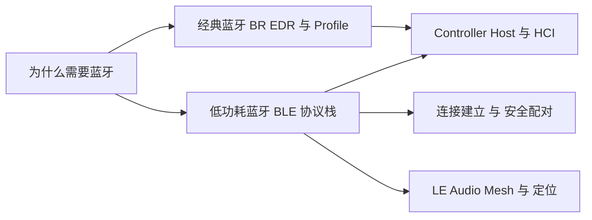
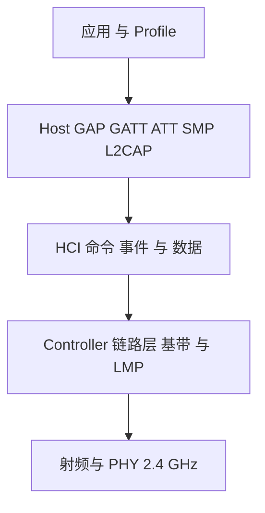
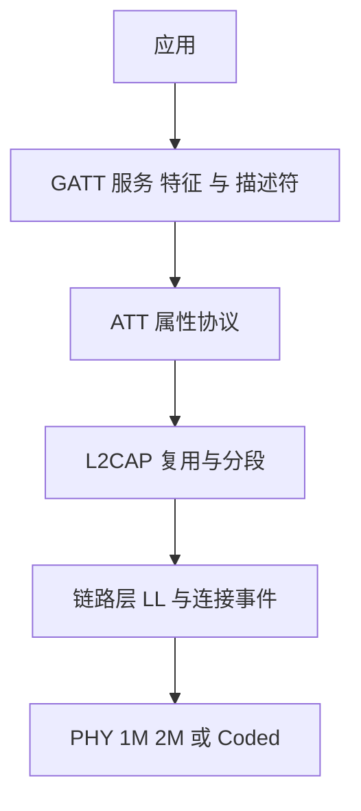
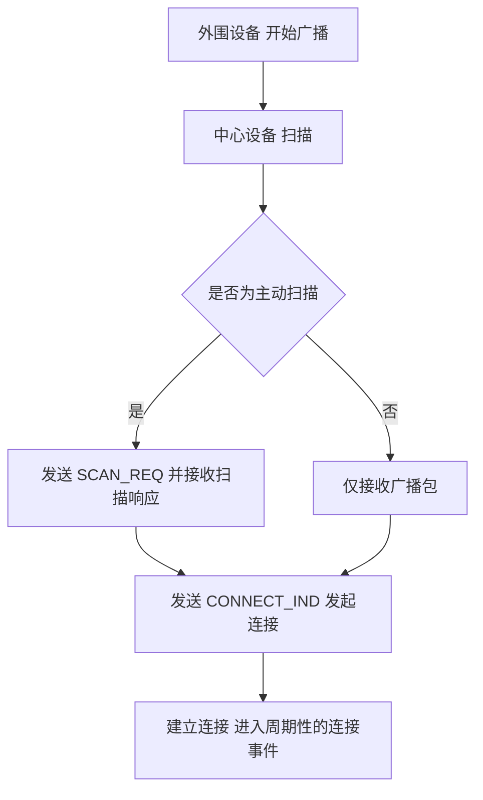
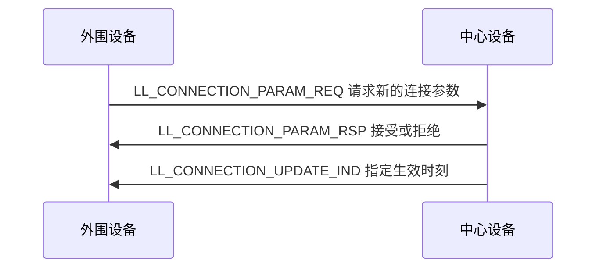
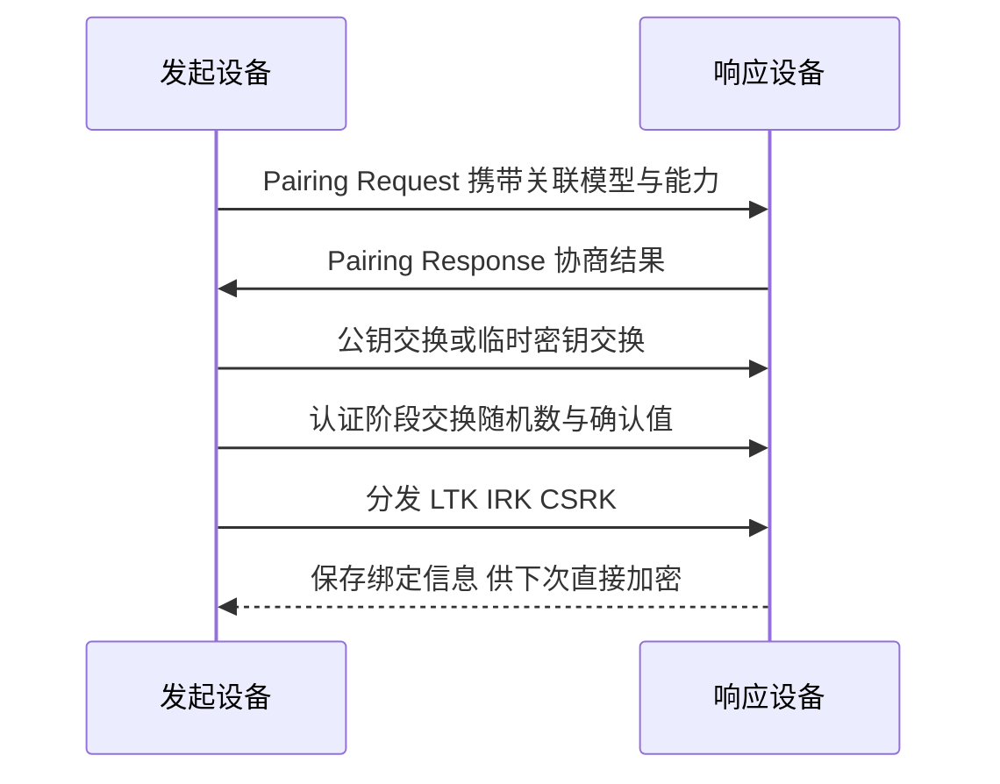
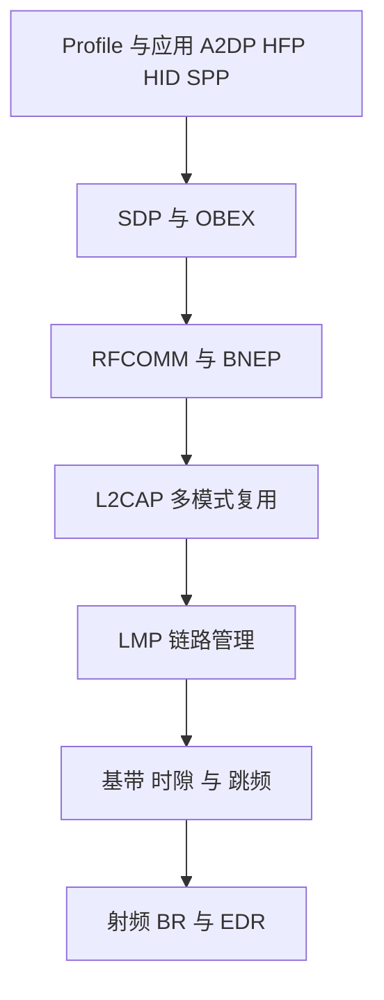
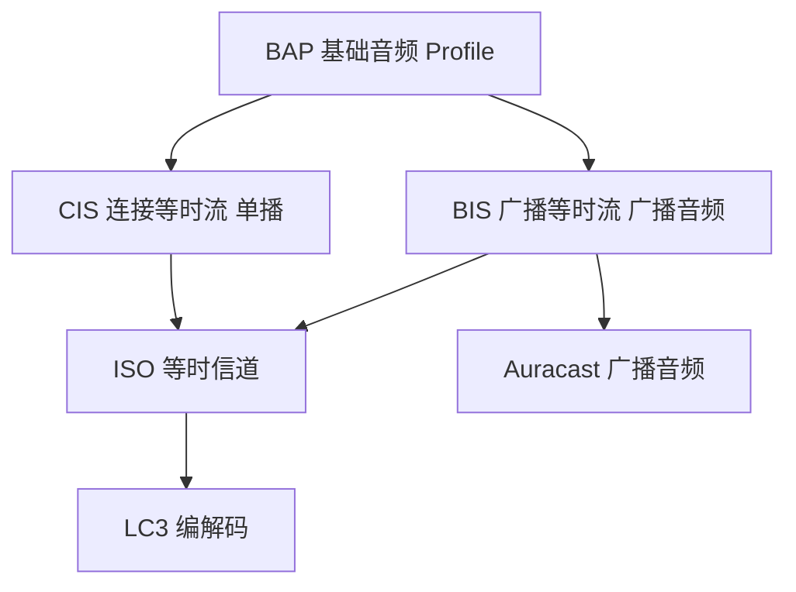
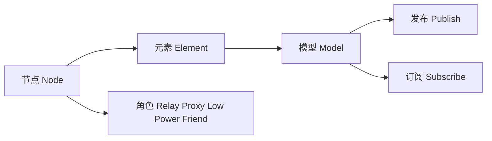
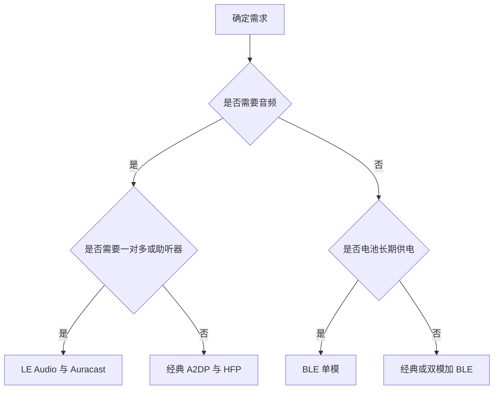

# 蓝牙：经典蓝牙与低功耗蓝牙的协议栈原理与架构

本文面向程序开发者，回答三个问题：蓝牙为什么被设计成这样、它的协议栈各层分别解决什么问题、以及经典蓝牙（BR/EDR）与低功耗蓝牙（BLE）为什么是两套几乎独立的技术。全文不绑定具体平台，但会用 Linux / BlueZ 作为「主机协议栈如何落地」的示例载体。

---

## 一、蓝牙解决的是什么问题

### 1.1 它出现之前的问题

蓝牙要替代的是**短距离设备之间的线缆**：耳机线、串口线、键鼠线、打印线。用无线替代线缆，会同时引出四组互相冲突的约束：

| 约束 | 具体含义 | 对设计的压力 |
|---|---|---|
| 低功耗 | 耳机、手环、传感器靠纽扣电池供电 | 需要深度休眠与短时唤醒 |
| 低成本 | 外设单价低，必须单芯片、小面积 | 射频与协议栈要足够简单 |
| 抗干扰 | 工作在 2.4 GHz 免许可频段，与 Wi-Fi 共享 | 需要跳频与自适应信道选择 |
| 互操作 | 任意品牌设备必须能配对互通 | 需要统一的规范与认证体系 |

这四组约束无法同时被一套射频与协议最优满足，这正是后来分裂的直接原因。蓝牙最初的设计（1999 年的 1.0 规范）选择了「面向连接、较高带宽、较高功耗」的路线，也就是今天所说的**经典蓝牙**。

### 1.2 为什么会有两套蓝牙

低功耗蓝牙的技术源头并不是经典蓝牙的演进，而是诺基亚 2001 年提出的 Wibree 低功耗无线技术，2006 年并入 Bluetooth SIG，最终在 **Bluetooth 4.0（2010）** 中作为低功耗蓝牙（Bluetooth Low Energy，BLE）正式落地。

因此，BLE 不是「经典蓝牙的省电模式」，而是**与经典蓝牙并列的另一套控制器与协议栈**。两者共享的只有：

- 同一段 2.4 GHz ISM 免许可频段；
- 相同的安全体系基础（配对、密钥）；
- L2CAP 这一层的部分思想与概念。

两者**不共享**的包括：信道划分、链路层、连接建立方式、服务发现方式（SDP 对 GATT）、音频传输路径、上层 Profile 体系。

> **理解要点：** 判断一个蓝牙问题是「经典」还是「BLE」问题，几乎总能决定后续所有技术细节。二者不可互相替代。

### 1.3 在整个无线体系中的位置

蓝牙的定位是**个人区域网（Personal Area Network，PAN）**级别的短距通信，典型覆盖 10 米级（BLE Coded PHY 可到百米级）。与之相邻的技术各有取舍：

| 技术 | 典型定位 | 与蓝牙的关系 |
|---|---|---|
| Wi-Fi | 高带宽、基础设施组网 | 共享 2.4 GHz，蓝牙靠跳频规避干扰 |
| Zigbee / Thread | 低功耗自组网、Mesh | 与 BLE Mesh 目标重叠 |
| NFC | 数厘米级、无源触发 | 常与蓝牙配对配合使用 |
| 蜂窝网络 | 广域 | 与蓝牙互补，不是替代 |

---

## 二、学习地图

下面这张图给出全文的知识路径：从「为什么存在」出发，分成经典与低功耗两条线，再汇聚到共同的下层（Controller / Host / HCI）与各自的专题。



---

## 三、经典蓝牙与低功耗蓝牙的定位差异

两者最容易被混淆，先把差异一次性对齐：

| 维度 | 经典蓝牙 BR/EDR | 低功耗蓝牙 BLE |
|---|---|---|
| 首次引入 | 1.0（1999） | 4.0（2010） |
| 信道划分 | 79 个信道 间隔 1 MHz | 40 个信道 间隔 2 MHz 其中 3 个广播信道 |
| 调制方式 | GFSK / pi/4-DQPSK / 8DPSK | 仅 GFSK |
| 基础速率 | 1 Mbps 加强后 2 / 3 Mbps | 1 Mbps 2 Mbps 编码后 500 / 125 kbps |
| 多址方式 | 时分双工 时隙 625 微秒 | 事件驱动的连接事件 |
| 拓扑 | Piconet 与 Scatternet | 星形 一个中心设备对多个外围设备 |
| 角色名称 | Master / Slave | Central / Peripheral |
| 服务发现 | SDP | GATT |
| 音频路径 | A2DP / HFP 走 ACL 与 SCO eSCO | LE Audio 走等时信道与 LC3 |
| 典型功耗 | 较高 不适合纽扣电池长期待机 | 极低 可数年待机 |
| 典型用途 | 耳机 音箱 车机 蓝牙串口 | 手环 传感器 遥控器 电子价签 |

（信道与速率事实见 Bluetooth SIG Core Specification，BR/EDR Controller 篇与 Low Energy Controller 篇；整体定位见 Bluetooth SIG《Bluetooth LE Primer》）

一个关键工程事实是：**双模（Dual Mode）芯片可以同时实现经典与 BLE**，例如一副 EDR 耳机同时作为 BLE 传感器提供服务。但「支持双模」不等于「两套协议可以互相通信」，上层 Profile 与 GATT 仍然互不相通。

---

## 四、协议栈分层：Controller 与 Host 的分工

### 4.1 分层结构与 HCI 分界线

蓝牙协议栈按「谁负责射频与实时时序、谁负责会话与数据组织」一分为二：



这条分界线就是 **HCI（Host Controller Interface）**。之所以要切开，原因是：

1. **实时性不同**：链路层必须严格按微秒级时序收发，适合放在控制器固件里；协议栈会话逻辑可以跑在操作系统里。
2. **可复用性**：同一套 Controller 固件可以配 Linux BlueZ、Android、iOS 等不同 Host；同一套 Host 可以配不同厂商的 Controller。
3. **接口标准化**：HCI 用标准命令与事件描述「Host 要求 Controller 做什么」，使不同厂商芯片可互换。

### 4.2 各层职责

| 层 | 所在侧 | 解决什么问题 |
|---|---|---|
| PHY | Controller | 调制解调、信道与跳频，把比特变成射频信号 |
| Link Layer / Baseband | Controller | 广播与连接事件调度、重传与确认、加密的链路级实施 |
| LMP / LL 控制 | Controller | 链路建立、能力协商、连接参数与功率控制 |
| HCI | 分界 | 把上层意图翻译成控制器可执行的命令与事件 |
| L2CAP | Host | 多路复用、分段与重组，为上层提供逻辑信道 |
| SMP | Host | 配对、密钥生成与分发 |
| ATT / GATT | Host | 属性数据库的读写与通知，BLE 的服务发现与数据模型 |
| SDP | Host | 经典蓝牙的服务发现 |
| GAP | Host | 定义角色、广播、扫描与连接的行为规则 |
| Profile | Host | 约定某一类应用如何使用上述能力 |

> **常见设计原则：** Controller 只做 Controller，Host 只做 Host。把应属于 Host 的逻辑塞进 Controller 固件，会让固件升级困难、跨平台复用变差。

### 4.3 HCI 的传输方式

HCI 只是一组逻辑接口，物理上传送方式有多种，这是「同一套协议栈能跑在不同硬件上」的关键：

| 传输 | 说明 | 典型场景 |
|---|---|---|
| UART H4 | 1 字节类型码加载荷，无校验 | 早期模组与 MCU |
| UART H5（三线） | 带 CRC 与重传，可靠性更高 | 需要可靠串口链路的模组 |
| USB | 标准 USB 端点，主机侧最常见 | 笔记本内置与 USB 蓝牙适配器 |
| SDIO / PCIe | 与 Wi-Fi 共芯片时使用 | 手机与 SoC 集成方案 |

### 4.4 主机协议栈如何落地：以 Linux / BlueZ 为例

Linux 把蓝牙拆成「内核态协议栈」与「用户态守护进程」两层，这正好是 Host 侧的一次真实实现：

- **内核** `net/bluetooth/` 实现 HCI core、L2CAP、SCO、RFCOMM、BNEP、HIDP、SMP 等协议，并通过 `netlink` 上的 **MGMT** 接口向上暴露管理能力（内核 3.4 起）。
- **用户态** `bluetoothd`（BlueZ）在 D-Bus 上提供 `org.bluez` 接口，把适配器、设备、GATT 对象暴露给应用。

BlueZ 的主要 D-Bus 对象：

| 接口 | 对象路径 | 作用 |
|---|---|---|
| `Adapter1` | `/org/bluez/hciX` | 开关适配器、开始扫描、设置名字 |
| `Device1` | `/org/bluez/hciX/dev_XX_...` | 连接与配对、读取 RSSI 与服务 |
| `GattService1` | 服务对象下 | 一个 GATT 服务 |
| `GattCharacteristic1` | 特征对象下 | 读写特征、订阅通知 |
| `AgentManager1` / `Agent1` | `/org/bluez` | 处理配对时的用户交互，如确认码 |
| `LEAdvertisingManager1` | 适配器下 | 发起 BLE 广播 |
| `ProfileManager1` | `/org/bluez` | 注册自定义 Profile |

命令行层面，`bluetoothctl` 与 `btmgmt` 分别封装了 D-Bus 与 MGMT 接口；早期的 `hcitool` / `hciconfig` / `hcidump` 已在上游被标记为弃用（由 `bluetoothctl` / `btmgmt` / `btmon` 取代），需要时须另行安装 deprecated 工具包（BlueZ 官方文档与 man 页；Ubuntu/Arch 官方文档）。

用户态程序也可以绕过守护进程，直接用 `AF_BLUETOOTH` 套接字访问内核协议栈：

```c
#include <sys/socket.h>
#include <bluetooth/bluetooth.h>
#include <bluetooth/l2cap.h>

/* BTPROTO_L2CAP 面向连接 用于自定义协议 而非标准 GATT */
int fd = socket(AF_BLUETOOTH, SOCK_SEQPACKET, BTPROTO_L2CAP);

/* BTPROTO_RFCOMM 提供类似串口的字节流 用于 SPP 类应用 */
int sp = socket(AF_BLUETOOTH, SOCK_STREAM, BTPROTO_RFCOMM);
```

- 它做什么：直接在用户态建立蓝牙协议栈的逻辑信道，跳过 BlueZ 的高层封装。
- 位置：位于上图 Host 层的 L2CAP 与 RFCOMM 之上，对应「应用直接使用内核协议栈」这条路径。
- 为什么需要：需要自定义协议、避开 D-Bus 语义限制或追求更低开销时会用到。
- 协议对照：`BTPROTO_HCI` 面向原始控制（现推荐用 MGMT），`BTPROTO_L2CAP` 面向连接或无连接数据，`BTPROTO_RFCOMM` 为字节流，`BTPROTO_SCO` 用于语音链路（见 man 页 `bluetooth(7)`、`l2cap(7)`、`rfcomm(7)`、`sco(7)`）。

---

## 五、BLE 的数据通路：GATT 与 ATT

### 5.1 通路全貌

BLE 应用数据自上而下的完整路径如下。理解这张图，就理解了 BLE 数据传输的绝大部分行为：



分工是：

- **GATT** 定义「数据长什么样」：服务、特征、描述符，以及如何组织成可被发现的数据库。
- **ATT** 定义「数据怎么被读写」：一组请求与响应操作，所有 GATT 操作最终都是 ATT 操作。
- **L2CAP** 提供逻辑信道与分段；**链路层**负责在连接事件里实际收发报文。

### 5.2 GATT 的数据模型

| 概念 | 含义 | 关键点 |
|---|---|---|
| Service | 一组相关功能的集合 | 有 UUID，可为主服务或次服务 |
| Characteristic | 服务内的一个数据项 | 由「声明 + 值」两个属性组成 |
| Descriptor | 特征的附加说明 | 描述值的单位、格式、权限 |
| CCCD | 客户端特征配置描述符 | UUID 为 `0x2902`，控制是否接收通知或指示 |
| UUID | 服务与特征的标识 | 16 位为 SIG 分配的标准值，128 位为自定义 |

### 5.3 ATT 的主要操作

| 操作 | 方向 | 需要确认 | 典型用途 |
|---|---|---|---|
| Read Request / Response | 客户端发起 | 是 | 读取特征值 |
| Write Request / Response | 客户端发起 | 是 | 可靠写入 |
| Write Command | 客户端发起 | 否 | 不需确认的快速写入 |
| Notification | 服务端主动 | 否 | 高频数据推送 |
| Indication / Confirmation | 服务端主动 | 是 | 需确认的推送 |
| Find Information | 客户端发起 | 是 | 发现属性句柄与类型 |
| Prepare Write / Execute Write | 客户端发起 | 是 | 拼接写入超过单包长度的值 |
| Read Blob | 客户端发起 | 是 | 分段读取长属性 |

两点容易出错的设计细节：

1. **订阅是显式动作。** 客户端必须写 CCCD 才会收到通知；服务端不能假设客户端在监听。
2. **长数据需要分段。** 超过单包容量的读用 `Read Blob`，写用 `Prepare Write` 加 `Execute Write`。

### 5.4 MTU 与数据长度：吞吐的真正瓶颈

默认情况下，**ATT MTU 为 23 字节**（L2CAP 载荷 27 字节减去 4 字节 L2CAP 头），这意味着一次通知的实际有效载荷只有约 20 字节。链路层默认载荷 27 字节，通过 **LE 数据长度扩展（DLE）** 可提升到 251 字节。两件事必须都做，吞吐才会显著提升。

应用层吞吐可以近似估算为：

$$
R_{app} \approx \frac{N_{pkt} \times (L_{ll} - L_{l2cap} - L_{att}) \times 8}{T_{interval}}
$$

其中 $N_{pkt}$ 是每个连接事件发送的报文数，$L_{ll}$ 为链路层载荷（默认 27 字节，DLE 后 251 字节），$L_{l2cap}$ 为 4 字节 L2CAP 头，$L_{att}$ 为 ATT 操作头（通知为 1 字节，读响应为 1 字节加数据），$T_{interval}$ 为连接间隔。

据此得到的量级（Bluetooth SIG 官方《Exploring Bluetooth 5 - How fast can it be?》）：

| 配置 | 理论峰值量级 |
|---|---|
| 1M PHY 默认载荷 27 字节 | 约 0.3 Mbps |
| 1M PHY 加 DLE 251 字节 | 约 0.8 Mbps |
| 2M PHY 加 DLE 251 字节 | 约 1.4 Mbps |

> **注意：** 这是峰值量级而非保证值。实际吞吐由连接间隔、连接事件长度、每事件报文数、MTU 协商结果共同决定，因此「BLE 传不动大文件」通常不是带宽不够，而是参数配置与事件调度受限。

---

## 六、BLE 的连接建立：广播、扫描与连接参数

### 6.1 为什么要「先广播再连接」

BLE 从设计上就假设两端**没有预先约定**，因此必须有一个无需连接就能被发现的阶段。这个阶段由 3 个广播信道承担（信道 37 / 38 / 39，对应 2402 / 2426 / 2480 MHz）。选这 3 个频点是有意的：它们避开 Wi-Fi 最常用的频点上最拥挤的区域，使「被发现」这件事更可靠。

GAP 定义了四种角色：

| 角色 | 是否建立连接 | 作用 |
|---|---|---|
| 广播者 Advertiser | 否 | 只发广播包 |
| 观察者 Observer | 否 | 只收广播包 |
| 外围设备 Peripheral | 是 | 可被连接的一方，同时可广播 |
| 中心设备 Central | 是 | 主动发起连接的一方 |

### 6.2 广播类型

| 广播类型 | 是否可连接 | 是否可被扫描请求 | 用途 |
|---|---|---|---|
| `ADV_IND` | 是 | 是 | 通用可连接广播 |
| `ADV_DIRECT_IND` | 是 | 否 | 针对特定设备快速重连 |
| `ADV_NONCONN_IND` | 否 | 否 | 纯广播，如 Beacon |
| `ADV_SCAN_IND` | 否 | 是 | 可被主动扫描补充信息 |

### 6.3 从广播到连接的流程



### 6.4 连接参数：延迟、吞吐与功耗的三角权衡

连接建立后，双方按固定的**连接事件**节奏通信。三个参数决定了全部行为：

| 参数 | 取值范围 | 作用 |
|---|---|---|
| 连接间隔 Connection Interval | 7.5 毫秒到 4 秒，步长 1.25 毫秒 | 两次通信机会的间隔，越小延迟越低但功耗越高 |
| 从设备延迟 Slave Latency | 0 到 499 | 允许外围设备跳过多少个连接事件不必应答，用延迟换功耗 |
| 监督超时 Supervision Timeout | 100 毫秒到 32 秒，步长 10 毫秒 | 多久收不到回应就判定链路断开 |

超时值必须显著大于「按延迟计算的最大静默时间」，否则会误断链：

$$
T_{supervision} > (1 + N_{latency}) \times T_{interval}
$$

> **实现差异：** 部分 Core 版本与厂商实现要求在不等式右侧再乘 2，因此参数合法性校验必须以所用 Core 版本与芯片实现为准。

参数由中心设备最终决定，但外围设备可以主动请求：



### 6.5 广播能力的扩展

| 特性 | 引入版本 | 解决的问题 |
|---|---|---|
| 扩展广播 Extended Advertising | 5.0 | 广播数据从 31 字节提升到 255 字节，并可使用 2M PHY 或 Coded PHY |
| 周期广播 Periodic Advertising | 5.0 | 让一个广播源持续、定时地推送数据，接收端无需连接 |
| 周期广播同步转交 PAST | 5.1 | 由已同步的设备把同步信息转交给受限设备，帮其省去持续扫描的功耗 |
| 带响应的周期广播 PAwR | 5.4 | 广播可分段寻址到成千上万个节点并接收其应答，用于电子价签 |
| 加密广播数据 EAD | 5.4 | 使无连接的广播内容也能受保护 |

---

## 七、BLE 的安全：配对、加密与隐私

### 7.1 配对要解决的三件事

在一条没有任何共享秘密的无线链路上，配对必须同时完成：

1. **建立共享密钥**，用于后续链路加密；
2. **确认双方身份**，防止中间人冒充（MITM）；
3. **可选地保存密钥**（绑定），使下次连接无需重新配对。

这三件事在 SMP（Security Manager Protocol，安全管理协议）中完成，其核心取舍是：**「认证强度」与「用户操作成本」不可兼得**。

### 7.2 四种关联模型

| 关联模型 | 认证强度 | 用户操作 | 防中间人 |
|---|---|---|---|
| Just Works | 最低 | 无 | 否 |
| Passkey Entry | 中 | 一端显示 6 位数字，另一端输入 | 是 |
| Numeric Comparison | 中 | 两端显示同一数字，用户确认一致 | 是 仅 LE Secure Connections |
| OOB | 高 | 借助带外信道，如 NFC | 是 |

其中 **Just Works 不提供防中间人能力**，只适合无敏感数据的场景，这是最常见的误用。

### 7.3 两代配对协议

| 对比项 | LE Legacy Pairing（4.0 / 4.1） | LE Secure Connections（4.2 起） |
|---|---|---|
| 密钥协商 | 基于临时密钥 TK | 基于椭圆曲线 Diffie-Hellman 密钥交换 P-256 |
| 密钥生成 | 链路密钥由双方算出并交换 | 长期密钥 LTK 由双方各自本地派生，不在空口传送 |
| 支持 Numeric Comparison | 否 | 是 |
| 抗窃听能力 | 较弱 | 较强 |

### 7.4 生成的密钥与各自用途

| 密钥 | 全称含义 | 用途 |
|---|---|---|
| LTK | Long Term Key | 链路加密的长期密钥 |
| IRK | Identity Resolving Key | 解析对端随机地址，实现隐私 |
| CSRK | Connection Signature Resolving Key | 对无连接数据进行签名与验签 |

把配对结果保存下来称为**绑定（Bonding）**，其价值是后续连接可以直接加密，无需再次交互。

### 7.5 隐私与随机地址

如果设备固定使用出厂 MAC 地址，就会被长期跟踪。BLE 因此允许使用**随机地址**：

| 地址类型 | 特点 |
|---|---|
| Public | 出厂固定的 IEEE 地址 |
| Random Static | 每次上电或运行期变化的随机地址 |
| Resolvable Private Address（RPA） | 由 IRK 生成、周期性变化，信任方用 IRK 反解身份 |
| Non-resolvable Private Address | 纯随机，不供解析 |

RPA 是隐私机制的核心：同一设备对未绑定方每次呈现不同地址，对已绑定方则可通过 IRK 识别为同一设备。链路层隐私（4.2 起）把这套解析下沉到控制器，使主机不必持续处理地址解析。

### 7.6 配对流程



---

## 八、经典蓝牙的协议分层与 Profile 生态

### 8.1 协议栈分层

经典蓝牙的栈比 BLE 多出服务发现与串口仿真两套机制：



> **例外：** 语音数据不经过 L2CAP，而是直接使用基带上的 SCO / eSCO 链路，这是理解经典音频必须记住的一点。

### 8.2 为什么经典蓝牙必须有 SDP 与 RFCOMM

- **SDP（Service Discovery Protocol）**：经典 Profile 暴露的不是「数据模型」而是「服务记录」。客户端必须先通过 SDP 查询对端有哪些服务、用哪个 L2CAP 信道号，才能发起业务连接。这正是 BLE 用 GATT 替代 SDP 的原因——GATT 自带可发现的数据模型。
- **RFCOMM**：基于 ETSI TS 07.10 标准，在 L2CAP 上仿真 RS-232 九路串口语义，使大量存量串口应用无需改造即可无线化。这是蓝牙串口模块（SPP）长期存在的原因。可同时建立的仿真端口数与实现相关，常见口径为 60 条。

### 8.3 L2CAP 在经典中的多模式

经典蓝牙的 L2CAP 信道有四种模式，BLE 的 L2CAP 则简化得多：

| 模式 | 特点 | 用途 |
|---|---|---|
| Basic | 无重传、无流控 | 默认与低要求场景 |
| Retransmission / Flow Control | 带重传与流控 | 需要可靠传输 |
| Enhanced Retransmission（ERTM） | 增强重传 | 3.0 起为高速数据引入 |
| Streaming | 无重传但有流控 | 等时流式数据 |

固定信道号也值得记住：`0x0001` 信令信道、`0x0002` 无连接信道、`0x0003` AMP 管理；LE 侧固定信道为 `0x0004` ATT、`0x0005` LE 信令、`0x0006` SMP。经典蓝牙上的 ATT 使用动态分配的面向连接信道，而非固定信道。

### 8.4 ACL 与 SCO/eSCO

| 对比项 | ACL | SCO / eSCO |
|---|---|---|
| 交换方式 | 分组交换 | 电路式预留时隙 |
| 速率特征 | 不对称、可变，适合数据 | 对称、恒定，适合语音 |
| 重传 | 有 | SCO 无；eSCO 有有限重传 |
| 典型用途 | 文件、控制、音频流 | 免提通话语音 |

音频业务选择 SCO/eSCO 而非 ACL，原因是语音要求**恒定码率与稳定延迟**，不能容忍分组重传带来的时延抖动。

### 8.5 主要 Profile

| Profile | 作用 | 依赖机制 |
|---|---|---|
| A2DP | 单向高质量音频流 | ACL 加 L2CAP，SBC 为必选编解码器 |
| AVRCP | 播放控制与元数据 | ACL |
| HFP / HSP | 免提与耳机通话 | AT 命令通道加 SCO/eSCO 语音通道 |
| HID | 键鼠手柄 | L2CAP 中断与控制在两条信道上 |
| SPP | 串口仿真 | RFCOMM |
| OPP | 对象推送 | OBEX |
| PBAP / MAP | 电话簿与短信访问 | OBEX 加 RFCOMM |

### 8.6 连接状态与节能

经典链路在 Active 之外还有 Sniff（周期性短暂唤醒）与 Hold（暂停 ACL）等节能状态，用于在不通信时降低占空比。Park 状态已在新版 Core 规范中被列为移除特性，因此不要在设计中依赖它。

---

## 九、LE Audio 与等时信道

### 9.1 为什么需要新的音频路径

经典 A2DP 的痛点有三：编码效率低（SBC 在同等音质下需要更高码率）、延迟偏高、无法一对多广播。LE Audio 的解法是引入**等时信道（Isochronous Channels，ISO）**与新的编解码器 LC3。

### 9.2 等时信道



| 类型 | 是否有连接 | 拓扑 | 典型用途 |
|---|---|---|---|
| CIS / CIG（连接等时流） | 是，基于 ACL | 点对点，可加密 | 真无线耳机左右独立声道 |
| BIS / BIG（广播等时流） | 否，基于周期广播 | 一对多，接收端数量不限 | Auracast 广播音频、多语言导览、助听器 |

ISO 与 ACL 的根本差异在于：ACL 是事件驱动加重传，ISO 按固定间隔发送带时间戳的数据，用**时间可预测性**换取了稳定延迟。

### 9.3 LC3 与 SBC 的取舍

| 对比项 | SBC | LC3 |
|---|---|---|
| 地位 | A2DP 必选编解码器 | LE Audio 必选编解码器 |
| 帧长 | 固定 | 10 毫秒或 7.5 毫秒 |
| 采样率 | 常见 44.1 / 48 kHz | 8 到 48 kHz 范围更宽 |
| 同码率音质 | 基准 | 明显更优，约一半码率即可达到同等音质 |
| 计算复杂度 | 低 | 编码约为 SBC 的 3 到 4 倍，解码约 2 到 3 倍 |
| 附加能力 | 无 | 内置丢包隐藏，整体功耗更优 |

### 9.4 LE Audio 的 Profile 体系

| Profile | 作用 |
|---|---|
| BAP | 基础音频 Profile，定义单播与广播的音频流建立 |
| CAP | 通用音频 Profile，统一各类音频场景的入口 |
| PBP | 公共广播 Profile，即 Auracast |
| TMAP | 电话与媒体音频 Profile |
| HAP | 助听器 Profile |

### 9.5 与经典 A2DP 的对比

| 对比项 | 经典 A2DP | LE Audio |
|---|---|---|
| 承载 | BR/EDR 的 ACL 与 L2CAP | BLE 的 ISO 等时信道 |
| 方向性 | 单向 源到宿 | 支持单向与广播 |
| 左右声道 | 通常合为一个流 | 可独立成两个流 |
| 延迟与功耗 | 较高 | 更低 |
| 一对多 | 不支持 | 支持 Auracast |
| 助听器场景 | 不适用 | 原生支持 |

---

## 十、Bluetooth Mesh

### 10.1 为什么在 BLE 之上再定义一层

BLE 的连接拓扑是星形：一个中心设备对多个外围设备。楼宇照明这类场景需要的是**多对多、可中继、覆盖整栋楼**的网络。Mesh 就是为此在 BLE 之上构建的独立规范，它不修改 BLE 链路层，而是复用它作为承载。

### 10.2 承载、结构与角色



| 概念 | 含义 |
|---|---|
| 承载 | Advertising 承载用于节点间通信，GATT 承载经 Proxy 供手机接入 |
| 节点 / 元素 / 模型 | 一个设备是节点，节点按功能拆成元素，元素上挂载模型 |
| 发布 / 订阅 | 模型不按地址直呼，而是按组地址发布与订阅，实现一对多 |
| Relay | 中继节点，把消息继续转发扩大覆盖 |
| Proxy | 代理节点，让不支持 Mesh 的手机经 GATT 接入 |
| Low Power / Friend | 低功耗节点与友节点配合，由友节点代收消息 |

### 10.3 配网与转发

新设备加入网络必须经过**配网（Provisioning）**：验证设备身份后，下发网络密钥 NetKey、应用密钥 AppKey 与一个单播地址。Mesh 1.0 采用**托管泛洪（Managed Flooding）**转发消息，即由中继节点按规则扩散，简单但开销随规模上升。

Mesh 1.1（2022 年采纳）在此基础上补充了更可控的转发与运维能力，包括定向转发（Directed Forwarding）、固件分发（DFU）、远程配网（Remote Provisioning）、基于证书的配网、私密信标、子网桥接与按需私密 GATT 代理。

---

## 十一、定位与测向

### 11.1 为什么 RSSI 只能粗定位

基于接收信号强度（RSSI）估算距离，看似简单，实际受多径反射、人体遮挡与发射功率波动影响，误差可达数米量级且不稳定。因此 RSSI 适合判断「很靠近」这一级别的门限应用，不适合精确坐标。

### 11.2 广播式信标

| 信标格式 | 提出方与时间 | 帧结构要点 |
|---|---|---|
| iBeacon | Apple 2013 | 16 字节 UUID 加 2 字节 Major 加 2 字节 Minor |
| Eddystone | Google 2015 | 使用 `0xFEAA` 服务数据，帧型有 UID 与 URL 与 TLM 与 EID |

它们都只是「把数据塞进不可连接广播包」的约定，本身不定义应用协议，这是实现简单、跨平台易用的原因。

### 11.3 到达角与离开角测向

要获得角度而非距离，需要在射频层引入**恒定音调扩展（CTE）**与 IQ 采样：

| 方式 | 谁发射 | 谁接收 | 计算方法 |
|---|---|---|---|
| AoA 到达角 | 标签 单天线发射 | 定位器 天线阵列接收 | 由阵列各天线 IQ 相位差算到达方向 |
| AoD 离开角 | 发射端 天线阵列按切换序列发射 | 接收端 单天线接收 | 由切换序列与相位差算离开方向 |

### 11.4 信道探测

Core 6.0（2024）引入 **Channel Sounding（信道探测）**，用相位测距（PBR）与往返时间（RTT）相结合的方式估算距离，并针对中继与欺骗攻击做了防护设计，目标是让「距离」本身成为可用于安全门禁的可靠判据，而不只是定位参考。

---

## 十二、选型：什么时候用哪一个



速查表：

| 需求 | 推荐 | 关键理由 |
|---|---|---|
| 手环、传感器、遥控器 | BLE 单模 | 功耗决定形态 |
| 耳机、音箱、车机免提 | 经典 A2DP 与 HFP | 生态与兼容性成熟 |
| 低延迟、一对多音频、助听器 | LE Audio | ISO 与 LC3 的能力边界更大 |
| 楼宇照明、大规模传感器组网 | Bluetooth Mesh | 原生多对多与中继 |
| 室内定位与资产跟踪 | AoA/AoD 或信道探测 | 角度或测距精度优于 RSSI |
| 电子价签、海量单向控制 | PAwR 与加密广播 | 单点可覆盖数千节点且无连接 |
| 蓝牙串口替换 | 经典 SPP 或 BLE 自定义 GATT | 取决于对端生态与带宽需求 |

---

## 十三、常见误区

**错误理解一：** BLE 就是更省电的经典蓝牙，能力可以互相替代。

**为什么容易这样理解：** 两者都叫蓝牙，都用 2.4 GHz，都有配对。

**正确理解：** 两者是并行的两套控制器与协议栈，共享射频与安全基础，但信道划分、链路层、服务发现（SDP 对 GATT）、音频路径与上层 Profile 体系都不同。

**错误理解二：** 设备连接上了就能直接收发数据。

**为什么容易这样理解：** 蓝牙连接成功后，感觉链路已经可用。

**正确理解：** 连接只建立了链路，还必须发现服务与特征，并在 CCCD 上完成订阅，才会收到通知。

**错误理解三：** 使用 Just Works 配对等同于「安全配对」。

**为什么容易这样理解：** 配对流程完整走完，看起来已经加密。

**正确理解：** Just Works 不提供防中间人保护，链路虽加密但身份未经认证，敏感业务应使用 Passkey Entry、Numeric Comparison 或 OOB。

**错误理解四：** BLE 传大数据慢是因为带宽不足。

**为什么容易这样理解：** 官方速率写着 1 Mbps 或 2 Mbps，实测却远低。

**正确理解：** 瓶颈来自连接间隔、连接事件长度、每事件报文数、MTU 协商与 DLE 是否启用，以及手机平台对连接事件占空比的限制。

**错误理解五：** 连接间隔越小越好，或广播间隔越小越好。

**为什么容易这样理解：** 间隔越小响应越快。

**正确理解：** 两者都以功耗为代价换取延迟。手机侧通常还会强行改写参数，实际值以对端协商结果为准。

**错误理解六：** Mesh 就是 BLE 广播的必然用法。

**为什么容易这样理解：** Mesh 建立在 BLE 广播之上，看起来是同一件事。

**正确理解：** Mesh 是独立规范，需要配网、需要密钥与地址分配，转发行为由中继与泛洪规则决定，与普通 BLE 广播的信息模型不通用。

---

## 十四、相关知识连接

- **Wi-Fi 与 2.4 GHz 共存**：经典蓝牙用自适应跳频（AFH）规避占用频点，BLE 广播信道刻意选在 Wi-Fi 较少占用的频点附近；这是两者能在同一空间共存的原因。
- **Zigbee / Thread**：同样是低功耗自组网，与 BLE Mesh 在目标上重叠，选型时需比较生态与功耗。
- **6LoWPAN 与 IPv6 over BLE**：由 IETF RFC 7668 定义，使 BLE 可承载 IPv6，是「BLE 与 IP 网络对接」的连接点。
- **Linux 内核 `net/bluetooth/` 与 BlueZ**：Host 侧的真实实现，学习协议栈落地时从这里入手。
- **USB 与 HCI**：USB 蓝牙适配器是最常见的主机接入方式，其枚举与端点设计是 HCI 传输层的实例。
- **Android 与 iOS 的蓝牙 API**：`BluetoothGatt` 与 `CoreBluetooth` 是 ATT / GATT 在移动平台上的封装，平台对连接参数与后台扫描有额外限制。
- **厂商 SDK**：Nordic、TI、Espressif 的 SDK 提供 Controller 与 Host 的取舍配置，是理解「Controller 与 Host 分工」的最好实验场。

---

## 十五、正式学习时重点关注

1. 为什么同一频段能容纳经典与 BLE 两套 2.4 GHz 技术，它们的信道划分差异带来什么后果？
2. HCI 为什么必须存在，它把哪一部分逻辑留在 Controller、哪一部分留给 Host？
3. L2CAP 在 BLE 中为什么被简化，固定信道号 `0x0004` 与 `0x0005` 与 `0x0006` 分别属于谁？
4. ATT 与 GATT 的分工边界在哪里，为什么「订阅」必须由客户端显式执行？
5. 连接间隔、从设备延迟、监督超时三者如何共同决定延迟、吞吐与功耗？
6. Just Works 与 LE Secure Connections 的安全差距来自哪一步，为什么 LTK 在安全连接下不在空口传送？
7. 随机地址与 IRK 如何共同实现隐私，链路层隐私把什么工作从主机下沉到了控制器？
8. 经典蓝牙为什么需要 SDP 而 BLE 不需要，RFCOMM 存在的真实原因是什么？
9. 语音为什么必须走 SCO/eSCO 而不是 ACL，eSCO 的重传机制解决了什么问题？
10. ISO 等时信道与 ACL 在时间语义上的根本差别是什么，为什么它使一对多音频成为可能？
11. Bluetooth Mesh 的发布订阅模型相对于按地址直呼解决了什么问题，托管泛洪的代价是什么？
12. RSSI、AoA/AoD 与信道探测分别能提供「强度、角度、距离」中的哪一种，各自的适用边界在哪里？

---

## 参考资料

- Bluetooth SIG，Core Specification（含 BR/EDR Controller、Low Energy Controller、Host 各篇与版本变更记录）：https://www.bluetooth.com/specifications/specs/core-specification/
- Bluetooth SIG，Bluetooth LE Primer：https://www.bluetooth.com/bluetooth-le-primer/
- Bluetooth SIG，Core Specification 版本特性概览（Core 6.0 及后续修订发布说明）：https://www.bluetooth.com/core-specification-6-feature-overview/
- Bluetooth SIG，Exploring Bluetooth 5 - How fast can it be?（吞吐量与 PHY、DLE 关系）：https://www.bluetooth.com/blog/exploring-bluetooth-5-how-fast-can-it-be/
- Bluetooth SIG，A Technical Overview of LC3：https://www.bluetooth.com/blog/a-technical-overview-of-lc3/
- Bluetooth SIG，LE Audio Specifications：https://www.bluetooth.com/learn-about-bluetooth/feature-enhancements/le-audio/le-audio-specifications/
- Bluetooth SIG，Mesh Feature Enhancements Summary（Mesh 1.1 新增能力）：https://www.bluetooth.com/mesh-feature-enhancements-summary/
- Bluetooth SIG，Direction Finding Technical Overview：https://www.bluetooth.com/wp-content/uploads/Files/developer/RDF_Technical_Overview.pdf
- Bluetooth SIG，Periodic Advertising Sync Transfer：https://www.bluetooth.com/blog/periodic-advertising-sync-transfer/
- Bluetooth SIG，How Bluetooth Technology Uses Adaptive Frequency Hopping：https://www.bluetooth.com/blog/how-bluetooth-technology-uses-adaptive-frequency-hopping-to-overcome-packet-interference/
- BlueZ，D-Bus API 参考与 MGMT API：https://bluez.readthedocs.io/en/latest/
- Linux man 页，bluetooth(7)、l2cap(7)、rfcomm(7)、sco(7)
- IETF，RFC 7668，IPv6 over BLUETOOTH Low Energy：https://datatracker.ietf.org/doc/html/rfc7668
- Nordic Semiconductor 与 Texas Instruments 官方蓝牙开发者文档（用于交叉验证链路层与安全实现细节）
