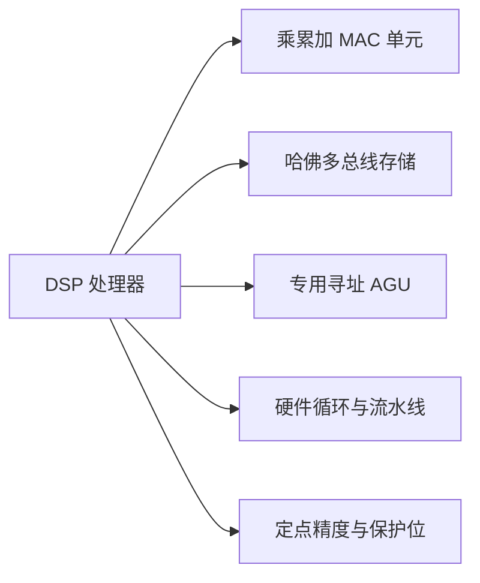
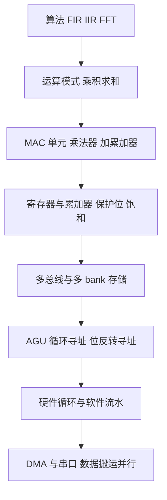
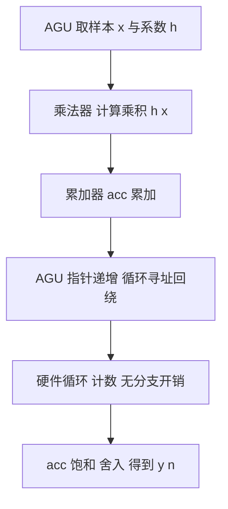
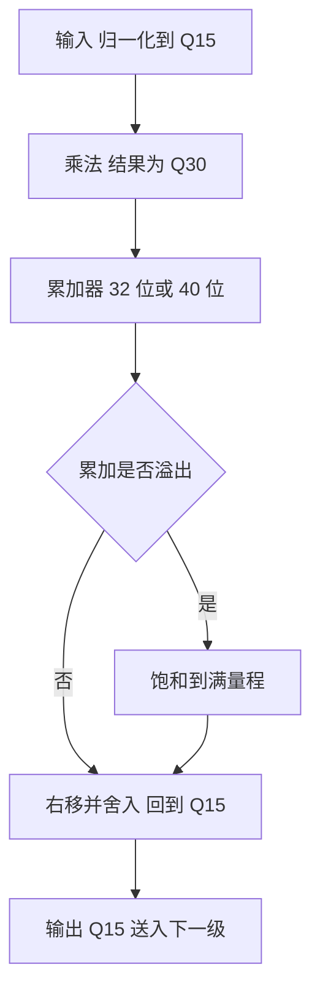
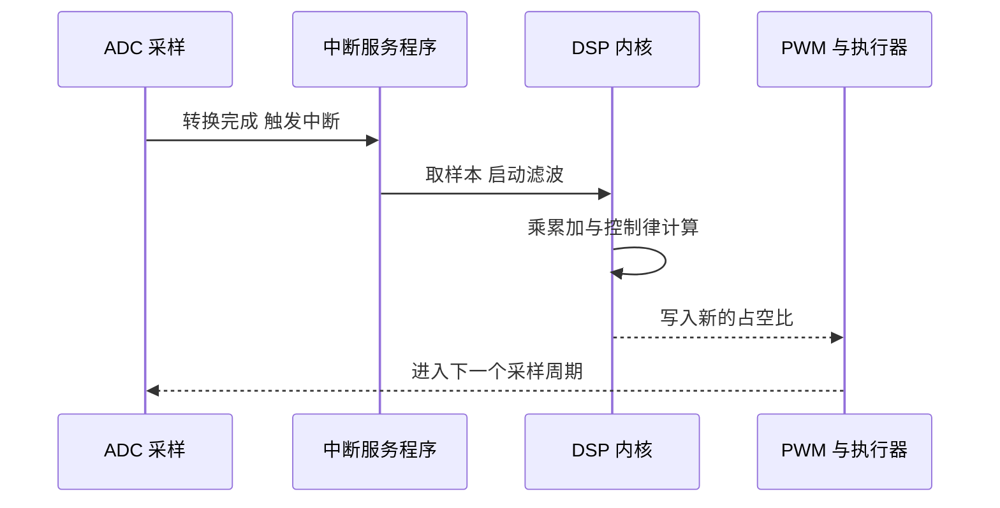

# 数字信号处理器（Digital Signal Processor，DSP）

> 本文是一份学习前的知识地图：目标不是替代正式学习，而是在正式学习之前建立可靠的整体认知，并在学习之后作为可独立阅读的个人知识库。
>
> 术语约定：本文中的“DSP”指**数字信号处理器这枚芯片及其处理器架构**，不是“数字信号处理（Digital Signal Processing）这门学科”。

---

## 1. 先建立整体认知

### 1.1 一句话定义

数字信号处理器（Digital Signal Processor，DSP）是一类**把信号处理中最常见的运算直接固化进硬件数据通路**的处理器：它在单个时钟周期内完成“乘法 + 累加”，用多条独立存储器总线同时取指令和操作数，并用硬件承担循环、地址回绕、溢出饱和等原本由软件完成的工作。

### 1.2 直觉理解

通用 CPU 像一名“什么活都能干的通才”，DSP 更像一条**为单一动作设计的装配线工位**：它不会算得更聪明，但它把重复次数最多的那个动作（乘累加）做得更快、更省电、更少消耗指令。

> 类比边界：DSP 并不是“只能做数学的 CPU”。它同样能执行循环、分支、中断与操作系统；它只是把**数据流密集的运算**做得远优于通用处理器，并在控制流的灵活性上做出让步。

### 1.3 为什么它存在（一句话版）

实时信号处理（滤波、相关、变换）本质上是**每秒数百万到数十亿次的乘累加**，而这恰好是通用处理器最不擅长的运算模式。

### 1.4 它在整个信号链中的位置


DSP 处理器处于**采样数据与模拟世界之间**：它接收 ADC 的离散样本，完成运算后把结果交给 DAC 或执行器。它是整条链路中唯一的“可编程运算核心”。

---

## 2. 为什么需要 DSP：从一条卷积公式说起

### 2.1 运算量来自哪里

有限冲激响应（FIR）滤波器的输出为：

$$
y[n]=\sum_{k=0}^{N-1} h[k]\,x[n-k]
$$

每产生**一个**输出样本，就需要 $N$ 次“乘法 + 累加”。设采样率为 $f_s$，taps 数为 $N$，则每秒需要的乘累加次数为：

$$
R_{\mathrm{MAC}} = N \cdot f_s
$$

一个最常见的例子：256 抽头滤波器、48 kHz 采样：

$$
R_{\mathrm{MAC}} = 256 \times 48000 = 1.2288\times 10^{7}\ \text{次乘累加/秒} \approx 12.3\ \text{MMAC/s}
$$

即滤波这一步就要每秒一千两百多万次乘累加。若再叠加多个通道、多级滤波、频谱分析，运算量迅速进入每秒数亿次量级。

### 2.2 为什么通用处理器做这件事很吃亏

同样的运算放在通用 CPU 上，会产生大量**与运算本身无关的额外成本**：

| 通用处理器需要做的事 | DSP 中对应的硬件机制 |
|---|---|
| 乘法是一条指令，加法又是另一条指令 | 单周期 MAC：乘法器直接连到累加器 |
| 取指令与取数据争抢同一条存储总线 | 哈佛架构：程序总线与数据总线分离 |
| 循环计数、比较、条件跳转 | 硬件循环 / 零开销循环，无分支惩罚 |
| 判断缓冲区下标是否越界 | 循环寻址（模寻址），地址自动回绕 |
| 溢出前插入判断与钳位指令 | 饱和运算与保护位，硬件直接钳位 |
| 逐条计算数组下标 | AGU 与指令执行并行计算有效地址 |

后果是三条：**指令条数膨胀**（一次 MAC 变成十几条指令）、**内存带宽成为瓶颈**、**功耗效率低**。分支不可预测还会不断清空流水线，使实际吞吐进一步下降。

### 2.3 DSP 给出的答案

> 与其用软件“拼出”高效的乘累加循环，不如把这条循环所需的**运算单元、总线、寻址方式、数值处理**全部做成硬件。

这就是 DSP 处理器存在的根本原因：**用架构专门化，换取单位功耗下的实时运算能力。**

---

## 3. DSP 处理器在整个计算体系中的位置

| 架构 | 最擅长 | 主要代价 | 典型场景 |
|---|---|---|---|
| CPU（x86 / ARM A 系列） | 通用逻辑、分支密集、操作系统 | MAC 效率低、能效低 | 服务器、桌面、通用应用 |
| MCU | 控制、事件响应、低功耗待机 | 数学吞吐低 | 家电、车身控制、传感器节点 |
| DSP | 流式乘累加、确定性实时 | 控制流能力较弱 | 音频、电机、通信基带、雷达 |
| FPGA | 极高并行、可定制流水线 | 开发成本高、灵活性差 | 高速前端、原型、量产加速 |
| GPU | 海量并行浮点 | 功耗高、实时确定性差 | 训练、图像批处理 |
| NPU / MMA | 低精度矩阵乘 | 通用性差 | 推理加速 |

关键判断依据不是“谁更快”，而是**算法每个样本需要多少次运算、实时约束有多硬、功耗预算有多少**。TI 的架构选型文档明确指出：MCU 面向控制密集型应用，DSP 面向数学、循环与数据搬运密集型应用（来源：TI SPRA879《Choosing the Right Architecture for Real-Time Signal Processing Designs》）。

### 3.1 现代的现实形态：异构 SoC

今天很少见到“纯 DSP”芯片。更常见的形态是**异构集成**：

- ARM 核负责控制流、协议栈与操作系统；
- DSP 核负责信号处理内核；
- 专用硬件加速器（如 TI C7x 中的 MMA 矩阵乘法加速器）负责深度学习推理。

例如 TI 的 AM68x 就同时包含浮点向量 DSP 核 C7x 与 MMA 深度学习加速器（来源：TI《AM68x Processors》数据手册）。因此学习 DSP 时，**“DSP 与其他核如何分工”**是一个必须建立的认知。

---

## 4. 知识地图

DSP 处理器的能力可以归结为五根支柱。后面所有核心概念都挂在这五根上。



| 支柱 | 解决的问题 | 硬件形态 |
|---|---|---|
| 乘累加单元 | 一次运算完成乘与加 | 硬件乘法器 + 累加器，可多组并行 |
| 哈佛与多总线 | 取指与取数不争抢带宽 | 程序存储器与数据存储器分离，多 bank |
| 专用寻址 AGU | 不花指令就能维护指针 | 地址生成单元，循环寻址、位反转寻址 |
| 硬件循环与流水线 | 消除循环开销与分支惩罚 | 循环计数器、循环缓冲、软件流水 |
| 定点精度与保护位 | 用低位宽换能耗且不溢出 | Q 格式、宽累加器、饱和运算 |

---

## 5. 核心概念

### 5.1 乘累加单元（Multiply-Accumulate，MAC）

> 乘累加（Multiply-Accumulate，MAC）是把一次乘法与一次加法合并成一条不可分割的运算，即 $\mathrm{acc}\leftarrow \mathrm{acc} + a\cdot b$。

MAC 是 DSP 的运算心脏。它之所以关键，是因为**卷积、相关、点积、矩阵乘、多项式求值都具有“乘积求和”这一共同数学结构**，而 MAC 正好是一一对应的硬件。通用核完成同样的语义需要“乘—存—取—加”多条指令，DSP 则在一个时钟周期内完成。

现代 DSP 的 MAC 能力体现在三个维度上：

- **数量**：单 MAC、双 MAC、四 MAC。例如 TI C55x 的每个 MAC 单元可在单周期内完成 $17\times17$ 位乘法并加到 32 位（来源：TI《TMS320C5514 Fixed-Point Digital Signal Processor》数据手册）。
- **位宽组合**：从 16 位、24 位到 32 位乘加。
- **并行度**：SIMD 与 VLIW。同一周期可以同时算多个独立乘累加。

用公式表示一个双 MAC 单元一个周期内的动作：

$$
y \leftarrow y + a_0 b_0,\qquad z \leftarrow z + a_1 b_1
$$

### 5.2 哈佛架构与多总线

> 哈佛架构（Harvard Architecture）把程序存储与数据存储物理分离，各自拥有独立总线，因此可以在同一周期内同时取指令与读写数据。

对比经典的冯·诺依曼架构（程序与数据共用一套存储与总线）：

| 维度 | 冯·诺依曼 | 哈佛 |
|---|---|---|
| 存储 | 程序与数据共用 | 程序与数据分离 |
| 总线 | 一条，取指与取数互斥 | 多条，可并行 |
| 每周期可做的事 | 取指 **或** 取数 | 取指 **与** 取数可同时 |
| 典型使用者 | 通用 CPU | 多数 DSP |

DSP 往往走得更远，采用**改进型哈佛架构**：在程序、数据之外再增加多条数据总线与多个存储 bank，使一条指令能同时取多个操作数。例如 TI C55x 的 CPU 内部总线由一条程序总线、三条数据读总线、两条数据写总线组成（来源：TI《TMS320C55x Technical Overview》SPRU393）；ADI 的 SHARC 使用四条独立总线，可在单周期内完成双数据、指令与 I/O 取数（来源：ADI《SHARC Processor Architectural Overview》）。

**为什么必须这样做**：乘累加需要“取系数 + 取样本 + 取指令”三件事同时发生，单总线结构根本无法喂饱运算单元。**总线结构决定了 MAC 阵列能不能被喂饱。**

### 5.3 流水线与硬件循环

DSP 内核普遍采用深度流水线（取指、译码、取数、执行、写回）。流水线带来的问题是：一旦发生分支，已经进入流水线的指令就要作废。DSP 的应对手段有两类：

- **硬件循环 / 零开销循环**：循环计数、递减与回跳由硬件完成，循环体内的指令不再包含“比较 + 跳转”，稳态下几乎无额外开销。
- **软件流水线（Software Pipelining）**：把循环的多个迭代重叠执行，使稳态（kernel）中每个周期都完成一次 MAC。

软件流水线把循环切成三段：

| 阶段 | 作用 | 是否有额外开销 |
|---|---|---|
| prolog（前奏） | 填充流水线 | 有，约 $S-1$ 个周期 |
| kernel（稳态） | 每周期进入一个新样本并输出一个结果 | 无 |
| epilog（尾声） | 排空流水线 | 有，约 $S-1$ 个周期 |

若流水线深度为 $S$、迭代次数为 $N$，总周期数近似为：

$$
T \approx N + (S-1)
$$

TI C6000 用专门的 `SPLOOP` 指令与循环缓冲（loop buffer）来实现这种软流水，把循环体缓冲在硬件里，避免重复取指（来源：TI《TMS320C64x/C64x+ DSP CPU and Instruction Set Reference Guide》SPRU732）。这解释了一件事：**为什么 DSP 的“循环”是一种硬件概念，而不是纯软件概念。**

### 5.4 专用寻址：AGU、循环寻址与位反转

> 地址生成单元（Address Generation Unit，AGU）是与运算单元并行工作的部件，负责计算下一次访存的有效地址，不占用运算周期。

AGU 提供三种对信号处理至关重要的寻址方式：

**（1）循环寻址 / 模寻址（Circular / Modulo Addressing）**

滤波器的“延迟线”需要保存最近 $N$ 个样本，写完一圈后要回到开头。循环寻址让地址在缓冲区边界自动回绕，无需任何软件判断。设缓冲区起始地址为 $B$、长度为 $L$、当前指针为 $p$、偏移为 $i$，则新地址为：

$$
A = B + \big((p + i - B) \bmod L\big)
$$

当 $L$ 是 2 的幂时，取模可用一次按位与运算实现，硬件开销极小。ADI 的 DSP 入门课程把这一机制作为 AGU 的核心示例：地址指针在固定边界缓冲区中循环前进，且可以带步长跳跃（来源：ADI《DSP 101 Part 2》）。

**（2）位反转寻址（Bit-Reversed Addressing）**

基-2 快速傅里叶变换（FFT）的输入（或输出）需要按位反转顺序重排。若用软件重排，需要额外一遍内存搬移；DSP 让 AGU 直接产生“下标按二进制位反转”的地址序列，从而在蝶形运算中顺带完成重排（来源：UT Austin EE382N 讲义《Digital Signal Processors》；TI SPRABB6《FFT Implementation on C55x》）。

**（3）自动递增 / 带步长寻址**

指针自动加一或加固定步长，用于顺序取数组元素，把“计算下标”从指令流中彻底移除。

### 5.5 数值表示：定点、Q 格式、饱和与保护位

DSP 大量使用**定点（Fixed-Point）**运算，以较小位宽换取功耗、面积与可重复性。定点数的核心是“小数点位置由程序员约定”，这套约定称为 **Q 格式（Q Format）**。

**（1）Q 格式的定义**

设 $n$ 为小数位数，则一个落在 $[-1,1)$ 的实数用 Q 格式表示为：

$$
x_{Q} = \mathrm{round}\!\left(x \cdot 2^{n}\right),\qquad x \approx x_{Q}\cdot 2^{-n}
$$

常用 Q15 格式：16 位有符号整数，隐含比例 $2^{15}=32768$，可表示范围为：

$$
x \in [-1,\ 1-2^{-15}],\qquad x_{Q}\in[-32768,\ 32767]
$$

**（2）乘法的位宽增长**

$Q_{m_1.n_1}$ 与 $Q_{m_2.n_2}$ 相乘，结果的格式会自动增长为 $Q_{(m_1+m_2).(n_1+n_2)}$：

$$
Q15 \times Q15 \Rightarrow Q30
$$

两个 Q15 相乘得到 Q30，恰好可以完整放进 32 位有符号数中，**不会丢精度**。这就是 DSP 取 16 位数据 + 32 位累加器这一经典组合的数学原因。

**（3）累加与保护位（Guard Bits）**

若把 $M$ 个满量程乘积累加起来，最坏情况下的幅值上界为：

$$
\left|\sum_{i=1}^{M} p_i\right| \le M\,(1-2^{-15})^{2} < M
$$

因此累加器相对“单个乘积”需要大约 $\lceil \log_2 M \rceil$ 位额外整数位，这些多出来的位就是**保护位**。

后果非常具体：**32 位累加器容纳 Q30 乘积时余量很小。** CMSIS-DSP 文档在描述卷积与双二阶滤波器时明确指出：快速版本使用 32 位累加器、2.30 格式，仅提供**单个**保护位，且中间加法不饱和，一旦溢出就会回绕并破坏结果，因此**输入信号必须预先缩放**（来源：CMSIS-DSP《Convolution》《Biquad Cascade》文档的 Scaling and Overflow Behavior 一节）。

这正是 40 位累加器存在的原因。C55x 提供 40 位中央 ALU，C64x 的 ALU 支持 32/40 位运算（来源：TI SPRS646、TI SPRU732）。相对 Q30 乘积，40 位累加器多出约 8 位保护位，可安全累加上百个满量程乘积而无需预缩放。

**（4）饱和与舍入**

定点运算溢出时有两种处理方式：回绕（wrap）或饱和（saturate）。DSP 通常提供饱和指令：

$$
\mathrm{sat}(x)=
\begin{cases}
x_{\max} & x > x_{\max}\\
x_{\min} & x < x_{\min}\\
x & \text{otherwise}
\end{cases}
$$

舍入则通过在右移前加上半个最低有效位实现，避免系统性偏差：

$$
y = (p + 2^{\,n-1}) \gg n
$$

例如从 Q30 回到 Q15 时取 $n=15$。

### 5.6 VLIW 与并行度

> 超长指令字（Very Long Instruction Word，VLIW）把多条可以并行执行的指令打包成一条超宽指令，由编译器负责静态调度并行性。

TI C6000 的 VelociTI 架构是 VLIW 在 DSP 上的经典实现：每个周期取一条 256 位宽的取指包，最多可向 8 个功能单元下发 8 条 32 位指令；若某个单元没有就绪，可以不向它下发指令（来源：TI《SMJ320C6203》数据手册）。

C64x 在此基础上把数据通路分成对称的两侧：每侧有 4 个功能单元，共享该侧的 32 个寄存器，两侧之间通过“数据交叉通路（data cross path）”互相访问寄存器（来源：TI《TMS320C64x DSPs》数据手册 SPRS226）。

**代价与收益**：VLIW 把调度责任交给编译器，换来简单的硬件和确定性的时序。代价是**性能高度依赖编译器与手工优化的汇编**——这是 DSP 开发的一大特点。

### 5.7 存储层次与外设

- **片上多 bank 存储**：L1/L2 RAM、指令缓存/数据缓存，配合交叉开关（crossbar）提供并行带宽。
- **DMA / EDMA**：独立于内核搬运数据。DSP 内核的周期非常宝贵，若由内核亲自搬数据，就会白白损失运算周期。DMA 让“搬数据”与“算数据”真正并行——这是 DSP 系统设计的核心思想之一。
- **专用串行口与转换器接口**：多通道缓冲串口（McBSP）、I2S、ADC、PWM 等，用于与音频编解码器、传感器、功率级直接对接。

---

## 6. 核心概念之间的关系

下面把 5 节的概念串成一条**从算法到硬件的映射链**，这是理解 DSP 处理器最有效的方式。



反过来读这张图也成立：**看到任何一条 DSP 硬件特性时，都应能回答“它对应算法的哪一部分”。** 若回答不出来，说明对该特性的理解还停留在记忆层面。

---

## 7. 工作原理：一段 FIR 滤波在 DSP 上如何执行

把第 2 节的卷积公式落到硬件上，稳态循环的每一步都有对应部件：



对照说明：

| 步骤 | 对应概念 | 为什么需要它 |
|---|---|---|
| 取样本与系数 | 多个存储 bank、多数据总线 | 同一周期要喂给乘法器两个操作数 |
| 乘法 | 硬件乘法器 | 消除“乘法是多步软件过程”的开销 |
| 累加 | 宽累加器与保护位 | 避免 $N$ 项求和时中间结果溢出 |
| 指针递增与回绕 | AGU 循环寻址 | 延迟线不需要软件判界 |
| 循环计数 | 硬件循环 | 稳态下循环体不再含分支 |
| 饱和与舍入 | 定点数值处理 | 结果回到 Q15 且不因溢出产生噪声 |

整个内层循环压缩为一个几乎无额外开销的“取数 + MAC”序列，这正是 DSP 相对通用处理器的效率来源。

---

## 8. 定点与浮点：公式与精度

这一节回答“为什么 DSP 大量使用定点，以及定点到底损失了什么”。这是理解 DSP 硬件取舍的关键。

### 8.1 定点数据通路



### 8.2 预缩放的代价

若累加器保护位不足，就必须先把输入整体减小。由第 5.5 节可知，$M$ 项求和需要约 $\lceil \log_2 M \rceil$ 位保护位；若架构只提供 $g$ 位，则需要预缩放：

$$
\Delta = \lceil \log_2 M \rceil - g \quad (\text{若} \Delta \le 0 \text{则无需预缩放})
$$

每减少 1 位，等效信噪比就下降约 6 dB。这解释了工程设计中的一条常见经验：

> 与其让算法处处小心缩放，不如选用带宽累加器（如 40 位）的 DSP，或把数据分块做**块浮点（Block Floating Point）**：一组数据共享一个指数，组内用定点运算，从而在保留定点效率的同时扩大动态范围。

### 8.3 定点与浮点的对比

| 维度 | 定点 | 浮点 |
|---|---|---|
| 动态范围 | 小，需预缩放与保护位设计 | 大，几乎无需人为干预 |
| 精度控制 | 由程序员设计 Q 格式 | 由格式自动决定 |
| 功耗与芯片面积 | 低 | 高 |
| 结果可重复性 | 强（逐位确定） | 依赖具体实现 |
| 开发速度 | 慢，容易踩溢出 | 快 |
| 典型场景 | 大批量、低功耗、成本敏感 | 算法验证、高动态范围、开发期 |

需要注意的是这个二分法正在模糊：C67x 的 8 个功能单元中，有 4 个 ALU 与 2 个乘法器同时支持定点与浮点运算，另有 2 个 ALU 仅支持定点（来源：UT Austin《TMS320C6713 DSK Overview》）；ADI SHARC 系列提供 32 位、40 位乃至 64 位浮点；SHARC+ 还引入了双精度浮点指令集与 SIMD 内核（来源：ADI《ADSP-2156x》数据手册）。

---

## 9. 典型产品家族速览

| 家族 | 厂商 | 定位 | 关键特征 |
|---|---|---|---|
| TMS320C2000（C28x 核） | TI | 实时控制（DSP 与 MCU 融合） | 改进型哈佛、循环寻址、FPU/三角函数加速器、CLA 协处理器 |
| TMS320C5000（C55x 核） | TI | 低功耗便携 | 双 MAC（17×17）、40 位 ALU、多数据总线 |
| TMS320C6000（C64x / C67x 核） | TI | 高性能计算 | VelociTI VLIW、每周期最多 8 条指令、定点或浮点 |
| TMS320C7000（C7x 核） | TI | 向量浮点 + 深度学习 | 浮点向量单元 + MMA 矩阵乘加速器 |
| SHARC / SHARC+ | ADI | 高精度浮点音频与工业 | 超级哈佛四总线、48 位指令字、32/40/64 位浮点、SIMD |

几个值得注意的具体事实：

- **C28x 是 DSP 与 MCU 的融合体**：TI 官方描述它是通用微控制器与 DSP 的联合体，兼有 RISC 的代码密度与 DSP 的执行速度，采用改进型哈佛架构并支持循环寻址（来源：TI C2000 官方文档《Overview of C28x Devices and Accelerators》）。这说明“DSP”与“MCU”的边界在工程上早已模糊。
- **CLA 是并行协处理器**：C2000 的控制律加速器（Control Law Accelerator，CLA）是一枚独立的 32 位浮点数学加速器，可与主 C28x CPU 并行执行控制环，显著缩短“ADC 采样到输出”的延迟（来源：TI《TMS320F280038-Q1》数据手册）。
- **C7x 面向深度学习**：C7000 核把 DSP 与 EVE 核合并，并增加浮点向量运算能力，配套 MMA 加速器可提供高 TOPS 的推理性能（来源：TI《AM68x Processors》数据手册）。

> **版本提示**：上述家族内部成员众多，乘法器宽度、累加器位宽、是否带浮点、缓存结构差异很大。任何具体参数都应以**对应型号的数据手册**为准，不能把某一型号的特性当成“DSP 的通用规律”。

---

## 10. 实际应用：一个实时控制闭环

下面用电机控制（典型 C2000 场景）说明 DSP 在时间轴上的工作方式：整个闭环必须在**一个采样周期内**完成，这对确定性提出了硬要求。



常见应用领域：

| 领域 | 典型运算 | 对 DSP 的要求 |
|---|---|---|
| 音频与语音 | 滤波、混响、降噪、编解码 | 低功耗、确定性延迟 |
| 电机与电源 | 坐标变换、电流环、锁相环 | 极短中断延迟、高精度 ADC 接口 |
| 通信 | 调制解调、信道均衡、同步 | 高 MAC 吞吐、SIMD |
| 雷达与测量 | 脉冲压缩、FFT、相关 | 大运算量、位反转寻址与 DMA |
| 图像与视觉 | 卷积、滤波、特征提取 | 宽数据总线、向量指令 |

---

## 11. 常见误区

**错误理解：** DSP 就是“数字信号处理”这门技术。

**为什么容易这样理解：** 两者缩写完全相同，中文也常常都简称“DSP”。

**正确理解：** DSP 在本文语境中指数字信号处理器芯片及架构；数字信号处理是它服务的算法学科。学习时要始终区分“算法”与“承载算法的硬件”。

---

**错误理解：** 浮点 DSP 一定比定点 DSP 好。

**为什么容易这样理解：** 浮点动态范围大、开发省心，直觉上等于“更强”。

**正确理解：** 浮点多出的动态范围是用面积、功耗与结果可重复性换来的。成本与功耗敏感的大批量产品仍以定点为主；实际选型取决于算法动态范围、量产成本与验证要求，很多器件本身同时支持定点与浮点。

---

**错误理解：** DSP 只能做数学运算，不能做控制，所以系统里必须再配一颗 MCU。

**正确理解：** 现代 DSP 核本身就能跑控制环、中断与实时调度（C28x 即为 DSP 与 MCU 的融合）。是否需要额外通用核，取决于应用的控制流复杂度与协议栈需求，而不是 DSP 的能力边界。

---

**错误理解：** DSP 比 MCU 快，所以任何场合都应换用 DSP。

**为什么容易这样理解：** 只比较了乘法吞吐，忽略了控制流与成本。

**正确理解：** 两者的优化方向不同：MCU 面向控制密集型任务，DSP 面向运算与数据搬运密集型任务。选型的判断依据是**每样本运算量、实时约束、功耗与成本**（来源：TI SPRA879）。

---

## 12. 相关知识连接

```text
数字信号处理器（DSP 处理器）
├── 数字信号处理理论（卷积 相关 DFT FFT 滤波器设计）
├── 定点数学与定点库（Q 格式 CMSIS-DSP IQmath）
├── 中断 DMA 与外设驱动（ADC McBSP PWM EDMA）
├── 实时操作系统与调度
├── 工具链 链接脚本 启动流程 缓存一致性
├── 异构 SoC（ARM 核 + DSP 核 + 硬件加速器）
├── FPGA 与 GPU NPU 的分工边界
└── 模型到代码（Simulink Embedded Coder 自动代码生成）
```

其中只需要先知道“它存在、以后会用到”的，做索引即可：

- 数字信号处理理论：DSP 处理器的服务对象，理解算法才能理解硬件为何这样设计。
- 定点数学库：把理论算法落到定点硬件时的主要工具，学习定点实现时再深入。
- 缓存一致性：多核 DSP 与 DMA 共存时的关键问题，学习系统级编程时再深入。

---

## 13. 知识脉络

用一条因果链把所有概念串起来，而不是记住一堆名词：

```text
实时信号处理需要每秒数百万次乘累加
        ↓
通用处理器：指令多 总线挤 分支贵 能效低
        ↓
把运算搬进硬件：MAC 单元
        ↓
但算得快还需要喂得饱：哈佛架构与多条数据总线
        ↓
喂数据需要跟上指针：AGU 循环寻址 位反转寻址
        ↓
循环本身不能有开销：硬件循环与软件流水
        ↓
低位宽省电但不能溢出：Q 格式 保护位 饱和 舍入
        ↓
再往上堆并行度：双 MAC SIMD VLIW 向量单元
        ↓
最终形成 DSP 处理器 并在异构 SoC 中与通用核分工
```

这条链的每一环都是**被上一个问题逼出来的**，因此理解了问题，就自然理解了设计。

---

## 14. 正式学习时重点关注

正式学习时，把注意力放在下面这些问题上（它们不是考试题，而是理解的重心）：

1. 卷积、相关、DFT 为什么都能归约为“乘积求和”？MAC 为什么是它们的公共硬件形态？
2. 哈佛架构相对冯·诺依曼架构，具体解决的是哪一类带宽冲突？
3. 一条 MAC 在硬件上的完整数据路径是什么？哪些环节可能成为瓶颈（寄存器、总线、存储 bank）？
4. 循环寻址是如何把“延迟线维护”从软件负担变成硬件行为的？缓冲区长度为什么取 2 的幂？
5. 位反转寻址在基-2 FFT 中到底解决了哪一步的重排？
6. 硬件循环与软件流水线的区别是什么？为什么 DSP 的性能如此依赖编译器？
7. Q15 与 Q30 的位宽关系是怎样推导出来的？保护位需要多少位，如何计算？
8. 32 位累加器在长滤波器上为什么会溢出？预缩放、40 位累加器、块浮点三种解决方案各自的代价是什么？
9. VLIW 把调度责任交给编译器，带来了什么好处与什么风险？
10. DMA 为什么对 DSP 如此重要？内核亲自搬数据会损失什么？
11. 定点与浮点的取舍边界在哪里？什么条件下必须选浮点？
12. 在 ARM + DSP + 加速器的异构 SoC 中，任务应如何划分？

---

## 15. 参考资料

- [The TMS320 Family of Digital Signal Processors (TI SPRA396)](https://www.ti.com/lit/an/spra396/spra396.pdf)：TMS32010（1982）与 DSP 家族历史脉络。
- [TMS320C64x/C64x+ DSP CPU and Instruction Set Reference Guide (TI SPRU732)](https://www.ti.com/lit/ug/spru732j/spru732j.pdf)：功能单元、寄存器文件、软件流水线与 SPLOOP。
- [TMS320C64x DSPs High-Performance Fixed-Point DSPs (TI SPRS226)](https://www.ti.com/lit/ds/symlink/tms320c6415t.pdf)：双侧数据通路与数据交叉通路。
- [TMS320C6713 DSK Overview（UT Austin）](https://users.ece.utexas.edu/~bevans/courses/rtdsp/lectures/laboratory/c6748winDSK/SLIDES/overview.pdf)：VelociTI VLIW 功能单元与定点/浮点乘法器配置。
- [TMS320C55x Technical Overview (TI SPRU393)](https://www.ti.com/lit/ug/spru393/spru393.pdf)：C55x 总线结构与低功耗架构定位。
- [TMS320C5514 Fixed-Point DSP 数据手册 (TI SPRS646)](https://www.ti.com/lit/ds/sprs646g/sprs646g.pdf)：双 MAC 与 40 位 ALU。
- [C2000 Overview of C28x Devices and Accelerators（TI 官方）](https://dev.ti.com/tirex/explore/content/c2000_academy_2_02_01_42_all/modules/c2000_overview/c2000_device_overview.html)：改进型哈佛、循环寻址、DSP 与 MCU 融合。
- [TMS320F280038-Q1 数据手册（CLA 章节，TI）](https://www.ti.com/document-viewer/TMS320F280038-Q1/datasheet/GUID-E8FFBC85-D27A-4EA2-89C3-56AA543B4310)：控制律加速器的作用与并行执行方式。
- [SHARC Processor Architectural Overview（ADI）](https://www.analog.com/en/lp/001/sharc-processor-architectural-overview.html)：超级哈佛架构与四总线。
- [ADSP-21371/21375 SHARC 数据手册（ADI）](https://www.analog.com/media/en/technical-documentation/data-sheets/ADSP-21371_21375.pdf)：48 位指令字与并行操作。
- [Choosing the Right Architecture for Real-Time Signal Processing Designs (TI SPRA879)](https://www.ti.com/lit/wp/spra879/spra879.pdf)：MCU、DSP、RISC/GPP 的定位对比与选型依据。
- [AM68x Processors 数据手册（TI）](https://www.ti.com/lit/ds/symlink/am68.pdf)：C7x 向量浮点 DSP 与 MMA 深度学习加速器。
- [DSP 101 Part 2: Why use a DSP?（ADI）](https://www.analog.com/en/resources/analog-dialogue/articles/dsp-101-part-2.html)：AGU 与循环缓冲区寻址的经典讲解。
- [CMSIS-DSP: Convolution（Scaling and Overflow Behavior）](https://web.eece.maine.edu/~hummels/classes/ece486/docs/CMSIS/Documentation/DSP/html/group__Conv.html)：32 位累加器与单个保护位、预缩放的必要性。
- [EE382N-4 Lecture: Digital Signal Processors（UT Austin）](https://users.ece.utexas.edu/~mcdermot/arch/0LD/lectures/Lecture_9.pdf)：位反转寻址与 FFT 蝶形顺序。
- [FFT Implementation on the TMS320VC5505/C5505/C5515（TI SPRABB6）](https://www.ti.com/lit/an/sprabb6b/sprabb6b.pdf)：位反转重排在具体 DSP 上的实现。
- [Digital signal processors（IEEE Technology Navigator）](https://technav.ieee.org/topic/digital-signal-processors/)：产业起源与架构共性概述。
