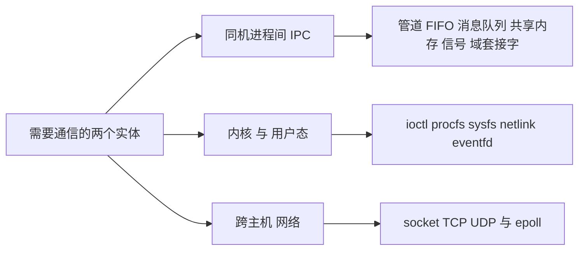
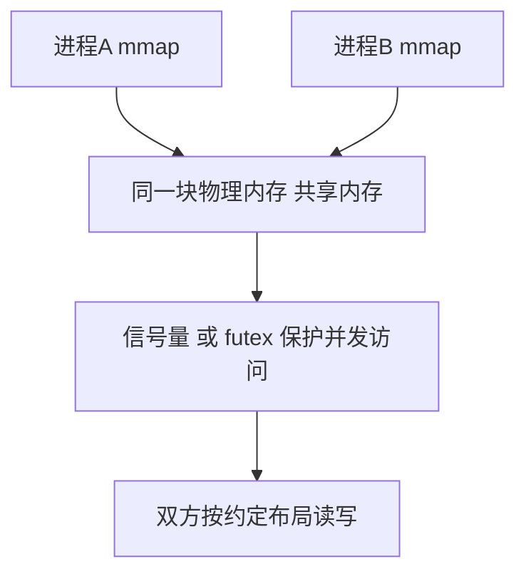
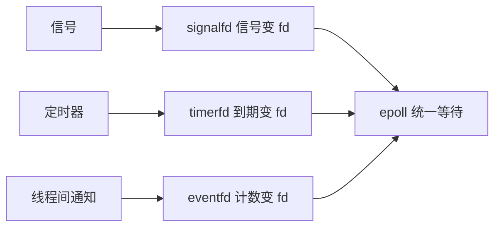
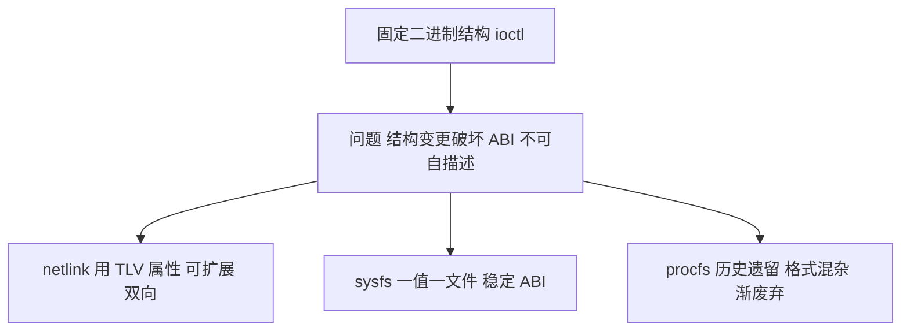
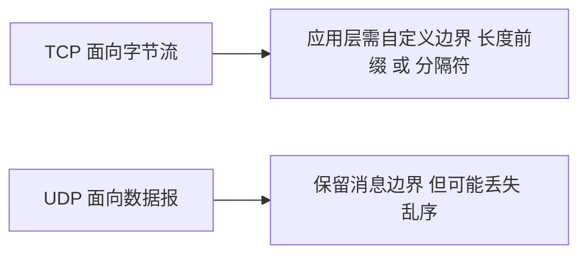
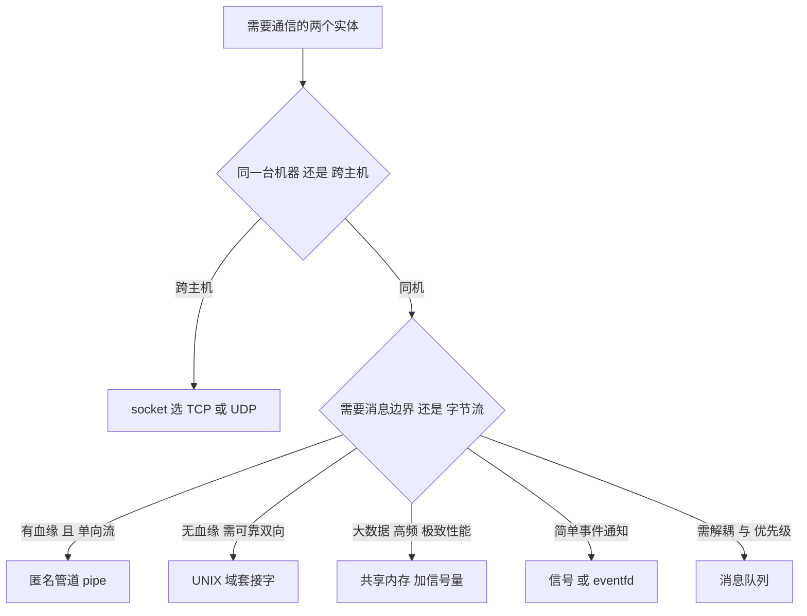

# Linux 通信方式学习笔记

> 本笔记面向希望系统理解 Linux 进程间通信机制的程序开发者。目标不是罗列 API，而是回答每种机制**为什么存在、解决什么问题、代价是什么、什么时候该用它**。阅读前不需要任何前置的通信知识，文档自身独立可读。

---

## 一、先看清问题：Linux 通信到底在解决什么

### 1.1 问题的起点：进程之间是隔离的

在 Linux 中，每个进程拥有独立的**虚拟地址空间**。进程 A 中一个变量的地址 `0x7f8a...`，在进程 B 中指向的完全是另一块物理内存。这种隔离是保护机制的基础，但也带来一个直接后果：

> **进程 A 无法直接读写进程 B 的变量，进程之间天然无法通过"赋值"传递数据。**

因此，任何一次跨进程的数据传递，都必须借助一个**双方都能访问的中间介质**。而这个中介只能由内核提供，因为只有内核有能力"同时看见"所有进程的地址空间与内核数据结构。

这一条是理解全部通信机制的**总前提**：Linux 的通信机制，本质上都是**内核提供的、被多个进程共同挂接的中间对象**的不同形态。

### 1.2 通信机制其实要同时解决三类问题

初学者常把"通信"等同于"传数据"，但实际上一套通信机制往往要回答三个不同的问题：

1. **数据传输**：如何把字节或消息从一方送到另一方。
2. **同步**：如何保证"生产者写完了，消费者才开始读"，避免竞争与数据错乱。
3. **事件通知**：如何让一方知道"对方有动作了"或"某个条件成立了"，而不必一直空转等待。

不同机制覆盖这三类问题的能力不同，这正是选择机制的核心依据。例如：

- **管道**同时覆盖传输与同步（读写自带阻塞语义），但不擅长事件通知。
- **共享内存**只覆盖传输（速度极快），**完全不解决同步**，必须额外配信号量。
- **信号**基本只解决事件通知（"通知你发生了某事"），几乎不承担批量数据传输。

### 1.3 一个有用的直觉模型

可以把所有通信机制想象成"建立一块双方都能碰到的公共黑板"。差别只在于：

- 黑板**放在哪里**：内核缓冲区里（管道、消息队列），还是一块被两个进程都映射的物理内存里（共享内存）。
- 黑板**怎么访问**：只能按字节顺序取（字节流），还是能按一条条消息取（消息边界）。
- 黑板**谁负责搬运**：内核帮你搬（涉及内存拷贝），还是你自己搬（共享内存零拷贝）。

> 类比只是辅助建立直觉。真实机制中"黑板"的实现、命名、生命周期、权限都各有差异，后面会逐一说明。

---

## 二、四个分类维度：给所有机制建立坐标系

Linux 通信机制数量多、命名杂，如果用"从管道到 epoll 逐个背"的方式学习，很容易记成一盘散沙。更有效的方式是先建立**分类坐标系**，任何一个机制放进去都能立刻定位。

| 维度 | 取值 | 典型机制 |
|---|---|---|
| 通信范围 | 同一台机器 / 跨主机 | 同机：管道、共享内存；跨机：TCP/UDP socket |
| 数据形态 | 字节流 / 消息边界 / 共享内存 | 字节流：管道、TCP；消息边界：UDP、消息队列 |
| 内核参与方式 | 内核拷贝 / 内核仅调度 / 直接映射 | 拷贝：管道、socket；映射：共享内存 |
| 命名与生命周期 | 匿名 / 命名；随进程 / 随内核 / 随文件系统 | 匿名：pipe；命名：FIFO、命名消息队列 |

掌握这四个维度后，"某个机制适合什么场景"就不再需要死记——**场景需求可以直接翻译成维度取值**。例如"跨主机 + 可靠 + 字节流"直接指向 TCP socket；"同机 + 大数据 + 极致性能"直接指向共享内存。

---

## 三、知识地图

先建立全局结构。Linux 的通信方式可以清楚地分为三个层次：同机进程之间、内核与用户态之间、跨主机之间。

- **同机 IPC**：解决"同一个操作系统内两个进程如何交换数据"。
- **内核与用户态**：解决"用户程序如何配置内核、读取内核状态、接收内核事件"。
- **跨主机网络**：解决"两台机器上的进程如何交换数据"，本章只讲与通信模型直接相关的部分（socket 抽象、字节流与数据报、多路复用），不深入协议细节。

三者的**共性**是：都通过内核提供的对象通信。**差异**在于对象的形态与跨机器的语义。

---

## 四、同机进程间通信（IPC）

### 4.1 匿名管道（pipe）：最古老的"单向传送带"

**它出现之前有什么问题？** 在管道出现之前，`shell` 中让两个程序协作处理数据非常麻烦——程序 A 的输出只能先写文件，程序 B 再从文件读。这既有磁盘开销，又无法流式处理。

**它解决什么问题？** 管道提供了内核中的一块**环形缓冲区**，两个有血缘关系（如父子）的进程可以一端写、一端读，形成**单向字节流**通道。shell 中的 `ls | grep txt` 就是它的最直接应用。

**机制与关键事实：**

- `pipe(int fd[2])` 返回两个文件描述符，`fd[0]` 读端、`fd[1]` 写端。
- 管道是**字节流**，没有消息边界——写入的字节会被读端按顺序取走，但读端无法区分"哪几个字节是一次写入的"。
- 管道容量有限且可查：自 Linux 2.6.11 起默认为 16 个页（页大小 4096 时为 65536 字节）；自 Linux 2.6.35 起可用 `fcntl` 的 `F_GETPIPE_SZ` / `F_SETPIPE_SZ` 查询和调整（man-pages `pipe(7)`）。
- **原子写**：`PIPE_BUF` 是单次写不被打断的上限，Linux 上为 4096 字节（POSIX 只要求不小于 512 字节）。小于等于 `PIPE_BUF` 的写入保证原子，超过则可能与其他写者交错（man-pages `pipe(7)`）。

**代价与陷阱：**

- 只能单向，双向通信要建两条管道。
- 只能用于**有血缘关系**的进程（通过 `fork` 继承描述符），否则拿不到对方那一端的 fd。
- 所有描述符被关闭后的行为很关键：写端全关闭时读端读到 EOF（返回 0）；读端全关闭时写端会收到 `SIGPIPE`，若该信号被忽略则 `write` 返回 `EPIPE`（man-pages `pipe(7)`）。

**适用场景：** 父子进程协作、shell 管道、把一个程序的输出接给另一个程序处理。**不适合**：需要消息边界、需要多对多、需要双向轮流对话的场景。

---

### 4.2 命名管道（FIFO）：给管道起个名字，摆脱血缘限制

**它解决什么问题？** 匿名管道最大的限制是"只给有血缘关系的进程用"。`FIFO`（FIFO，也称命名管道）用 `mkfifo` 在文件系统中创建一个**有名字的管道文件**，任何进程只要权限允许都可以 `open` 它，于是**无亲缘关系的进程也能通信**。

**机制与关键事实：**

- 创建：`mkfifo(path, mode)`；使用：读端 `open(..., O_RDONLY)`，写端 `open(..., O_WRONLY)`。
- **关键结论：管道的 I/O 语义与 FIFO 完全相同。** man-pages 明确指出："pipes 与 FIFO 唯一的区别在于创建和打开的方式，一旦打开完成，I/O 语义完全一致"（man-pages `pipe(7)`）。
- 注意：虽然 FIFO 在文件系统中有路径名，但**对 FIFO 的 I/O 并不涉及底层设备**，它仍然走内核缓冲区（man-pages `pipe(7)`）。

**代价与陷阱：** 打开 FIFO 时若对端尚未打开，`open` 会阻塞（除非 `O_NONBLOCK`），这正是它容易出现"莫名卡住"的原因。命名对象还带来权限与残留清理问题。

**适用场景：** 需要跨任意进程、单向、且不想引入套接字复杂度的场景；经典例子是**让不相关的两个程序通过约定路径通信**，以及 shell 中 `mkfifo` 配合重定向做数据中转。

---

### 4.3 信号（signal）：最轻的"事件通知"，但只能通知不能传数据

**它出现之前有什么问题？** 在早期 Unix 中，程序需要一种机制来处理"外部发生了某件事"——例如用户按下 `Ctrl+C`、子进程结束、定时器到期。轮询代价高且不及时。

**它解决什么问题？** 信号是内核向进程**异步投递的事件通知**。它**不承载批量数据**，只表达"发生了某种事件"（如 `SIGINT`、`SIGCHLD`、`SIGTERM`），必要时附带一个整型或指针。

**机制与代价：**

- 处理方式：默认动作（终止、忽略、停止）、忽略、或安装自定义处理函数（`signal()` 或更可靠的 `sigaction()`）。
- 信号是**异步**的，可能在任何时刻打断代码执行，因此**处理函数内部只能调用 async-signal-safe 的函数**（如 `write()`），不能在信号处理函数里调用 malloc、printf 等非可重入函数。
- 信号**会丢失**：标准信号没有排队机制，同一信号在阻塞期间多次到达只会合并成一次。

**适用场景：** 简单事件通知（唤醒父进程 `SIGCHLD`、终止进程 `SIGTERM`、超时 `SIGALRM`）。**不适合**作为数据通道。

> 后续出现的 `signalfd` 把信号"文件描述符化"，正是为了解决信号难以与 `epoll` 统一等待的问题，见第五章。

---

### 4.4 UNIX 域套接字（AF_UNIX）：同机通信的全能选手

**它出现之前有什么问题？** 管道单向、信号不能传数据、FIFO 只能算"有名字的管道"。当两个无亲缘进程需要**双向、可靠、带边界**地传输，并且希望复用已有的 socket 编程模型时，缺少合适机制。

**它解决什么问题？** AF_UNIX（又称 AF_LOCAL）套接字在**单机内**提供与 socket 一致的编程接口，同时补齐两大能力：

1. **三种语义模式**：`SOCK_STREAM`（面向连接、字节流）、`SOCK_DGRAM`（保留消息边界、可靠、不重排）、`SOCK_SEQPACKET`（面向连接且保留边界，自 Linux 2.6.4 支持）（man-pages `unix(7)`）。
2. **辅助数据（ancillary data）**：可以**传递文件描述符与进程凭证**。这是管道做不到的能力（man-pages `unix(7)`）。

**命名与地址：** 三种寻址方式（man-pages `unix(7)`）：

- **路径名**：绑定到文件系统路径，权限随目录，会被 `ls -l` 显示为 `s` 类型。
- **匿名**：`socketpair()` 创建的一对相互连接的套接字就是匿名的，适合父子进程双向通信。
- **抽象命名空间**：Linux 特有，`sun_path[0]` 为 `\0`，与文件系统无关，不产生文件残留，但**不可移植**。

**代价：** 只能用于同机；抽象命名空间是 Linux 专属；路径名套接字需要处理残留文件与权限。

**适用场景：** 这是同机通信中**最通用**的机制，现代系统中大量使用：

- 本地服务与客户端通信（Docker daemon、systemd、数据库本地连接通常都走 UNIX 域套接字）。
- **传递文件描述符**——容器、进程管理器的核心技巧之一。
- 需要双向、需要连接管理、又不想走网络协议栈的场景。

---

### 4.5 消息队列：把"字节流"升级成"有边界的消息"

**它出现之前有什么问题？** 管道和字节流套接字只保证字节顺序，**不保证消息边界**。发送方连续写两条"消息"，接收方可能一次读到两条合并在一起的字节，必须自己在应用层做粘包/拆包处理。此外，管道要求双方同时在线，无法"先把消息放在那里，对方稍后再取"。

**它解决什么问题？** 消息队列由内核维护，每条消息是一个**独立单元**，具有明确的边界；接收方按**消息**而不是按字节读取。这直接免除了应用层的边界处理。

Linux 上存在**两套互不兼容**的消息队列 API：

| 对比项 | System V 消息队列 | POSIX 消息队列 |
|---|---|---|
| 创建 API | `msgget` / `msgsnd` / `msgrcv` | `mq_open` / `mq_send` / `mq_receive` |
| 标识方式 | 整型 key / ID | `/name` 名字，挂在 `mqueue` 虚拟文件系统 |
| 优先级 | 可按任意优先级取 | 总是先取优先级最高的消息 |
| 生命周期 | 内核持久，除非显式删除 | 内核持久，除非 `mq_unlink` |
| 可取消息的灵活性 | 高（按类型/优先级挑选） | 低（严格最高优先级优先） |
| 状态 | 更老、接口设计较差 | 设计更好，但可用性历史较短 |

关键事实（man-pages）：

- POSIX 消息队列自 Linux 2.6.6 起支持，glibc 支持自 2.3.4（man-pages `mq_overview(7)`）。
- 消息优先级范围在 Linux 上可达 32768，POSIX 只要求至少 0~31（man-pages `mq_overview(7)`）。
- 默认上限：单队列最大消息数 `msg_max` 默认 10，单条消息最大字节 `msgsize_max` 默认 8192，系统队列总数 `queues_max` 默认 256（man-pages `mq_overview(7)`）。
- **Linux 实现细节**：POSIX 消息队列描述符 `mqd_t` 实际就是**文件描述符**，因此可以放进 `select` / `poll` / `epoll` 统一等待——但这**不可移植**（man-pages `mq_overview(7)`）。

**两者共同的设计缺陷（也是 POSIX 存在的理由）：** System V IPC 的接口被认为设计混乱（如 `msgget` 的 key 与权限机制、`shmctl` 的复杂参数），man-pages 直接评价"POSIX 提供了设计更好的接口，但可用性不如 System V 广泛"（man-pages `mq_overview(7)`、`shm_overview(7)`）。

**适用场景：** 需要消息边界、需要解耦（发送方与接收方不必同时在线）、需要优先级调度的场景，如任务队列、命令下发。**注意**：高吞吐大数据场景通常不如共享内存，因为每条消息都涉及内核拷贝。

---

### 4.6 共享内存：速度上限最高，但也最容易出错

**它出现之前有什么问题？** 管道、消息队列、套接字都要**经过内核拷贝**：数据从发送方用户空间拷到内核，再从内核拷到接收方用户空间。对于大块、高频的数据交换（如视频帧、大型结果集），两次拷贝成为瓶颈。

**它解决什么问题？** 共享内存让**同一块物理内存被多个进程映射到各自地址空间**。进程 A 写入的数据，进程 B 可以直接读取，**没有内核拷贝**。这是 Linux 上**带宽最高**的 IPC 方式。

**两种实现方式：**

| 方式 | API | 特征 |
|---|---|---|
| System V 共享内存 | `shmget` / `shmat` / `shmdt` | 老接口，ID 标识 |
| POSIX 共享内存 | `shm_open` + `ftruncate` + `mmap` | 接口更像文件操作，更简洁 |

关键事实（man-pages）：

- POSIX 共享内存自 Linux 2.4 / glibc 2.2 起支持，在 Linux 上以 **tmpfs** 实现，通常挂载于 `/dev/shm`（man-pages `shm_overview(7)`）。
- POSIX 共享内存具有**内核持久性**：对象会一直存在，直到系统关机，或所有进程解除映射且被 `shm_unlink` 删除（man-pages `shm_overview(7)`）。
- 还有一个更"匿名"的变体 `memfd_create`：创建**匿名内存文件**，不挂在文件系统上，无命名冲突、无残留，随 fd 释放而消失（man-pages `memfd_create(2)`）。

**代价（这是共享内存最重要的认知）：**

> **共享内存只解决"传输"，完全不解决"同步"。** 多个进程同时读写同一块内存会产生数据竞争。man-pages 明确指出：典型情况下进程必须自行同步对共享内存的访问，例如使用 POSIX 信号量（man-pages `shm_overview(7)`）。

因此共享内存几乎**总是与信号量或锁一起出现**——"共享内存 + 信号量"才是一个完整方案。

**适用场景：** 大数据量、高频率、低延迟的同机数据交换：图像/音频缓冲、进程间缓存、数据库的共享缓冲区、高性能计算中间结果。**不适合**：需要严格消息边界、需要简单可靠、或双方生命周期不确定的场景。

---

### 4.7 信号量与同步原语：通信的"编队规则"

**它解决什么问题？** 前面多次出现"需要同步"。共享内存没有内建同步，管道/消息队列的阻塞语义只能解决简单的"满/空"等待。当多个进程要**互斥**访问资源、或按**计数**协调多个参与者时，需要独立的同步原语。

**机制与代价：**

- **POSIX 信号量**：`sem_open` / `sem_wait` / `sem_post`，可按名字共享给多个进程（man-pages `sem_overview(7)`）。
- **System V 信号量**：`semget` / `semop`，可一次操作一组信号量，但接口复杂。
- **futex（Fast Userspace Mutex）**：一种**极底层**的原语，绝大部分操作在用户态完成，只有当真正需要阻塞时才陷入内核。它本身很少被应用直接使用，而是**被用来实现** pthread 互斥量、条件变量、以及 POSIX 信号量（man-pages 相关文档与 Kerrisk 的 IPC 综述）。

**适用场景：** 只要涉及共享内存或多进程共享资源，就必然涉及同步。选择原则：**能用线程库原语（mutex/condvar）就不用信号量；跨进程且需要命名时用 POSIX 信号量；几乎不需要直接写 futex。**

---

### 4.8 同机 IPC 机制横向对比

| 机制 | 数据形态 | 双向 | 消息边界 | 跨无亲缘进程 | 内核拷贝 | 典型用途 |
|---|---|---|---|---|---|---|
| 匿名管道 pipe | 字节流 | 否 | 否 | 否 | 是（两次） | shell 管道、父子协作 |
| 命名管道 FIFO | 字节流 | 否 | 否 | 是 | 是（两次） | 无亲缘进程单向传输 |
| 信号 signal | 事件 | -- | -- | 是 | -- | 事件通知 |
| UNIX 域套接字 | 字节流/报文 | 是 | 可选 | 是 | 是 | 本地服务、传 fd |
| 消息队列（POSIX/SysV） | 消息 | 可双向 | 是 | 是 | 是 | 解耦、优先级、任务队列 |
| 共享内存 | 原始内存 | 是 | -- | 是 | 否 | 大数据高频交换 |
| 信号量 / futex | -- | -- | -- | 是 | -- | 同步协调 |

---

## 五、内核与用户态通信：程序如何与内核对话

前面的机制是"进程与进程"通信。但还有一大类通信发生在**用户程序与内核之间**：用户程序需要配置内核、读取内核状态、接收内核事件。这类接口的演进史非常典型——它展示了"为什么旧机制会被替换"。

### 5.1 ioctl：最古老也最被诟病的控制接口

**它解决什么问题？** `read` / `write` 只能做"数据搬运"，无法表达"设置某项参数""启动某个操作""查询某个属性"这类**控制语义**。`ioctl(fd, request, arg)` 用一个"请求号 + 参数指针"的通用形式，为设备驱动提供了自定义控制入口。

**为什么它被诟病？** 因为 `ioctl` 把**固定布局的二进制结构体**直接暴露给用户空间，导致一系列问题：

- 结构体任何改动都可能破坏 ABI 兼容性。
- 结构体大小、位域、对齐在不同架构上不一致，需要复杂的兼容处理。
- 语义不可自描述，用户必须依赖头文件才能知道参数含义。

内核文档明确指出：`ioctl` 的替代方案中，**netlink 是网络相关配置的首选方式**，sysfs 适合暴露与 fd 无关的内核对象状态，debugfs 适合调试用接口（kernel.org `ioctl.rst`）；另有专门文档讨论"如何避免把 ioctl 设计得一塌糊涂"（kernel.org `botching-up-ioctls`）。

**适用场景：** 已有设备驱动的控制路径；对新接口，内核社区倾向于使用 netlink / sysfs 而非新增 ioctl。

### 5.2 procfs 与 sysfs：用"文件"表达内核状态

**它们解决什么问题？** 与其发明新的系统调用，不如把内核信息**以文件形式暴露**：用户用 `cat`、`echo`、`read`、`write` 就能读写内核状态，无需新 API。

**procfs（`/proc`）**：早期就承担了"进程信息 + 内核参数 + 杂项状态"的多重职责，因此**格式混杂**——有的文件一列一个值，有的是多行表格，有的甚至需要解析复杂文本。这种不统一带来了严重的可维护性问题。

**sysfs（`/sys`）**：自 Linux 2.6 引入，专门用来导出内核对象信息，核心原则是**"一个文件一个值"（one value per file）**，且基本为 ASCII 文本（kernel.org `sysfs.txt`）。这一约束让信息**可被脚本稳定解析**，也让 ABI 更稳定。

对比要点：

| 对比项 | procfs | sysfs |
|---|---|---|
| 主要职责 | 进程信息 + 历史遗留杂项 | 内核对象、驱动、设备属性 |
| 数据格式 | 混杂，常需解析 | 一值一文件，格式规范 |
| ABI 稳定性 | 较差 | 较好 |
| 现状 | 早期控制接口多已废弃 | 新接口推荐的暴露方式 |

内核 ABI 文档中大量标注了 `/proc` 接口"已被 sysfs / hwmon 取代而废弃"的案例，正是这一演进的证据（kernel.org `abi-obsolete`）。

**适用场景：** 用户读取传感器、调内核参数、查看设备状态、调试系统。**注意**：`/proc/sys` 是 sysctl 参数，属于可写配置；而 `/sys` 属性多为只读状态，两者职责不同。

### 5.3 netlink：结构化的内核-用户态通道

**它解决什么问题？** `ioctl` 的固定二进制结构不可扩展，`procfs` 的文本格式不可靠。内核需要一个**既能双向、又能扩展、又有明确消息边界**的内核-用户态通道，尤其是路由、网络、防火墙配置这类复杂场景。

**它解决什么机制问题？** netlink 是**基于 socket 的通信**（`socket(AF_NETLINK, SOCK_RAW, NETLINK_GENERIC)`），并采用 **TLV（type/length/value）属性格式**组织消息：固定的元数据头之后，跟随若干可增删的属性项（kernel.org netlink intro）。

> 关键结论（来自内核文档）：netlink **常被描述为 `ioctl` 的替代品**，它用可扩展的属性格式取代 `ioctl` 的固定 C 结构体（kernel.org netlink intro）。

**优势与代价：**

- **优势**：可扩展（新增属性不破坏旧端）、双向（请求-应答与异步事件上报都支持）、与 socket 模型统一（可进 `epoll`）。
- **代价**：需要理解消息头、属性解析、netlink 家族（如 `NETLINK_ROUTE` 路由、generic netlink 等），学习曲线比 `ioctl` 陡。

**适用场景：** `ip`、`ss`、`ethtool` 等工具的底层接口；任何需要对内核网络对象做结构化配置的用户态程序。

### 5.4 文件描述符化的事件：eventfd / signalfd / timerfd

**它们解决什么问题？** 现代程序大量使用 `epoll` 做事件驱动。但不同的事件源接入 `epoll` 的能力不同：socket、管道都是 fd，可以直接进 `epoll`；而**信号**和**定时器**原本不是 fd，无法与 `epoll` 统一等待，只能另开线程或用信号处理函数，导致架构割裂。

**解决方案**：把这三类事件**统一变成文件描述符**，从而可以被 `epoll` 统一等待（三者均自 Linux 2.6.22 引入）：

- **eventfd**：内核维护一个 64 位计数器，写入即累加，读取即清零。用作**线程/进程间的事件通知与唤醒**，非常适合与 `epoll` 组合（man-pages `eventfd(2)`）。
- **signalfd**：把信号转换为可 `read` 的 fd，让信号处理走同步的事件循环，避免异步信号处理的坑。
- **timerfd**：把定时器到期转换为可 `read` 的 fd，让超时逻辑与其他事件统一调度。

**适用场景：** 事件驱动服务器的统一事件循环。它体现了一个核心设计思想：

> **在 Linux 中，"一切皆文件描述符"意味着——只要一种事件能被做成 fd，它就能被同一套多路复用机制处理。**

### 5.5 内核接口的演进逻辑

把上述机制串起来看，能看到一条清晰的设计演进线索：

这条线索说明：内核接口设计的目标，是在**可扩展性、ABI 稳定性、可解析性**之间寻找平衡，而不是单纯"找一种更快的通信方式"。

---

## 六、跨主机通信：socket 抽象

### 6.1 socket 的统一抽象

**它解决什么问题？** 跨主机通信面对的是完全不同的世界：不可靠的网络、不同的地址、不同的协议。如果每种场景都发明一套 API，用户态代码将极度碎片化。socket 抽象用统一的 `socket / bind / connect / send / recv`，把**传输细节封装在"套接字类型"里**，用户程序只面对一个"端点"。

**它的统一性体现在：** `AF_UNIX` 与 `AF_INET` 共用同一套 socket API——只是地址族（`AF_`）和地址结构不同。这也是"网络通信"与"同机 IPC"能在同一章讲的原因。

### 6.2 TCP 与 UDP：字节流 vs 数据报

这是**最容易混淆、也最必须分清**的一对概念，因为它决定了应用层是否需要自己处理"消息边界"。

| 对比项 | TCP（SOCK_STREAM） | UDP（SOCK_DGRAM） |
|---|---|---|
| 数据形态 | 字节流，**无消息边界** | 数据报，**保留消息边界** |
| 连接 | 面向连接（`connect`） | 无连接 |
| 可靠性 | 可靠、有序、自动重传 | 不保证送达、不保证顺序 |
| 代价 | 建立连接、ACK/重传 | 无连接开销，但丢包要自己处理 |
| 应用层负担 | 需自己切分/组装消息 | 一次 `recv` 对应一个数据报 |

**核心理解：** TCP 是"水管"，你灌进去的字节连成一片，接收方**必须自己定义消息边界**（常见做法是定长、分隔符、或"长度前缀"）；UDP 是"一包一包的信件"，天然保留边界，但可能丢件、乱序。

### 6.3 多路复用：select / poll / epoll 为什么会出现

**它解决什么问题？** 一个服务器要同时处理成千上万个连接。为每个连接开一个线程/进程代价过大。`select` 的思路是"我一次等待多个 fd，谁就绪就处理谁"。

**为什么会有 epoll？** `select` 与 `poll` 有一个共同的结构性代价：

- `select` 使用**位图**，每轮调用都要重新设置并**线性扫描**全部被监视的 fd，能监视的 fd 数量也有上限（受 `FD_SETSIZE` 约束）。
- `poll` 使用**数组**，去掉了固定上限，但**仍要线性扫描**。

结果：当监视大量 fd 而只有少量活跃时，`select` / `poll` 的时间大量浪费在扫描空连接上。

**epoll 的改进：** 内核维护一个**就绪列表**，只有发生事件的 fd 才进入列表，每轮只需处理**就绪项**，而不是遍历全部被监视项。因此 epoll 在"大量 fd、少量活跃"场景下性能优势显著（Kerrisk 的 epoll 讲义；TLPI 第 63 章）。epoll 还提供**边沿触发（ET）**模式，而 `select` / `poll` 只有**水平触发（LT）**。

用复杂度表达这一差异（$N$ 为被监视的 fd 数量，$k$ 为就绪的 fd 数量，通常 $k \ll N$）。`select` 每轮调用都要扫描全部 $N$ 个 fd，而 epoll 每轮只处理 $k$ 个就绪项：

$$
T_{select} \sim O(N), \qquad T_{epoll} \sim O(k)
$$

**适用场景选择：**

- 连接数少、追求可移植：`select` / `poll`。
- 高并发、长连接、大量空连接（如网关、代理、聊天服务）：`epoll`。

### 6.4 零拷贝：splice 这类接口在解决什么

**它解决什么问题？** 即使 socket 已经很高效，"用户空间读文件 → 写 socket""从 socket 读到用户空间再写出"这类搬运仍然要**经过用户空间**，产生额外拷贝与上下文切换。

`splice()`、`tee()`、`vmsplice()` 允许在两个 fd 之间**在内核内部直接移动数据**，不经过用户空间，避免了这一层拷贝（man-pages `pipe(7)` 的 SEE ALSO 与 `splice(2)`）。它常用于高性能代理、文件传输服务器。

---

## 七、统一选型：从需求出发

### 7.1 通信开销的统一模型

无论哪种机制，一次通信的时间开销大体可拆成：

$$
T_{comm} = T_{syscall} + T_{copy} + T_{sync}
$$

- $T_{syscall}$：陷入内核的系统调用开销，所有机制都有。
- $T_{copy}$：数据在内核与用户空间之间的拷贝。**共享内存将其降到接近 0**，管道/socket 则有两段拷贝（发送方→内核→接收方）。
- $T_{sync}$：等待与唤醒开销。共享内存**把同步责任转移给了用户态**，所以这一项反而需要额外设计。

这个模型解释了核心权衡：**共享内存用"自己管同步"的复杂度，换来了拷贝开销的消失。**

### 7.2 选型决策流程

### 7.3 场景速查表

| 需求场景 | 首选机制 | 理由 |
|---|---|---|
| shell 中两程序串联 | 匿名管道 | 天生为流式管道设计 |
| 无亲缘进程单向传输 | FIFO | 有名字、无需血缘 |
| 本地服务/客户端，含传 fd | UNIX 域套接字 | 双向、可靠、可传 fd |
| 大数据高频共享 | 共享内存 + 信号量 | 无拷贝，带宽上限最高 |
| 跨机构的最简单事件通知 | 信号 | 最轻量 |
| 统一等待信号/定时器/通知 | signalfd/timerfd/eventfd + epoll | 全部 fd 化，统一调度 |
| 内核网络配置 | netlink | 结构化、可扩展、双向 |
| 读内核状态 | sysfs（新）/ procfs（历史） | 一值一文件，稳定可解析 |
| 高并发网络服务器 | epoll + 非阻塞 socket | 就绪列表，避免线性扫描 |
| 可靠有序跨机传输 | TCP | 自动重传与排序 |
| 低延迟可容忍丢包 | UDP | 无连接开销 |

---

## 八、常见误区

**错误理解一：共享内存"最快"，所以能用就用。**

**为什么容易这样理解：** 确实没有内存拷贝，带宽最高。

**正确理解：** 共享内存**只解决了传输，没有解决同步**。你必须自己处理多进程竞争、内存布局、生命周期与崩溃恢复。对于低频、小数据量、需要简单可靠的场景，管道或消息队列的开发成本远低于共享内存。共享内存的收益只有在**数据量大且频率高**时才明显。

**错误理解二：管道和消息队列差不多，都能传数据。**

**为什么容易这样理解：** 都能在内核缓冲区和进程间搬数据。

**正确理解：** 关键区别在**边界**。管道是字节流，读端无法区分消息，除非你在应用层自行切分；消息队列天然以"条"为单位。此外管道要求双方同时在线，消息队列允许异步放置。

**错误理解三：`ioctl` 是标准做法，设备控制就该用它。**

**为什么容易这样理解：** 大量驱动确实提供 ioctl。

**正确理解：** 对**新接口**，内核社区明确更推荐 netlink（网络配置）、sysfs（对象状态）、debugfs（调试），`ioctl` 的固定二进制结构在 ABI 兼容性上有先天缺陷（kernel.org `ioctl.rst`、`botching-up-ioctls`）。

**错误理解四：`select` / `poll` 已经过时，应该一律用 `epoll`。**

**为什么容易这样理解：** 都知道 epoll 更快。

**正确理解：** epoll 的优势体现在**大量 fd 且少量活跃**的场景。连接数少、或需要跨平台可移植时，`select` / `poll` 更简单且够用。同时 epoll 是 Linux 特有，不具备可移植性。

**错误理解五：`/proc` 和 `/sys` 是同类东西，随便用哪个都行。**

**为什么容易这样理解：** 两者都表现为"可以 `cat` 的文件"。

**正确理解：** 两者职责不同。`/sys` 遵循"一值一文件"原则，格式规范、ABI 较稳定，是**新接口推荐方式**；`/proc` 承担进程信息与历史遗留杂项，格式混杂，早期控制接口多已被取代（kernel.org `sysfs.txt`、`abi-obsolete`）。

---

## 九、相关知识连接

本笔记涉及的知识与其他主题的连接关系：

- **文件描述符模型**：管道、套接字、eventfd、netlink 都以 fd 为中心，理解"fd 是内核对象的句柄"是理解全部机制的基础。
- **VFS 与文件系统**：`/proc`、`/sys`、`/dev/shm`、`/dev/mqueue` 都是特殊文件系统，理解 tmpfs、sysfs、procfs 有助于理解共享内存与内核接口。
- **进程与信号**：`fork` 决定管道的可用性，信号模型决定 `signalfd` 存在的意义。
- **线程同步**：futex 是信号量与互斥量的底层，后续学习 pthread 同步原语时可回看。
- **网络协议栈**：socket、TCP/UDP、epoll 是网络编程的入口，协议细节（三次握手、拥塞控制）属于后续主题。
- **命名空间与容器**：IPC namespace、network namespace 决定了容器之间通信的隔离方式，是容器技术的必要背景。

---

## 十、正式学习时重点关注

下面这些问题不是考试题，而是帮助你在正式学习时把注意力放在关键处的导航：

1. 为什么进程之间不能直接访问对方内存？这决定了为什么所有通信机制都必须经过内核。
2. 管道、FIFO、消息队列、共享内存，分别解决了另外几种机制的什么不足？
3. 为什么共享内存必须配合信号量？如果不配会怎样？
4. 字节流与消息边界的区别，为什么它决定了应用层是否需要自己"拆包"？
5. `PIPE_BUF` 的原子写保证解决的是什么并发问题？
6. `select` / `poll` / `epoll` 的性能差异究竟来自哪一步操作？
7. 为什么内核要把信号、定时器、事件都"文件描述符化"？它统一了什么？
8. `ioctl` 的哪些设计缺陷导致内核更推荐 netlink 与 sysfs？
9. `sysfs` 的"一值一文件"原则为什么能提高 ABI 稳定性？
10. UNIX 域套接字为什么能传递文件描述符，而管道不能？

---

## 参考资料

- Linux man-pages（Michael Kerrisk 维护，权威用户态接口文档）
  - `pipe(7)`：管道与 FIFO 的容量、原子写、关闭语义
  - `unix(7)`：AF_UNIX 套接字的地址类型、SOCK 类型、辅助数据
  - `mq_overview(7)`、`shm_overview(7)`、`sem_overview(7)`、`sysvipc(7)`：POSIX 与 System V IPC
  - `netlink(7)`、`eventfd(2)`、`epoll(7)`、`memfd_create(2)`、`signal(7)`
- Linux Kernel Documentation（kernel.org）
  - `filesystems/sysfs.txt`：sysfs 的"一值一文件"原则
  - `driver-api/ioctl.rst` 与 `process/botching-up-ioctls`：ioctl 的替代方案与设计教训
  - `userspace-api/netlink/intro`：netlink 作为 ioctl 替代品的设计动机
  - `filesystems/proc.rst`、`admin-guide/abi-obsolete`：procfs 的职责与接口废弃情况
- Michael Kerrisk 的 Linux IPC 综述与 `epoll` 讲义（LCA 2013 / TLPI 第 63 章）：各类 IPC 的评价与 epoll 性能对比
